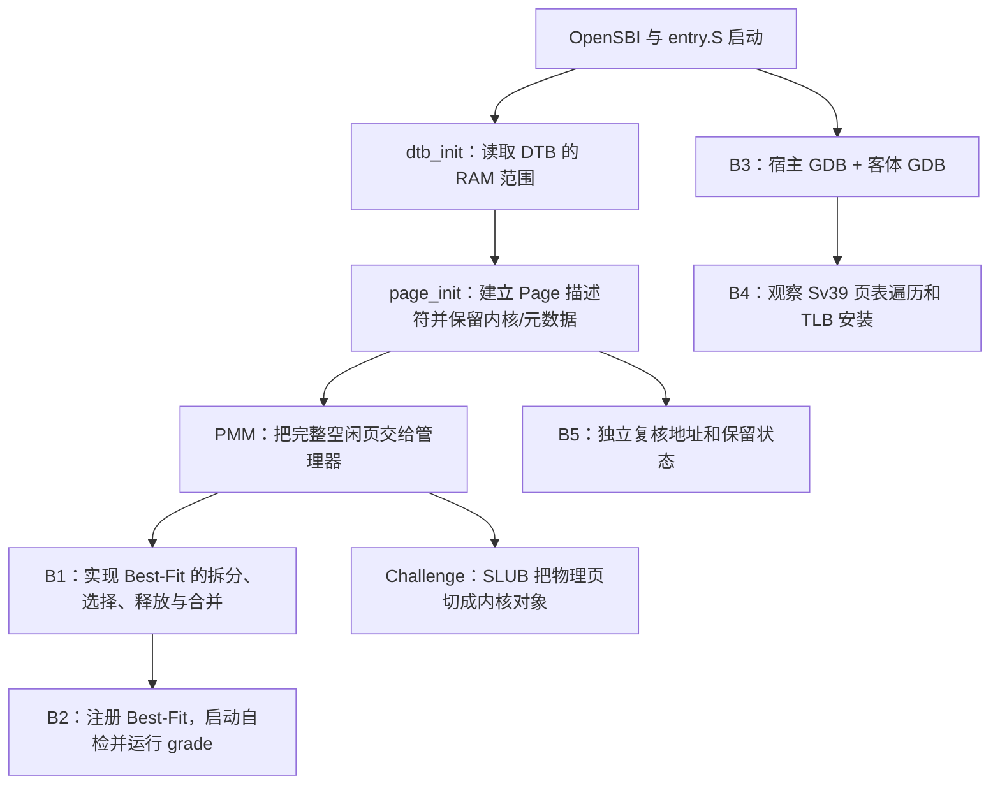

# Lab 2：B 线实验从零理解与全流程讲解

> 面向第一次接触 ucore、RISC-V、页分配器和 GDB 的读者。本文解释“代码为什么这样走、每个地址和结构代表什么、测试究竟证明了什么”，而不只列命令。
>
> 复盘基线：`2f3eea3`；主要实测环境为 QEMU virt、RV64、DTB 默认 128 MiB DRAM、Best-Fit 管理器。本文按该基线说明源码和实测结果，具体数值会随构建配置（尤其是否打开 `SLUB_TEST`）变化。

## 0. 先看全貌：这个实验到底在做什么

操作系统要管理内存，至少有两个不同层次：

1. **物理页层**：把 RAM 按固定大小切成页，记录每页的状态，并按需给内核连续的若干页。这是 PMM（Physical Memory Manager，物理内存管理器）的工作。
2. **内核对象层**：很多内核对象只有几十或几百字节。如果每个小对象都单独占用一整页会浪费，所以在物理页之上再把一页切成许多小槽位。这是本仓库 Challenge 中简化 SLUB 的工作。

B 线任务把几个不同视角接在一起：

| 任务 | 做什么 | 主要对象 | 最重要的结果 |
| --- | --- | --- | --- |
| B1 | 实现 Best-Fit 连续物理页分配器 | 一组连续页、空闲块链表、页描述符 | 选出“足够大且最小”的空闲块，能拆分、释放、合并 |
| B2 | 把 Best-Fit 注册到内核并验收 | PMM 管理器接口、固定测试、评分脚本 | 当前启动时使用 Best-Fit，Page Init 与 Best-Fit 评分通过 |
| B3 | 建立宿主机与客体机两层 GDB 调试 | QEMU 进程、QEMU 中的 RISC-V CPU、ucore 内核 | 一个 GDB 看模拟器，一个 GDB 看正在模拟的内核 |
| B4 | 跟踪真实地址转换和 TLB 填充 | VA、PA、satp、Sv39 页表项、软件 TLB | 把 ucore 的一次访存与 QEMU 的页表遍历对应起来 |
| B5 | 独立复核 A 实现的 `page_init()` | DTB 范围、`Page` 数组、Reserved 页、空闲页区间 | 证明“哪些页保留、哪些页可分配”，不改 A 的代码 |
| Challenge 扩展 | 实现并运行简化 SLUB | 物理页之上的小对象和大对象 | 九组运行时场景通过，最终空闲页数恢复 |

A 线的页初始化是 B1/B2 的前置基础：Best-Fit 只能管理已经由 `page_init()` 登记为可用的页；如果初始化把内核或描述符数组误交给分配器，再正确的 Best-Fit 也会破坏内核。B5 的价值正是在分配器之下重新审查这个边界。

整个实验可以简化成下面这条主线：



## 1. 初学者先要知道的几个名字

### 1.1 RAM、DRAM、DTB 和内核

- **RAM** 是程序运行时使用的随机存取内存。
- **DRAM** 是 RAM 的一种。这个实验的 QEMU virt 机器默认把 DRAM 放在物理地址 `0x80000000` 开始的位置。
- **DTB** 是 Device Tree Blob，设备树的二进制版本。固件启动内核时会把 DTB 地址放在启动参数里。内核通过 DTB 得知 QEMU 实际提供多少 RAM，而不是只靠代码里猜测。
- **内核镜像** 是编译出的 ucore 代码、只读数据、可写数据、BSS，以及链接脚本安排的其他内核区段。
- **BSS** 是未显式初始化的全局/静态变量区域。启动时 `kern_init()` 把它清零。启用 SLUB 测试后，大型静态测试表也位于 BSS，因此内核结束位置 `end` 会后移。

### 1.2 VA、PA、PPN、Page* 是四种不同东西

这四个概念最容易混淆：

| 缩写 | 全称 | 直观含义 | 例子 |
| --- | --- | --- | --- |
| VA | Virtual Address，虚拟地址 | CPU 当前使用的地址；内核代码、全局变量和指针通常表现为 VA | 内核入口 `0xffffffffc0200000` |
| PA | Physical Address，物理地址 | RAM 芯片/模拟 RAM 中的地址 | 内核入口实际装载位置 `0x80200000` |
| PPN | Physical Page Number，物理页号 | PA 去掉页内偏移后的页编号，即 `PA >> PGSHIFT` | `0x80200000 / 0x1000 = 0x80200` |
| `struct Page *` | 页描述符指针 | 指向内核里的一个 C 结构体；该结构体描述某个物理页，不是物理页本身 | `&pages[0x200]` 描述 PPN `0x80200` |

当前工程的基础页大小：

```text
PGSIZE  = 0x1000 = 4096 bytes = 4 KiB
PGSHIFT = 12
PPN(pa) = pa >> 12
```

“页”可以指物理 RAM 中的 4 KiB 区间；“页描述符”则是内核为了记账而创建的一个小结构体。页描述符数组放在内核可访问的内存里，每一个 `struct Page` 对应一个物理页。不要把描述符本身当作它描述的那个 RAM 页。

### 1.3 保留页、空闲页与分配页

- **Reserved 页**：固件、内核镜像、启动页表、栈或 `Page` 描述符数组已经占用，PMM 不得分配。
- **空闲页**：已经经过 `page_init()` 筛选，可以放入分配器的空闲链表。
- **已分配页**：曾经从空闲链表中取出，当前正在被内核使用。
- **连续页**：多个页的 PA 紧挨着。例如从一个 `Page *` 开始的连续 3 页，描述符是 `base`、`base+1`、`base+2`。

### 1.4 函数、断言和 panic

- **函数接口**规定模块能提供什么操作，例如 `alloc_pages(n)` 表示申请连续 `n` 页。
- **管理器（manager）**是一张函数指针表。上层只调用通用接口，具体执行由当前选中的 First-Fit 或 Best-Fit 函数完成。
- **assert(condition)** 是内核断言。条件为假时，说明程序员要求成立的不变量已被破坏。
- **panic(...)** 是内核不可恢复错误：内核打印错误信息并停止。测试若触发 panic，不能把“QEMU 最后被 timeout 结束”解释成通过。
- **固定测试**是课程测试源码中规定的断言；**grade** 是外层评分脚本，它通常把测试注入一份临时副本后运行 QEMU，再按输出判断得分。
- **静态检查**是读代码推导行为，不代表真的把异常输入送进内核运行；**动态测试**则是实际构建并运行用例。

## 2. 从复位到物理页初始化：启动顺序

### 2.1 先由固件和汇编准备运行环境

QEMU 启动时先运行 OpenSBI 固件。固件设置基本机器状态后，把启动信息（包括 hart ID、DTB 地址）交给 ucore。RISC-V 的 `entry.S` 使用这些参数，准备启动页表、内核栈，并切换到内核预期的地址空间。

这一步之后，内核开始在高虚拟地址运行。也就是说，CPU 指令里的 VA 不一定等于 RAM 中的 PA；硬件页表负责把 VA 翻译成 PA。

### 2.2 `kern_init()` 按顺序初始化

当前 [`init.c`](../../code/kern/init/init.c#L32) 的关键顺序是：

1. 用 `memset(edata, 0, end - edata)` 清零 BSS。
2. 调用 `dtb_init()`，读取设备树中的内存范围。
3. 初始化控制台并打印内核信息。
4. 调用 `pmm_init()`，建立物理页管理器。
5. 初始化 SLUB 的空闲链表。
6. 只有编译时明确传入 `SLUB_TEST=1`，才检查 SLUB 初始化是否占用页并运行 `slub_check()`。
7. 最后进入空循环，因为此实验内核不会启动完整用户程序。正常启动后 QEMU 因此一直运行，限时测试通常以 124 结束。

执行次序不能随便交换：

- `dtb_init()` 先提供内存边界，`page_init()` 才能知道管理哪些 PA。
- `pmm_init()` 必须先建立可用页，`slub_init()` 才能在以后需要时从 PMM 取页。
- SLUB 测试只有在 PMM 和 SLUB 都初始化之后才可执行。

## 3. A1 基础与 B5 重点：DTB 如何变成可用页

### 3.1 `dtb_init()` 做什么

[`dtb.c`](../../code/kern/driver/dtb.c#L107) 负责从 DTB 提取物理内存范围：

1. 启动参数里的 `boot_dtb` 是 DTB 的物理地址。
2. 内核当前位于高虚拟地址，解析 DTB 前先用 `boot_dtb + PHYSICAL_MEMORY_OFFSET` 得到可访问的内核 VA。
3. 检查 FDT magic。FDT 是 Flattened Device Tree 的缩写，也就是 DTB 所遵循的数据格式。
4. 读取 FDT 结构区和字符串区，按节点/属性 token 向前遍历。
5. 找名字以 `memory` 开头的节点，读取它的 `reg` 属性。
6. 将大端序的两个 64 位数转成 CPU 数值：第一个是 RAM 起始地址，第二个是长度。
7. 保存到静态变量；之后由 `get_memory_base()`、`get_memory_size()` 提供给 `page_init()`。

本项目这份解析器是为当前 QEMU virt DTB 写的简化实现：它读取第一个匹配内存节点、假定 `reg` 的头两个单元分别是 64 位 base 和 size。它并不是完整通用的设备树解析库。默认 QEMU 的 DTB 实际输入是：

```text
Base = 0x80000000
Size = 0x08000000 = 128 MiB
End  = Base + Size = 0x88000000   （右开区间，不包含 End）
```

DTB 打印的“最后一个地址”是 `0x87ffffff`；代码内部更适合使用右开区间终点 `0x88000000`。区间 `[base, end)` 包含 base，但不包含 end。

### 3.2 页编号为什么不是“页数”

[`pmm.c`](../../code/kern/mm/pmm.c#L65) 的 `page_init()` 使用几个关键量：

- `nbase`：描述符数组覆盖范围的起始 PPN。在这个平台 `DRAM_BASE=0x80000000`，所以 `nbase=0x80000`。
- `npage`：受管物理地址的**上界 PPN**，不是空闲页数。在默认配置中 `npage=0x88000`。
- `page_count`：真正需要描述符的页数，等于 `npage - nbase = 32768`。
- `nr_free_pages()`：分配器当前真正拥有的空闲页数，默认是 31929。它远小于物理页总量，因为有固件/内核/元数据保留。

公式：

```text
nbase      = DRAM_BASE / PGSIZE
           = 0x80000000 / 0x1000
           = 0x80000

managed_end = ROUNDDOWN(min(DTB_end, PHYSICAL_MEMORY_END), PGSIZE)
            = 0x88000000

npage      = PPN(managed_end)
           = 0x88000

page_count = npage - nbase
           = 0x88000 - 0x80000
           = 32768
```

因此“npage 是 0x88000”不等于“总共只有 0x88000 个页可分配”。它使用的是绝对 PPN 编号；范围起点是 PPN `0x80000`，计数必须相减。

### 3.3 `page_init()` 按步骤做什么

源码顺序可以用十步读懂：

1. 从 DTB 获取 `memory_base` 和 `memory_size`。
2. 设置 `va_pa_offset = PHYSICAL_MEMORY_OFFSET`，供后续 VA/PA 转换使用。
3. 检查 base/size 非零，并检查 `base + size` 会不会整数溢出。
4. 算出 `memory_end`，确认 DTB 报告的范围覆盖内核，并且内核不超过实验支持的固定上限。
5. 把管理终点截断到 `PHYSICAL_MEMORY_END`，然后向下对齐到整页，得到 `managed_end`。
6. 计算 `npage` 和 `page_count`。
7. 用 `PADDR(end)` 把链接器符号 `end` 从内核 VA 转成 PA，再将描述符数组起点向上对齐到页边界。
8. 在乘法前先检查“可用字节数是否足以容纳 `page_count` 个 `struct Page`”，避免容量不足或乘法越界。
9. 把 `pages` 指针设置成描述符 PA 加映射偏移；逐项初始化全部受管页描述符，并先标记为 Reserved。
10. 对描述符数组末端之后的完整页计算数量。只有数量大于零时才调用 `init_memmap()`；不足一整页时不调用，以免违反分配器 `n > 0` 的前置条件。

第 9 步很关键：先把所有描述符标成 Reserved，之后只有被 `init_memmap()` 明确登记的区间才变成空闲。保留区不是“靠分配器猜测”的，而是初始化阶段没有把它交给分配器。

### 3.4 默认机器的每个地址怎么推导

默认页大小为 `0x1000`，内核实际打印的符号值（本次合并后默认构建）为：

```text
end VA = 0xffffffffc02060fc
```

物理映射偏移：

```text
PHYSICAL_MEMORY_OFFSET = 0xffffffff40000000
VA = PA + PHYSICAL_MEMORY_OFFSET
PA = VA - PHYSICAL_MEMORY_OFFSET
```

故：

```text
kernel_end PA = PADDR(end)
              = 0xffffffffc02060fc - 0xffffffff40000000
              = 0x802060fc
```

描述符从内核最后占用的页之后开始：

```text
descriptors_pa = ROUNDUP(kernel_end PA, 0x1000)
               = 0x80207000
```

结构体 [`struct Page`](../../code/kern/mm/memlayout.h#L31) 在 RV64 上占 40 字节（0x28）：4 字节 ref、对齐填充、8 字节 flags、4 字节 property、对齐填充、16 字节链表节点。因此：

```text
descriptor_bytes = page_count * sizeof(struct Page)
                 = 32768 * 40
                 = 1,310,720 bytes
                 = 0x140000

descriptors_end = 0x80207000 + 0x140000
                = 0x80347000
```

`pages` 是描述符数组的内核虚拟地址，不是数组的物理地址：

```text
pages PA = 0x80207000
pages VA = 0x80207000 + 0xffffffff40000000
         = 0xffffffffc0207000

pages VA end = 0xffffffffc0207000 + 0x140000
             = 0xffffffffc0347000
```

描述符数组占用 `0x140000 / 0x1000 = 320` 个物理页。它本身也是内存使用者，所以这 320 页不能进入空闲链表。

然后得到空闲区：

```text
free_begin = ROUNDUP(descriptors_end, PGSIZE)
           = 0x80347000

free_count = (managed_end - free_begin) / PGSIZE
           = (0x88000000 - 0x80347000) / 0x1000
           = 0x7cb9
           = 31929 pages
```

`page_init()` 最后将下面的“描述符指针 + 页数”交给 PMM：

```c
init_memmap(pa2page(0x80347000), 31929);
```

这并不是把 PA 原样当成 `Page *`。`pa2page` 先把 PA 转为 PPN，再通过 `pages` 数组找到负责描述这个 PA 页的结构体：

```text
PPN(0x80347000) = 0x80347
描述符数组下标 = 0x80347 - nbase
                = 0x80347 - 0x80000
                = 0x347
pa2page(0x80347000) = &pages[0x347]
                   = 0xffffffffc020f318
page2pa(&pages[0x347]) = 0x80347000
```

`Page *` 指针值 `0xffffffffc020f318` 是“描述符在内核虚拟地址空间的位置”；`0x80347000` 是“它所描述的物理页地址”。这两个数不能互换。

### 3.5 VA、PA、PPN、Page* 具体对照

| 被描述的对象 | VA/指针 | PA | PPN | 说明 |
| --- | --- | --- | --- | --- |
| 内核入口 | `0xffffffffc0200000` | `0x80200000` | `0x80200` | 对应描述符 `&pages[0x200]`，Reserved |
| `end` 符号 | `0xffffffffc02060fc` | `0x802060fc` | `0x80206` | 所在尾页是 `0x80206000`，仍 Reserved |
| 描述符数组存放起点 | `pages = 0xffffffffc0207000` | `0x80207000` | `0x80207` | 描述这个 PA 页的对象是 `&pages[0x207]`，Reserved |
| 第一页空闲页 | 通过高映射访问为 `0xffffffffc0347000` | `0x80347000` | `0x80347` | 描述符是 `&pages[0x347]`，交给管理器 |
| 管理终点 | 不在区间中 | `0x88000000` | `0x88000` | 右开上界；没有对应的有效 `pages` 元素 |

转换函数的职责：

- `PADDR(kva)`：输入高虚拟内核地址，输出它对应的物理地址。它不是通用 VA 转换器，只适用于满足内核映射前置条件的 KVA。
- `page2pa(page)`：输入一个页描述符指针，输出该描述符代表的物理页起始 PA。
- `pa2page(pa)`：输入物理地址，先计算 PPN，再返回对应的 `struct Page *`。页内不同偏移的 PA 会落到同一页描述符。
- `page2ppn(page)`：先算出该描述符是 `pages` 数组中第几个，再加 `nbase` 得到绝对 PPN。

最常见的错误是把 `PADDR(pages)` 和 `pa2page(free_begin)` 当成同一转换。前者回答“描述符数组自己存在哪里”；后者回答“哪个描述符负责某个物理页”。

### 3.6 哪些页是保留的，哪些页可以分配

| PA 范围 | 状态 | 原因 |
| --- | --- | --- |
| `[0x80000000, 0x80200000)` | Reserved | DRAM 起始到内核装载前的区域；包含固件/启动所用区域，当前实现不把它登记为空闲 |
| `[0x80200000, 0x80207000)` | Reserved | 内核镜像、启动栈、启动页表、BSS 和 `end` 所在尾页 |
| `[0x80207000, 0x80347000)` | Reserved | `pages` 数组存放处，320 页 |
| `[0x80347000, 0x88000000)` | Free | 31929 个完整页，唯一由本次 `init_memmap()` 登记的区间 |
| `[0x88000000, ...)` | 不受管 | 超出本实验固定的 RAM 上界 |

`PageReserved(page)` 读取 `PG_reserved` 标志；`SetPageReserved` 设置它。`SetPageProperty(page)` 设置另一个标志，含义是“这是一个空闲连续块的首描述符”。它并不表示此页属于内核保留区。`property` 字段保存空闲块的长度，只有首项有意义。

空闲区登记时，`best_fit_init_memmap()` 首先要求每个描述符已是 Reserved，再清空这些空闲页的 flags，并只在区间首项设置 `property` 和 `PageProperty`。因此：

- 保留区继续是 Reserved，不在空闲链表中。
- 已登记空闲区的页不再 Reserved。
- 一个空闲区通常是一条链表项，首描述符记录整块页数；它不是每个空闲页都单独占一项。
- 被分配的块会从链表移除，首描述符的 PageProperty 被清除。
- 被释放时重新建立块首标记，之后可能与相邻的空闲块合并。

## 4. B1：为什么要写 Best-Fit，如何验证

### 4.1 先理解“连续页分配”

假设空闲 RAM 当前分成几个不相连的区域：

```text
地址从低到高：
[8 页空闲] [已使用] [3 页空闲] [已使用] [5 页空闲]
```

总空闲页数是 16 页，但请求 4 页时，不能把分散的页拼起来；必须找一个至少 4 页连续的块。

- **First-Fit**：从链表头开始，遇到第一个足够大的块就用。
- **Best-Fit**：看所有足够大的候选块，选择“剩余浪费最少”的那个，也就是最小的可用块。
- 这个例子中申请 4 页，First-Fit 选 8 页块；Best-Fit 选 5 页块，留下 1 页。

Best-Fit 不是“保证以后绝不碎片化”。它只是规定本次怎么选；长时间申请/释放仍可能形成不能满足大请求的碎片。

### 4.2 PMM 管理器是一张函数表

[`pmm.h`](../../code/kern/mm/pmm.h#L12) 的 `struct pmm_manager` 保存函数指针：

| 接口 | 作用 |
| --- | --- |
| `init()` | 初始化内部链表和计数 |
| `init_memmap(base,n)` | 将一个初始连续物理页区间登记为空闲 |
| `alloc_pages(n)` | 分配至少 `n` 个连续页 |
| `free_pages(base,n)` | 释放连续页 |
| `nr_free_pages()` | 读取当前空闲页数 |
| `check()` | 运行该实现的自检 |

公共的 `alloc_pages()`、`free_pages()` 只是转发调用。它们不需要知道实际策略是 First-Fit 还是 Best-Fit。改变管理器指针即可改变策略，是典型的“接口与实现分离”。

### 4.3 Best-Fit 的账本

[`best_fit_pmm.c`](../../code/kern/mm/best_fit_pmm.c#L8) 使用一个 `free_area`：

- `free_list`：循环双向链表，每一项表示一个连续空闲块。
- `nr_free`：所有空闲块长度之和。
- `Page.property`：若该 `Page` 是块首，记录这个块有多少页。
- `PG_property`：标记该描述符是空闲块首。
- `PG_reserved`：标记该页不能用于分配。

应该同时成立的状态不变量：

1. 每个空闲块在链表中恰好有一个块首。
2. 链表按物理地址从低到高排列。
3. 块首的 `property > 0` 且 PageProperty 为真。
4. 非块首没有空闲块首标志。
5. 所有块 `property` 的总和等于 `nr_free`。
6. 空闲页不能同时处于 Reserved 状态。

### 4.4 每个主要函数具体做什么

#### `best_fit_init()`

把链表头初始化成空链表，并把 `nr_free` 设为 0。它只初始化管理器记账，不触碰整片 RAM。

#### `best_fit_init_memmap(base,n)`

PMM 初始化阶段调用它登记页：

1. 要求 `n > 0`。
2. 逐页断言每项先前是 Reserved，说明上层必须先确定哪些页安全可用。
3. 清除页标志、清空 property、重置引用计数。
4. 在 `base` 写入块长度 `n` 并设置 PageProperty。
5. 把 `n` 加到 `nr_free`。
6. 按物理地址顺序把块首插入链表。

“引用计数 ref”记录共享引用情况；此实验固定测试中的裸页分配不依赖引用计数来决定块选择。

#### `best_fit_alloc_pages(n)`

1. 断言请求非零。
2. 如果 `n > nr_free`，总量都不够，直接返回 `NULL`。
3. 扫描整条空闲链表。
4. 过滤掉长度小于 `n` 的块。
5. 对剩余候选保留长度最小者。
6. 取下原块链表项。
7. 如果原块更大，在 `best + n` 建立剩余块，长度为 `原长度 - n`，并接回链表。
8. 清除被分配块首的 PageProperty。
9. `nr_free -= n`，返回分配块首的 `Page *`。

链表已经按地址排序；当两个块长度相同，代码只在严格更小时替换候选。因此相同大小的候选会稳定选择地址较低者。

#### `best_fit_free_pages(base,n)`

1. 断言每个页不是 Reserved，也不是已有空闲块首，防止重复释放或把保留页释放。
2. 清除旧状态、重置 ref。
3. 在 `base` 建立长度为 `n` 的新空闲块首。
4. `nr_free += n`，按地址插入链表。
5. 检查前一个块是否紧邻；若 `prev + prev->property == base`，向左合并。
6. 检查后一个块是否紧邻；若 `base + base->property == next`，向右合并。
7. 合并掉的旧块首清除 PageProperty 并从链表删除。

合并是为了减少外部碎片：相邻的空闲区不应长期留成两个小块。

### 4.5 固定自检与评分分别证明什么

Best-Fit 文件中的 `best_fit_check()` 调用 `basic_check()`，检查基本申请/释放、无空闲块时失败、拆分、最优块选择和计数/链表状态。`pmm_init()` 会调用当前管理器的 `check()`，所以启动日志出现：

```text
check_alloc_page() succeeded!
```

表示分配器内部断言执行完成，没有触发 panic。

评分注入的 [`test_best_fit()`](../../code/tools/test_lab2.c#L103) 主要检查 `pmm_manager` 是否指向 `best_fit_pmm_manager`。真正检查算法操作的固定断言位于 Best-Fit 实现自己的 `best_fit_check()`。因此“Best-Fit 评分项 OK”和“实现内部算法自检通过”是两条相关但不同的证据。

报告中还记录过独立临时 harness 检查精确匹配、等长块选低地址、左右/双侧合并、碎片化分配失败、反复分配释放恢复等。该临时 harness 没有作为仓库中的可重放测试保留，阅读历史材料时应把它视作历史证据，不要说成当前每次 grade 都会执行。

## 5. B2：从实现切换到课程评分

### 5.1 为什么 B2 不等于“再写一个分配器”

B1 写的是策略实现；B2 把策略接进启动调用链并证明内核实际使用它：

```text
kern_init()
  -> pmm_init()
     -> init_pmm_manager()
        -> pmm_manager = &best_fit_pmm_manager
     -> page_init()
        -> init_memmap(...)
           -> best_fit_init_memmap(...)
     -> check_alloc_page()
        -> pmm_manager->check()
           -> best_fit_check()
```

在 [`pmm.c`](../../code/kern/mm/pmm.c#L36)，当前管理器设置为 Best-Fit。初始化和通用接口通过函数指针分发，所以不需要让 `page_init()` 认识每个分配算法。

### 5.2 三个验收命令分别做什么

在仓库根目录：

```sh
make -C code
timeout --foreground --signal=INT --kill-after=2s 8s make -C code qemu
make -C code grade
```

- `make -C code`：进入 `code` 子目录构建内核。`-C` 是 make 的“先切到指定目录”选项。
- 限时 `make qemu`：启动内核，看它是否完成 DTB、PMM、Best-Fit 自检。QEMU 正常启动后内核停在空循环，所以用 timeout 安全停止。
- `make grade`：运行课程固定评分脚本。当前实际评分结果分别显示 Page Init OK、Best-Fit OK，总分 20/20。

合并后实际默认配置记录：

| 命令 | 退出码 | 关键结果 |
| --- | --- | --- |
| `make -C code` | 0 | 编译并链接成功 |
| 8 秒限时 QEMU | 124 | 打印 DTB 128 MiB、描述符 PA 区间、31929 个空闲页、`check_alloc_page() succeeded!` 后进入空循环；124 是 timeout 发出的停止结果 |
| `make -C code grade` | 0 | Page Init OK，Best-Fit OK，20/20 |

QEMU 的 124 只有在日志已经出现预期启动/自检内容、没有 panic 时才可视为“按计划结束”。如果在关键输出前就超时、出现 panic、或启动被卡住，124 本身不能证明成功。

### 5.3 Page Init 固定测试检查项

[`test_page_init()`](../../code/tools/test_lab2.c#L11) 检查：

1. `va_pa_offset` 是否为规定的高地址映射偏移。
2. DTB 的内存 base/size 是否有效。
3. `npage` 是否等于 DTB 终点的 PPN。
4. `pages` 是否非空、页对齐，且位于内核 `end` 后。
5. 空闲页数是否大于零且不超过总受管页数。
6. 内核 `end` 所在尾页是否 Reserved。
7. 描述符数组起始物理页是否 Reserved。
8. `page2pa()/pa2page()` 能否往返。

固定测试并没有逐页动态扫描整个描述符存储区，也没有运行异常 DTB 配置；这些部分需要像 B5 一样检查实现和边界条件。

## 6. B3：两个 GDB 分别看什么

### 6.1 什么是宿主机和客体机

这里的**宿主机（host）**是运行 QEMU 进程的 Linux 环境；**客体机（guest）**是 QEMU 模拟出来的 RISC-V 硬件，里面运行 ucore。

因此有两份“正在执行的代码”：

- QEMU 本身是宿主机上的普通程序。宿主 GDB 看 QEMU 的 C 源码、线程、调用栈和内部变量。
- ucore 是 QEMU 模拟的 RISC-V 客体程序。客体 GDB 用 RISC-V 工具链连接 QEMU 的 GDB stub，看客体寄存器、内存和内核函数。

GDB stub 是 QEMU 暴露出来的远程调试端口；本实验常用端口是 `1234`。宿主 GDB 和客体 GDB 不是同一个调试器在看同一套寄存器。

### 6.2 两层调试的实验顺序

1. 准备与源码匹配、带调试符号的 QEMU 可执行文件。
2. 宿主 GDB 加载 QEMU 符号，在地址翻译、TLB 填充或 TLB 安装函数处设置源码断点，并启动 QEMU。
3. 客体 GDB 通过 `make gdb` 连接 QEMU stub，并加载 `bin/kernel` 符号。
4. 客体 GDB 执行 `info registers pc satp`，再在 `kern_init` 设置临时断点。
5. 客体继续运行时，QEMU 内部执行到宿主断点，宿主 GDB 停下。
6. 宿主断点停住意味着整个 QEMU 进程暂停；客体 GDB 此时也会等待。记录宿主上下文后在宿主端 `continue`，客体才继续。
7. 将宿主端一次断点与客体端正在执行的访问配对，避免把无关的调试查询和真实客体访存混为一谈。

本次报告记录的客体状态：

| 阶段 | PC | satp | 解释 |
| --- | --- | --- | --- |
| 复位/固件早期 | `0x1000` | `0` | 还没有启用 ucore 的 Sv39 页表 |
| 命中 `kern_init` | `0xffffffffc02000d8` | `0x8000000000080205` | 已进入高虚拟地址内核，satp 的 MODE 表示 Sv39 |

宿主侧命中 `riscv_cpu_tlb_fill()` 的调用栈，说明真正进入 QEMU 软件 TLB 未命中处理路径，而不只是 GDB 查询某个地址。仓库的 [B4 调试手册](./b4_sv39_tlb_debug_manual.md)记录了终端准备、版本检查、断点设置和逐次 continue 的操作细节。

若要实际复现 B3/B4，按“先启动宿主 GDB 控制的 QEMU，再由客体 GDB 连接”的顺序操作。下面是当前实验机器上的命令骨架；路径、完整预检和正常退出步骤见上述手册。

终端 A（宿主 GDB 启动 QEMU）：

```sh
cd code
make debug QEMU='gdb -q -ex "set substitute-path /home/lenovo/os-lab/qemu/src/qemu-4.1.1 /home/lenovo/projects/os-lab/qemu/src/qemu-4.1.1" -ex "set pagination off" --args /home/lenovo/projects/os-lab/qemu/build-4.1.1/riscv64-softmmu/qemu-system-riscv64 -L /home/lenovo/projects/os-lab/qemu/qemu-4.1.1/share/qemu'
```

进入宿主 GDB 后，先确认符号，再设置临时断点并运行：

```gdb
(gdb) info functions riscv_cpu_tlb_fill
(gdb) tbreak helper_tlb_flush
(gdb) tbreak riscv_cpu_tlb_fill if mmu_idx == 1
(gdb) tbreak get_physical_address if mmu_idx == 1
(gdb) tbreak tlb_set_page_with_attrs if mmu_idx == 1
(gdb) run
```

终端 B（客体 GDB）：

```sh
cd code
make gdb
```

```gdb
(gdb) info registers pc satp
(gdb) tbreak kern_init
(gdb) continue
```

遇到“客体 GDB 好像卡住”时，先看宿主 GDB 是否停在断点。宿主断点会暂停整个 QEMU，客体也不能继续；在宿主端检查 `bt`、参数和寄存器后输入 `continue`，客体才会恢复。每次记录都应写下“宿主停在哪个函数、客体当时执行哪条访问、恢复后到了哪里”，不能只凭一张断点截图猜测它们属于同一次访存。

## 7. B4：一次虚拟地址怎样变成物理地址

### 7.1 页表、PTE、satp 和 TLB 的意思

- **页表**：内核维护的一组映射数据，回答“某个 VA 对应哪一个 PA 页、允许读/写/执行吗”。
- **PTE**：Page Table Entry，页表项。它包含下一级页表地址，或一个叶子映射的物理页号与权限位。
- **satp**：Supervisor Address Translation and Protection 寄存器。它告诉处理器当前使用哪种页表模式、根页表的 PPN 是多少。
- **Sv39**：RISC-V 64 位的一种分页模式；虚拟地址有三级页表索引（每级 9 位）和 12 位页内偏移，对应 4 KiB 页。高地址需要符合 Sv39 的符号扩展规则。
- **TLB**：Translation Lookaside Buffer，地址转换缓存。已转换过的 VA 页可以缓存为 VA→PA 映射，后续命中时不用重新走页表。
- **TLB miss**：缓存里没有这项映射。处理器/QEMU 才需要走页表并在成功后填充 TLB。

所以“TLB 断点没有被每次访问打中”不表示地址没有转换；很可能是 TLB 命中。要观察页表遍历，应找到一次尚未缓存的访问，或通过启动阶段的刷新让访问重新 miss。

### 7.2 QEMU 中可观察的调用链

B4 在 QEMU 源码侧跟踪的逻辑大体是：

```text
客体执行一次取指/读/写
  -> QEMU 查询软件 TLB
     -> 命中：直接使用缓存的 PA
     -> 未命中：tlb_fill()
         -> riscv_cpu_tlb_fill()
             -> get_physical_address()
                 -> 读取 satp 和页表 PTE
             -> tlb_set_page_with_attrs()
```

- `riscv_cpu_tlb_fill()` 说明 QEMU 正在处理客体的一次 TLB 未命中。
- `get_physical_address()` 按当前 satp、VA、权限检查 PTE 并计算 PA。
- `tlb_set_page_with_attrs()` 把成功的映射放入 QEMU 的软件 TLB。

B3 的工作是把两类 GDB 建起来；B4 才用它们解释一次具体地址转换。

### 7.3 实际追踪的三个阶段

#### 阶段一：Bare 模式下的 ucore 首次取指

OpenSBI 把控制权交给 ucore 的物理装载地址 `0x80200000`。此时 `satp=0`，RISC-V 处于 Bare 地址模式，地址没有经过 Sv39 页表：

```text
VA = 0x80200000
PA = 0x80200000
```

QEMU 将这一页的直接映射放进软件 TLB。这里的关键不是“所有时候 VA 都等于 PA”，而是“此刻分页模式尚未打开”。

#### 阶段二：打开 Sv39 后取高虚拟地址内核指令

ucore 在启动汇编中写入 `satp`，执行 `sfence.vma` 刷新转换缓存，再跳转到高地址 `kern_init`。实际客体状态：

```text
VA (PC) = 0xffffffffc02000d8
satp    = 0x8000000000080205
root PA = 0x80205000
```

`satp` 顶部 MODE 字段为 8，表示 Sv39；低位 PPN `0x80205` 左移 12 位得到根页表物理地址 `0x80205000`。内核使用高 VA 执行，但代码所在 PA 仍在 `0x80200000` 左右。

本工程另外用固定映射差值表示内核高地址与 PA 的关系：

```text
PHYSICAL_MEMORY_OFFSET = 0xffffffff40000000
0xffffffffc02000d8 - 0xffffffff40000000 = 0x802000d8
```

实际 CPU 翻译由页表完成；上面的减法是工程地址布局的核对方式，不等于 CPU 直接执行 `PADDR()`。

#### 阶段三：`kern_init` 函数序言对栈的写入

启动栈顶 VA 为 `0xffffffffc0205000`。函数序言把 `sp` 向下移动 16 字节，再通过 `sd ra, 8(sp)` 写入 8 字节返回地址：

```text
新 sp        = 0xffffffffc0204ff0
写入 VA      = 0xffffffffc0204ff8
所属 VA 页   = 0xffffffffc0204000
对应 PA 页   = 0x80204000
写入 PA      = 0x80204ff8
访问长度     = 8 bytes
```

高地址代码页的取指映射不能替代数据页映射；这是一次新的数据写入访问。如果对应软件 TLB 项不存在，QEMU 会再次进入 TLB fill。

手册记录的根层页表读取示例：根页表索引为 511，PTE 地址 `0x80205ff8`，读取值 `0x200000cf`。PTE 中 V/R/W/X 等标志描述该项有效并带有叶子页权限；PPN 字段给出映射物理基址。因为这是高地址映射中的大页叶子项，VA 在映射跨度内的偏移也要保留；代入 `0xffffffffc0204ff8` 后得到实际物理地址 `0x80204ff8`。

B4 最重要的学习结果不是背下某个常数，而是能够把“客体执行的哪条访存指令—宿主命中的哪个 QEMU 函数—satp 指向哪张页表—PTE 如何给出 PA—TLB 最终缓存什么”讲成一条完整因果链。

实际调试日志还记录了以下关键值，便于读者把推导与本机观察对照：

| 实际观察点 | 记录值 | 说明 |
| --- | --- | --- |
| Bare 启动取指 | `address=0x80200000`、`satp=0`、`access_type=2` | 客体以监管者模式取指；直接映射结果 VA=PA=`0x80200000`。 |
| Bare TLB 安装 | `vaddr=0x80200000`、`paddr=0x80200000`、`size=4096`、`prot=7` | 观察到 QEMU 安装 4 KiB 软件 TLB 项。 |
| Sv39 栈写入 | `address=0xffffffffc0204ff8`、`size=8`、`access_type=1`、`mmu_idx=1` | 宿主调用栈回到 `store_helper()`，确认为客体的 8 字节存储 TLB miss。 |
| 根层 PTE | `satp=0x8000000000080205`、`pte_addr=0x80205ff8`、`pte=0x200000cf` | 根页表物理地址是 `0x80205000`；VPN2 索引 511，PTE 为 1 GiB 叶子映射。 |
| 转换与安装 | 页 PA `0x80204000`、`prot=7`；映射 VA 页 `0xffffffffc0204000` → PA 页 `0x80204000`，大小 `4096` | 原访存偏移 `0xff8` 不变，因此字节 PA 为 `0x80204ff8`；成功路径返回到 `store_helper()`。 |

有一个容易误读的调试细节：记录中 `finish` 显示的函数返回值与优化后的局部变量 `ret` 数值不一致。判断本次转换成功的证据是控制流实际进入 `tlb_set_page_with_attrs()`、随后 `riscv_cpu_tlb_fill()` 返回 `true` 并回到通用 TLB helper；不要只依据一个被优化器影响的局部变量。未捕获到的 TLB 命中分支和页错误分支仍是“未动态验证”，不应写成已实测。

## 8. B5：怎样判断 page_init 有没有把内存交错

B5 是**只读复核**，不是重写 `page_init()`。目标是从 DTB 输入开始，逐步解释每个范围和 Page 状态，并区分动态证据与静态边界推理。

### 8.1 B5 核对顺序

按下面顺序阅读：

1. `dtb_init()` 输入是什么、解析出什么 base/size。
2. `kern_init()` 是否先解析 DTB，再初始化 PMM。
3. `page_init()` 如何设置 VA/PA 偏移、检查内存和内核范围。
4. `kernel.ld` 的 `end` 符号实际落在哪里。
5. `nbase`、`npage`、`page_count` 分别是绝对页号、页号上界还是数量。
6. 描述符占多少字节、物理起止地址在哪里。
7. 页描述符数组自身是否仍 Reserved。
8. `free_begin` 如何按页对齐，`free_count` 如何得到。
9. 传给 `init_memmap()` 的参数是 `Page *` 还是 PA，如何转换。
10. 课程固定测试动态检查了哪些项，哪些只做了静态检查。

### 8.2 代码是否表达了正确的保护

默认配置下代码的意图与证据：

- 启动代码、镜像、栈、启动页表都在 `end` 之前；`descriptors_pa` 从 `ROUNDUP(PADDR(end), PGSIZE)` 起步。
- 初始化循环对所有受管 `Page` 先设置 Reserved。
- 描述符数组的存储范围位于 `[descriptors_pa, descriptors_end)`。
- `free_begin = ROUNDUP(descriptors_end, PGSIZE)`，所以空闲范围不会与描述符数组重叠。
- 只在 `free_begin < managed_end` 时调用 `init_memmap()`。
- Best-Fit 初始化空闲区时断言每个页先前 Reserved；它只修改传入的空闲区，不会主动把数组前面的页加进来。

固定测试检查了内核 `end` 页和描述符数组起始页的 Reserved 状态、`pages` 对齐/位置、空闲页计数和转换往返。它没有逐页扫描数组所有物理页；“整段不重叠”主要由静态公式和运行日志交叉证明。

### 8.3 B5 的动态结果和静态边界不要混写

当前合并后的默认 QEMU 实测：

```text
DTB = [0x80000000, 0x88000000)
end VA = 0xffffffffc02060fc
end PA = 0x802060fc
descriptors PA = [0x80207000, 0x80347000)
free PA = [0x80347000, 0x88000000)
free pages = 31929
grade = Page Init OK, Best-Fit OK, 20/20
```

早期 B5 记录基于合并前代码，曾记下 `end VA = 0xffffffffc0206078`。合并后 `init.c`、SLUB 代码等改变了内核镜像末端，因此本次运行是 `0xffffffffc02060fc`。两者都在 PA 页 `0x80206000` 内，向上对齐仍为 `0x80207000`；所以这个字节级变化没有改变默认的描述符起点、描述符终点或 31929 页结果。这正说明具体地址应注明代码基线，而不能把旧日志不加说明地当作当前输出。

B5 已动态验证的是默认 QEMU 128 MiB 配置和固定测试；下列情形没有实际构造特殊 DTB，不应写成“实测通过”：

| 边界 | 代码上的预期/风险 | 证据等级 |
| --- | --- | --- |
| base/size 为零或加法溢出 | `page_init()` 触发 panic，不继续建分配区 | 静态审查 |
| DTB 内存不覆盖整个内核 | 检查失败并 panic | 静态审查 |
| 描述符存储容量不足 | 先用可用字节数除以 `sizeof(Page)` 检查，失败则 panic | 静态审查 |
| 终点非页对齐 | 向下舍弃不完整尾页，保留完整页边界 | 静态审查 |
| 描述符后没有完整空闲页 | 跳过 `init_memmap()`，避免传入 n=0 | 静态审查 |
| DTB 终点大于固定 `PHYSICAL_MEMORY_END=0x88000000` | `managed_end` 被截断，但固定测试按原始 DTB 终点算 `npage`，两种契约可能不一致 | 风险待验证 |
| `pa2page(PA)` 的 PA 低于 `nbase` | 实现检查了 PPN 上界，但依赖调用者不传低于受管起点的 PA | 调用契约风险 |

本次没有发现默认配置下必须交 A 修复的可复现问题。若课程只要求默认固定 RAM，截断上限是设计约束；若要支持更大或多段 RAM，应由负责 A 的成员统一定义 DTB、管理上限和测试期望，而不是由 B5 擅自修改代码。

更完整的历史运行表和 A 反馈草案见 [B5 复核记录](./b5_page_init_review.md) 与 [B5 复现实录](./b5_page_init_reproduction.md)。

## 9. Challenge 扩展：从物理页到 SLUB 小对象

### 9.1 为什么还需要对象分配器

PMM 的最小单位是 4096 字节。如果内核只需要一个 32 字节结构体，直接申请一页会留下大量未用空间。SLUB 在 PMM 上面再加一层：

```text
slub_alloc(32 bytes)
    -> 找 32-byte 类别的 slab
       -> slab 有空槽：直接返回槽位
       -> 没有 slab/空槽：向 PMM 申请 1 个物理页
    -> slub_free(ptr)
       -> 还回槽位
       -> 如果 slab 最后一个对象也释放，整页交回 PMM
```

这里的 Challenge 是教学用的简化 slab/SLUB 分配器，不等于 Linux 内核中完整的生产级 SLUB。它强调对象大小类别、空闲槽管理、底层页申请与归还。

### 9.2 本实现使用的结构

[`slub.c`](../../code/kern/mm/slub.c#L1) 规定 16 字节对齐和 8 个小对象类别：

```text
16, 32, 64, 128, 256, 512, 1024, 2048 bytes
```

每个小对象页称为一个 **slab**：

- 页首放 `slub_header`：类别编号、页数、已用对象数、容量、空闲槽链表头和 partial 链表节点。
- 头部大小按 16 字节向上取整。当前 RV64 布局下是 64 字节。
- 剩余空间被切成同尺寸对象槽。
- 空槽中临时存一根指向下一个空槽的指针；对象一旦分配，槽内存的是调用者数据，不再被当空闲链表。
- 每个类别有一个 partial 链表，只链接“尚有空槽”的 slab。满页从链表摘除；释放一个对象后又变成部分空闲，就重新加入。

对于 2048 字节对象，单页可用空间是 `4096 - 64 = 4032`，容不下两个对象，因此容量是 1。小对象类别的多个对象可以共享同一物理页。

### 9.3 `slub_init()`、`slub_alloc()`、`slub_free()`

#### 初始化：`slub_init()`

初始化八条 partial 链表并设置 initialized 标志。它没有申请任何物理页。运行测试入口在初始化前后比较 `nr_free_pages()`，证明此初始化没有暗中消耗页。

#### 小对象申请：`slub_alloc(size)`

1. 未初始化时触发断言。
2. `size == 0` 返回 `NULL`。
3. 若 `size <= 2048`，从八个类别中找第一个不小于请求长度的类别。例如请求 33 字节就进入 64 字节类别。
4. 找到该类别第一个有空槽的 slab；若链表为空，调用 `slub_new_slab()` 从 PMM 申请一页并把这一页切槽。
5. 从 `free_head` 弹出一个空槽，更新 `inuse`。
6. 若这一页刚好满了，从 partial 链表摘掉，返回对象 VA。

#### 大对象申请：`slub_alloc(size > 2048)`

它不进入小对象类别，而是：

1. 检查 `size + header` 是否会发生 `size_t` 溢出。
2. 把用户长度和元数据头部相加。
3. 算需要的连续页数：`total / PGSIZE`，若有余数再加一页。这样的写法避免用 `total + PGSIZE - 1` 时发生加法溢出。
4. 从 PMM 申请连续页；失败返回 `NULL`。
5. 第一页页首存大对象元数据，向调用者返回 `header + 64`。

#### 释放：`slub_free(ptr)`

- `NULL` 直接返回，不影响页数。
- 用 `ROUNDDOWN(ptr, PGSIZE)` 找到对象所在物理页页首，也就是 SLUB 元数据。
- 如果元数据说它是大对象，读取页数后一次性把所有连续页交给 `free_pages()`。
- 小对象释放时把槽放回该 slab 的空闲链表。
- 若 slab 曾经满页，现在释放出空位，则重新加入 partial 链表。
- 若 `inuse` 减到 0，立刻把整页还给 PMM。

接口前置条件很重要：非 NULL 指针必须是仍然有效的、原始 `slub_alloc()` 返回值；不支持重复释放、内部偏移、非法地址或并发调用。分配内存不会自动清零。

### 9.4 九个运行场景如何覆盖两层分配器

SLUB 测试代码只有定义 `SLUB_TEST=1` 才会编译和运行；默认 grade 不会执行这些场景。控制记录是静态表，避免测试为了记账再递归调用 SLUB。

| 场景 | 实际做法 | 它在证明什么 |
| --- | --- | --- |
| 1 零大小与 NULL | 有/无存活对象时申请 0、释放 NULL，再正常申请 | 异常空操作不改变页数、不损坏其他对象 |
| 2 类别边界 | 同时申请 1、15、16、17、31、32、33 … 2047、2048、2049 等 25 种大小 | 每个类别边界选择正确；地址 16 字节对齐；对完整对象范围写读 |
| 3 隔离和数据保持 | 11 个混合小/大对象同时存活，交错释放和重分配 | 活对象范围不能重叠，释放某对象不能改坏另一个对象的每个字节 |
| 4 释放后复用 | 16 个 32-byte 对象共享一页，释放部分，再申请同类别对象 | 空 slab 槽可复用，不应无故额外申请物理页 |
| 5 多 slab 和共享 | 80 个 128-byte 对象跨多页；另测 16 个 16-byte 对象共享一页 | 小对象并非每对象独占一页；同类别可扩展多个 slab |
| 6 最后对象立即回收 | 同一 slab 中多个对象与另一类别对象并存，逐个释放 | 释放第一个对象不能过早还页；最后一个对象释放时该页应回 PMM |
| 7 大对象 | 2049、4095、4096、4097、8315 字节完整写读并逐一释放 | 元数据头部计入容量、跨页读写安全、连续页整体归还 |
| 8 失败、溢出、真实耗尽 | 超大/近溢出请求；用 PMM 临时占满剩余页，再尝试小 slab 和大对象 | 分配失败返回 NULL，不泄漏或破坏已有对象；资源归还后可恢复 |
| 9 固定顺序混合操作 | 384 轮可重复申请/释放，最多 32 个活槽，每步检查存活数据 | 长时间混合操作后链表仍一致，页数最终回到起点 |

检查模式不仅写首字节，而是给每个对象按种子和偏移生成字节模式，写完整请求长度，再以 volatile 读回所有字节。申请新对象写数据前先比较所有活对象范围，避免错误别名先覆盖证据。每个场景开始记录当时的空闲页数，结束时释放所有测试对象并要求页数精确恢复。

### 9.5 SLUB 专用构建、运行和真实结果

为了不让 Makefile 复用默认构建参数下的旧目标文件，使用独立目录：

```sh
cd code
make OBJDIR=obj-slub-test BINDIR=bin-slub-test DEFS=-DSLUB_TEST=1 -j2
timeout 20s make OBJDIR=obj-slub-test BINDIR=bin-slub-test DEFS=-DSLUB_TEST=1 qemu > /tmp/ucore-slub-test.log 2>&1
```

实测构建退出码 0。QEMU 日志中出现九个场景 PASS 和最终标记：

```text
[SLUB] START: baseline=31862, slots=160, mixed-rounds=384
[SLUB 1] PASS: free pages restored to 31862
[SLUB 2] PASS: free pages restored to 31862
[SLUB 3] PASS: free pages restored to 31862
[SLUB 4] PASS: free pages restored to 31862
[SLUB 5] PASS: free pages restored to 31862
[SLUB 6] PASS: free pages restored to 31862
[SLUB 7] size=2049 charged=1 payload-pages>=1
[SLUB 7] size=4095 charged=2 payload-pages>=1
[SLUB 7] size=4096 charged=2 payload-pages>=1
[SLUB 7] size=4097 charged=2 payload-pages>=2
[SLUB 7] size=8315 charged=3 payload-pages>=3
[SLUB 7] PASS: free pages restored to 31862
[SLUB 8] PMM exhaustion exercised: held=31859, small/large failures verified
[SLUB 8] PASS: free pages restored to 31862
[SLUB 9] PASS: free pages restored to 31862
[SLUB] ALL 9 CASES PASSED: baseline=31862 final=31862
```

QEMU 最后退出码 124，是因为测试完成后内核继续空转，由 20 秒 timeout 停止；应以九个 PASS、最终 ALL 标记、没有 panic 为测试判据，而不是要求内核自行退出。

测试构建下的 `baseline=31862` 与普通默认构建的 `31929` 不同，不是 SLUB 测试泄漏：`SLUB_TEST` 会把大型静态控制表放入内核 BSS，内核 `end` 因而后移，PMM 需要额外保留这些内核页。实际 free_begin 从默认 `0x80347000` 移至 `0x8038a000`，差 `0x43000 = 67` 页。每个测试场景都以测试构建自己的 baseline 开始和结束比较，最终精确恢复到 31862。

注意：`make grade` 的课程测试检查 Page Init 和 Best-Fit，不替代 SLUB 的九场景运行测试。SLUB 测试必须通过单独 `SLUB_TEST=1` 的专用构建和 QEMU 日志确认。

## 10. 一次把全部结果连起来看

当前默认构建验证的是：

```text
DTB 128 MiB
-> managed_end = 0x88000000
-> nbase = 0x80000, npage = 0x88000, 32768 个受管页
-> 内核 end PA = 0x802060fc
-> Page 数组 PA = [0x80207000, 0x80347000)
-> 空闲 PA = [0x80347000, 0x88000000), 31929 页
-> Best-Fit 注册并自检
-> make grade：Page Init OK / Best-Fit OK / 20/20
```

SLUB 专用构建额外验证：

```text
默认 PMM 空闲页
-> slub_init 初始化八类 partial 链表（不申请页）
-> slub_check 执行九组边界、隔离、复用、回收、耗尽测试
-> 每组空闲页回到该组 baseline
-> ALL 9 CASES PASSED，final=baseline=31862
```

B3/B4 则用另一种观察方向：不是问“哪些页被分配”，而是看 CPU 发出的 VA 在 QEMU 中如何经过 satp/PTE 变成 PA，以及这个转换如何缓存进 TLB。

## 11. 常见误区和排查顺序

1. **把 VA 当 PA。** 先写清楚地址类型，再做转换。内核高地址 `0xffffffff...` 是 VA；DTB 和 RAM 区间通常打印 PA。
2. **把 `Page *` 当 PA。** `Page *` 是页描述符的 C 指针；只有 `page2pa()` 才把它映射到被描述的页的 PA。
3. **把 `PADDR` 当成 `pa2page`。** `PADDR` 转换 KVA→PA；`pa2page` 转换 PA→描述符指针。
4. **把 `npage` 当空闲页数量。** `npage` 是 PPN 上界；空闲页数由 `nr_free_pages()` 返回。
5. **认为每个 free page 都有一个链表节点。** Best-Fit 链表节点代表连续块，块首的 property 表示整块大小。
6. **认为 QEMU 返回 124 就一定失败。** 看 timeout 前日志是否完整到自检或最终测试标记，以及有没有 panic。
7. **把 Best-Fit grade 通过当作 Page Init 逐页正确证明。** grade 的 Page Init 与 Best-Fit 是独立检查；B5 还要对照地址区间和初始化顺序。
8. **把 SLUB 测试代码编译通过当作 SLUB 运行通过。** 只有启用宏、实际启动 QEMU、九场景 PASS 和最终标记同时存在，才能说运行测试通过。
9. **把 31862 与 31929 的差异说成泄漏。** 先比较二进制配置和 `end`；SLUB 测试表静态占据 BSS，影响可用页基线。
10. **只看“程序没崩溃”。** 检查对象全区间数据、范围不重叠、空闲计数恢复和最终日志，不要只看 QEMU 仍在运行。

## 12. 术语小词典

| 词 | 用白话解释 |
| --- | --- |
| 连续物理页 | RAM 中地址一个接一个的若干个 4 KiB 页 |
| 页描述符 / `struct Page` | 内核为每个物理页维护的元数据记录 |
| 空闲链表 | 把可分配的连续内存块串起来的数据结构 |
| 双向循环链表 | 每项有前后指针，头尾相接，空表时头节点指回自身 |
| 分配器策略 | 当多个空闲块都可满足请求时，决定选哪一个的规则 |
| 碎片 | 空闲内存总量够，但没有一块连续区域足以满足请求 |
| 内核高地址映射 | 内核使用较高的 VA 访问被映射到较低 PA 的 RAM |
| 页内偏移 | 地址在一个 4 KiB 页中的位置，低 12 位 |
| 链接器符号 `end` | 链接脚本标记内核镜像/BSS 结束位置的地址 |
| 页对齐 | 地址是 `0x1000` 的倍数；`ROUNDUP` 向上到边界，`ROUNDDOWN` 向下 |
| 右开区间 | 写作 `[start,end)`，包含 start，不包含 end |
| 内存映射/线性映射 | 给一个物理范围建立可计算的内核虚拟地址访问方式 |
| slab | 用一个或多个物理页承载某一类固定大小小对象的区域 |
| partial slab | 仍有可用对象槽位的 slab |
| size_t 溢出 | 无符号大小加法超过类型最大值后绕回很小的数，可能造成分配过小 |
| 运行时证据 | 实际执行得到的日志、退出码和断言结果 |
| 证据不足 | 源码有推导，但尚未用对应特殊配置实际运行验证 |

## 13. 建议阅读顺序与参考文件

如果读者希望从源码验证本文，可按以下顺序打开：

1. 启动顺序：[`init.c`](../../code/kern/init/init.c)、[`dtb.c`](../../code/kern/driver/dtb.c)、[`kernel.ld`](../../code/tools/kernel.ld)。
2. 页地址和状态：[`memlayout.h`](../../code/kern/mm/memlayout.h)、[`pmm.h`](../../code/kern/mm/pmm.h)、[`pmm.c`](../../code/kern/mm/pmm.c)。
3. 管理器接口与实现：[`default_pmm.c`](../../code/kern/mm/default_pmm.c)、[`best_fit_pmm.c`](../../code/kern/mm/best_fit_pmm.c)。
4. 固定测试：[`test_lab2.c`](../../code/tools/test_lab2.c)、[`Makefile`](../../code/Makefile)。
5. B3/B4 过程：[实验报告`](../../report/report.md)、[双 GDB 与 Sv39 手册](./b4_sv39_tlb_debug_manual.md)。
6. B5 交叉复核：[审核记录](./b5_page_init_review.md)、[复现实录](./b5_page_init_reproduction.md)。
7. SLUB：[`slub.c`](../../code/kern/mm/slub.c)、[`slub_test.c`](../../code/kern/mm/slub_test.c)、[SLUB 测试说明](../../report/slub-tests.md)。

本文是学习说明，不替代课程规格、固定测试或成员间审核。对未运行的异常 DTB/RAM、并发和真实硬件场景，应继续标成“静态分析/证据不足”，不要把默认 QEMU 下的通过外推为任意配置都通过。
