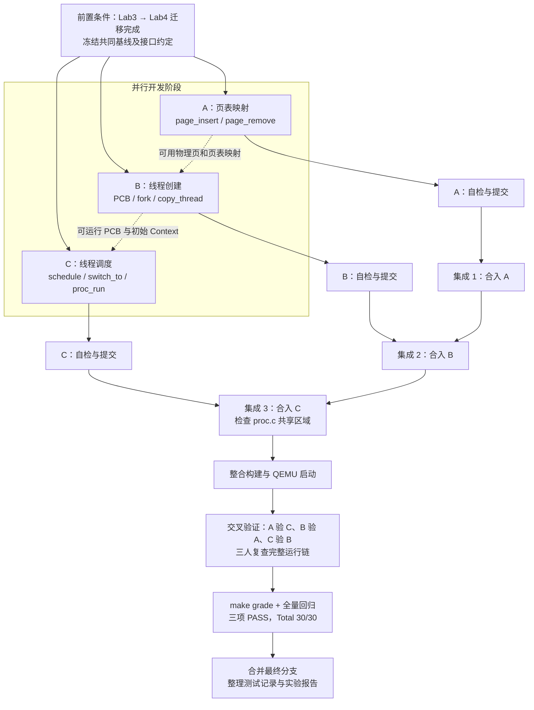

# Lab4 三人分工与集成验收方案

## 一、任务目标与分工原则

本次 Lab4 的目标是在 Lab2 物理内存管理与 Lab3 Trap 处理的基础上，实现**虚拟页映射维护、内核线程创建、进程调度及上下文切换**，使内核能够创建多个可运行线程，并通过调度让它们轮流获得 CPU。

本方案参考仓库 `LIZZYGREAT/Operation-System-Labs` 的 `lab4` 分支及实验文档 `lab4-instruction.md`、`lab4-requirements.md`。核心实现以源码中的 `LAB4 function1/2/3` 标记为准，验收以 `tools/test_lab4.c` 与 `tools/grade.sh` 为准。

**分工原则：**

1. **按功能链划分**：A 负责页表操作，B 负责线程创建，C 负责线程调度。每人负责自己的算法实现、局部检查和提交。
2. **尽量并行开发**：三人从同一个、已经完成 Lab3 → Lab4 迁移的基线提交创建工作分支；单模块能够独立检查的部分先行验证。
3. **共享文件按代码区域划分**：B、C 都涉及 `kern/process/proc.c`。B 仅负责 `LAB4 function2`，C 仅负责 `LAB4 function3`；不得整文件覆盖或顺手改动对方区域。若发生冲突，在集成阶段逐函数解决。
4. **前置迁移与本次任务分离**：如果 Lab3 → Lab4 迁移尚未完成，应先按照既有迁移方案完成，并形成共同基线。本分工不要求三人重复迁移 Lab2/Lab3 的实现。
5. **保留实验原有框架**：优先补充 TODO 和最小必要的接口修复，不引入无关模块，不修改评分脚本以迎合结果，不伪造 PASS 输出。

### 1. 总体分工

| 成员 | 负责模块 | 核心函数 | 主要修改文件 | 交付物 |
|---|---|---|---|---|
| **A** | 功能一：虚拟内存页映射管理 | `page_insert()`、`page_remove()` | `code/kern/mm/pmm.c` 的 `LAB4 function1` 区域 | 页表映射实现、引用计数与映射测试记录 |
| **B** | 功能二：进程创建与初始化 | `alloc_proc()`、`proc_init()`、`kernel_thread()`、`do_fork()`、`copy_thread()`、`copy_mm()` | `code/kern/process/proc.c` 的 `LAB4 function2` 区域 | PCB 初始化、线程创建、首次运行现场构造及测试记录 |
| **C** | 功能三：进程调度与上下文切换 | `cpu_idle()`、`schedule()`、`proc_run()`、`switch_to()` | `code/kern/schedule/sched.c`、`code/kern/process/switch.S`、`code/kern/process/proc.c` 的 `LAB4 function3` 区域 | 调度算法、寄存器切换汇编、运行调度测试记录 |

三项任务的复杂度不同：A 的函数数量少，但页表映射、引用计数和 Sv39 兼容性较易出错；B 的函数数量最多，主要承担线程生命周期及资源管理；C 的函数数量居中，但需要协调 C 与汇编层面的真实执行控制流。整体工作量可视为相近，不按函数数量平均分工。

## 二、实现流程与依赖关系

以下 Mermaid 图同时展示**三人并行开发、必要接口依赖、交叉审查和最终集成**。虚线表示接口依赖，不代表必须等前一组全部实现完才能编写代码。



### 1. 事先确定的接口约定

在三人并行开始前，先用短时间对齐以下约定，记录后尽量不变更：

| 接口或数据结构 | 提供方 | 使用方 | 必须统一的含义 |
|---|---|---|---|
| `alloc_page()`、`free_page()`、`page2kva()` | 前置迁移基线 | A、B | 物理页的获取、释放与内核虚拟地址转换 |
| `page_insert()`、`page_remove()` | A | 内存初始化检查及后续内存管理 | 已映射页处理、引用计数、TLB 失效及失败返回值 |
| `struct proc_struct`、`current`、`proc_list` | Lab4 基线，B 初始化 | B、C | 进程状态、运行资格、链表和当前进程指针 |
| `kernel_thread()`、`do_fork()`、`copy_thread()` | B | `proc_init()`、C 的首次切换流程 | 新线程进入 `PROC_RUNNABLE` 前已具有合法内核栈、`context`、`trapframe` |
| `wakeup_proc()` | Lab4 原有实现，双方核对 | B、C | 唤醒前状态合法，唤醒后可以被 `schedule()` 选中 |
| `schedule()`、`proc_run()`、`switch_to()` | C | `cpu_idle()`、`initproc`、测试线程 | 选择可运行进程，保存旧 Context，恢复新 Context |
| `forkret → forkrets → __trapret → kernel_thread_entry` | B 构造初始现场；C 验证切换 | B、C | 新线程第一次被调度后进入正确函数，参数不丢失 |

特别注意：`struct context`（`ra`、`sp`、`s0`～`s11`）和 `struct trapframe` 是不同的数据结构。B 负责将首次运行时所需的两类现场构造正确；C 负责在切换过程中准确保存/恢复 `context`，并验证首次执行链路能正确落到线程入口。**不得为了某个模块方便而单方面更改结构体字段顺序或汇编偏移。**

## 三、成员 A：虚拟内存页映射管理

**负责范围：** `code/kern/mm/pmm.c` 中 `LAB4 function1` 对应的映射维护逻辑；对相关 `get_pte()`、`check_pgdir()`、`check_boot_pgdir()` 进行必要核对。后者属于现有框架，只有确认存在阻止功能正确运行的问题时，才允许作有依据的最小修复，并在提交中单列说明。

### 1. 实现任务

- **`page_insert(pgdir, page, la, perm)`**：定位或创建页表项；建立 `la → page` 的映射；处理原地址无映射、已经映射到同一物理页、原映射为另一物理页三种情况；正确维护引用计数与页表权限；必要时使旧 TLB 翻译失效；资源不足时返回 `-E_NO_MEM`，不破坏已有合法映射。
- **`page_remove(pgdir, la)`**：定位已有页表项；若存在有效叶子映射，解除关联并减少物理页引用；引用归零时释放物理页；清理页表项并刷新对应 TLB；对未映射地址安全返回。
- **检查 Sv39 页表路径**：核对 Lab4 的 `get_pte()` 三级页表遍历，与启动阶段高地址区的大页映射是否兼容；关注 `check_boot_pgdir()` 的地址类型与遍历范围。允许报告并修复真实缺陷，不得删除原测试、降低断言强度或直接跳过检查。

### 2. 自检与交付标准

检查 `page_insert()` 的首次映射、权限更新、同页重新插入、不同页替换、失败返回；检查 `page_remove()` 的单次/重复删除；核对物理页 `ref` 和空闲页数量在测试前后正确恢复。使用原有 `check_pgdir()` 和评分注入的 `test_lab4_pmm_basic()` 作为运行时验收依据。

**提交范围**：优先只改 `pmm.c` 的对应区域；如果需要修改 `pmm.h`、`mmu.h` 或启动页表，先记录问题并与 B、C 共同确认变更范围。

## 四、成员 B：进程创建与初始化

**负责范围：** `code/kern/process/proc.c` 中 `LAB4 function2`，保留文件中已有 `get_pid()`、`hash_proc()`、`find_proc()`、`setup_kstack()`、`put_kstack()`、`forkret()`、`init_main()` 等基础实现。

### 1. 实现任务

- **`alloc_proc()`**：分配 `proc_struct`，初始化状态、PID、父进程、内存指针、内核栈、调度标记、Context、Trapframe、链表结点等字段，避免未初始化值影响调度。
- **`proc_init()`**：初始化进程链表和哈希表；建立特殊的 `idleproc`（PID=0、使用启动栈、`current=idleproc`）；创建 `initproc`（预期 PID=1）并设置合法名称与父子关系；确保进程数量及状态一致。
- **`kernel_thread()`**：根据目标函数及参数构造新线程的初始 Trapframe，再进入 `do_fork()`；返回新线程 PID 或正确错误码。
- **`do_fork()`**：按顺序分配 PCB、申请内核栈、处理地址空间、复制线程上下文、分配 PID、注册链表及哈希索引、更新进程数量、唤醒线程；任一阶段失败都回收已取得的资源。
- **`copy_thread()`**：将初始 Trapframe 放在新线程内核栈合适位置，设置子线程初始返回值和栈指针，并将 `context.ra`、`context.sp` 指向首次执行所需的恢复入口和上下文。
- **`copy_mm()`**：按本次内核线程实验所需的共享地址空间语义实现最小正确处理；不要擅自扩展为完整用户进程地址空间复制。

### 2. 自检与交付标准

重点验证 `idleproc`/`initproc` 的 PID、状态、父指针、栈地址、`mm`、`tf`、`context`、`runs` 等字段满足 `test_lab4_process_create()` 的断言；`find_proc(initproc->pid)` 能找到正确 PCB；资源分配失败时没有悬挂链表节点或内核栈泄漏。

**与 C 的边界：** B 只负责将新线程创建到可调度状态。不要在本分支实现 `schedule()`、`switch_to()`，也不要改写 `LAB4 function3` 区域；B 可以通过结构体及静态检查提前验收，真正的“首次运行成功”在集成 C 后验证。

## 五、成员 C：进程调度与上下文切换

**负责范围：** `code/kern/schedule/sched.c`、`code/kern/process/switch.S`，以及 `code/kern/process/proc.c` 的 `LAB4 function3` 区域。默认采用实验框架中的可运行进程链表进行简单轮转选择，避免引入额外的复杂调度器。

### 1. 实现任务

- **`schedule()`**：保护调度临界区；从当前进程之后查找 `PROC_RUNNABLE` 进程；找不到合适线程时退回 `idleproc`；更新必要调度标记，通过 `proc_run()` 切换。应支持测试线程多次主动调用 `schedule()`，不能只处理首次 idle → init 切换。
- **`proc_run(proc)`**：检查目标进程有效且与当前运行状态相容；在必要的中断保护下更新 `current`、切换页表环境，再调用 `switch_to(&prev->context, &next->context)`；处理目标就是当前进程的情况。
- **`switch_to(from, to)`**：使用 RISC-V 汇编按 `struct context` 的字段顺序保存旧线程 `ra`、`sp`、`s0`～`s11`，再恢复目标线程对应寄存器并返回到其执行位置。偏移必须与 `proc.h` 的结构布局严格对应。
- **`cpu_idle()`**：保持空闲线程循环，检测 `need_resched` 并调用 `schedule()`；避免把 Lab3 的自动关机或调试停机逻辑带进正常 Lab4 调度流程。

### 2. 自检与交付标准

验证调度不会始终选择同一个线程；上下文切换后线程的 `sp`、`ra` 及被调用者保存寄存器正确；新线程首次执行能够经过 `forkret()`、`forkrets()`、`__trapret` 到达 `kernel_thread_entry()`；两个测试线程均得到执行机会，原来的线程能从 `schedule()` 调用后继续执行。

**与 B 的协作方式：** C 可以先独立完成 `sched.c` 和 `switch.S`，并设计 `proc_run()`、`cpu_idle()` 的实现；如 `proc.c` 的两个 TODO 区域发生 Git 合并冲突，集成人员应在 B 的创建代码已落地后，逐函数放入 C 的调度代码并由 B、C 双方检查，严禁用整份 `proc.c` 替换。

## 六、开发分支、提交与合并规则

### 1. 基线准备

在开始分工前，确认 Lab3 → Lab4 迁移已完成，包括 Best-Fit、物理内存初始化、Trap 保存/恢复、启动栈及必要的 SBI 接口兼容。**迁移基线的完整 Lab4 `make`/`make grade` 可能因新 TODO 尚未实现而失败，这不意味着迁移代码必然错误。** 先冻结一个共同提交 SHA，三人从同一 SHA 开始。

建议分支：`work/lab4/A-pmm`、`work/lab4/B-process`、`work/lab4/C-schedule`，另设 `integration/lab4` 汇总分支。**不能以 ZIP 整树覆盖 GitHub 已迁移的源码**，也不能将迁移前的 `lab4` 原始分支误当作共同完成基线。

### 2. 并行提交约束

| 文件区域 | A | B | C |
|---|---|---|---|
| `kern/mm/pmm.c`：`LAB4 function1` | **编辑** | 只读 | 只读 |
| `kern/process/proc.c`：`LAB4 function2` | 只读 | **编辑** | 只读 |
| `kern/process/proc.c`：`LAB4 function3` | 只读 | 只读 | **编辑** |
| `kern/schedule/sched.c` | 只读 | 只读 | **编辑** |
| `kern/process/switch.S` | 只读 | 只读 | **编辑** |
| `proc.h`、`pmm.h`、`trapentry.S` 等共享接口 | 需要一致同意 | 需要一致同意 | 需要一致同意 |
| `tools/grade.sh`、`tools/inject.py`、`tools/test_lab4.*` | 不修改 | 不修改 | 不修改 |

每人提交前运行 `git diff --check`，审查 `git diff --name-only`，确保没有修改队友代码、报告或评分文件。每次提交应清楚写明自己完成的函数和证据；不得把他人未完成的 TODO 改成空桩函数骗过链接。

### 3. 集成顺序

建议由三人共同指定一个集成操作者，按 **A → B → C** 的顺序合入 `integration/lab4`。C 的 `proc.c` 改动与 B 相邻，放在最后合入，发现冲突时只合并 `LAB4 function3`，保留 B 的 `LAB4 function2` 实现。

每合入一项都检查文件改动范围、编译错误、符号定义及原有接口是否仍然存在。等全部模块进入集成分支后，再将完整系统的启动与评分作为正式通过门槛。不要因中间阶段尚缺另一组函数而人为放宽测试。

## 七、交叉审查与相互测试

为防止“作者自己测过，但模块接口不兼容”，规定**每人至少负责复查另一个模块、复测第二个模块**；三个人均参与最后的运行主线检查。

| 被检查模块 | 代码作者 | 主要代码审查者 | 独立运行复测者 | 重点检查 |
|---|---|---|---|---|
| 页表操作（任务一） | A | **B** | **C** | 替换映射、引用计数、TLB、空闲页恢复、失败路径 |
| 线程创建（任务二） | B | **C** | **A** | PCB 字段初始化、`do_fork()` 失败清理、`initproc` 合法性 |
| 线程调度（任务三） | C | **A** | **B** | 上下文寄存器保存、轮转公平性、首次运行入口、重复切换 |

**实施方式：**

1. 作者先交付代码、局部检查记录和已知限制；代码审查者逐函数核对实现是否与接口约定相符，提出问题时写明函数、调用链和预期行为。
2. 等三项模块合并并能启动后，复测者在集成分支上独立执行相应测试、保存原始日志，避免只引用作者的测试截图或结论。
3. B、C 共同核对 `copy_thread()` 构造的初始 `context`、`trapframe`，以及 `switch_to()` 恢复顺序；A、C 共同核对页表切换与启动页表映射；A、B 共同核对 PCB 资源分配和释放路径。
4. 检查发现问题，优先由原模块作者修复并重新提交；需要跨文件改动时由相关双方共同审查，不由集成者直接大范围重写。

## 八、完整集成验收

### 1. 构建与静态检查

在 `integration/lab4` 分支的 `code/` 目录执行：

```bash
make clean
make
```

预期：内核完整编译与链接通过，生成 `bin/kernel`、`bin/ucore.img`；不存在未定义符号、重复定义、遗漏对象文件或不正确的汇编寄存器偏移。

随后检查：

```bash
git diff --check
git status --short
```

预期：无空白错误、冲突标记和未经说明的非目标文件修改。

### 2. QEMU 运行主线

```bash
make qemu
```

按下列真实执行顺序核对：

`kern_init → pmm_init → check_pgdir/check_boot_pgdir → kmalloc_init → vmm_init → proc_init → cpu_idle → schedule → proc_run → switch_to → forkret → forkrets → __trapret → kernel_thread_entry → init_main`。

运行日志应能证明内存管理和进程初始化成功，`initproc` 得到执行机会，出现预期的 `init_main()` 输出。需检查是否因陷入错误地址、栈破坏、页表错误或 Lab3 遗留关机逻辑导致提前终止。

### 3. 官方评分与结果判定

```bash
make grade
```

该命令依据仓库 `tools/inject.py` 将测试分别插入 `pmm_init()` 末尾、`proc_init()` 末尾和 `init_main()` 入口，执行 `tools/test_lab4.c` 的三组断言。**不得直接修改这三处评分注入逻辑或手动打印通过标志。**

| 检查项 | 必须出现的真实输出 | 分值 | 验证人 |
|---|---|---:|---|
| 页表映射 | `[Test PMM] PASS` | 10 | C 复测，B 审查 |
| 进程创建 | `[Test Process Create] PASS` | 10 | A 复测，C 审查 |
| 调度执行 | `[Test Schedule] PASS` | 10 | B 复测，A 审查 |
| **完整结果** | **`Total Score: 30/30`** | **30** | 三人共同确认 |

调度部分还需出现原评分脚本要求的 `init_main` 相关输出：

```text
this initproc, pid = 1, name = "init"
To U: "Hello world!!".
To U: "en.., Bye, Bye. :)"
```

注意：原框架 `do_exit()` 可能仍采用教学阶段的 `panic` 占位，属于需要记录的运行边界。不能在测试实际失败时将其解释为“正常”；如果所有预期输出已成功出现而仅在 `init_main()` 返回后触发该占位，应明确记录发生时机和实验要求范围，并保留原始日志。

### 4. 最终回归检查

除评分项之外，三人还应核对：

- 物理内存管理仍选择正确的分配器，原 Lab2/3 的必要初始化、Trap 和定时器行为没有意外回退。
- `page_insert()` 同页重映射时不会释放正在使用的物理页；删除映射后引用计数归零且空闲页数量正常。
- `idleproc` 和 `initproc` 均有正确状态；新建测试线程都能运行；多次切换后不会卡死在单个线程。
- `switch_to()` 对 `ra`、`sp`、`s0`～`s11` 的偏移与 `struct context` 一致；中断屏蔽和恢复顺序合理。
- 程序没有为通过评分而删除原断言、绕过原函数、伪造输出或修改评分脚本。

## 九、验收结论与最终交付

每位成员提交一份简短的完成记录，至少包括：修改文件、完成函数、关键实现思路、运行命令、真实结果和仍需处理的问题。交叉审查者追加审查意见，复测者追加独立测试结果。

最后由集成操作者整理一次完整记录，包含：

1. **分支与提交**：共同基线 SHA、A/B/C 工作提交、集成分支最终 SHA，以及合并过程中解决的冲突。
2. **功能清单**：三项任务的全部函数均已实现，且未遗留阻断性的 `LAB4 function1/2/3` 占位。
3. **验证证据**：`make`、QEMU 实际输出、`make grade` 原始日志及 `30/30` 结果；没有执行成功的项目必须如实标注。
4. **团队复核**：A、B、C 各自审查与复测结果，尤其是 B/C 的新线程首次运行链路。
5. **最终合并**：只在上述检查通过、三人认可后，将 `integration/lab4` 合入正式 `lab4` 分支；避免在正式分支直接进行未验证的临时修复。

**最终完成标准：三项功能实现齐全、前置 Lab2/Lab3 机制可继续使用、完整内核能够启动并运行多线程、三人交叉验证通过、Lab4 评分达到 30/30。**

## 十、Challenge（共同讨论）

Challenge 暂不指定负责人，等三个功能模块实现与集成验收完成后共同讨论，并结合实际代码与测试现象整理答案：

- **中断开关**：说明 `local_intr_save(intr_flag)` 与 `local_intr_restore(intr_flag)` 如何保存、屏蔽与恢复中断状态。
- **分页模式与 `get_pte()`**：结合 Sv32、Sv39、Sv48 的页表层级，解释相似的查表代码，以及是否值得拆分“查找现有页表项”和“缺失时创建页表页”两个职责。

Challenge 的讨论结果可进入实验报告，不影响 A/B/C 三个功能模块的责任边界。
