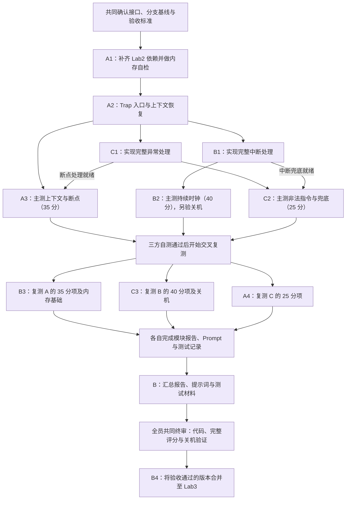
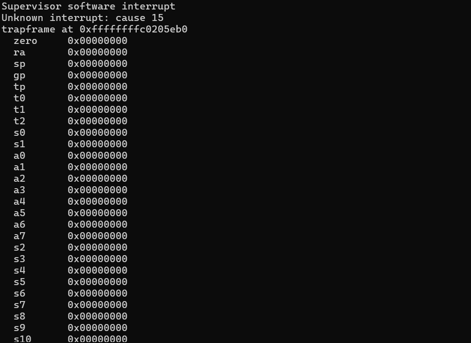
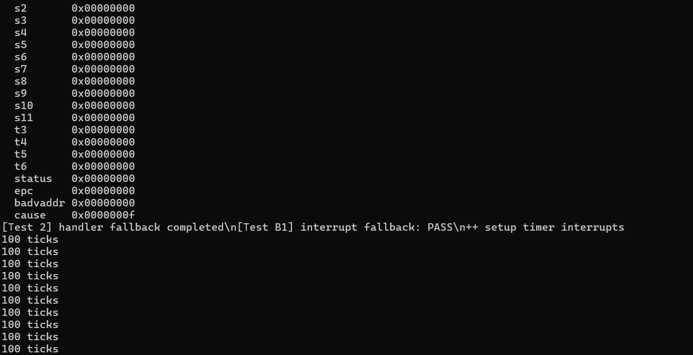
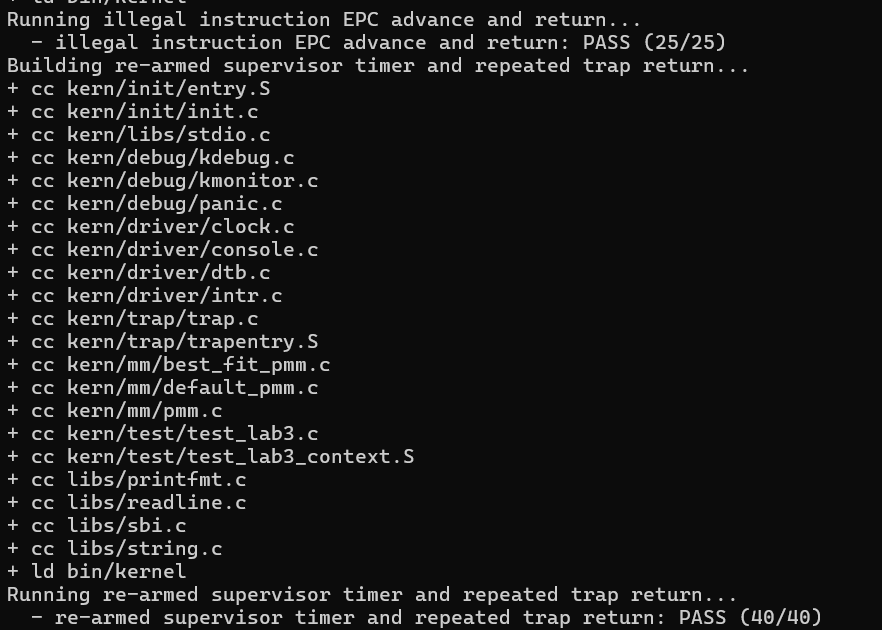
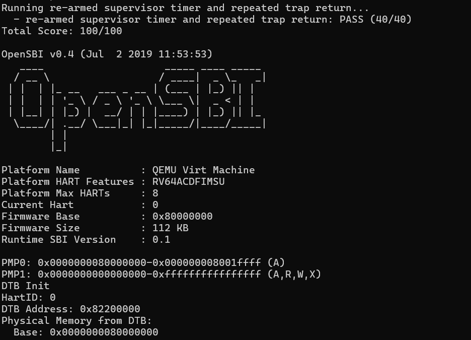
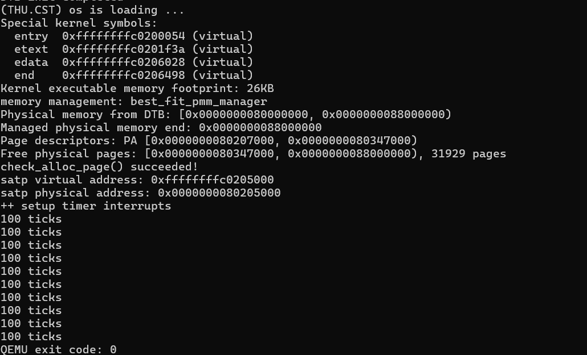
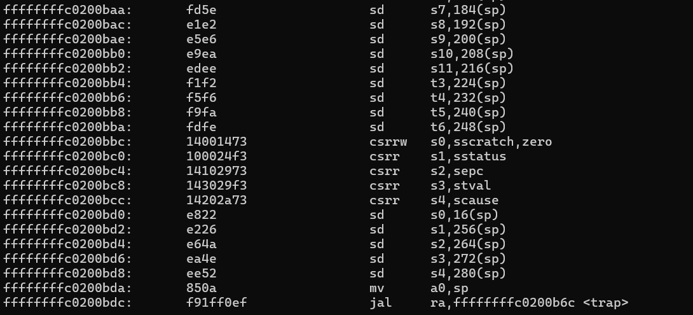
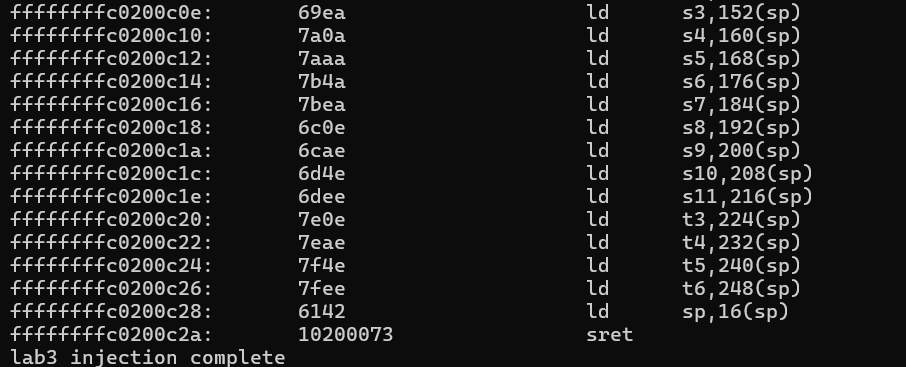
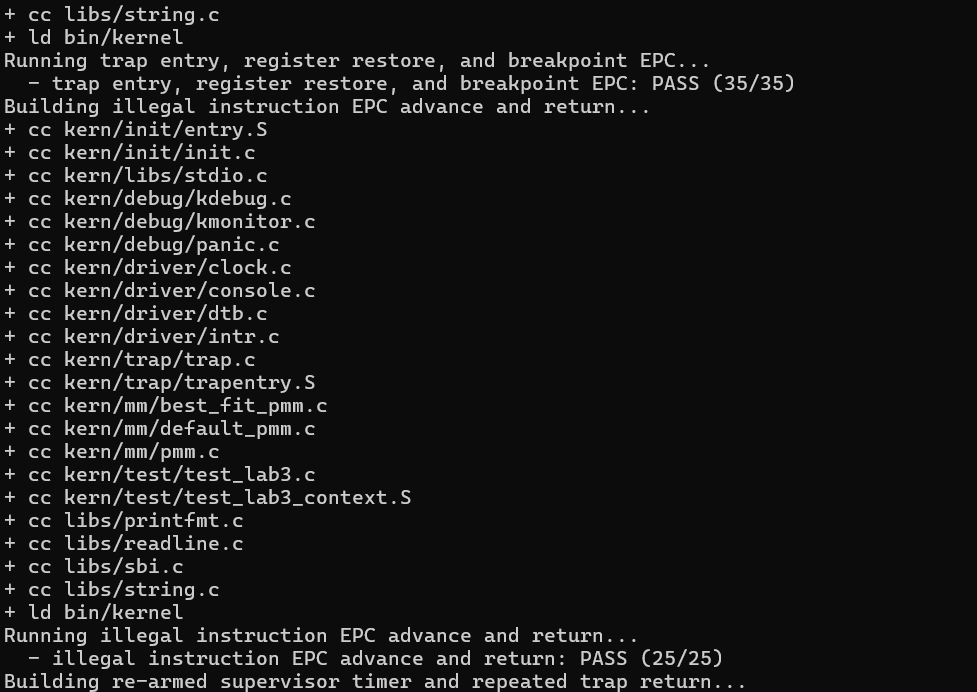

# 操作系统实验报告

## 实验基本信息

| 项目 | 内容 |
| --- | --- |
| **实验名称** | Lab3：断，都可以断——中断与异常处理 |
| **小组成员** | 2412712-王子楸、2412700-甘文杰、2413318-向宇航 |
| **完成日期** | 2026-11-04 |


### 小组分工

**实验实现与测试分工：**

| 成员 | 负责的练习或模块 | 主测任务 | 交叉复测任务 |
| --- | --- | --- | --- |
| A：2412712-王子楸 | A1：回填 Lab2 的物理内存初始化和 Best-Fit；A2：实现 Trap 入口与上下文恢复 | 内存基础自检；A3：上下文、寄存器恢复与断点返回，35 分 | A4：独立复测 C 的非法指令与兜底，25 分 |
| B：2412700-甘文杰 | B1：实现完整中断处理，包括时钟、软件中断和未知中断处理 | B2：持续时钟中断，40 分；额外验证统计输出和关机 | B3：复测 A 的上下文与断点，35 分，以及内存基础 |
| C：2413318-向宇航 | C1：实现完整异常处理，包括断点、非法指令和未知异常处理 | C2：非法指令与兜底，25 分 | C3：复测 B 的持续时钟，40 分，以及关机 |

**实验报告分工：**

| 成员 | 报告职责 |
| --- | --- |
| 王子楸 | 撰写小组分工、实验目的、整体逻辑分析，以及本人 A1、A2、A3+A4 的功能说明、实现过程、测试记录和总结 |
| 甘文杰 | 撰写中断处理、40 分主测与交叉复测材料；汇总三人的报告、提示词和截图，统一格式与图片引用 |
| 向宇航 | 撰写异常处理、25 分主测与交叉复测材料，说明异常指令长度判断、EPC 更新和兜底行为 |
| 全体成员 | 共同核对代码、测试结果和报告；共同终审通过后，由甘文杰执行分支合并 |

---

## 一、实验目的

1. 理解 RISC-V 中断和异常的区别，掌握内核从接收 Trap 到恢复原执行流的完整过程，明确硬件自动保存的信息与软件需要保存的上下文。
2. 根据已有的 `SAVE_ALL` 和 `struct trapframe`，完成 Trap 入口、C 函数参数传递和上下文恢复，理解通用寄存器、栈指针以及 `sstatus`、`sepc` 在返回过程中的作用。
3. 完成时钟中断、断点异常和非法指令异常的处理，理解时钟事件重新设置、计数统计和异常返回地址更新之间的关系。
4. 将 Lab2 的内存管理实现适配到 Lab3，在保留现有中断保护和固定自检的基础上，保证内存初始化、分配与释放正常工作。
5. 通过 QEMU 运行、关键指令检查和已有评分用例，验证“保存现场—处理 Trap—恢复现场—继续执行”这一链路；通过交叉复测检查模块之间的配合。

---

## 二、实验环境

你们使用的 AI 工具

| 成员 | AI 编程工具 | 底层模型 | 备注 |
| --- | --- | --- | --- |
| 2412712-王子楸 | Codex | GPT-6.1 sol high | 无 |
| 2412700-甘文杰 | Codex | GPT-6.0 luna max | 无 |
| 2413318-向宇航 | 由本人补充 | 由本人补充 | 合并个人报告时补齐 |

**说明：**
- **AI 编程工具**：指具体使用的终端工具、编辑器插件、桌面应用或浏览器界面
- **底层模型**：指该工具使用的大语言模型及版本

---

## 三、实验整体逻辑分析

### 3.1 本章节的逻辑主线

本实验围绕内核如何响应中断和异常展开。发生 Trap 时，处理器会记录返回地址、原因等控制状态，并跳转到 `stvec` 指定的入口。通用寄存器仍需要由软件保存，否则进入 C 语言处理函数后，原程序正在使用的寄存器值可能被覆盖。

因此，整个实验需要连通以下执行过程：

`发生 Trap → __alltraps → SAVE_ALL → trap(tf) → 中断或异常处理 → RESTORE_ALL → sret → 继续执行`

其中，Trap frame 是汇编入口和 C 语言处理函数之间的共同接口。汇编按照固定偏移保存现场，C 层通过结构体读取原因、修改需要更新的返回状态，汇编再按照同一布局恢复。上下文布局、函数调用约定和处理器返回机制需要相互对应。

内存管理是本实验的基础依赖。回填 Lab2 实现后，需要先确认物理页描述符、空闲页链表和分配器能够正常工作，再进行 Trap 链路的联调。中断开启以后，内存分配和释放还需要保留框架已有的中断保护，避免同一执行核上的中断处理打断空闲链表更新。

### 3.2 功能的逐步实现与协作流程

我们按照“共同基础、分项实现、主测与交叉复测、材料汇总和共同终审”的顺序组织实验。下面沿用小组分工流程图，展示任务之间的依赖关系。图中 A 为王子楸，B 为甘文杰，C 为向宇航；连线表示后续任务需要具备的实现或验收条件。



**先建立共同基础。** A1 将 Lab2 的 `page_init()` 和 Best-Fit 适配到 Lab3，通过内存自检排除启动与内存布局问题；A2 再补全 `__alltraps` 和 `RESTORE_ALL`，把保存现场、调用 C 层和恢复执行连接起来。这两项是三组评分测试共同需要的基础。

**在统一入口上分别实现中断与异常处理。** B1 负责中断分类、时钟事件重新设置、计数统计和关机，C1 负责断点、非法指令和异常兜底。时钟中断通常保留保存的 EPC，处理后继续原执行流；本实验的断点和非法指令处理则按指令长度更新 `tf->epc`，再由 A2 将更新后的地址写回 `sepc` 并返回。

**按依赖开展主测。** A3 的 35 分项需要 A2 和 C1 的断点处理配合；B2 的 40 分项需要 A2 和 B1；C2 的 25 分项同时使用异常处理和中断兜底，因此依赖 A、B、C 的实现。35 分和 40 分可以在各自依赖就绪后分别进行，25 分项待相关实现齐备后运行。图中的三条主测分支表示职责和依赖，实际可通过完整评分入口依次执行三组用例。

**通过交叉复测后汇总与终审。** B 复测 A 的上下文与内存基础，C 复测 B 的时钟和关机，A 复测 C 的异常与兜底。各人记录所用版本、命令和真实结果，再由 B 汇总报告、`prompt.md` 和测试材料。全员共同确认完整评分、关机验证、交叉复测记录及报告一致性后，由 B 完成分支合并。

---

## 四、实验内容与实现

本节记录本人负责的 B1 中断处理实现，主要包括中断原因识别、时钟中断的持续处理、软件中断提示和未知中断兜底。B2 的 40 分主测与关机验证，以及 B3 对 A 组内存管理和 Trap 上下文的交叉复测，统一放在第五部分。

### 4.1 功能模块一：中断分类与处理（B1）

**负责人：** 2412700-甘文杰

#### 模块功能描述

**需要补全的函数：**

```c
/* code/kern/trap/trap.c */
void interrupt_handler(struct trapframe *tf);
```

**使用的已有接口：**

```c
/* code/kern/driver/clock.c */
void clock_set_next_event(void);
extern volatile size_t ticks;

/* code/kern/trap/trap.c */
void print_trapframe(struct trapframe *tf);

/* code/libs/sbi.c */
void sbi_shutdown(void);
```

B1 主要修改 `code/kern/trap/trap.c` 中的 `interrupt_handler()`，把原来的占位处理替换成可以实际运行的中断分派逻辑。Trap 发生后，A 组编写的汇编入口负责保存现场，已有的 `trap()` 和 `trap_dispatch()` 根据原因区分中断与异常；进入本函数时，`tf` 已经指向保存好的 Trap frame。

**1. 从 `scause` 提取中断编号**

RISC-V 的 `scause` 既表示 Trap 的类型，也表示具体原因。最高位为 1 表示中断，为 0 表示异常，其余位用于表示原因编号。因此，分派前需要先去掉最高位的中断标记：

```c
const uintptr_t interrupt_bit = (uintptr_t)1 << (__riscv_xlen - 1);
uintptr_t cause = tf->cause & ~interrupt_bit;
```

本实验使用 RV64，最高位是第 63 位。这里使用 `__riscv_xlen` 计算位置，而不是直接写死一个 64 位常量。取出 `cause` 后，再用 `switch` 分别处理时钟中断、软件中断和未知编号。

**2. 软件中断与未知中断**

```c
switch (cause) {
case IRQ_S_SOFT:
    cprintf("Supervisor software interrupt\n");
    break;
case IRQ_S_EXT:
    cprintf("Supervisor external interrupt\n");
    break;
default:
    cprintf("Unknown interrupt: cause %d\n", (int)cause);
    print_trapframe(tf);
    break;
}
```

软件中断分支按照测试要求打印固定提示；未知中断分支先输出原因编号，再调用已有的 `print_trapframe()` 打印现场信息。这样遇到未专门处理的中断时，至少能够看到原因和寄存器状态，而不是继续使用原占位函数的 `panic()` 直接终止。

该函数只负责中断。断点、非法指令等异常由 C 组的 `exception_handler()` 处理，因此本次没有修改异常处理函数，也没有改变 A 组的 Trap 保存、恢复汇编。

#### 最终提示词

本模块的提示词及讨论记录见 [B 组 Prompt](../prompts/wenjie.md) 中 B1 对应部分。主要围绕 Trap 的整体路径、`scause` 的含义、如何根据原因编号分支，以及不同分支应输出什么信息来确定实现要求。

#### 实现迭代过程

**先确认接口与修改范围。** 结合分工文档和实际源码，确认 `trap_dispatch()` 已经负责区分中断与异常，B1 不需要重新写 Trap 入口，只需要补全 `interrupt_handler()`。同时沿用工程已经提供的中断编号宏、打印函数和时钟接口。

**替换占位实现。** 在已有函数中完成原因编号提取与分支处理，并保留原本的函数签名和成员学号标记。B1 的实现提交记录为 `7bd243a`。

**按分支补充检查。** 时钟分支通过 B2 的持续中断测试验证；软件和未知中断则使用临时副本中的直接调用测试核对输出。两种检查对应的运行条件不同，结果分别记录在第五部分。

### 4.2 功能模块二：持续时钟中断与关机机制（B1/B2）

#### 模块功能描述

时钟中断需要反复发生，而不是处理一次就结束。已有 `clock_init()` 会使能 S 模式时钟中断、预约第一次计时事件并将 `ticks` 清零；`kern_init()` 后续调用 `intr_enable()` 开启全局中断。等到计时事件到达，CPU 进入 Trap，最后由 B1 的时钟分支接手处理。

**1. 预约下一次中断并更新计数**

`clock_set_next_event()` 内部读取时间计数，再加上固定的 `timebase`，通过 `sbi_set_timer()` 预约下一次事件。由于这次计时事件已经触发，如果不重新预约，时钟就无法按照本实验要求持续产生新的中断。

因此，时钟分支的前两步是先预约下一次事件，再递增全局计数：

```c
case IRQ_S_TIMER:
    clock_set_next_event();
    ticks++;
    if (ticks % TICK_NUM == 0) {
        print_ticks();
    }
    if (ticks == TICK_SHUTDOWN_NUM) {
        sbi_shutdown();
    }
    break;
```

这段代码每进入一次时钟中断，就使 `ticks` 增加 1。中断处理完毕后，函数返回统一的 Trap 恢复流程，下一次计时事件发生时再次进入此分支，从而形成连续计数。

**2. 每 100 次输出一次统计信息**

工程中定义 `TICK_NUM = 100`。当 `ticks` 是 100 的整数倍时，调用 `print_ticks()`，输出一行 `100 ticks`。例如计数达到 100、200、300 时，各输出一次。这里的输出表示每累计 100 次时钟中断进行一次提示，而不是把当前计数值直接打印出来。

**3. 计数达到 1000 后关机**

```c
#define TICK_NUM 100
#define TICK_SHUTDOWN_NUM (TICK_NUM * 10)
```

分工要求在达到一定条件后关机，但没有指定具体阈值。本次实现选择 1000 次：一方面让 40 分测试先在 `ticks == 200` 时输出通过标记，另一方面可以继续观察后续计数和关机结果。

| `ticks` 递增后的值 | 对应行为 |
| --- | --- |
| 100 | 第一次输出 `100 ticks` |
| 200 | 第二次输出 `100 ticks`；计时测试可以输出 40 分通过标记 |
| 300 至 900（每隔 100） | 继续输出时钟统计 |
| 1000 | 第十次输出 `100 ticks`，随后调用 `sbi_shutdown()` |

`sbi_shutdown()` 通过 SBI 接口向底层固件提出关机请求。在本实验的 QEMU 环境中，关机后模拟器会退出。因此，除了查看串口文字，还需要检查 QEMU 是正常退出还是因为超时被强制停止。

#### 最终提示词

本部分对应 [B 组 Prompt](../prompts/wenjie.md) 中关于时钟事件、`ticks` 更新、统计输出与关机条件的 B1/B2 问题。学习时重点确认了第一次计时事件由谁设置、为什么处理时还要设置下一次，以及测试在 200 次通过后为什么还能继续运行。

#### 实现迭代过程

**先确定时钟中断的执行顺序。** 从 `clock_init()`、`clock_set_next_event()` 和 `interrupt_handler()` 串联启动与中断流程，确认下一次事件设置、计数更新和输出检查之间的关系。

**再确定输出和关机边界。** 保留框架已有的 `print_ticks()`，使用每 100 次输出一次的条件；选择 1000 次作为关机阈值，使测试能先检查到 200 次，再继续观察最终退出。

**区分阶段性结果与集成结果。** B2 初次运行时，时钟项已经得到 40/40，但整套评分仍因异常处理尚未完成而只有 40/100。后续 C 组实现集成之后，整套评分才达到 100/100。这属于模块之间的依赖变化，不是把早期测试记录改成最终结果。

---

## 五、测试与验证

下面将本人负责的 B1、B2 自测和 B3 交叉复测分开记录。测试使用仓库现有代码与评分入口；需要额外构造分支测试时，仅在 `/tmp` 临时副本中进行，没有修改正式评分脚本或队友负责的源码。

### 5.1 B1：软件中断与未知中断分支验证

**验证方法与判断依据：**

为了检查不容易在日常运行中自然遇到的分支，在临时测试副本中增加了 `GRADE_LAB3_INTERRUPT_FALLBACK` 测试变体，直接构造 `trapframe` 并调用 `interrupt_handler()`。验证的重点是分支选择、提示文字和 Trap frame 是否按预期输出。

| 测试分支 | 构造的输入 | 预期结果 |
| --- | --- | --- |
| S 模式软件中断 | `IRQ_S_SOFT`，带最高位的中断标记 | 输出 `Supervisor software interrupt` |
| 未知中断 | `cause = 15` | 输出 `Unknown interrupt: cause 15`，并打印 Trap frame |

**实际结果：**

临时副本的构建与 QEMU 运行退出码均为 0。串口显示软件中断提示、未知中断编号和完整的 Trap frame 输出，处理完成后能够继续执行测试。原始日志见 [b1-fallback-qemu.log](../logs/b1-fallback-qemu.log)。



**图 1：** 软件中断的固定输出以及未知中断 cause 15 的分支提示。



**图 2：** 未知中断输出 Trap frame 后继续完成测试。后面的时钟提示来自同一次临时运行。

本项通过直接调用处理函数检查了软件分支，并没有声称在 QEMU 中由真实硬件主动触发了上述未知中断。B1 的时钟分支由下一节的持续计时测试进一步验证。

### 5.2 B2：持续时钟 40 分主测与关机验证

**测试环境：** GNU Make 4.3、SiFive GCC-Metal `riscv64-unknown-elf-gcc` 10.2.0、QEMU 4.1.1（OpenSBI v0.4）。针对旧汇编 CSR 名称，构建使用 `DEFS=-Dsbadaddr=stval` 兼容参数。

**验证方法与判断依据：**

B2 的 40 分测试要求时钟不断触发，计数达到 200，并在串口出现规定的统计输出和通过标记。测试主要检查是否重新预约计时事件、是否能够跨多次 Trap 正常返回，以及 `ticks` 是否持续增加。该评分条件本身不直接检查第 1000 次中断的关机行为，所以额外使用限时 QEMU 运行进行验证。

正式评分在 `code/` 目录执行：

```bash
make grade DEFS=-Dsbadaddr=stval
```

评分脚本会分别构建、运行 35 分、25 分、40 分三组用例。最初 B1 已完成、C1 仍为占位时，完整评分结果是 **40/100**：其中时钟项通过 **40/40**，其余两项没有通过。该阶段并不表示全部功能完成。

**独立计时与关机补测：**

在 `/tmp` 临时副本中通过现有 `tools/inject.py` 注入计时测试，以 `GRADE_LAB3_TIMER` 编译后启动 QEMU。关键运行方式为：

```bash
# 在已注入测试的临时副本 code/ 目录中
make clean
make V= 'DEFS=-Dsbadaddr=stval -DGRADE_LAB3_TIMER'
timeout 20s qemu-system-riscv64 \
  -machine virt -nographic -bios default \
  -device loader,file=bin/ucore.img,addr=0x80200000 \
  -serial file:<串口日志的绝对路径> \
  -monitor none -no-reboot
```

这里的 `<串口日志的绝对路径>` 需要换成本机实际的日志路径。B2 实际使用的临时目录及完整命令见 [B1/B2 验证记录](../../b1_b2_interrupt_usage.md)，对应构建和串口日志保存在 `report/_work/logs/`。

| 检查项目 | 本人实际结果 | 对应说明 |
| --- | --- | --- |
| 初次完整评分 | 40/100，`make grade` 退出码 2 | B 的时钟项 40/40；其他项目仍受未完成的异常处理影响 |
| 独立计时补测 | 出现一次 `PASS (40/40, ticks=200)` | 证明计数达到 200，持续时钟测试通过 |
| 统计输出 | 共 10 次 `100 ticks` | 计数达到 1000 前各阶段的统计输出符合代码逻辑 |
| 独立运行退出 | QEMU 退出码 0，约 8.2 秒，未达到 20 秒上限 | 结合源码中 1000 次调用 `sbi_shutdown()`，支持关机路径正常运行 |
| 后续集成评分 | 100/100，命令退出码 0 | C1 加入后，35/35、25/25、40/40 三项全部通过 |
| 集成后正式内核运行 | 10 次 `100 ticks`，20 秒限制内退出码 0 | 正常初始化路径下也完成时钟统计和关机 |



**图 3：** 集成版本的 25 分异常项和 40 分持续时钟项均显示通过。



**图 4：** C1 合入后的完整评分结果为 100/100。图中包含 A、B、C 的协作结果，不全部归为 B 的单独实现成绩。



**图 5：** 正式内核启动后完成 Best-Fit 自检，继续输出 10 次时钟统计，并在测试终端中正常退出。

串口没有打印专门的关机提示，也没有逐次显示全部 1000 个 `ticks`。本次根据统计次数、QEMU 正常退出，以及源码中达到 1000 时调用 `sbi_shutdown()` 的路径共同判断关机成功，而不是声称曾在 `sbi_shutdown()` 设置断点检查。

### 5.3 B3：对 A 组内存基础与 Trap 上下文的交叉复测

**复测范围：** B3 不重新实现 A 的代码，重点独立核查 A1 的物理内存初始化与 Best-Fit 自检，以及 A2 的 Trap frame 布局、入口传参和恢复顺序。随后通过官方 35 分用例验证断点返回与寄存器恢复。

本次复测日期为 2026-11-04，使用的代码版本为 `0e15d4a`，已包含 A1/A2、A3/A4 和 B、C 的真实实现。工具环境为 GNU Make 4.3、RISC-V GCC 10.2.0、QEMU 4.1.1。

**验证步骤：**

在 `code/` 目录执行干净构建、反汇编、评分与启动检查：

```bash
make clean
make V= DEFS=-Dsbadaddr=stval
riscv64-unknown-elf-objdump -d --disassemble=__alltraps bin/kernel
riscv64-unknown-elf-objdump -d --disassemble=__trapret bin/kernel
make grade DEFS=-Dsbadaddr=stval
timeout 20s make qemu DEFS=-Dsbadaddr=stval
```

上述命令的退出码均为 0。构建、反汇编、评分和启动日志见 `report/_work/logs/` 中的 `b3-` 文件，详细记录见 [B3 交叉复测记录](../../b3_retest_a.md)。

**1. 内存初始化与 Best-Fit 自检**

正式内核输出了 `memory management: best_fit_pmm_manager`，说明当前实际选择的是 Best-Fit 分配器。DTB 报告的物理内存范围是 `[0x80000000, 0x88000000)`，描述符数组位于 `[0x80207000, 0x80347000)`，其后的可用物理页区间共有 31,929 页。

同时出现 `check_alloc_page() succeeded!`，说明原有的页面分配和回收固定自检通过。这次复测主要依据正式启动输出和已有自检，没有额外启动 GDB 逐项检查全部页描述符。

**2. Trap 入口与恢复顺序**

B3 进一步对比 `trap.h` 的 `struct trapframe` 和 `trapentry.S` 的反汇编。RV64 的每个寄存器槽是 8 字节，32 个通用寄存器槽加上 4 个控制信息槽，共 36 个槽、288 字节。

| 检查内容 | 本次观察及意义 |
| --- | --- |
| 保存原始 `sp` | `SAVE_ALL` 使用 `sscratch` 暂存原始栈指针，并放入第 2 槽（偏移 16） |
| 向 C 层传参 | `__alltraps` 中出现 `mv a0,sp`，随后调用 `trap`；传入的是当前帧基址 |
| 恢复 CSR | `__trapret` 从偏移 256、264 取出 `status`、`epc`，写回 `sstatus`、`sepc` |
| 恢复通用寄存器 | 根据保存槽位依次恢复可写通用寄存器 |
| 最后恢复栈指针 | 在其他帧访问结束后执行 `ld sp,16(sp)`，然后 `sret` 返回 |



**图 6：** 入口反汇编中保存现场后将当前 `sp` 交给 `a0`，再调用 C 层的 `trap()`。



**图 7：** 返回反汇编中先恢复相关寄存器和状态，最后恢复原始 `sp` 并执行 `sret`。

**3. 35 分上下文测试**

官方测试通过 `ebreak` 进入异常处理，再返回到原执行流，逐项比较事先设置的寄存器值。它直接检查了 `t0–t6`、`s0–s11`、`a1–a7` 共 26 个寄存器；`sp`、`ra` 参与返回过程，但不是该测试逐值比较的对象。因此，寄存器比较通过和反汇编中的栈恢复检查需要放在一起理解。

**实际结果：**

```text
trap entry, register restore, and breakpoint EPC: PASS (35/35)
illegal instruction EPC advance and return: PASS (25/25)
re-armed supervisor timer and repeated trap return: PASS (40/40)
Total Score: 100/100
```



**图 8：** 重新执行的完整评分中，A 负责的 Trap 入口、寄存器恢复和断点 EPC 项通过，得分 35/35。


**图 9：** B3 复测时完整评分总分 100/100；本次 B3 的主要复测结论是 A 的 35 分项与内存基础通过，其余两项是同次集成运行结果。

本次交叉复测确认：A1 的 Best-Fit 初始化与固定自检成功，A2 的入口传参与恢复顺序和源码一致，A3 对应的 35 分测试通过。正常启动也在时钟输出后以退出码 0 结束。没有修改 A 组代码，也没有在本次 B3 复测中启动 GDB。

---

## 六、实验总结与收获

### 6.1 对操作系统的理解

**实验知识点与 OS 原理的对应关系：**

| 实验知识点 | 对应的 OS 原理 | 本次实验中的理解 |
| --- | --- | --- |
| `scause` 中断标记与原因编号 | 中断识别与分派 | CPU 先记录 Trap 原因，汇编负责保存现场，C 层再根据原因编号进入相应处理分支 |
| 连续时钟事件与 `ticks` | 时钟中断与周期性内核工作 | 处理当前计时中断时还要预约下一次事件，计数才能持续增长，进而执行周期性的统计或其他任务 |
| `sbi_set_timer()` 与 `sbi_shutdown()` | 内核与底层固件的接口 | 内核可以通过 SBI 请求设置计时事件或关机，不需要直接在 B1 中重新实现底层设备操作 |
| Trap frame 与 `sret` | 现场保护与执行流恢复 | 处理函数可以读取保存的现场，返回汇编按对应槽位恢复寄存器和状态，最后回到被中断前的执行流 |
| Best-Fit 与内存自检 | 物理内存管理 | B3 复测让我看到，内核不仅需要管理空闲页，还必须正确保留固件、内核和页描述符所占的页面 |

这次实验中比较重要的一点是，我开始能把“时钟中断发生一次”和“时钟能够一直运行”区分开。初始化阶段只负责预约第一次事件；真正持续运行依赖每次进入中断处理函数后继续预约下一次，再恢复现场回到原程序。如果只看到一次 `100 ticks`，还不能说明持续中断和关机链路已经完成，所以 B2 还需要检查 `ticks=200` 的通过标记、后续统计次数及 QEMU 的退出状态。


### 6.2 AI 协作开发的经验

本次在 B1 开始前，先围绕整个 Trap 链路弄清楚哪些部分已经由框架或队友提供，哪些才是我需要实现的内容。这样阅读 `trap.c` 时就不会把保存现场、异常处理和中断处理混在一起，也更容易把代码修改限制在自己的函数内。

对于时钟中断，我主要关注从 `clock_init()` 预约第一次事件开始，到进入 handler、再次预约、更新 `ticks`、恢复执行以及最终关机的完整过程。让 AI 协助解释这一流程，并对照现有接口和测试条件检查，比只要求“写一个时钟中断处理函数”更容易理解为什么要按当前顺序实现。

通过这些检查，我对操作系统实验的认识从“把函数补完、程序能编译”逐渐转向了“沿着实际执行流程说明每一步为什么存在，并用对应的运行现象确认它的作用”。
