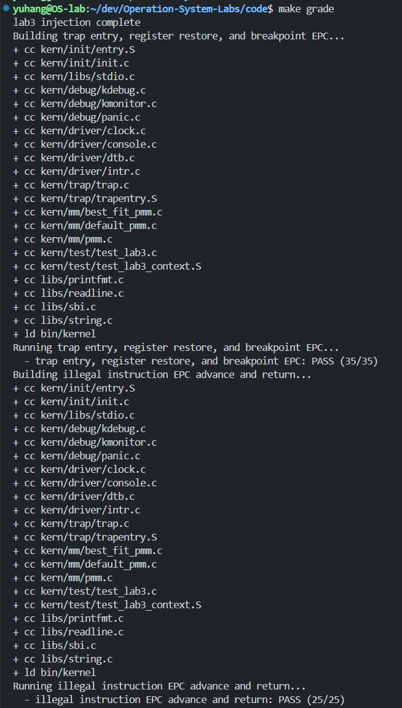
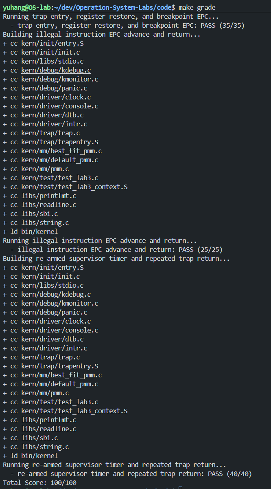
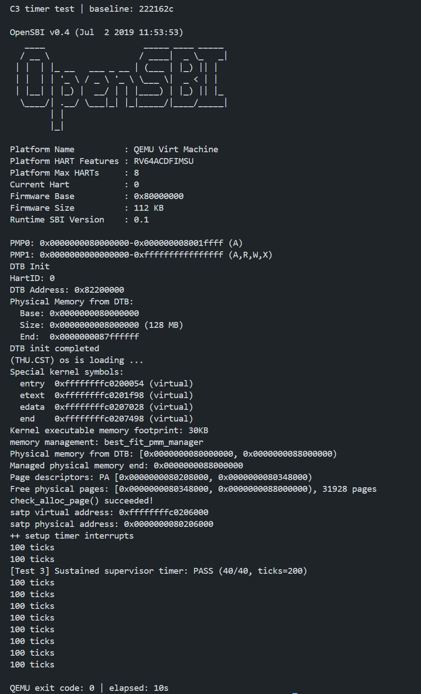
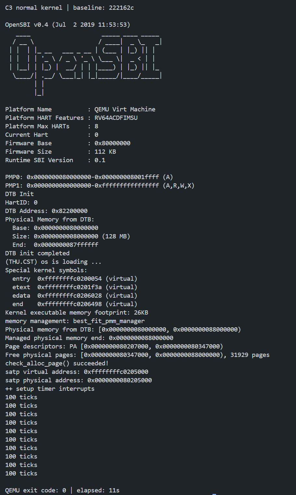

# 操作系统实验报告

## 实验基本信息

| 项目 | 内容 |
| --- | --- |
| **实验名称** | Lab3：断，都可以断——中断与异常处理 |
| **小组成员** | 2412712-王子楸、2412700-甘文杰、2413318-向宇航 |
| **个人报告作者** | 2413318-向宇航 |
| **报告整理日期** | 2026-11-06 |
| **实际测试日期** | C1/C2：2026-11-04；C3：2026-11-05 |

### 小组分工

| 成员 | 实现工作 | 主测工作 | 交叉复测 |
| --- | --- | --- | --- |
| A：王子楸 | Lab2 内存依赖、Trap 入口与上下文恢复 | 内存基础自检；上下文与断点，35 分 | C 的非法指令与兜底，25 分 |
| B：甘文杰 | 中断分类、持续时钟、统计输出与关机 | 持续时钟，40 分，另验关机 | A 的上下文与内存基础 |
| C：向宇航 | C1：断点、非法指令和其他异常处理 | C2：非法指令与兜底，25 分 | C3：B 的持续时钟，40 分，及关机 |

本人负责异常处理与对应测试材料，并独立复测 B 的时钟和关机。各人先完成个人报告，由 B 汇总材料；共同终审和合并属于小组后续工作，本报告不将其视为已经完成。

## 一、实验目的

1. 理解中断、异常与 Trap 的关系，掌握从硬件记录原因到软件处理、恢复执行的过程。
2. 理解 `scause`、`sepc`、Trap frame 和 `sret` 的配合关系，保证处理结果落实到正确的返回位置。
3. 按 RISC-V 指令编码判断本实验中的 16/32 位异常指令长度，使断点和非法指令处理后能够继续执行。
4. 使用现有评分与补充用例验证正常返回和兜底行为，通过独立运行检查持续时钟及关机。
5. 在协作中明确实现、主测和复测的归属，保存可以追溯到具体版本的证据。

## 二、实验环境

| 项目 | 本人使用情况 |
| --- | --- |
| AI 编程工具 | Codex |
| 底层模型 | GPT-6 系列，不另推定具体型号或推理档位 |
| GNU Make | 4.3 |
| RISC-V 编译器 | SiFive GCC-Metal `riscv64-unknown-elf-gcc` 10.2.0 |
| QEMU | 4.1.1，`virt`，默认 OpenSBI |
| 脚本运行环境 | Python 3.12.3（C3 状态记录） |
| CSR 兼容参数 | `DEFS=-Dsbadaddr=stval` |

兼容参数用于适配框架中的旧 CSR 名称，沿用此前成员的构建方式。本文使用已有代码、日志和截图整理结果，整理报告时没有重新运行实验。

| 阶段 | 对应版本与日期 |
| --- | --- |
| C1 开发基线 | `cdc9814801ed48fd6ab18420eba371a6ef5909af`，已包含 A、B 实现 |
| C1 实现及 C2 日志记录版本 | `efa5e989fc196c21f6b9f2b0b3778d5397a5bcf5`，2026-11-04 |
| C3 独立复测基线 | `222162ce44b2cd84a9fa854a192a006c618ee7c1`，2026-11-05 |

版本取自保存的状态文件。后续分支可能继续更新，历史结果仅对应上述版本，不自动表示覆盖了后续修改。

## 三、实验整体逻辑分析

### 3.1 从 Trap 进入到返回

本章围绕“被打断以后如何继续执行”展开。处理器在发生 Trap 时记录原因、返回地址和相关控制状态，然后转到 `stvec` 指定的入口。通用寄存器的完整现场由软件保存，形成汇编入口与 C 层共同使用的 Trap frame。

```text
Trap 发生
  → __alltraps / SAVE_ALL：保存现场
  → trap(tf) / trap_dispatch()：区分中断和异常
  → interrupt_handler() 或 exception_handler()：处理具体事件
  → RESTORE_ALL：恢复寄存器、sstatus 和 sepc
  → sret：返回保存的执行位置
```

A 的入口负责将帧地址作为参数传给 C 层；B 处理异步中断；本人负责同步异常。C 层修改 `tf->epc` 后，A 的恢复逻辑将修改后的值写回 `sepc`，最终影响真实返回位置。只打印异常信息而不更新 EPC，会再次执行原异常指令，形成重复异常。

### 3.2 功能依赖与协作顺序

先补齐内存管理，再实现 Trap 保存与恢复，随后分别实现中断和异常处理。A 的 35 分项依赖本人的断点处理；B 的 40 分项依赖持续时钟与 Trap 返回；本人的 25 分项还会调用 B 的软件中断与未知中断分支，因此需要相关实现齐备。

本人的工作分为三个阶段：C1 实现异常处理，C2 主测非法指令与兜底并补充长度验证，C3 在集成基线上独立复测 B。C2 中出现的 35/35、40/40 属于同期集成检查；C3 则重新导出副本并构建运行，单独保留复测证据。

## 四、实验内容与实现

### 4.1 C1：完整异常处理

**负责人：** 2413318-向宇航。

需要实现的函数位于 `code/kern/trap/trap.c`：

```c
void exception_handler(struct trapframe *tf);
```

已有入口保证 `tf` 指向保存好的现场。函数依赖 `CAUSE_ILLEGAL_INSTRUCTION`、`CAUSE_BREAKPOINT`、`cprintf()` 和 `print_trapframe()`，使用 `tf->cause` 分类，使用 `tf->epc` 调整返回位置。

#### 行为规格

Pre-Condition：Trap frame 有效，需要跳过的指令地址可读，指令属于本实验覆盖的 16/32 位范围。

Post-Condition：非法指令与断点打印原 EPC，再按编码长度更新 EPC；其他异常输出 Trap frame 后返回。

| 情况 | 行为 |
| --- | --- |
| 非法指令 | 输出 `Illegal instruction at 0x%016lx\n`，随后跳过实际长度的指令 |
| 断点 | 输出 `Breakpoint at 0x%016lx\n`，随后跳过实际长度的指令 |
| 其他异常 | 调用 `print_trapframe(tf)`，EPC 不变，不额外 panic |

输出必须在修改 EPC 前完成，确保报告的是触发异常的位置。未知异常的兜底不读取 EPC 处的指令，因为它没有对应的跳过要求。

#### 实现与指令长度判断

```c
void exception_handler(struct trapframe *tf) {
    // lab3 C1 - 2413318: skip the faulting 16-bit or 32-bit instruction.
    switch (tf->cause) {
    case CAUSE_ILLEGAL_INSTRUCTION:
        cprintf("Illegal instruction at 0x%016lx\n", (unsigned long)tf->epc);
        break;
    case CAUSE_BREAKPOINT:
        cprintf("Breakpoint at 0x%016lx\n", (unsigned long)tf->epc);
        break;
    default:
        print_trapframe(tf);
        return;
    }

    uint16_t instruction = *(const uint16_t *)tf->epc;
    tf->epc += (instruction & 0x3) == 0x3 ? 4 : 2;
}
```

两个已处理分支共用长度判断。在本实验的编码范围内，首个半字的低两位不等于 `0b11` 时按 16 位处理，否则按 32 位处理。因此压缩断点和普通断点都能正确跳过，非法指令也不会被一律当作 4 字节。

使用 `uint16_t` 读取前缀，适应仅按两字节对齐的指令地址，并避免为判断长度额外读取后续半字。这里没有实现完整反汇编器、用户地址探测或更长指令编码的处理。

实现仅替换异常处理的占位函数体，保留公共签名、Trap frame 布局和其他成员实现。对于未知异常，打印诊断信息后原地返回并不代表异常已经恢复；如果真实故障仍存在，它可能再次触发。

#### 提示词与实现修正

整理后的示例 Prompt 见 [个人 Prompt 的 C1 小节](../prompts/yuhang.md#c1异常处理)，采用 `[PROMPT]`、`[RELY]`、`[GUARANTEE]`、`[SPECIFICATION]` 四段模板，分别描述任务、已有接口、交付函数和前后置条件。示例用于表达最终规格，不作为实际对话记录。

计划阶段曾考虑“非法指令固定跳过 4 字节、断点固定跳过 2 字节”。重新核对手册后，发现这一方案只覆盖部分用例，于是在写入实现前改为读取前缀判断长度。固定长度方案没有提交。最终实现首次编译及后续验证通过，没有发生需要虚构为多轮修复的运行故障。

### 4.2 C2/C3：主测与复测设计

C2 使用原始评分入口检查 25 分项，再在 `/tmp` 副本补测四种编码。直接调用 handler 检查 EPC 精确增量，真实 Trap 检查返回后能否继续执行，两类证据共同验证长度判断。

C3 使用两个从固定提交导出的独立副本：一个只启用原始 `GRADE_LAB3_TIMER` 用例，另一个运行未注入的正式内核。判断关机时同时检查统计行数、QEMU 退出码和耗时，避免只有评分文本通过而进程实际超时。

对应的模板化规格见 [个人 Prompt](../prompts/yuhang.md) 中 C2、C3 小节，具体操作与证据见下一部分。

## 五、测试与验证

### 5.1 C2：25 分主测与同期集成评分

2026-11-04，在 C1 已实现且 A、B 依赖可用的版本上，从仓库根目录运行：

```bash
make -C code grade DEFS=-Dsbadaddr=stval
```

评分入口在临时副本注入测试并分别构建三组用例。实际结果为退出码 0，总分 100/100：

| 项目 | 实际结果 | 本人的职责归属 |
| --- | --- | --- |
| 上下文与断点返回 | 35/35 | 本轮集成检查，A 的主测项 |
| 非法指令返回与兜底 | 25/25 | C2 主测 |
| 持续时钟 | 40/40 | 本轮集成检查，B 的主测项 |

25 分用例首先执行 4 字节非法编码 `0x0000007b`，要求出现 `Illegal instruction at` 并返回到后续测试。接着构造帧调用 handler，检查软件中断提示、未知中断 cause 15 提示和未知异常 cause 20 的 Trap frame 输出。

其中非法指令真实触发 Trap；软件中断与未知原因分支通过直接函数调用验证，没有声称硬件实际产生了对应中断。



**图 1：** 已有终端截图显示上下文 35/35 和非法指令项 25/25。



**图 2：** 已有评分截图显示 25/25、40/40 和总分 100/100。截图用于展示评分结果，原自动运行的命令、日期和退出状态以保存的日志及 JSON 为准。

证据：[官方评分完整日志](../logs/c2-grade.log)、[评分状态](../logs/c2-grade-status.json)。

### 5.2 C2：16/32 位指令和未知异常补测

原评分只直接覆盖特定非法指令和断点，因此另在独立临时副本中使用固定编码，避免汇编器自动压缩造成长度不确定：

| 场景 | 固定编码 | 直接调用的 EPC 检查 | 真实 Trap 返回 |
| --- | --- | --- | --- |
| 16 位非法指令 | `.2byte 0x0000` | +2，通过 | 后续输出 PASS |
| 32 位非法指令 | `.4byte 0x0000007b` | +4，通过 | 后续输出 PASS |
| 压缩断点 | `.2byte 0x9002` | +2，通过 | 后续输出 PASS |
| 普通断点 | `.4byte 0x00100073` | +4，通过 | 后续输出 PASS |

另构造 `cause=20`、`epc=0x1234` 的 Trap frame，直接调用异常处理函数。日志显示 Trap frame 输出后继续执行，检查确认 EPC 仍为 `0x1234`。这验证了兜底不额外读取无关指令地址，也没有加入 panic。

构建与 QEMU 退出码均为 0，运行约 10.34 秒，日志出现 `[C2 extra] ALL PASS`。补充测试未修改仓库中的正式测试或评分条件。

补测的准备和构建方式如下，从仓库根目录执行；完整 QEMU 参数见 [C1/C2 记录](../../c1_c2_exception_usage.md)：

```bash
c2_root=$(mktemp -d /tmp/lab3-c2-reproduce.XXXXXX)
cp -a code "$c2_root/code"
python3 code/tools/inject.py "$c2_root/code"
python3 report/_work/scripts/c2_extended.py "$c2_root/code"
make -C "$c2_root/code" clean
make -C "$c2_root/code" 'DEFS=-Dsbadaddr=stval -DGRADE_LAB3_ILLEGAL'
```

证据：[补测脚本](../scripts/c2_extended.py)、[构建日志](../logs/c2-extended-build.log)、[完整串口日志](../logs/c2-extended-qemu.log)、[退出状态与实现版本](../logs/c2-extended-status.json)。补测部分保留文本证据，没有为四种编码额外制作截图。

### 5.3 C3：独立复测 B 的持续时钟与关机

2026-11-05，从 `222162c` 导出两个唯一临时副本并干净构建。计时副本使用原始注入脚本和 `GRADE_LAB3_TIMER`；正式内核副本没有测试注入。复现脚本从仓库根目录运行：

```bash
python3 report/_work/scripts/c3_retest.py
```

脚本在各自副本运行 QEMU，使用 20 秒超时，并记录完整参数和退出状态。此阶段没有重新执行全套评分，目标是 B 的持续时钟与关机。

**源码核对：** 每次时钟中断先重新预约事件，再执行一次 `ticks++`；计数每满 100 输出一次，1000 时在第十次输出后调用 SBI 关机。

| 递增后的 ticks | 源码判断的输出 | 源码判断的关机 |
| --- | --- | --- |
| 99 / 100 | 无 / 第 1 行 | 均不关机 |
| 199 / 200 | 无 / 第 2 行 | 均不关机 |
| 999 / 1000 | 无 / 第 10 行 | 1000 时关机 |

这些边界来自源码核对，没有增加动态边界插桩。实际运行结果如下：

| 检查 | 计时测试副本 | 正式内核副本 |
| --- | --- | --- |
| 注入、清理与构建 | 均成功 | 未注入，清理与构建成功 |
| 初始化与内存自检 | 成功 | 成功 |
| 计时通过标记 | 一次 `PASS (40/40, ticks=200)` | 无，符合未注入预期 |
| `100 ticks` 行数 | 恰好 10 行 | 恰好 10 行 |
| FAIL / panic | 未发现 | 未发现 |
| QEMU 退出码 | 0 | 0 |
| 自动运行耗时 | 10.342 秒 | 10.329 秒 |
| 是否超时 | 否 | 否 |

原始评分脚本只匹配文本，并通过 `timeout ... || true` 忽略模拟器退出码。本次必须同时确认进程正常结束，超时退出码 124 不能算关机成功。

串口没有逐次输出 ticks，也没有关机函数断点。因此，动态观察是 200 次通过标记、10 次统计输出和正常退出；结合对应版本源码，支持 1000 次中断触发 SBI 关机的结论。



**图 3：** 手动复现显示 40/40、`ticks=200`、10 次统计输出及退出码 0，整秒耗时为 10 秒。



**图 4：** 手动复现的正式内核完成初始化、输出 10 次统计后正常退出，整秒耗时为 11 秒。

两张截图来自同一基线的后续手动复现，与自动脚本是不同运行，因此保留各自耗时，不用截图中的整数时间替换原日志的精确记录。

证据：[C3 复测记录](../../c3_retest_b.md)、[复现脚本](../scripts/c3_retest.py)、[状态文件](../logs/c3-status.json)、[计时串口](../logs/c3-timer-qemu.log)、[正式内核串口](../logs/c3-normal-qemu.log)。本阶段未发现需交回 B 修复的问题。

## 六、实验总结与收获

### 6.1 实验知识与 OS 原理的对应关系

| 实验内容 | 对应原理 | 本人的理解 |
| --- | --- | --- |
| 中断与异常分类 | 异步事件与同步故障 | `scause` 最高位用于区分类型，具体原因再决定处理路径；本实验主动跳过已处理的异常指令，中断通常保留返回位置 |
| Trap frame 与 `sret` | 现场保护与恢复 | C 层修改的是栈上的保存状态，只有恢复逻辑将 EPC 写回 `sepc`，处理结果才影响实际执行 |
| 按编码更新 EPC | 指令边界与异常返回 | 压缩指令使固定加 4 不再可靠，长度判断需要依据指令前缀；本实现的范围为 16/32 位 |
| 时钟重新预约 | 周期性中断与时间管理 | SBI 一次设置一个事件，持续计时依赖每次重新预约；累计计数、统计与关机是其上的软件策略 |
| 未知异常诊断 | 故障处理与隔离 | 输出现场便于定位，但不能替代消除故障、终止进程或恢复映射 |

OS 原理中重要但本实验尚未实现的内容包括：

1. **调度与进程切换。** 本实验返回当前执行流，尚未根据时钟在多个进程间选择运行者。
2. **用户态隔离与完整系统调用。** 当前验证以内核代码为主，未实现完整用户参数校验、系统调用服务和错误隔离。
3. **缺页恢复与页面置换。** 未知异常只输出现场，尚未按原因分配物理页、修复映射或调入页面。
4. **多核同步和复杂中断控制。** 本实验没有验证多核共享数据竞争、嵌套中断、优先级或完整外设响应流程。

### 6.2 AI 协作开发的经验

对 AI 的约束需要落到接口和状态变化上。例如“处理非法指令”过于宽泛，明确“打印原 EPC、按编码增加 2/4 字节、由统一流程恢复”以后，才能同时覆盖分类、输出和真实返回。将共享逻辑收敛到一次前缀读取，也使实现保持简洁。

测试时应区分输出证据与执行证据。出现异常提示只表示进入了分支，后续 PASS 才能说明返回并继续执行；出现时钟评分标记也不代表已经关机，还需要检查统计次数、退出码和超时情况。

报告整理同样需要核对版本与来源。自动日志、手动截图和队友后续更新可能对应不同运行或提交，记录时保留各自日期、版本和耗时。提示词可以按模板整理以说明规格，但不将整理示例写成实际对话，也不为满足迭代格式而补写未发生的故障。
