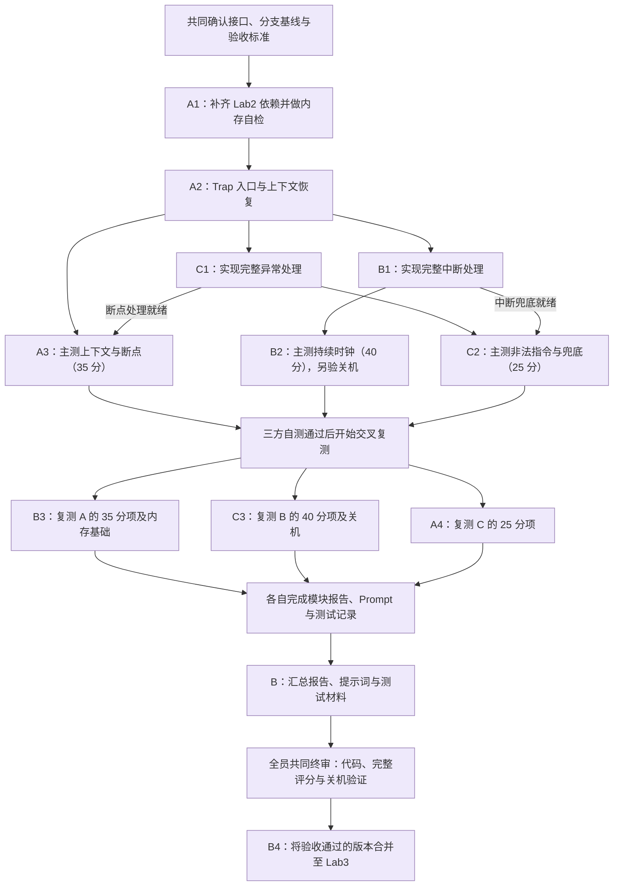
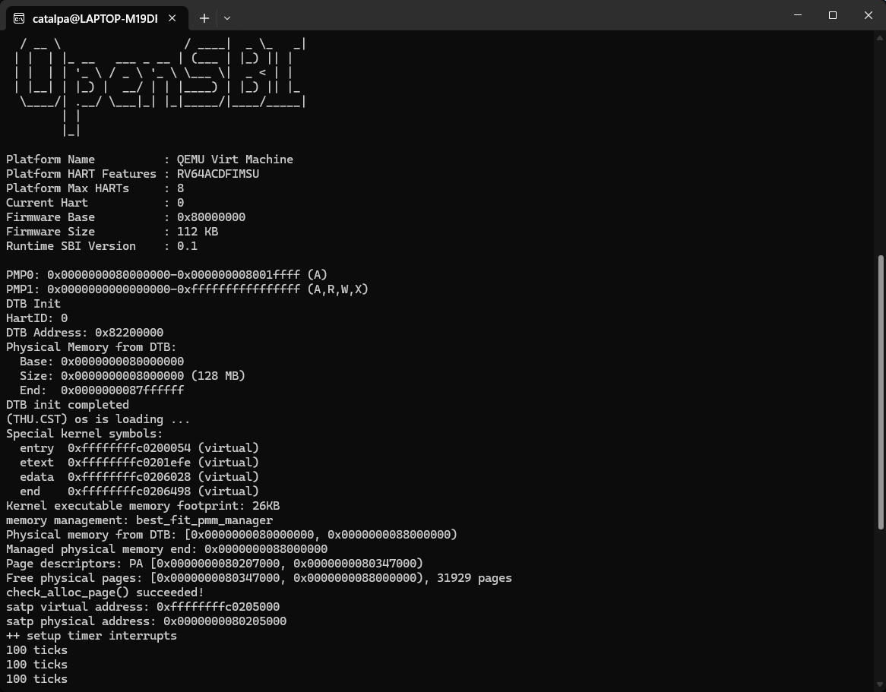
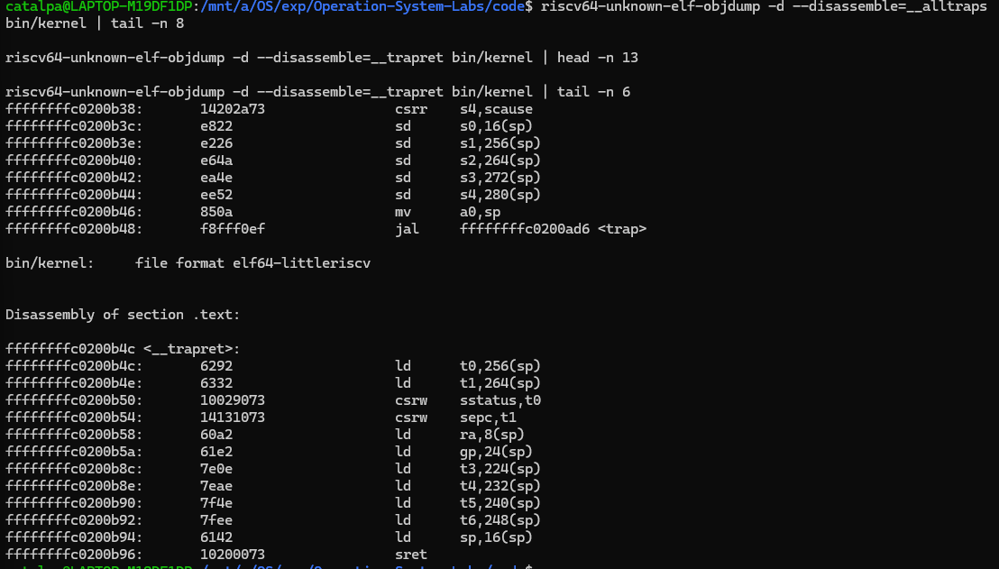
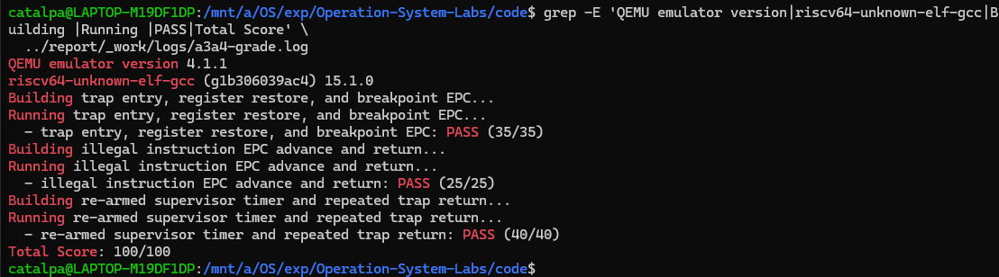

# 操作系统实验报告

## 实验基本信息

| 项目 | 内容 |
| --- | --- |
| **实验名称** | Lab3：断，都可以断——中断与异常处理 |
| **小组成员** | 2412712-王子楸、2412700-甘文杰、2413318-向宇航 |
| **完成日期** | 2026-11-04 |


### 小组分工

**实验实现与测试分工：**

| 成员 | 负责的练习或模块 | 主测任务 | 交叉复测任务 |
| --- | --- | --- | --- |
| A：2412712-王子楸 | A1：回填 Lab2 的物理内存初始化和 Best-Fit；A2：实现 Trap 入口与上下文恢复 | 内存基础自检；A3：上下文、寄存器恢复与断点返回，35 分 | A4：独立复测 C 的非法指令与兜底，25 分 |
| B：2412700-甘文杰 | B1：实现完整中断处理，包括时钟、软件中断和未知中断处理 | B2：持续时钟中断，40 分；额外验证统计输出和关机 | B3：复测 A 的上下文与断点，35 分，以及内存基础 |
| C：2413318-向宇航 | C1：实现完整异常处理，包括断点、非法指令和未知异常处理 | C2：非法指令与兜底，25 分 | C3：复测 B 的持续时钟，40 分，以及关机 |

**实验报告分工：**

| 成员 | 报告职责 |
| --- | --- |
| 王子楸 | 撰写小组分工、实验目的、整体逻辑分析，以及本人 A1、A2、A3+A4 的功能说明、实现过程、测试记录和总结 |
| 甘文杰 | 撰写中断处理、40 分主测与交叉复测材料；汇总三人的报告、提示词和截图，统一格式与图片引用 |
| 向宇航 | 撰写异常处理、25 分主测与交叉复测材料，说明异常指令长度判断、EPC 更新和兜底行为 |
| 全体成员 | 共同核对代码、测试结果和报告；共同终审通过后，由甘文杰执行分支合并 |

---

## 一、实验目的

1. 理解 RISC-V 中断和异常的区别，掌握内核从接收 Trap 到恢复原执行流的完整过程，明确硬件自动保存的信息与软件需要保存的上下文。
2. 根据已有的 `SAVE_ALL` 和 `struct trapframe`，完成 Trap 入口、C 函数参数传递和上下文恢复，理解通用寄存器、栈指针以及 `sstatus`、`sepc` 在返回过程中的作用。
3. 完成时钟中断、断点异常和非法指令异常的处理，理解时钟事件重新设置、计数统计和异常返回地址更新之间的关系。
4. 将 Lab2 的内存管理实现适配到 Lab3，在保留现有中断保护和固定自检的基础上，保证内存初始化、分配与释放正常工作。
5. 通过 QEMU 运行、关键指令检查和已有评分用例，验证“保存现场—处理 Trap—恢复现场—继续执行”这一链路；通过交叉复测检查模块之间的配合。

---

## 二、实验环境

你们使用的 AI 工具

| 成员 | AI 编程工具 | 底层模型 | 备注 |
| --- | --- | --- | --- |
| 2412712-王子楸 | Codex | GPT-6.1 sol high | 无 |
| 2412700-甘文杰 | 由本人补充 | 由本人补充 | 合并个人报告时补齐 |
| 2413318-向宇航 | 由本人补充 | 由本人补充 | 合并个人报告时补齐 |

**说明：**
- **AI 编程工具**：指具体使用的终端工具、编辑器插件、桌面应用或浏览器界面
- **底层模型**：指该工具使用的大语言模型及版本

---

## 三、实验整体逻辑分析

### 3.1 本章节的逻辑主线

本实验围绕内核如何响应中断和异常展开。发生 Trap 时，处理器会记录返回地址、原因等控制状态，并跳转到 `stvec` 指定的入口。通用寄存器仍需要由软件保存，否则进入 C 语言处理函数后，原程序正在使用的寄存器值可能被覆盖。

因此，整个实验需要连通以下执行过程：

`发生 Trap → __alltraps → SAVE_ALL → trap(tf) → 中断或异常处理 → RESTORE_ALL → sret → 继续执行`

其中，Trap frame 是汇编入口和 C 语言处理函数之间的共同接口。汇编按照固定偏移保存现场，C 层通过结构体读取原因、修改需要更新的返回状态，汇编再按照同一布局恢复。上下文布局、函数调用约定和处理器返回机制需要相互对应。

内存管理是本实验的基础依赖。回填 Lab2 实现后，需要先确认物理页描述符、空闲页链表和分配器能够正常工作，再进行 Trap 链路的联调。中断开启以后，内存分配和释放还需要保留框架已有的中断保护，避免同一执行核上的中断处理打断空闲链表更新。

### 3.2 功能的逐步实现与协作流程

我们按照“共同基础、分项实现、主测与交叉复测、材料汇总和共同终审”的顺序组织实验。下面沿用小组分工流程图，展示任务之间的依赖关系。图中 A 为王子楸，B 为甘文杰，C 为向宇航；连线表示后续任务需要具备的实现或验收条件。



**先建立共同基础。** A1 将 Lab2 的 `page_init()` 和 Best-Fit 适配到 Lab3，通过内存自检排除启动与内存布局问题；A2 再补全 `__alltraps` 和 `RESTORE_ALL`，把保存现场、调用 C 层和恢复执行连接起来。这两项是三组评分测试共同需要的基础。

**在统一入口上分别实现中断与异常处理。** B1 负责中断分类、时钟事件重新设置、计数统计和关机，C1 负责断点、非法指令和异常兜底。时钟中断通常保留保存的 EPC，处理后继续原执行流；本实验的断点和非法指令处理则按指令长度更新 `tf->epc`，再由 A2 将更新后的地址写回 `sepc` 并返回。

**按依赖开展主测。** A3 的 35 分项需要 A2 和 C1 的断点处理配合；B2 的 40 分项需要 A2 和 B1；C2 的 25 分项同时使用异常处理和中断兜底，因此依赖 A、B、C 的实现。35 分和 40 分可以在各自依赖就绪后分别进行，25 分项待相关实现齐备后运行。图中的三条主测分支表示职责和依赖，实际可通过完整评分入口依次执行三组用例。

**通过交叉复测后汇总与终审。** B 复测 A 的上下文与内存基础，C 复测 B 的时钟和关机，A 复测 C 的异常与兜底。各人记录所用版本、命令和真实结果，再由 B 汇总报告、`prompt.md` 和测试材料。全员共同确认完整评分、关机验证、交叉复测记录及报告一致性后，由 B 完成分支合并。

---

## 四、实验内容与实现

本节记录王子楸负责的 A1、A2 实现。验证步骤、截图及 A3+A4 测试统一放在第五部分；中断处理和异常处理的具体实现过程由甘文杰、向宇航分别补充。

### 4.1 基础依赖：Lab2 内存管理回填（A1）

**负责人：** 2412712-王子楸

#### 模块功能描述

**需要实现或修改的函数及管理器：**

```c
/* code/kern/mm/pmm.c */
static void page_init(void);
static void init_pmm_manager(void);

/* code/kern/mm/best_fit_pmm.c */
static void best_fit_insert_free_block(struct Page *base);
static void best_fit_init(void);
static void best_fit_init_memmap(struct Page *base, size_t n);
static struct Page *best_fit_alloc_pages(size_t n);
static void best_fit_free_pages(struct Page *base, size_t n);
static size_t best_fit_nr_free_pages(void);

const struct pmm_manager best_fit_pmm_manager;
```

A1 将 Lab2 已完成的物理内存初始化和 Best-Fit 迁入 Lab3，并接入现有 PMM 接口。保留原实现的贡献标记，迁移与适配部分注明 `lab3 A1 - 2412712`。

**物理内存初始化：**

`page_init()` 通过已有 DTB 接口取得物理内存起点和长度，设置虚实地址偏移，再根据当前框架的地址上界确定实际管理范围。Lab2 中的部分物理地址宏在 Lab3 中已经不存在，因此在 `pmm.c` 内根据现有宏推导：

```c
va_pa_offset = PHYSICAL_MEMORY_OFFSET;
uintptr_t kernel_begin_pa = KERNBASE - va_pa_offset;
uintptr_t physical_limit = KERNTOP - va_pa_offset;
```

随后将内核末端向上按页对齐，放置 `struct Page` 数组；初始化描述符，先将所描述页面标记为保留，再将数组之后的完整空闲页交给 `init_memmap()`。固件、内核和页描述符数组本身占用的页面继续保持保留。

这里需要区分“页描述符的存储地址”和“页描述符表示的物理页”。描述符数组只占用一段物理内存，但其中每个元素记录一个物理页的状态；这段数组本身占用的页也必须从可分配范围中排除。

**Best-Fit 分配与释放：**

空闲块使用按地址排列的双向链表管理。分配时遍历所有空闲块，选择能够满足请求的最小块；同样大小的候选块保留先遇到的低地址块。若选中块大于请求页数，则将剩余部分作为新的空闲块留在链表中。

释放时先恢复页面状态，将归还区间按地址插入，再检查前后相邻块是否在物理地址上连续；连续时合并并更新块首页的 `property`。按地址组织链表便于判断相邻关系，选择最小可用块则需要遍历比较块大小。

`init_pmm_manager()` 选择 `best_fit_pmm_manager`，将上述实现接入公共接口。框架原有的 `basic_check()`、`best_fit_check()` 以及 `alloc_pages()`、`free_pages()`、`nr_free_pages()` 的中断保护保持不变。

#### 最终提示词

本模块的提示词及执行过程见 `prompt.md` 中 A1 对应部分。

#### 实现迭代过程

**依赖迁移与框架适配：**

先核对 Lab2 实现和 Lab3 的地址布局、接口及固定测试，只回填本次所需的内存初始化和 Best-Fit。对旧版宏的引用改为使用当前映射关系推导，完成管理范围、对齐和描述符占用的适配。

**构建中遇到的问题：**

首次直接构建时，当前汇编器不识别原框架中的 `sbadaddr`。该问题来自工具链与旧 CSR 名称的兼容性。

**解决策略：**

在构建命令中增加 `DEFS=-Dsbadaddr=stval`，通过命令行完成 CSR 名称兼容，保留原框架源码和构建规则。构建与运行结果见第五部分。


### 4.2 功能模块一：Trap 上下文恢复与入口（A2）

**负责人：** 2412712-王子楸

#### 模块功能描述

**需要补全的汇编接口：**

```asm
RESTORE_ALL
__alltraps
```

**已有 C 语言接口：**

```c
void trap(struct trapframe *tf);
```

本模块位于 `code/kern/trap/trapentry.S`。已有的 `SAVE_ALL` 负责保存上下文，本次补全入口到 C 层的调用关系，以及 C 层返回后的恢复过程。

**1. Trap frame 布局**

目标为 RISC-V64，`REGBYTES` 为 8。Trap frame 共 36 个槽，大小为：

\[
36 \times 8 = 288\ \mathrm{B}
\]

| 保存内容 | 槽位 | 字节偏移 |
| --- | --- | --- |
| `x0` 至 `x31` | 0 至 31 | 0 至 248 |
| 原始 `sp`，即 `x2` | 2 | 16 |
| `sstatus` | 32 | 256 |
| `sepc` | 33 | 264 |
| `badvaddr` | 34 | 272 |
| `scause` | 35 | 280 |

表中的 `sp` 行特别列出第 2 槽的含义。已有 `SAVE_ALL` 先将 Trap 前的 `sp` 暂存到 `sscratch`，再从当前栈分配 288 字节，最后把原始 `sp` 放入第 2 槽。保存完成后的当前 `sp` 指向帧基址，帧中的第 2 槽保存进入 Trap 前的栈指针。

288 字节是 16 的整数倍，因此在入口栈原本对齐的条件下，分配该帧后仍满足调用 C 函数所需的栈对齐要求。

**2. 入口传参**

RISC-V 调用约定使用 `a0` 传递首个参数，因此入口在保存现场后执行：

```asm
__alltraps:
    SAVE_ALL
    mv a0, sp
    call trap

__trapret:
    RESTORE_ALL
    sret
```

`a0` 指向栈上的实际 Trap frame，C 层即可通过 `struct trapframe *tf` 读取保存的状态。调用 C 函数会改变 `ra`、参数寄存器或临时寄存器，它们的原值已经保存在帧中，后续统一从帧恢复。

**3. 返回状态与通用寄存器恢复**

`RESTORE_ALL` 先从第 32、33 槽取出返回状态和返回地址：

```asm
LOAD t0, 32*REGBYTES(sp)
LOAD t1, 33*REGBYTES(sp)
csrw sstatus, t0
csrw sepc, t1
```

随后恢复除 `sp` 外的可写通用寄存器，用于暂存 CSR 的 `t0`、`t1` 也在其中恢复。C 层如果更新了 `tf->epc`，这里会使用更新后的值写回 `sepc`，使返回位置与异常处理结果一致。

**4. 最后恢复原始栈指针**

所有从帧中加载数据的操作都依赖当前 `sp`。因此必须在其他帧访问结束后，才执行：

```asm
LOAD x2, 2*REGBYTES(sp)
```

此时直接取回原始 `sp`，无需再增加 288 字节。若提前恢复 `sp`，后续加载就会以旧栈位置作为基址，读取错误数据。最后由 `sret` 按 `sepc` 和保存的状态完成返回。

`badvaddr`、`cause` 供诊断和分派使用，恢复过程不需要将它们写回对应 CSR。本次实现保持已有 `SAVE_ALL`、结构体定义和 `trap()` 接口不变。

#### 最终提示词

本模块的提示词及执行过程见 `prompt.md` 中 A2 对应部分。

#### 实现迭代过程

A2 根据现有帧布局，在两个待填位置补全入口传参与恢复逻辑，一次完成实现，未发生源码修复迭代。实现时 C 的异常函数仍为占位，动态返回检查安排在真实异常处理集成之后。阶段性构建、关键指令检查与后续动态验证见第五部分。

---

## 五、测试与验证

以下验证均使用已有内核和测试入口。A1、A2 的阶段性检查与集成后的 A3+A4 分别记录，各节集中说明操作步骤、判断依据和实际结果。

### 5.1 A1：物理内存初始化与 Best-Fit 验证

**验证步骤与判断依据：**

1. 使用兼容参数进行干净构建，并在 QEMU 4.1.1 中启动正式内核。
2. 核对管理器名称、DTB 内存范围、描述符数组和空闲区间，独立计算空闲页数并与输出比较。
3. 检查固定自检是否完成。`pmm_init()` 经 `check_alloc_page()` 调用 `best_fit_check()`，其中也会执行 `basic_check()`；全部断言通过后才输出 `check_alloc_page() succeeded!`。

报告截图对应的运行命令为：

```bash
cd /mnt/a/OS/exp/Operation-System-Labs/code
make clean
set -o pipefail
make qemu DEFS=-Dsbadaddr=stval \
  QEMU=/home/catalpa/.local/opt/qemu-4.1.1/bin/qemu-system-riscv64 \
  2>&1 | tee ../report/_work/logs/a1-qemu-report.log
```

固定自检覆盖单页分配与归还、空闲页耗尽、连续页申请及回收后的计数和链表恢复。其中，Best-Fit 的关键检查是在同时存在 2 页块和 1 页块时申请 1 页，要求选中 1 页块，并使随后的 2 页申请仍能成功。这直接检查了分配器是否优先选择最小可用块。

**实际结果：**

如图所示输出 `memory management: best_fit_pmm_manager` 和 `check_alloc_page() succeeded!`，说明所选管理器正确，固定自检完成。



**图 1：** 正式内核完成 Best-Fit 内存初始化和固定自检，并继续执行时钟初始化。

截图中内核末端物理地址为 `0x80206498`，向上对齐至 `0x80207000`。实际内存布局为：

| 类别 | 物理地址区间 | 页数 |
| --- | --- | --- |
| 固件预留 | `[0x80000000, 0x80200000)` | 512 |
| 内核及对齐占用 | `[0x80200000, 0x80207000)` | 7 |
| 页描述符数组 | `[0x80207000, 0x80347000)` | 320 |
| 可分配空闲页 | `[0x80347000, 0x88000000)` | 31,929 |

页大小为 4 KiB，128 MiB 内存共包含：

\[
128 \times 1024 \div 4 = 32768\ \text{页}
\]

每个 `struct Page` 占 40 字节，描述符数组占用：

\[
32768 \times 40 = 1310720\ \mathrm{B} = 320\ \text{页}
\]

因此，可分配页数为：

\[
32768 - 512 - 7 - 320 = 31929\ \text{页}
\]

独立计算与启动输出一致，保留区与空闲区的划分符合预期。运行日志见 [a1-qemu-report.log](../logs/a1-qemu-report.log)。

A1 阶段还曾在 `pmm_init()` 返回后、开启时钟前，通过 GDB 核对当时镜像的描述符和空闲链表：共 32,768 个描述符，839 页保留、31,929 页空闲，计数与链表关系一致。

### 5.2 A2：Trap 入口与上下文恢复验证

**验证步骤与判断依据：**

先完成干净构建，再检查入口与返回部分的反汇编。可按以下命令复现：

```bash
cd /mnt/a/OS/exp/Operation-System-Labs/code
make clean
make DEFS=-Dsbadaddr=stval
riscv64-unknown-elf-objdump -d --disassemble=__alltraps bin/kernel
riscv64-unknown-elf-objdump -d --disassemble=__trapret bin/kernel
```

**实际结果：**

A2 实现阶段的完整编译、链接和镜像生成通过。关键指令检查如下：

| 检查项 | 判断依据与实际结果 |
| --- | --- |
| 入口传参 | 保存现场后执行 `mv a0,sp`，再调用 `trap`，帧地址通过首个参数传入 C 层 |
| 返回状态 | 从偏移 256、264 读取状态和 EPC，写回 `sstatus`、`sepc`，与帧布局一致 |
| 栈指针恢复 | 在其他帧访问完成后执行 `ld sp,16(sp)`，恢复第 2 槽保存的原始栈指针 |
| Trap 返回 | 恢复完成后执行 `sret` |



**图 2：** Trap 入口与上下文恢复的关键反汇编，展示参数传递、CSR 写回以及最后恢复 `sp` 的顺序。

A2 阶段 C 的异常函数尚为占位，当时完成的是构建与指令检查。真实异常处理集成后，通过下一节 A3 的 35 分用例检查实际断点返回与寄存器恢复。

### 5.3 A3+A4：上下文主测与异常复测


**验证方法与判断依据：**

A3 使用 `test_lab3_register_context()` 写入一组已知寄存器值，执行 `ebreak`。执行流经 A2 入口进入 C 层，完成断点处理和 EPC 更新，再经恢复流程与 `sret` 返回，继续比较寄存器值。评分要求出现 `Breakpoint at` 和上下文测试 PASS。

现有用例显式比较 `t0` 至 `t6`、`s0` 至 `s11`、`a1` 至 `a7`，共 26 个寄存器。`sp`、`ra` 参与真实调用和返回链路，用例未单独逐值比较它们。

A4 在相同版本上重新运行已有评分，独立复测 C 的 25 分项，检查内容为：

| 检查内容 | 现有用例与通过条件 |
| --- | --- |
| 非法指令异常返回 | 执行 4 字节非法编码 `0x0000007b`，出现 `Illegal instruction at`，并在返回后输出非法指令测试 PASS |
| 软件中断提示 | 构造 Trap frame 并调用中断处理函数，出现 `Supervisor software interrupt` |
| 未知中断兜底 | 构造 cause 15 并调用中断处理函数，出现 `Unknown interrupt: cause 15` |
| 未知异常兜底 | 构造 cause 20 并调用异常处理函数，Trap frame 输出包含 `cause    0x00000014` |

非法指令部分实际触发 Trap 并返回；其余兜底检查通过构造帧调用处理函数完成，验证范围为规定的分支输出。

**执行步骤与实际结果：**

评分脚本直接调用 `qemu-system-riscv64`，先通过当前会话的 `PATH` 选中 4.1.1，再运行完整评分：

```bash
cd /mnt/a/OS/exp/Operation-System-Labs/code
export PATH="/home/catalpa/.local/opt/qemu-4.1.1/bin:$PATH"
qemu-system-riscv64 --version
make grade CC='riscv64-unknown-elf-gcc -Dsbadaddr=stval'
```

CSR 兼容定义通过 `CC` 传入，保留评分脚本为各用例设置的宏。`make grade` 在临时副本中注入现有测试，分别完成三组干净构建和运行，评分成功后自动清理副本。

| 轮次 | 目的 | 实际结果 | 日志保存情况 |
| --- | --- | --- | --- |
| 第一轮 | A3：上下文与断点主测 | 35/35、25/25、40/40，总分 100/100，退出码 0 | 保留完整日志，当前文件名为 `a3a4-grade.log` |
| 第二轮 | 复核 B2、C2，其中 C2 计入 A4 独立复测 | 35/35、25/25、40/40，总分 100/100，退出码 0 | 未另存日志，按实际执行记录说明 |



**图 3：** 已有完整评分日志摘录，包含版本信息、三项 PASS 和总分。完整保存日志见 [a3a4-grade.log](../logs/a3a4-grade.log)；该图展示保存日志的结果，第二轮复测情况按上表单独记录。A3 的 35 分主测和 A4 的 25 分独立复测均已完成，提示词及执行过程见 `prompt.md` 中 A3+A4 对应部分。

---

## 六、实验总结与收获

### 6.1 对操作系统的理解

**实验知识点与 OS 原理的对应关系：**

| 实验知识点 | 对应的 OS 原理 | 本次实验中的理解 |
| --- | --- | --- |
| 物理页描述符与 Best-Fit | 物理内存管理与连续分配 | 描述符数组本身也占用内存，需要从空闲区排除；最小可用块选择和连续块合并决定分配、回收行为 |
| Trap 入口与恢复 | 现场保护与函数调用约定 | 汇编偏移必须与 C 结构体一致，通过 `a0` 传递帧地址，最后恢复原始 `sp`，才能正确衔接处理与返回 |
| EPC 更新与 `sret` | 异常返回与特权状态恢复 | C 层更新 `tf->epc` 后，恢复流程将其写回 `sepc`；处理结果需要落实到返回状态中，执行流才能越过异常指令 |
| 内存接口的中断保护 | 临界区与互斥 | 回填 Lab2 时保留 Lab3 的中断保护，防止本地中断打断链表更新，并在结束后恢复原中断状态 |

一个收获是区分编译结果与运行结果。A2 编译和反汇编检查能够确认关键指令及布局，但只有在断点实际触发、处理并返回后，才能观察寄存器比较是否成功。A3 将这些环节串联起来，补齐了动态验证。

**OS 原理中重要、但本实验尚未实现的内容：**

1. **进程调度和进程上下文切换。** 本实验从 Trap 返回当前执行流，没有在多个进程之间选择下一运行者。
2. **用户态隔离与完整系统调用机制。** 当前用例主要在内核环境中触发 Trap，没有完成用户进程的权限检查、参数验证和系统调用分发。
3. **缺页异常恢复和虚拟内存策略。** 未知异常仅输出诊断信息，尚未根据缺页原因分配页面、建立映射或实施页面置换。
4. **多核同步与复杂中断管理。** 本地中断保护无法覆盖多个处理器之间的并发访问，本实验也未实现中断优先级、嵌套中断和多核共享状态管理。

### 6.2 AI 协作开发的经验

本次实验中，先让 AI 阅读现有源码、接口和固定测试，再根据已有代码编写实现要求。这样能够明确哪些内容已经提供、哪些位置需要补全，以及生成代码需要遵守的布局和调用关系。A2 尤其依赖这一点：只描述“恢复寄存器”还不够，还需要明确原始 `sp` 的保存位置、CSR 槽位，以及 C 层修改 EPC 后应当使用更新后的帧返回。

Lab2 代码迁移也需要先核对当前框架。算法可以沿用，但地址宏、初始化流程和中断保护需要适配。A1 出现的 `sbadaddr` 问题进一步说明，构建失败可能来自工具链兼容性，定位时需要结合具体错误和已有源码判断修改范围。

测试方面，我们按照任务依赖使用已有入口，没有额外扩展测试或反复修改已通过的实现。遇到具体问题时再针对相关环节检查，更便于追踪原因。
