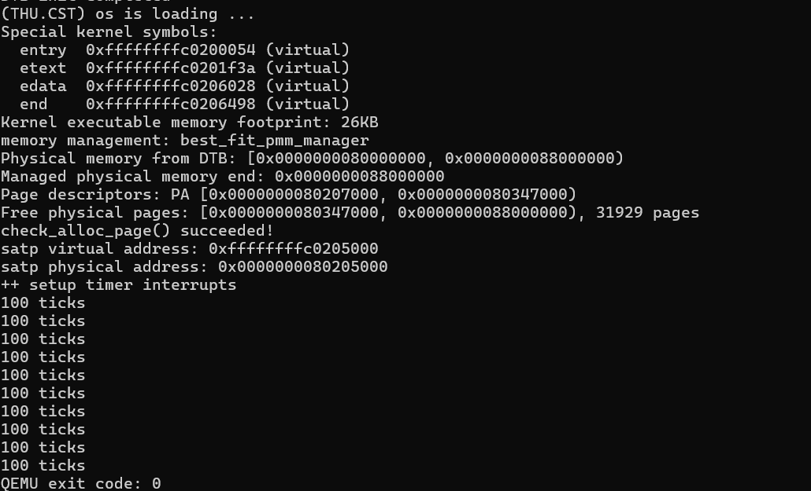
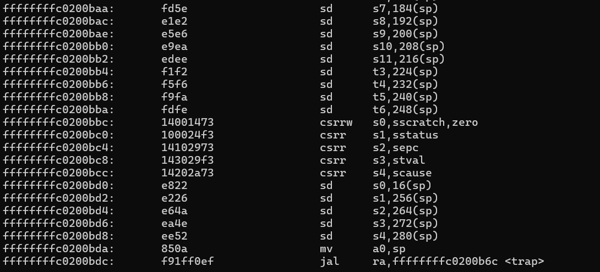
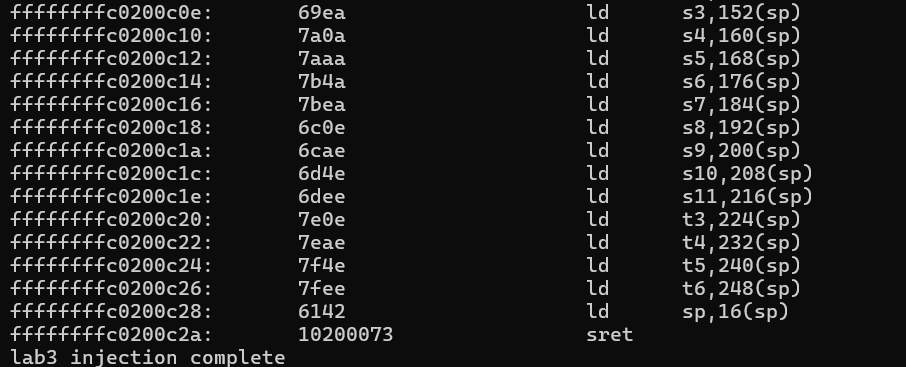
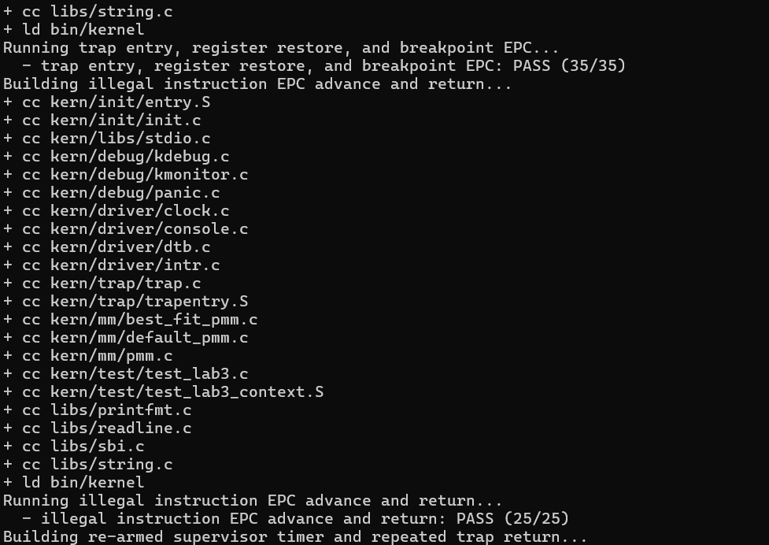
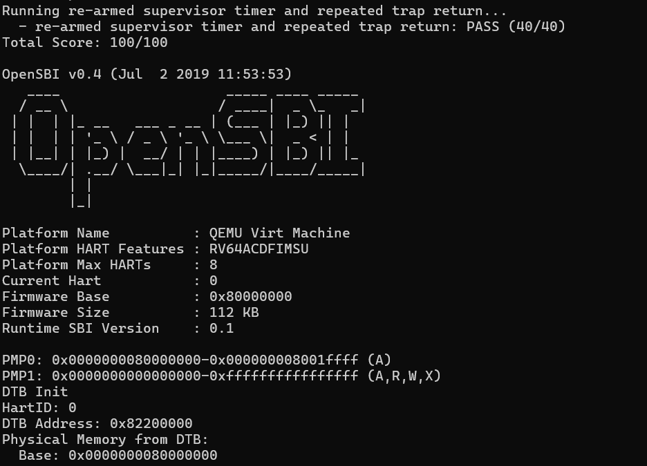

# Lab3 B3：复测 A 的内存基础与 Trap 上下文

执行日期：2026-11-04。复测人：B（学号 `2412700`）。分支：`work/lab3/wenjie`。测试代码版本：`0e15d4a`，已包含 A1/A2、A3/A4 和 B/C 实现。

本次未修改内核源码和任何 Prompt 文件。所有对话内容均未写入 `prompt.md`。

## 环境与命令结果

| 项目 | 实际值 |
| --- | --- |
| GNU Make | 4.3 |
| RISC-V GCC | SiFive GCC-Metal 10.2.0 |
| QEMU | 4.1.1 |
| CSR 兼容参数 | `DEFS=-Dsbadaddr=stval` |

| 检查 | 命令 | 退出码与结果 |
| --- | --- | --- |
| 清理 | `make clean`（`code/`） | 0，删除旧的 `obj/`、`bin/`。 |
| 干净构建 | `make V= DEFS=-Dsbadaddr=stval`（`code/`） | 0，编译、链接并生成 `bin/ucore.img`。 |
| 入口反汇编 | `riscv64-unknown-elf-objdump -d --disassemble=__alltraps bin/kernel` | 0，见 `b3-alltraps-objdump.log`。 |
| 恢复反汇编 | `riscv64-unknown-elf-objdump -d --disassemble=__trapret bin/kernel` | 0，见 `b3-trapret-objdump.log`。 |
| 完整评分 | `make grade DEFS=-Dsbadaddr=stval`（`code/`） | 0，总分 **100/100**，A 的 35 分项 **35/35**。 |
| 正常启动与内存自检 | `timeout 20s make qemu DEFS=-Dsbadaddr=stval`（`code/`） | 0，早于 timeout 正常结束；启动日志见 `b3-qemu.log`。 |

原始构建、反汇编、评分和启动输出保存在 `report/_work/logs/`。

## 内存基础复测

正式 `make qemu` 的串口输出确认：

```text
memory management: best_fit_pmm_manager
Physical memory from DTB: [0x0000000080000000, 0x0000000088000000)
Managed physical memory end: 0x0000000088000000
Page descriptors: PA [0x0000000080207000, 0x0000000080347000)
Free physical pages: [0x0000000080347000, 0x0000000088000000), 31929 pages
check_alloc_page() succeeded!
```

Best-Fit 管理器已选中，DTB 报告的 128 MiB 内存范围有效，页描述符与空闲页范围衔接，固定分配/释放自检成功。启动后时钟输出 10 次 `100 ticks`，随后 QEMU 以退出码 0 结束；当前 B 的 1000 tick SBI 关机逻辑正常完成。



**图 1：** 启动日志显示 `check_alloc_page() succeeded!`，随后输出时钟统计并正常结束。

## Trap frame、参数和恢复顺序

源码和实际反汇编相互吻合：

| 内容 | 复测结果 |
| --- | --- |
| 帧布局 | RV64 每槽 8 字节。`struct pushregs` 为 32 槽，`status`、`epc`、`badvaddr`、`cause` 位于偏移 256、264、272、280；总帧大小为 36 × 8 = **288 字节**。 |
| 栈对齐 | 288 是 16 的倍数；入口从原栈指针减 288 后仍保持 16 字节对齐。 |
| 原始 `sp` 保存 | `SAVE_ALL` 先将入口 `sp` 写入 `sscratch`，再把其值保存到帧槽 2（偏移 16）。 |
| C 参数传递 | 反汇编实际显示 `mv a0,sp` 后调用 `trap`，因此 `a0` 收到当前帧基址。 |
| 返回状态 | `__trapret` 从偏移 256、264 读取 `status` 和 `epc`，写回 `sstatus`、`sepc`。 |
| 通用寄存器与栈恢复 | 反汇编显示其他可恢复寄存器从对应槽加载，最后执行 `ld sp,16(sp)`，随后 `sret`。 |



**图 2：** 入口反汇编显示保存上下文后以 `mv a0,sp` 传递 Trap frame，再调用 `trap`。



**图 3：** 返回反汇编显示恢复寄存器和原始 `sp`，最后执行 `sret`。

评分中的 A3 上下文用例通过 `ebreak` 验证异常返回，并逐项比较 `t0–t6`、`s0–s11`、`a1–a7` 共 26 个寄存器，之后继续运行并通过 35 分项。用例没有单独逐值比较 `sp` 或 `ra`；这两者的保存/恢复依据本次反汇编确认，动态评分则验证了断点后的返回和后续执行。

完整评分日志显示：

```text
trap entry, register restore, and breakpoint EPC: PASS (35/35)
illegal instruction EPC advance and return: PASS (25/25)
re-armed supervisor timer and repeated trap return: PASS (40/40)
Total Score: 100/100
```



**图 4：** 完整评分中的 Trap 入口、寄存器恢复和断点 EPC 项通过，得分 35/35。



**图 5：** 集成版本完整评分结果为 100/100。

## 结论

B3 复测通过：内存初始化和固定自检成功；A3 的 35 分 Trap 上下文项通过；帧布局、`a0` 参数传递、原始 `sp` 槽位和恢复顺序均在反汇编中确认。完整集成评分为 100/100。QEMU 结束后未发现残留 QEMU 进程；本次未启动 GDB。
