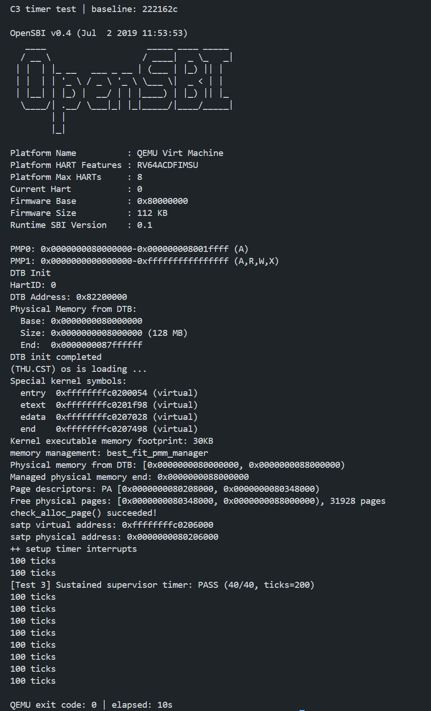
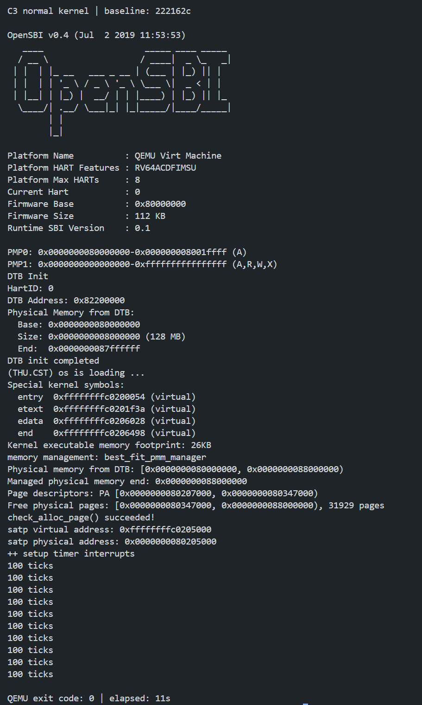

# Lab3 C3：独立复测 B 的持续时钟与关机

执行日期：2026-11-05。复测人：向宇航（2413318）。工作分支：`work/lab3/yuhang/c3`。

**结论：C3 复测通过。** 从固定基线分别导出、干净构建计时测试与正式内核，两次运行均恰好输出 10 行 `100 ticks`，并在 20 秒超时前以退出码 0 结束。独立计时用例出现一次 `PASS (40/40, ticks=200)`。

## 版本、范围与环境

测试基线为 `222162ce44b2cd84a9fa854a192a006c618ee7c1`，测试前确认本地与远端 `lab3` 一致，已包含 A、B、C 的实现及后续交付。两个副本均通过 `git archive` 从此提交导出，没有复用已有构建产物或队友日志。

| 项目 | 本次实际值 |
| --- | --- |
| GNU Make | 4.3 |
| RISC-V GCC | SiFive GCC-Metal 10.2.0 |
| QEMU | 4.1.1，`virt`，默认 OpenSBI |
| Python | 3.12.3 |
| 构建兼容参数 | `-Dsbadaddr=stval` |
| 本次临时目录 | `/tmp/lab3-c3-vch_ft6r`，下分 `timer/code` 与 `normal/code` |

C3 聚焦 B 的持续时钟与正常关机。本次没有重新执行全套 35/25/40 分评分，不将此前 100/100 记录当作本次结果。正式代码、原始测试用例和评分条件均未修改。

## 源码核对

依据固定基线中的 `code/kern/trap/trap.c`、`code/kern/driver/clock.c`、`code/libs/sbi.c` 与初始化流程确认：

- `clock_init()` 使能 S 模式时钟中断、预约第一次事件并将 `ticks` 清零；初始化完成后 `intr_enable()` 开启全局中断。
- `IRQ_S_TIMER` 分支首先调用 `clock_set_next_event()`，以当前 `rdtime` 加 `timebase=100000` 经 SBI 设置下一次事件，随后仅执行一次 `ticks++`。
- 计数为 `TICK_NUM=100` 的整数倍时调用 `print_ticks()`，输出 `100 ticks`。本次未定义会提前 panic 的 `DEBUG_GRADE`。
- `TICK_SHUTDOWN_NUM` 为 `100 * 10`；计数等于 1000 时，在本次统计输出之后调用 `sbi_shutdown()`，其内部调用 SBI 关机服务。

以下边界是**源码逻辑核对**，没有增加动态边界插桩：

| 本次 handler 递增后的 ticks | 统计输出 | 关机 |
| --- | --- | --- |
| 99 | 无 | 否 |
| 100 | 第 1 行 `100 ticks` | 否 |
| 199 | 无 | 否 |
| 200 | 第 2 行 `100 ticks` | 否 |
| 999 | 无 | 否 |
| 1000 | 第 10 行 `100 ticks` | 是，输出后调用 SBI |

## 独立运行结果

下表记录原自动复测日志中的结果；后续手动复现的真实终端截图见下方，两轮耗时分别保留。

| 项目 | 40 分计时副本 | 未注入的正式内核副本 |
| --- | --- | --- |
| 注入 | 使用原始 `tools/inject.py`，退出码 0 | 未注入 |
| 干净构建 | `make clean` 与构建退出码均为 0 | `make clean` 与构建退出码均为 0 |
| 额外编译宏 | `GRADE_LAB3_TIMER` | 无 |
| 内存自检 | `check_alloc_page() succeeded!` | `check_alloc_page() succeeded!` |
| 时钟初始化 | `++ setup timer interrupts` | `++ setup timer interrupts` |
| 40 分通过标记 | 1 次，`ticks=200` | 无，符合未注入预期 |
| 精确匹配 `100 ticks` 的行数 | 10 | 10 |
| FAIL / panic | 未发现 | 未发现 |
| QEMU 退出码 | 0 | 0 |
| QEMU 运行耗时 | 10.342 秒 | 10.329 秒 |
| 20 秒超时 | 未发生 | 未发生 |

原始 40 分用例在 `ticks` 达到 200 后打印通过标记，随后继续空转，因此本轮让 QEMU 继续运行直至其自行结束。正式内核副本验证正常初始化路径下同样能结束。

评分脚本原本通过 `timeout ... || true` 忽略 QEMU 返回码，且仅匹配评分文本。本次复现脚本独立记录 `timeout`/QEMU 的退出状态，必须为 0 且早于 20 秒；超时退出码 124 不会被当作通过。

串口没有逐次输出 ticks，也没有单独的“调用关机”文本。因此本次实际观察是：200 次通过标记、10 次统计输出及进程正常退出；结合固定基线的源码，支持 1000 次中断触发 SBI 关机的结论，不声称直接观测全部计数值或在关机函数设置过断点。

### 终端运行截图

以下为同一基线 `222162c` 的手动复现终端截图。截图中的耗时由终端按整秒显示：计时用例为 10 秒，正式内核为 11 秒；上表的 10.342 秒和 10.329 秒来自原自动复测日志，属于另一次运行。



**图 1：** 计时用例显示内存自检成功、一次 `PASS (40/40, ticks=200)` 和 10 行 `100 ticks`，结束时显示 `QEMU exit code: 0 | elapsed: 10s`。



**图 2：** 未注入的正式内核显示内存自检成功、时钟初始化和 10 行 `100 ticks`，结束时显示 `QEMU exit code: 0 | elapsed: 11s`。

## 证据与复现

- [完整命令、环境、耗时、退出状态及验收结果](./_work/logs/c3-status.json)
- [计时项构建日志](./_work/logs/c3-timer-build.log)、[计时项串口日志](./_work/logs/c3-timer-qemu.log)
- [正式内核构建日志](./_work/logs/c3-normal-build.log)、[正式内核串口日志](./_work/logs/c3-normal-qemu.log)
- [复现脚本](./_work/scripts/c3_retest.py)

注入、清理及 QEMU 标准错误日志也保存于同一日志目录，以 `c3-` 开头；标准错误日志为空表示本次没有相应输出。串口日志只将 CRLF 换行归一化为 LF。

从仓库根目录执行：

```bash
python3 report/_work/scripts/c3_retest.py
```

脚本固定默认基线为上述完整提交，每次生成新的 `/tmp/lab3-c3-*` 目录。它依次执行原始测试注入（仅计时副本）、`make clean`、`make V= 'DEFS=-Dsbadaddr=stval -DGRADE_LAB3_TIMER'`（正式副本不带测试宏）和以下 QEMU 命令：

```bash
timeout 20s qemu-system-riscv64 \
  -machine virt -nographic -bios default \
  -device loader,file=bin/ucore.img,addr=0x80200000 \
  -serial file:<对应的串口日志绝对路径> -monitor none -no-reboot
```

QEMU 命令在各自副本的 `code` 目录执行，实际参数已完整保存在状态 JSON。重跑默认会更新本轮 `c3-` 证据文件；需要保留当前证据时，可指定 `--output /tmp/c3-new-logs`。脚本只保存日志与状态，不生成图片；真实终端截图由手动复现时截取。

本次首次构建及两次运行均通过，没有发现需交回 B 修复的问题。 Prompt 已追加至 [yuhang.md](./_work/prompts/yuhang.md) 的 C3 小节。
