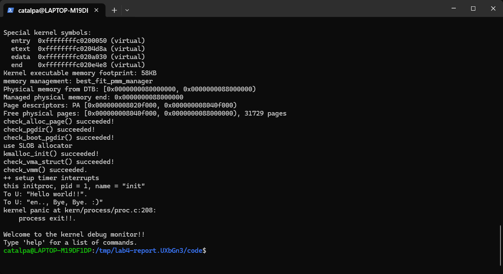
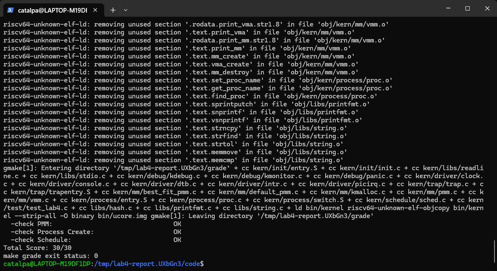

## 四、实验内容与实现

### 功能模块三：进程调度（C1）

**负责人** 2412712-王子楸

#### 模块功能与实现

`proc_init()` 初始化时将 `current` 指向 `idleproc`，并为它设置 `need_resched`。启动流程进入 `cpu_idle()` 后，空闲线程循环读取这一标志，标志置位时调用 `schedule()`，由此触发第一次调度。空闲线程后来重新获得 CPU 时，会继续检查调度请求。

`schedule()` 关闭本地中断后先清除当前线程的 `need_resched`，再遍历带表头的循环链表 `proc_list`。从 `idleproc` 发起调度时，查找从链表的第一个进程开始。普通线程发起调度时，查找从它的后继开始，绕回时跳过表头，因此当前线程最后才参与本轮选择。找到第一个 `PROC_RUNNABLE` 线程就结束查找，遍历一轮仍找不到时退回 `idleproc`。记账和实际切换的条件如下。

```c
next->runs++;
if (next != current)
{
    proc_run(next);
}
local_intr_restore(intr_flag);
```

`proc_run()` 将 `current`、页表和执行现场依次切换到目标线程。它先记录原线程，再更新 `current`。`pgdir` 保存根页表的物理地址，右移 `RISCV_PGSHIFT` 得到 Sv39 所需的物理页号，与模式位组合后写入 `satp`。写入后刷新 TLB，再切换寄存器上下文。整个过程在本地中断关闭时执行。

```c
bool intr_flag;
local_intr_save(intr_flag);
struct proc_struct *prev = current;
current = proc;

uintptr_t satp_value = ((uintptr_t)SATP_MODE_SV39 << 60) |
                       (proc->pgdir >> RISCV_PGSHIFT);
write_csr(satp, satp_value);
flush_tlb();
switch_to(&prev->context, &proc->context);
local_intr_restore(intr_flag);
```

从 `schedule()` 调用 `proc_run()` 时，内层保存操作读到的中断状态已是关闭。原线程日后切回来时，从自己的 `switch_to()` 调用之后继续执行。此时内层恢复为空操作，外层 `schedule()` 再按先前保存的状态恢复本地中断。

`switch_to()` 接收旧、目标两个 `struct context` 的地址，分别通过 `a0`、`a1` 传入。RV64 下每个字段占 8 字节，所以 `ra` 和 `sp` 的偏移分别为 0 和 8，`s0` 到 `s11` 的偏移为 16 到 104。汇编先用 `sd` 将旧寄存器写入 `from`，再用 `ld` 从 `to` 恢复同一组寄存器，最后执行 `ret`。

首次运行新线程时，`copy_thread()` 已将 `context.ra` 设为 `forkret`，所以 `ret` 从这里开始执行。`forkrets` 将 `sp` 指向新线程的 trapframe，再跳到 `__trapret`。恢复代码把帧中的 `epc` 写入 `sepc`，`sret` 由此进入 `kernel_thread_entry`。线程入口使用恢复后的 `s0` 和 `s1` 取得目标函数及参数，`initproc` 正是通过这条路径进入 `init_main()`。

#### 最终提示词

提示词按 `[PROMPT]`、`[RELY]`、`[GUARANTEE]` 和 `[SPECIFICATION]` 四段组织。先限定 `proc.c`、`sched.c` 和 `switch.S` 中的补全区域，再列出四个函数签名和可直接使用的接口，包括进程链表、本地中断宏和 `struct context` 的布局。

规格部分按函数写清调用前提和执行结果。调度部分明确遍历的起点、回绕和空闲线程回退条件，切换部分明确更新 `current`、写 `satp`、刷新 TLB 和切换上下文的顺序。完整提示词将补充到 `prompt.md`。

#### 实现迭代过程

第一轮按提示词补全三个 `LAB4 function3` 区域。随后对照 `proc.h` 核对汇编的保存与恢复偏移，并顺着 `forkret` 到 `kernel_thread_entry` 检查首次执行链路。这个过程重点核对了两个入口地址的位置，`context.ra` 对应第一次 `ret`，trapframe 的 `epc` 对应后续的 `sret`。

后续调整集中在验证环境。GCC 15 将框架中的整数到指针转换和评分线程的函数指针类型不匹配报告为错误，通过编译参数将这两项诊断降为警告。

## 五、测试与验证

### C2 编译与运行验证

#### 编译与启动

在 WSL 临时副本的 `code/` 下执行 `make qemu`。构建日志显示 `bin/kernel` 链接成功，并由 `objcopy` 生成 `bin/ucore.img`，随后启动 QEMU。

```bash
lab4_qemu=/home/catalpa/.local/opt/qemu-4.1.1/bin/qemu-system-riscv64
lab4_flags="-Wno-error=int-conversion -Wno-error=incompatible-pointer-types"
timeout 15s make qemu QEMU="$lab4_qemu" DEFS="$lab4_flags" </dev/null
```

截图中可以看到页表和虚拟内存自检通过，随后 `init_main()` 输出 `initproc` 的 PID、名称和两行 `To U:`。其中 `Hello world!!` 是创建线程时传入的参数，说明执行流已经切换到 `initproc` 并进入线程函数。三行输出结束后，框架的 `do_exit()` 占位触发 `process exit!!.`。



#### 调度验证

在相同环境中执行仓库自带的评分命令。

```bash
make grade QEMU="$lab4_qemu" DEFS="$lab4_flags" \
    GRADE_TMP="$(dirname "$PWD")/grade"
```

评分将 `test_lab4_schedule()` 注入 `init_main()` 的入口。测试创建两个内核线程，线程运行时设置各自的标志，并主动调用 `schedule()` 让出 CPU。用例断言两个标志都已置位，评分脚本还检查 `init_main()` 随后的三行输出，由此验证两个测试线程都获得过 CPU，且原执行流能在切回后继续执行。

评分结果中 `PMM`、`Process Create` 和 `Schedule` 三项均为 `OK`，调度项为 10/10，总分为 0/30，`make grade` 退出码为0。原始输出见 `report/logs/lab4_c2_grade.log`。


