# 操作系统实验报告

报告导航：[实验目的](#purpose) · [实验环境](#environment) · [整体逻辑](#workflow) · [内容与实现](#implementation) · [测试与验证](#verification) · [总结](#summary) · [完整实验过程](#process) · [提示词汇总](./prompt.md)


## 实验基本信息

| 项目 | 内容 |
| --- | --- |
| **实验名称** | Lab3：断，都可以断——中断与异常处理 |
| **小组成员** | 2412712-王子楸、2412700-甘文杰、2413318-向宇航 |
| **报告整理日期** | 2026-11-06 |
| **实际测试日期** | A1/A2、B1/B2：2026-11-03；A3/A4、B3、C1/C2：2026-11-04；C3：2026-11-05 |


### 小组分工

**实验实现与测试分工：**

| 成员 | 负责的练习或模块 | 主测任务 | 交叉复测任务 |
| --- | --- | --- | --- |
| A：2412712-王子楸 | A1：回填 Lab2 的物理内存初始化和 Best-Fit；A2：实现 Trap 入口与上下文恢复 | 内存基础自检；A3：上下文、寄存器恢复与断点返回，35 分 | A4：独立复测 C 的非法指令与兜底，25 分 |
| B：2412700-甘文杰 | B1：实现完整中断处理，包括时钟、软件中断和未知中断处理 | B2：持续时钟中断，40 分；额外验证统计输出和关机 | B3：复测 A 的上下文与断点，35 分，以及内存基础 |
| C：2413318-向宇航 | C1：实现完整异常处理，包括断点、非法指令和未知异常处理 | C2：非法指令与兜底，25 分 | C3：复测 B 的持续时钟，40 分，以及关机 |

**实验报告分工：**

| 成员 | 报告职责 |
| --- | --- |
| 王子楸 | 撰写小组分工、实验目的、整体逻辑分析，以及本人 A1、A2、A3+A4 的功能说明、实现过程、测试记录和总结 |
| 甘文杰 | 撰写中断处理、40 分主测与交叉复测材料；汇总三人的报告、提示词和截图，统一格式与图片引用 |
| 向宇航 | 撰写异常处理、25 分主测与交叉复测材料，说明异常指令长度判断、EPC 更新和兜底行为 |
| 全体成员 | 共同核对代码、测试结果和报告；共同终审通过后，由甘文杰执行分支合并 |

---

<a id="purpose"></a>

## 一、实验目的

1. 理解 RISC-V 中断和异常的区别，掌握内核从接收 Trap 到恢复原执行流的完整过程，明确硬件自动保存的信息与软件需要保存的上下文。
2. 根据已有的 `SAVE_ALL` 和 `struct trapframe`，完成 Trap 入口、C 函数参数传递和上下文恢复，理解通用寄存器、栈指针以及 `sstatus`、`sepc` 在返回过程中的作用。
3. 完成时钟中断、断点异常和非法指令异常的处理，理解时钟事件重新设置、计数统计和异常返回地址更新之间的关系。
4. 将 Lab2 的内存管理实现适配到 Lab3，在保留现有中断保护和固定自检的基础上，保证内存初始化、分配与释放正常工作。
5. 通过 QEMU 运行、关键指令检查和已有评分用例，验证“保存现场—处理 Trap—恢复现场—继续执行”这一链路；通过交叉复测检查模块之间的配合。

---

<a id="environment"></a>

## 二、实验环境

### AI 工具

各成员记录的 AI 工具如下：

| 成员 | AI 编程工具 | 底层模型 | 备注 |
| --- | --- | --- | --- |
| 2412712-王子楸 | Codex | GPT-6.1 sol high | 无 |
| 2412700-甘文杰 | Codex | GPT-6.0 luna max | 无 |
| 2413318-向宇航 | Codex | GPT-6.1 sol medium | 无 |

**说明：**
- **AI 编程工具**：指具体使用的终端工具、编辑器插件、桌面应用或浏览器界面
- **底层模型**：指该工具使用的大语言模型及版本

---


### 构建与运行环境

| 项目 | 已保存材料中的环境 |
| --- | --- |
| A 组环境 | WSL Ubuntu，RISC-V GCC 15.1.0 |
| C 组环境 | GNU Make 4.3，SiFive GCC-Metal 10.2.0；C3 使用 Python 3.12.3 |
| 模拟器 | QEMU 4.1.1，`virt`，默认 OpenSBI，镜像加载地址 `0x80200000` |
| CSR 兼容 | 通常使用 `DEFS=-Dsbadaddr=stval`；A3/A4 使用 `CC='riscv64-unknown-elf-gcc -Dsbadaddr=stval'` 保留评分用例的 `DEFS` |


---

<a id="workflow"></a>

## 三、实验整体逻辑分析

### 3.1 本章节的逻辑主线

本实验围绕内核如何响应中断和异常展开。发生 Trap 时，处理器会记录返回地址、原因等控制状态，并跳转到 `stvec` 指定的入口。通用寄存器仍需要由软件保存，否则进入 C 语言处理函数后，原程序正在使用的寄存器值可能被覆盖。

因此，整个实验需要连通以下执行过程：

`发生 Trap → __alltraps → SAVE_ALL → trap(tf) → 中断或异常处理 → RESTORE_ALL → sret → 继续执行`

其中，Trap frame 是汇编入口和 C 语言处理函数之间的共同接口。汇编按照固定偏移保存现场，C 层通过结构体读取原因、修改需要更新的返回状态，汇编再按照同一布局恢复。上下文布局、函数调用约定和处理器返回机制需要相互对应。

内存管理是本实验的基础依赖。回填 Lab2 实现后，需要先确认物理页描述符、空闲页链表和分配器能够正常工作，再进行 Trap 链路的联调。中断开启以后，内存分配和释放还需要保留框架已有的中断保护，避免同一执行核上的中断处理打断空闲链表更新。

### 3.2 功能的逐步实现与协作流程

我们按照“共同基础、分项实现、主测与交叉复测、材料汇总和共同终审”的顺序组织实验。下面沿用小组分工流程图，展示任务之间的依赖关系。图中 A 为王子楸，B 为甘文杰，C 为向宇航；连线表示后续任务需要具备的实现或验收条件。

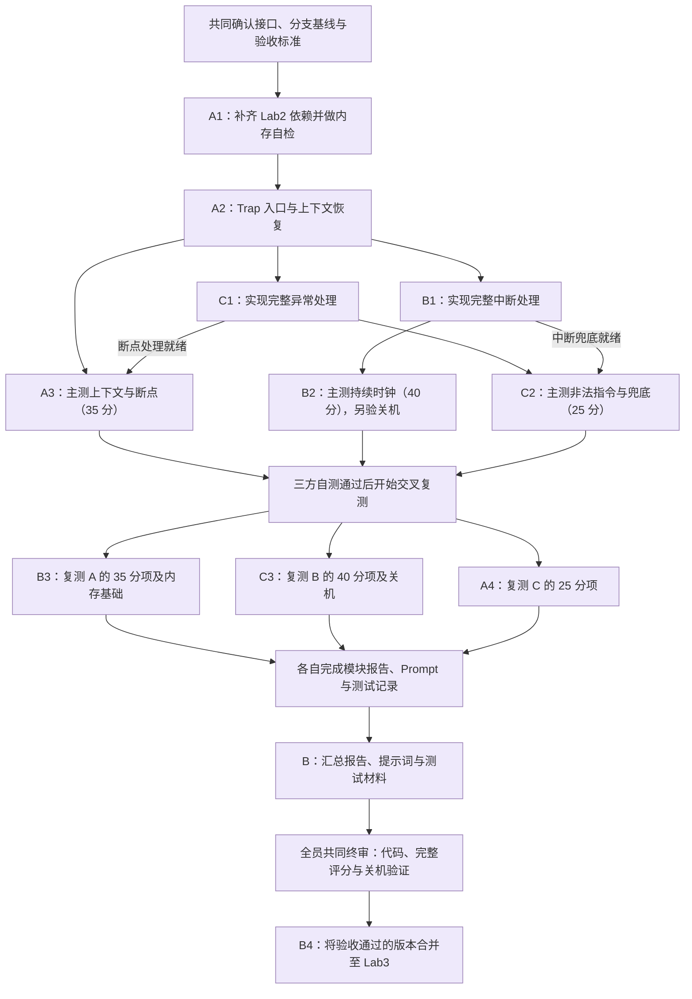

**先建立共同基础。** A1 将 Lab2 的 `page_init()` 和 Best-Fit 适配到 Lab3，通过内存自检排除启动与内存布局问题；A2 再补全 `__alltraps` 和 `RESTORE_ALL`，把保存现场、调用 C 层和恢复执行连接起来。这两项是三组评分测试共同需要的基础。

**在统一入口上分别实现中断与异常处理。** B1 负责中断分类、时钟事件重新设置、计数统计和关机，C1 负责断点、非法指令和异常兜底。时钟中断通常保留保存的 EPC，处理后继续原执行流；本实验的断点和非法指令处理则按指令长度更新 `tf->epc`，再由 A2 将更新后的地址写回 `sepc` 并返回。

**按依赖开展主测。** A3 的 35 分项需要 A2 和 C1 的断点处理配合；B2 的 40 分项需要 A2 和 B1；C2 的 25 分项同时使用异常处理和中断兜底，因此依赖 A、B、C 的实现。35 分和 40 分可以在各自依赖就绪后分别进行，25 分项待相关实现齐备后运行。图中的三条主测分支表示职责和依赖，实际可通过完整评分入口依次执行三组用例。

**通过交叉复测后汇总与终审。** B 复测 A 的上下文与内存基础，C 复测 B 的时钟和关机，A 复测 C 的异常与兜底。各人记录所用版本、命令和真实结果，再由 B 汇总报告、各成员的提示词记录（[A 组](./prompt.md#prompts-a)、[B 组](./prompt.md#prompts-b)、[C 组](./prompt.md#prompts-c)）和测试材料。全员共同确认完整评分、关机验证、交叉复测记录及报告一致性后，由 B 完成分支合并。

---

<a id="implementation"></a>

## 四、实验内容与实现

本节依次记录 A 的内存管理与 Trap 上下文、B 的中断与持续时钟、C 的异常处理。主测、交叉复测及截图统一放在第五部分，完整过程记录与复现命令收录于附录。

### 4.1 基础依赖：Lab2 内存管理回填（A1）

**负责人：** 2412712-王子楸

#### 模块功能描述

**需要实现或修改的函数及管理器：**

```c
/* code/kern/mm/pmm.c */
static void page_init(void);
static void init_pmm_manager(void);

/* code/kern/mm/best_fit_pmm.c */
static void best_fit_insert_free_block(struct Page *base);
static void best_fit_init(void);
static void best_fit_init_memmap(struct Page *base, size_t n);
static struct Page *best_fit_alloc_pages(size_t n);
static void best_fit_free_pages(struct Page *base, size_t n);
static size_t best_fit_nr_free_pages(void);

const struct pmm_manager best_fit_pmm_manager;
```

A1 将 Lab2 已完成的物理内存初始化和 Best-Fit 迁入 Lab3，并接入现有 PMM 接口。保留原实现的贡献标记，迁移与适配部分注明 `lab3 A1 - 2412712`。

**物理内存初始化：**

`page_init()` 通过已有 DTB 接口取得物理内存起点和长度，设置虚实地址偏移，再根据当前框架的地址上界确定实际管理范围。Lab2 中的部分物理地址宏在 Lab3 中已经不存在，因此在 `pmm.c` 内根据现有宏推导：

```c
va_pa_offset = PHYSICAL_MEMORY_OFFSET;
uintptr_t kernel_begin_pa = KERNBASE - va_pa_offset;
uintptr_t physical_limit = KERNTOP - va_pa_offset;
```

随后将内核末端向上按页对齐，放置 `struct Page` 数组；初始化描述符，先将所描述页面标记为保留，再将数组之后的完整空闲页交给 `init_memmap()`。固件、内核和页描述符数组本身占用的页面继续保持保留。

这里需要区分“页描述符的存储地址”和“页描述符表示的物理页”。描述符数组只占用一段物理内存，但其中每个元素记录一个物理页的状态；这段数组本身占用的页也必须从可分配范围中排除。

**Best-Fit 分配与释放：**

空闲块使用按地址排列的双向链表管理。分配时遍历所有空闲块，选择能够满足请求的最小块；同样大小的候选块保留先遇到的低地址块。若选中块大于请求页数，则将剩余部分作为新的空闲块留在链表中。

释放时先恢复页面状态，将归还区间按地址插入，再检查前后相邻块是否在物理地址上连续；连续时合并并更新块首页的 `property`。按地址组织链表便于判断相邻关系，选择最小可用块则需要遍历比较块大小。

`init_pmm_manager()` 选择 `best_fit_pmm_manager`，将上述实现接入公共接口。框架原有的 `basic_check()`、`best_fit_check()` 以及 `alloc_pages()`、`free_pages()`、`nr_free_pages()` 的中断保护保持不变。

#### 最终提示词

本模块的提示词及执行过程见 [A 组 Prompt 记录](./prompt.md#prompts-a) 中 A1 对应部分。

#### 实现迭代过程

**依赖迁移与框架适配：**

先核对 Lab2 实现和 Lab3 的地址布局、接口及固定测试，只回填本次所需的内存初始化和 Best-Fit。对旧版宏的引用改为使用当前映射关系推导，完成管理范围、对齐和描述符占用的适配。

**构建中遇到的问题：**

首次直接构建时，当前汇编器不识别原框架中的 `sbadaddr`。该问题来自工具链与旧 CSR 名称的兼容性。

**解决策略：**

在构建命令中增加 `DEFS=-Dsbadaddr=stval`，通过命令行完成 CSR 名称兼容，保留原框架源码和构建规则。构建与运行结果见第五部分。


### 4.2 功能模块一：Trap 上下文恢复与入口（A2）

**负责人：** 2412712-王子楸

#### 模块功能描述

**需要补全的汇编接口：**

```asm
RESTORE_ALL
__alltraps
```

**已有 C 语言接口：**

```c
void trap(struct trapframe *tf);
```

本模块位于 `code/kern/trap/trapentry.S`。已有的 `SAVE_ALL` 负责保存上下文，本次补全入口到 C 层的调用关系，以及 C 层返回后的恢复过程。

**1. Trap frame 布局**

目标为 RISC-V64，`REGBYTES` 为 8。Trap frame 共 36 个槽，大小为：

$$
36 \times 8 = 288\ \mathrm{B}
$$

| 保存内容 | 槽位 | 字节偏移 |
| --- | --- | --- |
| `x0` 至 `x31` | 0 至 31 | 0 至 248 |
| 原始 `sp`，即 `x2` | 2 | 16 |
| `sstatus` | 32 | 256 |
| `sepc` | 33 | 264 |
| `badvaddr` | 34 | 272 |
| `scause` | 35 | 280 |

表中的 `sp` 行特别列出第 2 槽的含义。已有 `SAVE_ALL` 先将 Trap 前的 `sp` 暂存到 `sscratch`，再从当前栈分配 288 字节，最后把原始 `sp` 放入第 2 槽。保存完成后的当前 `sp` 指向帧基址，帧中的第 2 槽保存进入 Trap 前的栈指针。

288 字节是 16 的整数倍，因此在入口栈原本对齐的条件下，分配该帧后仍满足调用 C 函数所需的栈对齐要求。

**2. 入口传参**

RISC-V 调用约定使用 `a0` 传递首个参数，因此入口在保存现场后执行：

```asm
__alltraps:
    SAVE_ALL
    mv a0, sp
    call trap

__trapret:
    RESTORE_ALL
    sret
```

`a0` 指向栈上的实际 Trap frame，C 层即可通过 `struct trapframe *tf` 读取保存的状态。调用 C 函数会改变 `ra`、参数寄存器或临时寄存器，它们的原值已经保存在帧中，后续统一从帧恢复。

**3. 返回状态与通用寄存器恢复**

`RESTORE_ALL` 先从第 32、33 槽取出返回状态和返回地址：

```asm
LOAD t0, 32*REGBYTES(sp)
LOAD t1, 33*REGBYTES(sp)
csrw sstatus, t0
csrw sepc, t1
```

随后恢复除 `sp` 外的可写通用寄存器，用于暂存 CSR 的 `t0`、`t1` 也在其中恢复。C 层如果更新了 `tf->epc`，这里会使用更新后的值写回 `sepc`，使返回位置与异常处理结果一致。

**4. 最后恢复原始栈指针**

所有从帧中加载数据的操作都依赖当前 `sp`。因此必须在其他帧访问结束后，才执行：

```asm
LOAD x2, 2*REGBYTES(sp)
```

此时直接取回原始 `sp`，无需再增加 288 字节。若提前恢复 `sp`，后续加载就会以旧栈位置作为基址，读取错误数据。最后由 `sret` 按 `sepc` 和保存的状态完成返回。

`badvaddr`、`cause` 供诊断和分派使用，恢复过程不需要将它们写回对应 CSR。本次实现保持已有 `SAVE_ALL`、结构体定义和 `trap()` 接口不变。

#### 最终提示词

本模块的提示词及执行过程见 [A 组 Prompt 记录](./prompt.md#prompts-a) 中 A2 对应部分。

#### 实现迭代过程

A2 根据现有帧布局，在两个待填位置补全入口传参与恢复逻辑，一次完成实现，未发生源码修复迭代。实现时 C 的异常函数仍为占位，动态返回检查安排在真实异常处理集成之后。阶段性构建、关键指令检查与后续动态验证见第五部分。

### 4.3 功能模块二：中断分类与处理（B1）

**负责人：** 2412700-甘文杰

#### 模块功能描述

**需要补全的函数：**

```c
/* code/kern/trap/trap.c */
void interrupt_handler(struct trapframe *tf);
```

**使用的已有接口：**

```c
/* code/kern/driver/clock.c */
void clock_set_next_event(void);
extern volatile size_t ticks;

/* code/kern/trap/trap.c */
void print_trapframe(struct trapframe *tf);

/* code/libs/sbi.c */
void sbi_shutdown(void);
```

B1 主要修改 `code/kern/trap/trap.c` 中的 `interrupt_handler()`，把原来的占位处理替换成可以实际运行的中断分派逻辑。Trap 发生后，A 组编写的汇编入口负责保存现场，已有的 `trap()` 和 `trap_dispatch()` 根据原因区分中断与异常；进入本函数时，`tf` 已经指向保存好的 Trap frame。

**1. 从 `scause` 提取中断编号**

RISC-V 的 `scause` 既表示 Trap 的类型，也表示具体原因。最高位为 1 表示中断，为 0 表示异常，其余位用于表示原因编号。因此，分派前需要先去掉最高位的中断标记：

```c
const uintptr_t interrupt_bit = (uintptr_t)1 << (__riscv_xlen - 1);
uintptr_t cause = tf->cause & ~interrupt_bit;
```

本实验使用 RV64，最高位是第 63 位。这里使用 `__riscv_xlen` 计算位置，而不是直接写死一个 64 位常量。取出 `cause` 后，再用 `switch` 分别处理时钟中断、软件中断和未知编号。

**2. 软件中断与未知中断**

```c
switch (cause) {
case IRQ_S_SOFT:
    cprintf("Supervisor software interrupt\n");
    break;
case IRQ_S_EXT:
    cprintf("Supervisor external interrupt\n");
    break;
default:
    cprintf("Unknown interrupt: cause %d\n", (int)cause);
    print_trapframe(tf);
    break;
}
```

软件中断分支按照测试要求打印固定提示；未知中断分支先输出原因编号，再调用已有的 `print_trapframe()` 打印现场信息。这样遇到未专门处理的中断时，至少能够看到原因和寄存器状态，而不是继续使用原占位函数的 `panic()` 直接终止。

该函数只负责中断。断点、非法指令等异常由 C 组的 `exception_handler()` 处理，因此本次没有修改异常处理函数，也没有改变 A 组的 Trap 保存、恢复汇编。

#### 最终提示词

本模块的提示词及讨论记录见 [B 组 Prompt](./prompt.md#prompts-b) 中 B1 对应部分。主要围绕 Trap 的整体路径、`scause` 的含义、如何根据原因编号分支，以及不同分支应输出什么信息来确定实现要求。

#### 实现迭代过程

**先确认接口与修改范围。** 结合分工文档和实际源码，确认 `trap_dispatch()` 已经负责区分中断与异常，B1 不需要重新写 Trap 入口，只需要补全 `interrupt_handler()`。同时沿用工程已经提供的中断编号宏、打印函数和时钟接口。

**替换占位实现。** 在已有函数中完成原因编号提取与分支处理，并保留原本的函数签名和成员学号标记。B1 的实现提交记录为 `7bd243a`。

**按分支补充检查。** 时钟分支通过 B2 的持续中断测试验证；软件和未知中断则使用临时副本中的直接调用测试核对输出。两种检查对应的运行条件不同，结果分别记录在第五部分。

### 4.4 功能模块三：持续时钟中断与关机机制（B1/B2）

#### 模块功能描述

时钟中断需要反复发生，而不是处理一次就结束。已有 `clock_init()` 会使能 S 模式时钟中断、预约第一次计时事件并将 `ticks` 清零；`kern_init()` 后续调用 `intr_enable()` 开启全局中断。等到计时事件到达，CPU 进入 Trap，最后由 B1 的时钟分支接手处理。

**1. 预约下一次中断并更新计数**

`clock_set_next_event()` 内部读取时间计数，再加上固定的 `timebase`，通过 `sbi_set_timer()` 预约下一次事件。由于这次计时事件已经触发，如果不重新预约，时钟就无法按照本实验要求持续产生新的中断。

因此，时钟分支的前两步是先预约下一次事件，再递增全局计数：

```c
case IRQ_S_TIMER:
    clock_set_next_event();
    ticks++;
    if (ticks % TICK_NUM == 0) {
        print_ticks();
    }
    if (ticks == TICK_SHUTDOWN_NUM) {
        sbi_shutdown();
    }
    break;
```

这段代码每进入一次时钟中断，就使 `ticks` 增加 1。中断处理完毕后，函数返回统一的 Trap 恢复流程，下一次计时事件发生时再次进入此分支，从而形成连续计数。

**2. 每 100 次输出一次统计信息**

工程中定义 `TICK_NUM = 100`。当 `ticks` 是 100 的整数倍时，调用 `print_ticks()`，输出一行 `100 ticks`。例如计数达到 100、200、300 时，各输出一次。这里的输出表示每累计 100 次时钟中断进行一次提示，而不是把当前计数值直接打印出来。

**3. 计数达到 1000 后关机**

```c
#define TICK_NUM 100
#define TICK_SHUTDOWN_NUM (TICK_NUM * 10)
```

分工要求在达到一定条件后关机，但没有指定具体阈值。本次实现选择 1000 次：一方面让 40 分测试先在 `ticks == 200` 时输出通过标记，另一方面可以继续观察后续计数和关机结果。

| `ticks` 递增后的值 | 对应行为 |
| --- | --- |
| 100 | 第一次输出 `100 ticks` |
| 200 | 第二次输出 `100 ticks`；计时测试可以输出 40 分通过标记 |
| 300 至 900（每隔 100） | 继续输出时钟统计 |
| 1000 | 第十次输出 `100 ticks`，随后调用 `sbi_shutdown()` |

`sbi_shutdown()` 通过 SBI 接口向底层固件提出关机请求。在本实验的 QEMU 环境中，关机后模拟器会退出。因此，除了查看串口文字，还需要检查 QEMU 是正常退出还是因为超时被强制停止。

#### 最终提示词

本部分对应 [B 组 Prompt](./prompt.md#prompts-b) 中关于时钟事件、`ticks` 更新、统计输出与关机条件的 B1/B2 问题。学习时重点确认了第一次计时事件由谁设置、为什么处理时还要设置下一次，以及测试在 200 次通过后为什么还能继续运行。

#### 实现迭代过程

**先确定时钟中断的执行顺序。** 从 `clock_init()`、`clock_set_next_event()` 和 `interrupt_handler()` 串联启动与中断流程，确认下一次事件设置、计数更新和输出检查之间的关系。

**再确定输出和关机边界。** 保留框架已有的 `print_ticks()`，使用每 100 次输出一次的条件；选择 1000 次作为关机阈值，使测试能先检查到 200 次，再继续观察最终退出。

**区分阶段性结果与集成结果。** B2 初次运行时，时钟项已经得到 40/40，但整套评分仍因异常处理尚未完成而只有 40/100。后续 C 组实现集成之后，整套评分才达到 100/100。这属于模块之间的依赖变化，不是把早期测试记录改成最终结果。

---

### 4.5 功能模块四：完整异常处理（C1）

**负责人：** 2413318-向宇航。

需要实现的函数位于 `code/kern/trap/trap.c`：

```c
void exception_handler(struct trapframe *tf);
```

已有入口保证 `tf` 指向保存好的现场。函数依赖 `CAUSE_ILLEGAL_INSTRUCTION`、`CAUSE_BREAKPOINT`、`cprintf()` 和 `print_trapframe()`，使用 `tf->cause` 分类，使用 `tf->epc` 调整返回位置。

#### 行为规格

Pre-Condition：Trap frame 有效，需要跳过的指令地址可读，指令属于本实验覆盖的 16/32 位范围。

Post-Condition：非法指令与断点打印原 EPC，再按编码长度更新 EPC；其他异常输出 Trap frame 后返回。

| 情况 | 行为 |
| --- | --- |
| 非法指令 | 输出 `Illegal instruction at 0x%016lx\n`，随后跳过实际长度的指令 |
| 断点 | 输出 `Breakpoint at 0x%016lx\n`，随后跳过实际长度的指令 |
| 其他异常 | 调用 `print_trapframe(tf)`，EPC 不变，不额外 panic |

输出必须在修改 EPC 前完成，确保报告的是触发异常的位置。未知异常的兜底不读取 EPC 处的指令，因为它没有对应的跳过要求。

#### 实现与指令长度判断

```c
void exception_handler(struct trapframe *tf) {
    // lab3 C1 - 2413318: skip the faulting 16-bit or 32-bit instruction.
    switch (tf->cause) {
    case CAUSE_ILLEGAL_INSTRUCTION:
        cprintf("Illegal instruction at 0x%016lx\n", (unsigned long)tf->epc);
        break;
    case CAUSE_BREAKPOINT:
        cprintf("Breakpoint at 0x%016lx\n", (unsigned long)tf->epc);
        break;
    default:
        print_trapframe(tf);
        return;
    }

    uint16_t instruction = *(const uint16_t *)tf->epc;
    tf->epc += (instruction & 0x3) == 0x3 ? 4 : 2;
}
```

两个已处理分支共用长度判断。在本实验的编码范围内，首个半字的低两位不等于 `0b11` 时按 16 位处理，否则按 32 位处理。因此压缩断点和普通断点都能正确跳过，非法指令也不会被一律当作 4 字节。

使用 `uint16_t` 读取前缀，适应仅按两字节对齐的指令地址，并避免为判断长度额外读取后续半字。这里没有实现完整反汇编器、用户地址探测或更长指令编码的处理。

实现仅替换异常处理的占位函数体，保留公共签名、Trap frame 布局和其他成员实现。对于未知异常，打印诊断信息后原地返回并不代表异常已经恢复；如果真实故障仍存在，它可能再次触发。

#### 提示词与实现修正

整理后的示例 Prompt 见 [个人 Prompt 的 C1 小节](./prompt.md#prompts-c)，采用 `[PROMPT]`、`[RELY]`、`[GUARANTEE]`、`[SPECIFICATION]` 四段模板，分别描述任务、已有接口、交付函数和前后置条件。示例用于表达最终规格，不作为实际对话记录。

计划阶段曾考虑“非法指令固定跳过 4 字节、断点固定跳过 2 字节”。重新核对手册后，发现这一方案只覆盖部分用例，于是在写入实现前改为读取前缀判断长度。固定长度方案没有提交。最终实现首次编译及后续验证通过，没有发生需要虚构为多轮修复的运行故障。

### 4.6 C2/C3：主测与复测设计

C2 使用原始评分入口检查 25 分项，再在 `/tmp` 副本补测四种编码。直接调用 handler 检查 EPC 精确增量，真实 Trap 检查返回后能否继续执行，两类证据共同验证长度判断。

C3 使用两个从固定提交导出的独立副本：一个只启用原始 `GRADE_LAB3_TIMER` 用例，另一个运行未注入的正式内核。判断关机时同时检查统计行数、QEMU 退出码和耗时，避免只有评分文本通过而进程实际超时。

对应的模板化规格见 [个人 Prompt](./prompt.md#prompts-c) 中 C2、C3 小节，具体操作与证据见下一部分。

---

<a id="verification"></a>

## 五、测试与验证


### 5.1 A1：物理内存初始化与 Best-Fit 验证

**验证步骤与判断依据：**

1. 使用兼容参数进行干净构建，并在 QEMU 4.1.1 中启动正式内核。
2. 核对管理器名称、DTB 内存范围、描述符数组和空闲区间，独立计算空闲页数并与输出比较。
3. 检查固定自检是否完成。`pmm_init()` 经 `check_alloc_page()` 调用 `best_fit_check()`，其中也会执行 `basic_check()`；全部断言通过后才输出 `check_alloc_page() succeeded!`。

报告截图对应的运行命令为：

```bash
cd /mnt/a/OS/exp/Operation-System-Labs/code
make clean
set -o pipefail
make qemu DEFS=-Dsbadaddr=stval \
  QEMU=/home/catalpa/.local/opt/qemu-4.1.1/bin/qemu-system-riscv64 \
  2>&1 | tee ../report/logs/a1-qemu-report.log
```

固定自检覆盖单页分配与归还、空闲页耗尽、连续页申请及回收后的计数和链表恢复。其中，Best-Fit 的关键检查是在同时存在 2 页块和 1 页块时申请 1 页，要求选中 1 页块，并使随后的 2 页申请仍能成功。这直接检查了分配器是否优先选择最小可用块。

**实际结果：**

如图所示输出 `memory management: best_fit_pmm_manager` 和 `check_alloc_page() succeeded!`，说明所选管理器正确，固定自检完成。

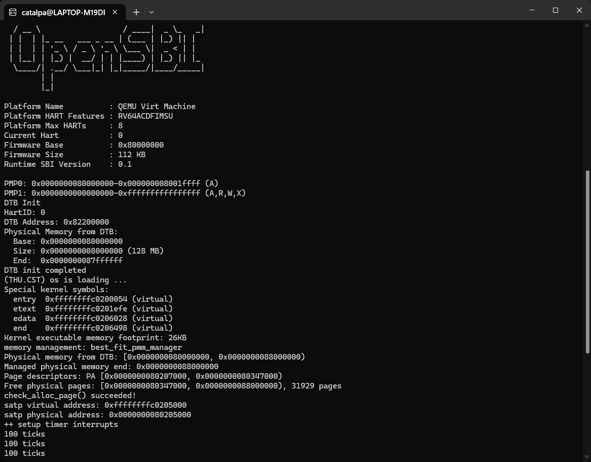

**图 1：** 正式内核完成 Best-Fit 内存初始化和固定自检，并继续执行时钟初始化。

截图中内核末端物理地址为 `0x80206498`，向上对齐至 `0x80207000`。实际内存布局为：

| 类别 | 物理地址区间 | 页数 |
| --- | --- | --- |
| 固件预留 | `[0x80000000, 0x80200000)` | 512 |
| 内核及对齐占用 | `[0x80200000, 0x80207000)` | 7 |
| 页描述符数组 | `[0x80207000, 0x80347000)` | 320 |
| 可分配空闲页 | `[0x80347000, 0x88000000)` | 31,929 |

页大小为 4 KiB，128 MiB 内存共包含：

$$
128 \times 1024 \div 4 = 32768\ \text{页}
$$

每个 `struct Page` 占 40 字节，描述符数组占用：

$$
32768 \times 40 = 1310720\ \mathrm{B} = 320\ \text{页}
$$

因此，可分配页数为：

$$
32768 - 512 - 7 - 320 = 31929\ \text{页}
$$

独立计算与启动输出一致，保留区与空闲区的划分符合预期。运行日志见 [a1-qemu-report.log](./logs/a1-qemu-report.log)。

A1 阶段还曾在 `pmm_init()` 返回后、开启时钟前，通过 GDB 核对当时镜像的描述符和空闲链表：共 32,768 个描述符，839 页保留、31,929 页空闲，计数与链表关系一致。

### 5.2 A2：Trap 入口与上下文恢复验证

**验证步骤与判断依据：**

先完成干净构建，再检查入口与返回部分的反汇编。可按以下命令复现：

```bash
cd /mnt/a/OS/exp/Operation-System-Labs/code
make clean
make DEFS=-Dsbadaddr=stval
riscv64-unknown-elf-objdump -d --disassemble=__alltraps bin/kernel
riscv64-unknown-elf-objdump -d --disassemble=__trapret bin/kernel
```

**实际结果：**

A2 实现阶段的完整编译、链接和镜像生成通过。关键指令检查如下：

| 检查项 | 判断依据与实际结果 |
| --- | --- |
| 入口传参 | 保存现场后执行 `mv a0,sp`，再调用 `trap`，帧地址通过首个参数传入 C 层 |
| 返回状态 | 从偏移 256、264 读取状态和 EPC，写回 `sstatus`、`sepc`，与帧布局一致 |
| 栈指针恢复 | 在其他帧访问完成后执行 `ld sp,16(sp)`，恢复第 2 槽保存的原始栈指针 |
| Trap 返回 | 恢复完成后执行 `sret` |

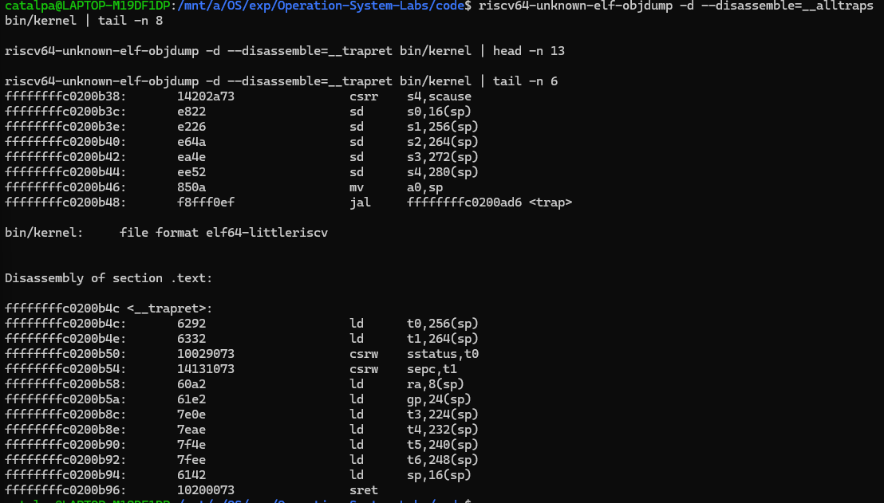

**图 2：** Trap 入口与上下文恢复的关键反汇编，展示参数传递、CSR 写回以及最后恢复 `sp` 的顺序。

A2 阶段 C 的异常函数尚为占位，当时完成的是构建与指令检查。真实异常处理集成后，通过下一节 A3 的 35 分用例检查实际断点返回与寄存器恢复。

### 5.3 A3+A4：上下文主测与异常复测


**验证方法与判断依据：**

A3 使用 `test_lab3_register_context()` 写入一组已知寄存器值，执行 `ebreak`。执行流经 A2 入口进入 C 层，完成断点处理和 EPC 更新，再经恢复流程与 `sret` 返回，继续比较寄存器值。评分要求出现 `Breakpoint at` 和上下文测试 PASS。

现有用例显式比较 `t0` 至 `t6`、`s0` 至 `s11`、`a1` 至 `a7`，共 26 个寄存器。`sp`、`ra` 参与真实调用和返回链路，用例未单独逐值比较它们。

A4 在相同版本上重新运行已有评分，独立复测 C 的 25 分项，检查内容为：

| 检查内容 | 现有用例与通过条件 |
| --- | --- |
| 非法指令异常返回 | 执行 4 字节非法编码 `0x0000007b`，出现 `Illegal instruction at`，并在返回后输出非法指令测试 PASS |
| 软件中断提示 | 构造 Trap frame 并调用中断处理函数，出现 `Supervisor software interrupt` |
| 未知中断兜底 | 构造 cause 15 并调用中断处理函数，出现 `Unknown interrupt: cause 15` |
| 未知异常兜底 | 构造 cause 20 并调用异常处理函数，Trap frame 输出包含 `cause    0x00000014` |

非法指令部分实际触发 Trap 并返回；其余兜底检查通过构造帧调用处理函数完成，验证范围为规定的分支输出。

**执行步骤与实际结果：**

评分脚本直接调用 `qemu-system-riscv64`，先通过当前会话的 `PATH` 选中 4.1.1，再运行完整评分：

```bash
cd /mnt/a/OS/exp/Operation-System-Labs/code
export PATH="/home/catalpa/.local/opt/qemu-4.1.1/bin:$PATH"
qemu-system-riscv64 --version
make grade CC='riscv64-unknown-elf-gcc -Dsbadaddr=stval'
```

CSR 兼容定义通过 `CC` 传入，保留评分脚本为各用例设置的宏。`make grade` 在临时副本中注入现有测试，分别完成三组干净构建和运行，评分成功后自动清理副本。

| 轮次 | 目的 | 实际结果 | 日志保存情况 |
| --- | --- | --- | --- |
| 第一轮 | A3：上下文与断点主测 | 35/35、25/25、40/40，总分 100/100，退出码 0 | 保留完整日志，当前文件名为 `a3a4-grade.log` |
| 第二轮 | 复核 B2、C2，其中 C2 计入 A4 独立复测 | 35/35、25/25、40/40，总分 100/100，退出码 0 | 未另存日志，按实际执行记录说明 |

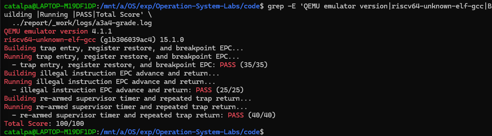

**图 3：** 已有完整评分日志摘录，包含版本信息、三项 PASS 和总分。完整保存日志见 [a3a4-grade.log](./logs/a3a4-grade.log)；该图展示保存日志的结果，第二轮复测情况按上表单独记录。

A3 的 35 分主测和 A4 的 25 分独立复测均已完成，提示词及执行过程见 [A 组 Prompt 记录](./prompt.md#prompts-a) 中 A3+A4 对应部分。

### 5.4 B1：软件中断与未知中断分支验证

**验证方法与判断依据：**

为了检查不容易在日常运行中自然遇到的分支，在临时测试副本中增加了 `GRADE_LAB3_INTERRUPT_FALLBACK` 测试变体，直接构造 `trapframe` 并调用 `interrupt_handler()`。验证的重点是分支选择、提示文字和 Trap frame 是否按预期输出。

| 测试分支 | 构造的输入 | 预期结果 |
| --- | --- | --- |
| S 模式软件中断 | `IRQ_S_SOFT`，带最高位的中断标记 | 输出 `Supervisor software interrupt` |
| 未知中断 | `cause = 15` | 输出 `Unknown interrupt: cause 15`，并打印 Trap frame |

**实际结果：**

临时副本的构建与 QEMU 运行退出码均为 0。串口显示软件中断提示、未知中断编号和完整的 Trap frame 输出，处理完成后能够继续执行测试。原始日志见 [b1-fallback-qemu.log](./logs/b1-fallback-qemu.log)。

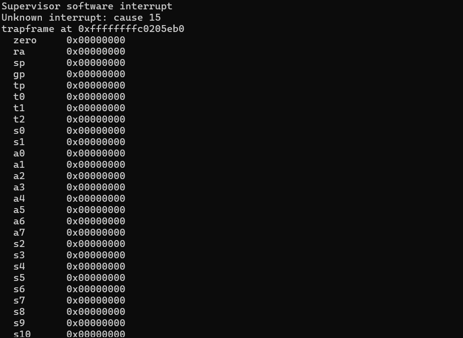

**图 4：** 软件中断的固定输出以及未知中断 cause 15 的分支提示。

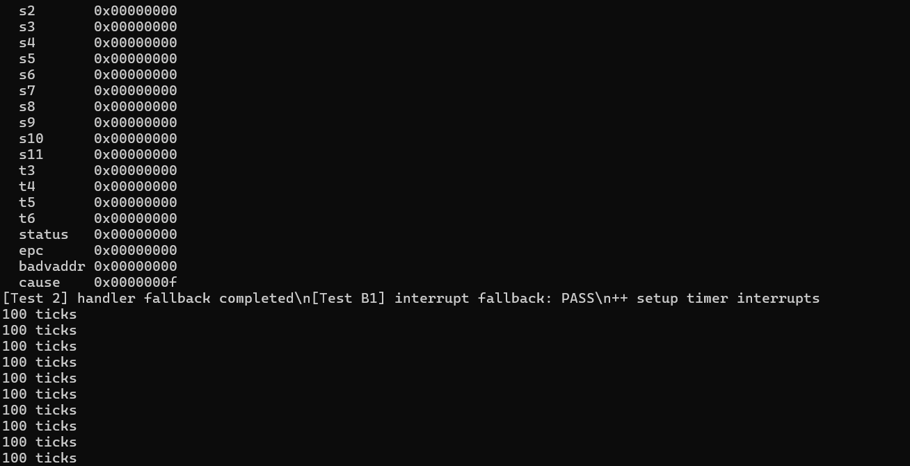

**图 5：** 未知中断输出 Trap frame 后继续完成测试。后面的时钟提示来自同一次临时运行。

本项通过直接调用处理函数检查了软件分支，并没有声称在 QEMU 中由真实硬件主动触发了上述未知中断。B1 的时钟分支由下一节的持续计时测试进一步验证。

### 5.5 B2：持续时钟 40 分主测与关机验证

**测试环境：** GNU Make 4.3、SiFive GCC-Metal `riscv64-unknown-elf-gcc` 10.2.0、QEMU 4.1.1（OpenSBI v0.4）。针对旧汇编 CSR 名称，构建使用 `DEFS=-Dsbadaddr=stval` 兼容参数。

**验证方法与判断依据：**

B2 的 40 分测试要求时钟不断触发，计数达到 200，并在串口出现规定的统计输出和通过标记。测试主要检查是否重新预约计时事件、是否能够跨多次 Trap 正常返回，以及 `ticks` 是否持续增加。该评分条件本身不直接检查第 1000 次中断的关机行为，所以额外使用限时 QEMU 运行进行验证。

正式评分在 `code/` 目录执行：

```bash
make grade DEFS=-Dsbadaddr=stval
```

评分脚本会分别构建、运行 35 分、25 分、40 分三组用例。最初 B1 已完成、C1 仍为占位时，完整评分结果是 **40/100**：其中时钟项通过 **40/40**，其余两项没有通过。该阶段并不表示全部功能完成。

**独立计时与关机补测：**

在 `/tmp` 临时副本中通过现有 `tools/inject.py` 注入计时测试，以 `GRADE_LAB3_TIMER` 编译后启动 QEMU。关键运行方式为：

```bash
# 在已注入测试的临时副本 code/ 目录中
make clean
make V= 'DEFS=-Dsbadaddr=stval -DGRADE_LAB3_TIMER'
timeout 20s qemu-system-riscv64 \
  -machine virt -nographic -bios default \
  -device loader,file=bin/ucore.img,addr=0x80200000 \
  -serial file:<串口日志的绝对路径> \
  -monitor none -no-reboot
```

这里的 `<串口日志的绝对路径>` 需要换成本机实际的日志路径。B2 实际使用的临时目录及完整命令见 [B1/B2 验证记录](./report.md#process-b1-b2)，对应构建和串口日志保存在 `./logs/`。

| 检查项目 | 本人实际结果 | 对应说明 |
| --- | --- | --- |
| 初次完整评分 | 40/100，`make grade` 退出码 2 | B 的时钟项 40/40；其他项目仍受未完成的异常处理影响 |
| 独立计时补测 | 出现一次 `PASS (40/40, ticks=200)` | 证明计数达到 200，持续时钟测试通过 |
| 统计输出 | 共 10 次 `100 ticks` | 计数达到 1000 前各阶段的统计输出符合代码逻辑 |
| 独立运行退出 | QEMU 退出码 0，约 8.2 秒，未达到 20 秒上限 | 结合源码中 1000 次调用 `sbi_shutdown()`，支持关机路径正常运行 |
| 后续集成评分 | 100/100，命令退出码 0 | C1 加入后，35/35、25/25、40/40 三项全部通过 |
| 集成后正式内核运行 | 10 次 `100 ticks`，20 秒限制内退出码 0 | 正常初始化路径下也完成时钟统计和关机 |

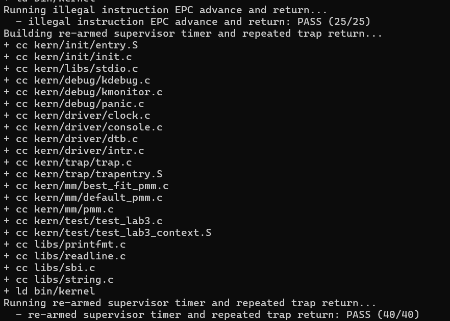

**图 6：** 集成版本的 25 分异常项和 40 分持续时钟项均显示通过。

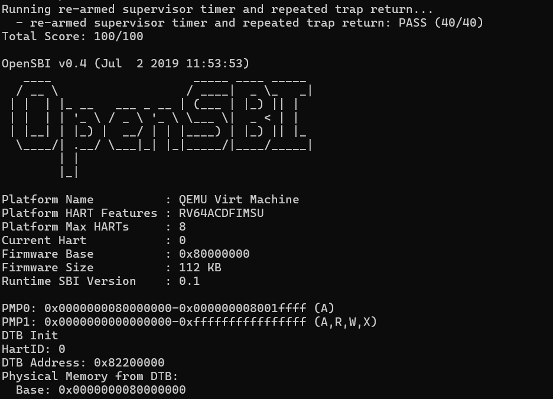

**图 7：** C1 合入后的完整评分结果为 100/100。图中包含 A、B、C 的协作结果，不全部归为 B 的单独实现成绩。

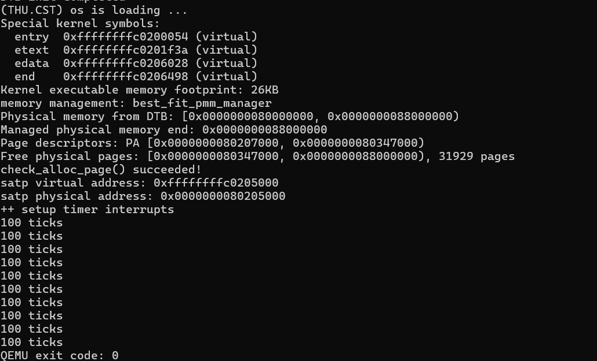

**图 8：** 正式内核启动后完成 Best-Fit 自检，继续输出 10 次时钟统计，并在测试终端中正常退出。

串口没有打印专门的关机提示，也没有逐次显示全部 1000 个 `ticks`。本次根据统计次数、QEMU 正常退出，以及源码中达到 1000 时调用 `sbi_shutdown()` 的路径共同判断关机成功，而不是声称曾在 `sbi_shutdown()` 设置断点检查。

### 5.6 B3：对 A 组内存基础与 Trap 上下文的交叉复测

**复测范围：** B3 不重新实现 A 的代码，重点独立核查 A1 的物理内存初始化与 Best-Fit 自检，以及 A2 的 Trap frame 布局、入口传参和恢复顺序。随后通过官方 35 分用例验证断点返回与寄存器恢复。

本次复测日期为 2026-11-04，使用的代码版本为 `0e15d4a`，已包含 A1/A2、A3/A4 和 B、C 的真实实现。工具环境为 GNU Make 4.3、RISC-V GCC 10.2.0、QEMU 4.1.1。

**验证步骤：**

在 `code/` 目录执行干净构建、反汇编、评分与启动检查：

```bash
make clean
make V= DEFS=-Dsbadaddr=stval
riscv64-unknown-elf-objdump -d --disassemble=__alltraps bin/kernel
riscv64-unknown-elf-objdump -d --disassemble=__trapret bin/kernel
make grade DEFS=-Dsbadaddr=stval
timeout 20s make qemu DEFS=-Dsbadaddr=stval
```

上述命令的退出码均为 0。构建、反汇编、评分和启动日志见 `./logs/` 中的 `b3-` 文件，详细记录见 [B3 交叉复测记录](./report.md#process-b3)。

**1. 内存初始化与 Best-Fit 自检**

正式内核输出了 `memory management: best_fit_pmm_manager`，说明当前实际选择的是 Best-Fit 分配器。DTB 报告的物理内存范围是 `[0x80000000, 0x88000000)`，描述符数组位于 `[0x80207000, 0x80347000)`，其后的可用物理页区间共有 31,929 页。

同时出现 `check_alloc_page() succeeded!`，说明原有的页面分配和回收固定自检通过。这次复测主要依据正式启动输出和已有自检，没有额外启动 GDB 逐项检查全部页描述符。

**2. Trap 入口与恢复顺序**

B3 进一步对比 `trap.h` 的 `struct trapframe` 和 `trapentry.S` 的反汇编。RV64 的每个寄存器槽是 8 字节，32 个通用寄存器槽加上 4 个控制信息槽，共 36 个槽、288 字节。

| 检查内容 | 本次观察及意义 |
| --- | --- |
| 保存原始 `sp` | `SAVE_ALL` 使用 `sscratch` 暂存原始栈指针，并放入第 2 槽（偏移 16） |
| 向 C 层传参 | `__alltraps` 中出现 `mv a0,sp`，随后调用 `trap`；传入的是当前帧基址 |
| 恢复 CSR | `__trapret` 从偏移 256、264 取出 `status`、`epc`，写回 `sstatus`、`sepc` |
| 恢复通用寄存器 | 根据保存槽位依次恢复可写通用寄存器 |
| 最后恢复栈指针 | 在其他帧访问结束后执行 `ld sp,16(sp)`，然后 `sret` 返回 |

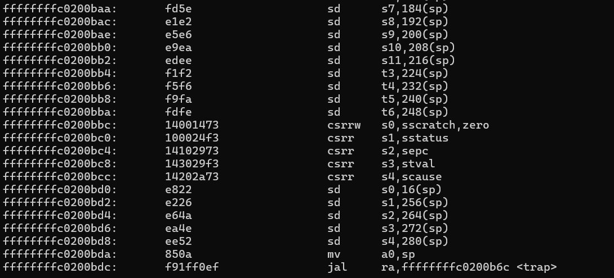

**图 9：** 入口反汇编中保存现场后将当前 `sp` 交给 `a0`，再调用 C 层的 `trap()`。

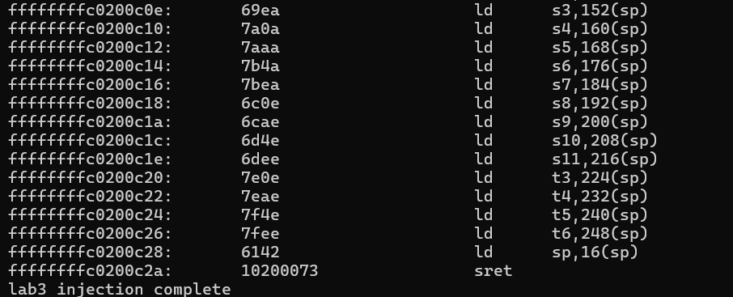

**图 10：** 返回反汇编中先恢复相关寄存器和状态，最后恢复原始 `sp` 并执行 `sret`。

**3. 35 分上下文测试**

官方测试通过 `ebreak` 进入异常处理，再返回到原执行流，逐项比较事先设置的寄存器值。它直接检查了 `t0–t6`、`s0–s11`、`a1–a7` 共 26 个寄存器；`sp`、`ra` 参与返回过程，但不是该测试逐值比较的对象。因此，寄存器比较通过和反汇编中的栈恢复检查需要放在一起理解。

**实际结果：**

```text
trap entry, register restore, and breakpoint EPC: PASS (35/35)
illegal instruction EPC advance and return: PASS (25/25)
re-armed supervisor timer and repeated trap return: PASS (40/40)
Total Score: 100/100
```

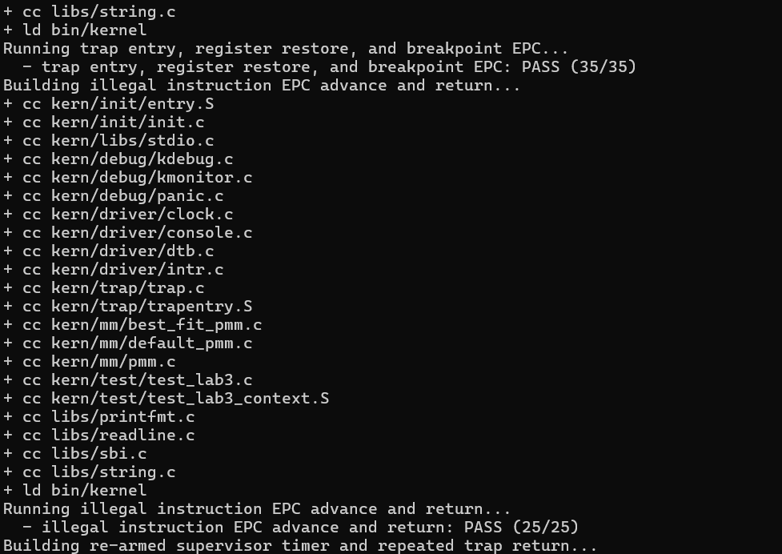

**图 11：** 重新执行的完整评分中，A 负责的 Trap 入口、寄存器恢复和断点 EPC 项通过，得分 35/35。


**图 12：** B3 复测时完整评分总分 100/100；本次 B3 的主要复测结论是 A 的 35 分项与内存基础通过，其余两项是同次集成运行结果。

本次交叉复测确认：A1 的 Best-Fit 初始化与固定自检成功，A2 的入口传参与恢复顺序和源码一致，A3 对应的 35 分测试通过。正常启动也在时钟输出后以退出码 0 结束。没有修改 A 组代码，也没有在本次 B3 复测中启动 GDB。

---

### 5.7 C2：25 分主测与同期集成评分

2026-11-04，在 C1 已实现且 A、B 依赖可用的版本上，从仓库根目录运行：

```bash
make -C code grade DEFS=-Dsbadaddr=stval
```

评分入口在临时副本注入测试并分别构建三组用例。实际结果为退出码 0，总分 100/100：

| 项目 | 实际结果 | 本人的职责归属 |
| --- | --- | --- |
| 上下文与断点返回 | 35/35 | 本轮集成检查，A 的主测项 |
| 非法指令返回与兜底 | 25/25 | C2 主测 |
| 持续时钟 | 40/40 | 本轮集成检查，B 的主测项 |

25 分用例首先执行 4 字节非法编码 `0x0000007b`，要求出现 `Illegal instruction at` 并返回到后续测试。接着构造帧调用 handler，检查软件中断提示、未知中断 cause 15 提示和未知异常 cause 20 的 Trap frame 输出。

其中非法指令真实触发 Trap；软件中断与未知原因分支通过直接函数调用验证，没有声称硬件实际产生了对应中断。

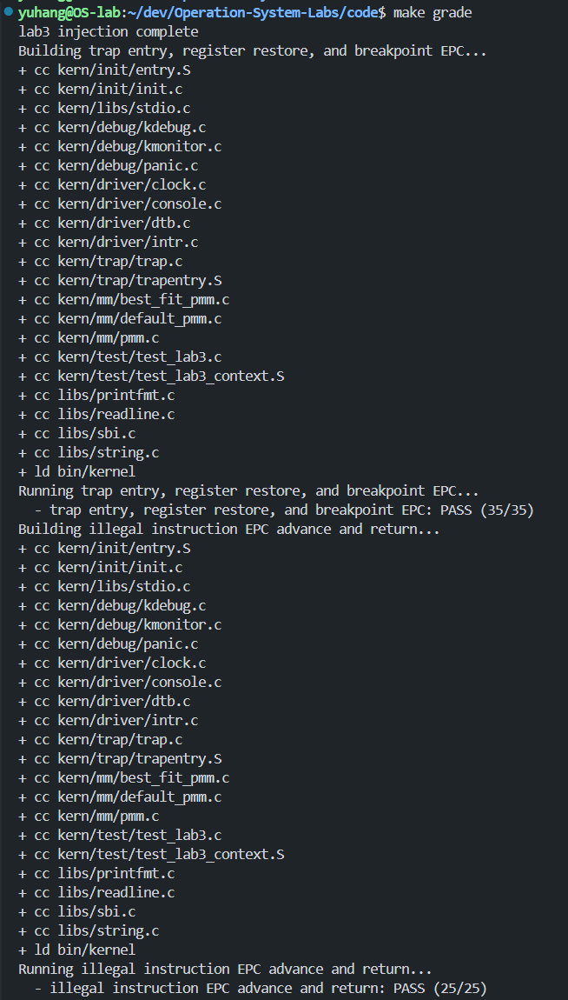

**图 13：** 已有终端截图显示上下文 35/35 和非法指令项 25/25。

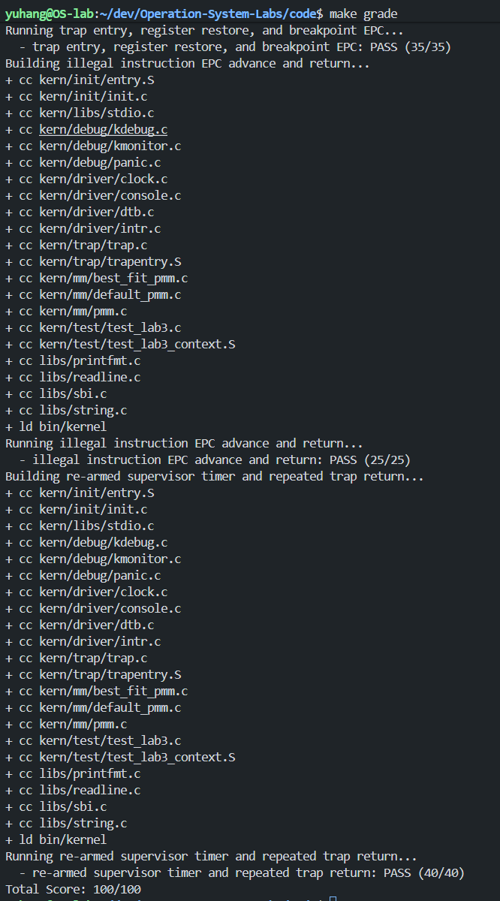

**图 14：** 已有评分截图显示 25/25、40/40 和总分 100/100。截图用于展示评分结果，原自动运行的命令、日期和退出状态以保存的日志及 JSON 为准。

证据：[官方评分完整日志](./logs/c2-grade.log)、[评分状态](./logs/c2-grade-status.json)。

### 5.8 C2：16/32 位指令和未知异常补测

原评分只直接覆盖特定非法指令和断点，因此另在独立临时副本中使用固定编码，避免汇编器自动压缩造成长度不确定：

| 场景 | 固定编码 | 直接调用的 EPC 检查 | 真实 Trap 返回 |
| --- | --- | --- | --- |
| 16 位非法指令 | `.2byte 0x0000` | +2，通过 | 后续输出 PASS |
| 32 位非法指令 | `.4byte 0x0000007b` | +4，通过 | 后续输出 PASS |
| 压缩断点 | `.2byte 0x9002` | +2，通过 | 后续输出 PASS |
| 普通断点 | `.4byte 0x00100073` | +4，通过 | 后续输出 PASS |

另构造 `cause=20`、`epc=0x1234` 的 Trap frame，直接调用异常处理函数。日志显示 Trap frame 输出后继续执行，检查确认 EPC 仍为 `0x1234`。这验证了兜底不额外读取无关指令地址，也没有加入 panic。

构建与 QEMU 退出码均为 0，运行约 10.34 秒，日志出现 `[C2 extra] ALL PASS`。补充测试未修改仓库中的正式测试或评分条件。

补测的准备和构建方式如下，从仓库根目录执行；完整 QEMU 参数见 [C1/C2 记录](./report.md#process-c1-c2)：

```bash
c2_root=$(mktemp -d /tmp/lab3-c2-reproduce.XXXXXX)
cp -a code "$c2_root/code"
python3 code/tools/inject.py "$c2_root/code"
python3 report/scripts/c2_extended.py "$c2_root/code"
make -C "$c2_root/code" clean
make -C "$c2_root/code" 'DEFS=-Dsbadaddr=stval -DGRADE_LAB3_ILLEGAL'
```

证据：[补测脚本](./scripts/c2_extended.py)、[构建日志](./logs/c2-extended-build.log)、[完整串口日志](./logs/c2-extended-qemu.log)、[退出状态与实现版本](./logs/c2-extended-status.json)。补测部分保留文本证据，没有为四种编码额外制作截图。

### 5.9 C3：独立复测 B 的持续时钟与关机

2026-11-05，从 `222162c` 导出两个唯一临时副本并干净构建。计时副本使用原始注入脚本和 `GRADE_LAB3_TIMER`；正式内核副本没有测试注入。复现脚本从仓库根目录运行：

```bash
python3 report/scripts/c3_retest.py
```

脚本在各自副本运行 QEMU，使用 20 秒超时，并记录完整参数和退出状态。此阶段没有重新执行全套评分，目标是 B 的持续时钟与关机。

**源码核对：** 每次时钟中断先重新预约事件，再执行一次 `ticks++`；计数每满 100 输出一次，1000 时在第十次输出后调用 SBI 关机。

| 递增后的 ticks | 源码判断的输出 | 源码判断的关机 |
| --- | --- | --- |
| 99 / 100 | 无 / 第 1 行 | 均不关机 |
| 199 / 200 | 无 / 第 2 行 | 均不关机 |
| 999 / 1000 | 无 / 第 10 行 | 1000 时关机 |

这些边界来自源码核对，没有增加动态边界插桩。实际运行结果如下：

| 检查 | 计时测试副本 | 正式内核副本 |
| --- | --- | --- |
| 注入、清理与构建 | 均成功 | 未注入，清理与构建成功 |
| 初始化与内存自检 | 成功 | 成功 |
| 计时通过标记 | 一次 `PASS (40/40, ticks=200)` | 无，符合未注入预期 |
| `100 ticks` 行数 | 恰好 10 行 | 恰好 10 行 |
| FAIL / panic | 未发现 | 未发现 |
| QEMU 退出码 | 0 | 0 |
| 自动运行耗时 | 10.342 秒 | 10.329 秒 |
| 是否超时 | 否 | 否 |

原始评分脚本只匹配文本，并通过 `timeout ... || true` 忽略模拟器退出码。本次必须同时确认进程正常结束，超时退出码 124 不能算关机成功。

串口没有逐次输出 ticks，也没有关机函数断点。因此，动态观察是 200 次通过标记、10 次统计输出和正常退出；结合对应版本源码，支持 1000 次中断触发 SBI 关机的结论。

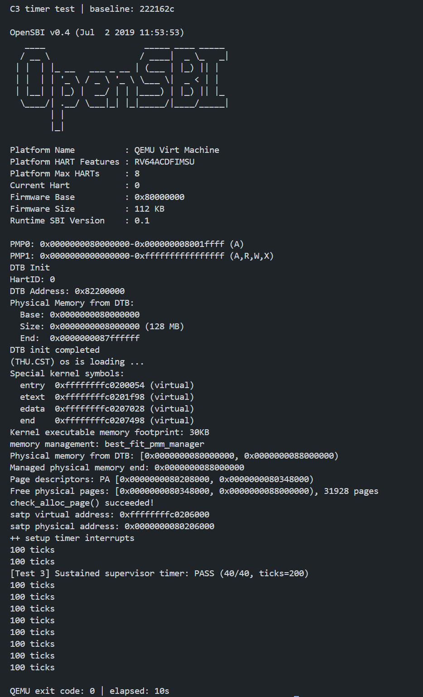

**图 15：** 手动复现显示 40/40、`ticks=200`、10 次统计输出及退出码 0，整秒耗时为 10 秒。

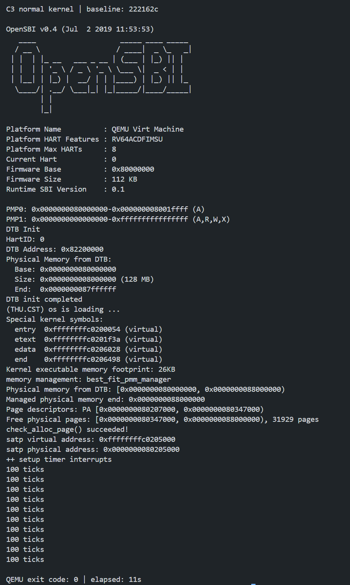

**图 16：** 手动复现的正式内核完成初始化、输出 10 次统计后正常退出，整秒耗时为 11 秒。

两张截图来自同一基线的后续手动复现，与自动脚本是不同运行，因此保留各自耗时，不用截图中的整数时间替换原日志的精确记录。

证据：[C3 复测记录](./report.md#process-c3)、[复现脚本](./scripts/c3_retest.py)、[状态文件](./logs/c3-status.json)、[计时串口](./logs/c3-timer-qemu.log)、[正式内核串口](./logs/c3-normal-qemu.log)。本阶段未发现需交回 B 修复的问题。

---

<a id="summary"></a>

## 六、实验总结与收获

### 6.1 对操作系统的理解

**实验知识点与 OS 原理的对应关系：**

| 实验知识点 | 对应的 OS 原理 | 本次实验中的理解 |
| --- | --- | --- |
| 物理页描述符与 Best-Fit | 物理内存管理与连续分配 | 描述符数组本身也占用内存，需要从空闲区排除；最小可用块选择和连续块合并决定分配、回收行为 |
| Trap 入口与恢复 | 现场保护与函数调用约定 | 汇编偏移必须与 C 结构体一致，通过 `a0` 传递帧地址，最后恢复原始 `sp`，才能正确衔接处理与返回 |
| EPC 更新与 `sret` | 异常返回与特权状态恢复 | C 层更新 `tf->epc` 后，恢复流程将其写回 `sepc`；处理结果需要落实到返回状态中，执行流才能越过异常指令 |
| 内存接口的中断保护 | 临界区与互斥 | 回填 Lab2 时保留 Lab3 的中断保护，防止本地中断打断链表更新，并在结束后恢复原中断状态 |
| `scause` 中断标记与原因编号 | 中断识别与分派 | CPU 先记录 Trap 原因，汇编负责保存现场，C 层再根据原因编号进入相应处理分支 |
| 连续时钟事件与 `ticks` | 时钟中断与周期性内核工作 | 处理当前计时中断时还要预约下一次事件，计数才能持续增长，进而执行周期性的统计或其他任务 |
| `sbi_set_timer()` 与 `sbi_shutdown()` | 内核与底层固件的接口 | 内核可以通过 SBI 请求设置计时事件或关机，不需要直接在 B1 中重新实现底层设备操作 |
| Trap frame 与 `sret` | 现场保护与执行流恢复 | 处理函数可以读取保存的现场，返回汇编按对应槽位恢复寄存器和状态，最后回到被中断前的执行流 |
| Best-Fit 与内存自检 | 物理内存管理 | B3 复测让我看到，内核不仅需要管理空闲页，还必须正确保留固件、内核和页描述符所占的页面 |


一个收获是区分编译结果与运行结果。A2 编译和反汇编检查能够确认关键指令及布局，但只有在断点实际触发、处理并返回后，才能观察寄存器比较是否成功。A3 将这些环节串联起来，补齐了动态验证。


**OS 原理中重要、但本实验尚未实现的内容：**

1. **进程调度和进程上下文切换。** 本实验从 Trap 返回当前执行流，没有在多个进程之间选择下一运行者。
2. **用户态隔离与完整系统调用机制。** 当前用例主要在内核环境中触发 Trap，没有完成用户进程的权限检查、参数验证和系统调用分发。
3. **缺页异常恢复和虚拟内存策略。** 未知异常仅输出诊断信息，尚未根据缺页原因分配页面、建立映射或实施页面置换。
4. **多核同步与复杂中断管理。** 本地中断保护无法覆盖多个处理器之间的并发访问，本实验也未实现中断优先级、嵌套中断和多核共享状态管理。

### 6.2 AI 协作开发的经验

本次实验中，先让 AI 阅读现有源码、接口和固定测试，再根据已有代码编写实现要求。这样能够明确哪些内容已经提供、哪些位置需要补全，以及生成代码需要遵守的布局和调用关系。A2 尤其依赖这一点：只描述“恢复寄存器”还不够，还需要明确原始 `sp` 的保存位置、CSR 槽位，以及 C 层修改 EPC 后应当使用更新后的帧返回。

Lab2 代码迁移也需要先核对当前框架。算法可以沿用，但地址宏、初始化流程和中断保护需要适配。A1 出现的 `sbadaddr` 问题进一步说明，构建失败可能来自工具链兼容性，定位时需要结合具体错误和已有源码判断修改范围。

测试方面，A、B 按任务依赖使用已有评分入口；C 另在临时副本补充 16/32 位编码与 EPC 检查。正式内核和评分条件保持原样，补测用于确认已有评分未逐一覆盖的指令长度组合。

B 在 B1 开始前，先围绕整个 Trap 链路弄清楚哪些部分已经由框架或队友提供，哪些属于本人的实现范围。这样阅读 `trap.c` 时就不会把保存现场、异常处理和中断处理混在一起，也更容易把代码修改限制在自己的函数内。

对于时钟中断，B 主要关注从 `clock_init()` 预约第一次事件开始，到进入 handler、再次预约、更新 `ticks`、恢复执行以及最终关机的完整过程。让 AI 协助解释这一流程，并对照现有接口和测试条件检查，比只要求“写一个时钟中断处理函数”更容易理解为什么要按当前顺序实现。

通过这些检查，我们对操作系统实验的认识从“把函数补完、程序能编译”逐渐转向了“沿着实际执行流程说明每一步为什么存在，并用对应的运行现象确认它的作用”。


B 的运行检查还明确区分单次中断与持续计时：初始化只预约第一次事件，后续事件依赖 handler 重新预约；单次统计输出不能替代持续中断和关机验证。

### 6.3 异常处理与证据记录的补充体会


对 AI 的约束需要落到接口和状态变化上。例如“处理非法指令”过于宽泛，明确“打印原 EPC、按编码增加 2/4 字节、由统一流程恢复”以后，才能同时覆盖分类、输出和真实返回。将共享逻辑收敛到一次前缀读取，也使实现保持简洁。

测试时应区分输出证据与执行证据。出现异常提示只表示进入了分支，后续 PASS 才能说明返回并继续执行；出现时钟评分标记也不代表已经关机，还需要检查统计次数、退出码和超时情况。

报告整理同样需要核对版本与来源。自动日志、手动截图和队友后续更新可能对应不同运行或提交，记录时保留各自日期、版本和耗时。提示词可以按模板整理以说明规格，但不将整理示例写成实际对话，也不为满足迭代格式而补写未发生的故障。

长度判断需要依据指令前缀，当前实现覆盖 16/32 位；未知异常的现场输出只提供诊断，不能替代故障恢复。时钟每次通过 SBI 重新预约，累计计数、统计输出和关机属于其上的软件策略。


---

<a id="process"></a>

## 附录：实验过程、历史验证与复现命令

下列记录来自本分支原有的分项材料，保留各阶段的版本、命令、失败原因与证据限制。记录中的“待实现”“未执行”“本次没有提交”等表述描述当时阶段；后续集成与交叉复测结果以第五部分和后续阶段记录为准。历史绝对路径和临时目录用于说明当时环境，复现时需替换为本机路径。日志与脚本分别归档至 `report/logs/`、`report/scripts/`，原始日志正文和状态文件中的历史路径保持原样。

<a id="process-a1"></a>

### 附录 1：A1：内存管理依赖回填与验证

执行日期：2026-11-03。负责人：A，学号 `2412712`。工作分支：`work/lab3/ziqiu`。

#### 完成情况与版本

A1 已完成物理内存初始化、Best-Fit 回填和管理器切换。使用 **QEMU 4.1.1** 完成固定内存自检，并在开启时钟前通过 GDB 检查真实描述符、空闲页计数和链表。正式启动流程及 Trap 文件保持原样。

| 项目 | 版本或状态 |
| --- | --- |
| Lab3 开发基线 | `6ad00e708fe2000f9cb8a2ddef297c5d1015bea1` |
| 老师提供的 Lab3 基线 | `59c9845` |
| 迁入的 Lab2 版本 | `ba88beae418e63456d55f92f29cbd6e5db9a421c` |
| 本次实现 | 与 A2 一并提交至个人分支 `work/lab3/ziqiu` |
| 构建环境 | WSL Ubuntu，`riscv64-unknown-elf-gcc` 15.1.0 |
| 模拟器 | `/home/catalpa/.local/opt/qemu-4.1.1/bin/qemu-system-riscv64`，实际版本 4.1.1 |

`page_init()` 保留原贡献标记 `lab2 function1 2413318`，Best-Fit 保留 `lab2 function2-2 2412700`。本次迁移与适配注释使用 `lab3 A1 - 2412712`。

#### 修改范围与接口

| 文件或接口 | 本次行为 |
| --- | --- |
| `code/kern/mm/pmm.c`：`page_init()` | 查询 DTB，确定管理范围，建立描述符，保留已用页，登记完整空闲页 |
| `code/kern/mm/pmm.c`：`init_pmm_manager()` | 选择 `best_fit_pmm_manager`，保留原初始化和打印流程 |
| `code/kern/mm/best_fit_pmm.c`：`best_fit_init()` | 初始化私有链表和空闲页计数 |
| `best_fit_init_memmap()` | 将保留页区间初始化为空闲块并按地址插入 |
| `best_fit_alloc_pages()` | 选择最小可用块；同尺寸取低地址；必要时拆分；失败不改变状态 |
| `best_fit_free_pages()` | 归还合法区间，按地址插入并合并前后连续空闲块 |
| `best_fit_nr_free_pages()` | 返回空闲页总数 |
| `best_fit_pmm_manager` | 注册五个管理函数和现有 `best_fit_check()` |

Best-Fit 按请求的原始页数分配，支持框架自检中的合法子区间释放。没有迁入 Buddy、SLUB 或 Lab2 的扩展测试、后端开关。

`basic_check()`、`best_fit_check()` 从函数定义到文件末端与 Lab3 基线一致。`alloc_pages()`、`free_pages()`、`nr_free_pages()` 的原有中断保护代码也逐字核对一致。A1 阶段未修改公共头文件、原子操作、First-Fit、构建规则、评分脚本、设备树解析器和 Trap 文件。

#### Lab3 适配

Lab2 使用的 `KERNEL_BEGIN_PADDR`、`PHYSICAL_MEMORY_END` 在 Lab3 中未定义。本次先设置 `va_pa_offset`，再在 `pmm.c` 内通过当前宏推导边界：

```c
uintptr_t kernel_begin_pa = KERNBASE - va_pa_offset;
uintptr_t physical_limit = KERNTOP - va_pa_offset;
```

当前分别得到 `0x80200000` 和 `0x88000000`。没有恢复旧版公共宏。

`page_init()` 在计算内存末端前检查 DTB 范围溢出，并校验内存覆盖内核；实际管理末端取 DTB 末端和框架上界中的较小者，再向下按页对齐。额外在向上对齐内核末端前确认它没有超过已对齐的管理末端。

描述符容量先通过剩余空间除以 `sizeof(struct Page)` 检查，再计算数组字节数与末端地址。这样乘法和加法均受已验证容量约束；数组末端不超过页对齐的管理末端，后续空闲起点的向上对齐也保持在该边界内。

保留 Lab3 的中断保存、关闭和按原状态恢复逻辑。没有将 Lab2 的无保护公共包装函数迁入，也没有无条件开启中断。

#### 实际内存布局

以下值来自本次正式内核镜像及其运行状态，后续代码体积变化时应重新核对。

| 项目 | 实际值 |
| --- | --- |
| DTB 报告的物理内存 | `[0x80000000, 0x88000000)`，128 MiB |
| 虚实地址偏移 | `0xffffffff40000000` |
| 内核结束虚拟地址 | `0xffffffffc0206490` |
| 内核结束物理地址 | `0x80206490` |
| 描述符数组虚拟地址 | `0xffffffffc0207000` |
| 描述符数组物理区间 | `[0x80207000, 0x80347000)` |
| `nbase` / `npage` | `0x80000` / `0x88000` |
| 描述符数量 | 32,768；每个 40 字节，总计 1,310,720 字节，占 320 页 |
| 初始空闲物理区间 | `[0x80347000, 0x88000000)` |
| 初始空闲页数 | 31,929 |
| 启动页表地址 | VA `0xffffffffc0205000`，PA `0x80205000`，处于保留区 |

按实际布局独立计算：

\[
557056-524288=32768
\]

\[
32768\times40=1310720=320\times4096
\]

\[
32768-512-7-320=31929
\]

| 页面类别 | 物理范围 | 页数 |
| --- | --- | --- |
| 固件预留 | `[0x80000000, 0x80200000)` | 512 |
| 内核及页对齐占用 | `[0x80200000, 0x80207000)` | 7 |
| 描述符数组 | `[0x80207000, 0x80347000)` | 320 |
| 空闲区 | `[0x80347000, 0x88000000)` | 31,929 |

前三项共 839 页保持保留，与空闲区合计 32,768 页。描述符地址和所描述物理页地址严格区分。

#### 构建与运行结果

以下保留 A1 实际执行时的验证摘要。原始 `report/logs` 日志、检查脚本及 JSON 结果已在提交前清理，未包含在本次提交中。

| 检查 | 实际结果与证据 |
| --- | --- |
| 直接 `make clean`、`make` | 在原框架 `trapentry.S` 的旧 CSR 名称 `sbadaddr` 处失败 |
| 加兼容参数的干净构建 | 完整编译、链接和镜像生成通过 |
| QEMU 4.1.1 正式镜像启动 | 输出真实 Best-Fit 名称、内存布局和 `check_alloc_page() succeeded!` |
| 开启时钟前的 GDB 检查 | 在 `kern/init/init.c:33` 停止；此时 `pmm_init()` 已返回，`clock_init()` 尚未调用 |
| 全部描述符和空闲链表 | 逐项检查 32,768 个真实描述符；839 页保留、31,929 页空闲，引用计数均为零；仅一个合法空闲块，计数与双向链接正确 |
| 固定测试和中断保护保留 | 与 Lab3 基线进行文本比较通过 |
| 完整 Lab3 评分、时钟与异常验收 | 未执行；需要 A2、B、C 的真实实现 |
| B 的独立复测 | 尚待 B 执行 |

当前工具链使用新 CSR 名称 `stval`，通过命令行 `DEFS=-Dsbadaddr=stval` 兼容原框架的旧名称。没有修改 `trapentry.S` 或 `Makefile`。本次构建结论包含该环境参数，不能描述为当前 GCC 下无参数构建成功。

正式启动限时 4 秒，命令退出码为 124；通过结论依据实际管理器名称和固定自检完成输出。日志中的 `++ setup timer interrupts` 只说明执行到了时钟初始化，后续 Trap 功能仍待实现。另一次 GDB 运行在开启时钟前停止，检查完成后仅终止本次启动的 QEMU 进程，未改动正式 `init.c`，未创建独立代码副本。

#### 边界核查与验证限制

| 场景 | 核查结论 | 验证方式 |
| --- | --- | --- |
| 正常初始化、保留区隔离与自检后恢复 | 通过；实际计数、描述符状态和链表一致 | 实际运行与内存导出检查 |
| 内核末端未按页对齐 | 通过；`0x80206490` 向上对齐至 `0x80207000` | 实际运行 |
| DTB 起点或长度无效、末端加法溢出 | 在使用范围前 `panic()` | 代码核查；未注入异常 DTB 运行 |
| DTB 内存不能覆盖内核 | 在描述符写入前 `panic()` | 代码核查；未构造运行 |
| DTB 报告超过框架上界 | 取较小末端后按页向下对齐 | 代码核查；未用更大内存配置运行 |
| DTB 末端不按页对齐 | 尾部不完整页不登记 | 代码核查；未构造运行 |
| 描述符空间不足 | 先验证容量，再计算并写入数组 | 代码核查；未构造运行 |
| 描述符可建立但无完整空闲页 | 输出说明，跳过零长度登记；后续固定自检可能因资源不足失败 | 代码核查；未构造运行 |
| 中断原状态恢复 | 公共保护代码与基线一致 | 文本与代码核查；未开启中断进行动态注入 |

#### 复现步骤

以下 Bash 命令在 WSL 的登录环境中执行，确保 `/opt/riscv-elf-toolchains/bin` 已在 `PATH` 中。

```bash
cd /mnt/a/OS/exp/Operation-System-Labs/code
/home/catalpa/.local/opt/qemu-4.1.1/bin/qemu-system-riscv64 --version
make clean
make DEFS=-Dsbadaddr=stval
timeout 4s make qemu DEFS=-Dsbadaddr=stval QEMU=/home/catalpa/.local/opt/qemu-4.1.1/bin/qemu-system-riscv64
```

核对管理器名称、固定自检成功输出和实际地址。限时结束的 124 退出码本身不代表通过。

全量描述符检查使用的临时导出和辅助脚本已清理；本提交保留上述常规构建与启动步骤。后续集成版本已合入 A2 和 B、C 的真实实现，并完成 A3 主测与 A4 复测。

提示词原文和本次实际修正过程保存在 `report/prompt.md（A 组）` 的 A1 小节，原有内容保留。A3 的 35 分主测和 A4 的 25 分复测均已完成，见 [A3+A4 测试记录](./report.md#process-a3-a4)；B 的独立复测按分工记录。

---

<a id="process-a2"></a>

### 附录 2：A2：Trap 入口与上下文恢复

执行日期：2026-11-03。负责人：A，学号 `2412712`。分支：`work/lab3/ziqiu`。

#### 修改内容

在 `code/kern/trap/trapentry.S` 的两个 `lab3 function1 YOUR CODE` 位置补齐实现，注释标明 `lab3 A2 - 2412712`。

- `__alltraps`：已有 `SAVE_ALL` 建立帧后，将当前 `sp` 作为 `a0` 参数传给 `trap()`；C 函数正常返回后，顺序进入 `__trapret`。
- `RESTORE_ALL`：先取出帧中的返回状态和地址并写入 `sstatus`、`sepc`，再恢复全部可写通用寄存器，最后恢复 `sp`。原有 `sret` 完成特权级返回。

保留 `SAVE_ALL`、结构体、C 层处理函数、正式初始化流程及构建规则；A1 的内存管理代码保持原样。实现直接使用现有帧，不增加运行时防御检查、额外上下文结构或测试框架。

#### 帧布局与恢复顺序

当前 RISC-V64 的 `REGBYTES` 为 8，帧包含 36 个槽，共 288 字节；已有对齐的栈减去该大小后仍满足 C 调用的 16 字节对齐要求。

| 内容 | 槽位 | 字节偏移 | 本次恢复方式 |
| --- | --- | --- | --- |
| `x0` | 0 | 0 | 保持硬连线零 |
| `x1`、`x3` 至 `x31` | 对应寄存器编号 | 对应编号乘以 8 | 从各自保存槽加载 |
| 原始 `x2(sp)` | 2 | 16 | 在所有其他帧访问完成后加载 |
| `status` | 32 | 256 | 经 `t0` 写入 `sstatus` |
| `epc` | 33 | 264 | 经 `t1` 写入 `sepc` |
| `badvaddr`、`cause` | 34、35 | 272、280 | 留作诊断和分派信息 |

`SAVE_ALL` 已把 Trap 前的原始 `sp` 经 `sscratch` 保存到第 2 槽。调用 C 函数前后的当前 `sp` 指向帧基址；恢复完成后的 `sp` 则取自该保存槽。最后一条加载指令为 `LOAD x2, 2*REGBYTES(sp)`，因此不再额外增加帧大小。

`t0`、`t1` 在写完两个 CSR 后，从各自的第 5、6 槽恢复；`ra`、`a0` 及其他通用寄存器也都从帧恢复。C 层对 `tf->epc` 的合法更新会被用于返回，汇编不额外推进地址。返回特权级和中断状态由保存的 `sstatus` 与 `sret` 决定，未固定改成用户态或额外开启中断。

#### 必要验证

在 WSL 登录环境的 `code` 目录执行：

```bash
make clean
make DEFS=-Dsbadaddr=stval
riscv64-unknown-elf-objdump -d --disassemble=__alltraps --disassemble=__trapret bin/kernel
```

| 检查 | 实际结果 |
| --- | --- |
| 干净构建 | 通过；完成所有源码编译、内核链接和 `bin/ucore.img` 生成，命令退出码为 0 |
| 入口指令 | 确认保存帧后执行 `mv a0,sp` 和到 `trap` 的 `jal`，随后衔接 `__trapret` |
| 恢复指令 | 确认 CSR 来自偏移 256、264；全部可写通用寄存器按槽位恢复，最后为 `ld sp,16(sp)` 和 `sret` |
| 断点处理后返回、寄存器动态检查 | 未执行；当前 `exception_handler()` 仍为触发 `panic()` 的占位，依赖 C 的真实断点处理 |

本次反汇编中，`__alltraps` 位于 `0xffffffffc0200a10`，`__trapret` 位于 `0xffffffffc0200a78`。这些是当前构建的地址，后续代码变化时可重新定位。

`DEFS=-Dsbadaddr=stval` 沿用 A1 已确认的工具链兼容方式，使原有 `SAVE_ALL` 中的旧 CSR 名称可由当前汇编器识别，没有修改该宏本身。

本次没有启动 QEMU、运行完整评分或构造测试替身。后续运行仍固定使用 **QEMU 4.1.1**：

```bash
make qemu DEFS=-Dsbadaddr=stval QEMU=/home/catalpa/.local/opt/qemu-4.1.1/bin/qemu-system-riscv64
```

A2 实现阶段仅完成上述构建与反汇编检查。C 的真实异常处理合入后，A 已完成 A3 的 35 分主测及 A4 的 25 分复测，见 [A3+A4 测试记录](./report.md#process-a3-a4)。

实际提示词及执行记录保存在 `report/prompt.md（A 组）`。A1、A2 实现及相关记录已提交至个人分支 `work/lab3/ziqiu`，后续测试结果按 A3+A4 归档。

---

<a id="process-a3-a4"></a>

### 附录 3：A3/A4：上下文主测与异常复测

执行日期：2026-11-04。负责人：A，学号 `2412712`。任务标记：`lab3 A3+A4`。

#### 版本与环境

| 项目 | 实际值 |
| --- | --- |
| 分支 | `work/lab3/ziqiu` |
| 测试提交 | `e88ec4421a4415b10b0711c26c2667f6bc9e0f0c`，与本地 `lab3` 一致 |
| 执行环境 | WSL 登录环境 |
| 编译器 | `riscv64-unknown-elf-gcc` 15.1.0 |
| QEMU | **4.1.1** |
| 实际 QEMU 路径 | `/home/catalpa/.local/opt/qemu-4.1.1/bin/qemu-system-riscv64` |
| 启动方式 | 沿用评分脚本的 `virt`、默认 BIOS 和 `0x80200000` 镜像加载地址 |

当前版本已集成 A1、A2 和 B、C 的真实实现。A 在该版本上完成了两轮实际评分：第一轮完成 A3 的 35 分主测；随后按要求重跑 B2、C2，其中对 C2 的独立复测计入 A4，结果为 25/25。两轮总评分均为 100/100，退出码均为 0。

| 轮次 | 目的 | 结果与材料 |
| --- | --- | --- |
| 第一轮 | A3：上下文与断点主测 | 35/35，通过；保存完整评分日志，现名为 `a3a4-grade.log` |
| 第二轮 | A4：独立复测 C 的非法指令与兜底；同时复核 B2 | A4 为 25/25，B2 为 40/40；按当时要求未另存日志，结果在本次材料整理中补记 |

第一轮日志最初名为 `a3-grade.log`，材料整理后的现存文件为 `a3a4-grade.log`。下方执行命令保留当时使用的原文件名。第二轮依据实际控制台结果记录，没有将第一轮日志改作第二轮日志。

#### A3：执行命令与结果

第一轮在 WSL 的 `code` 目录运行一次现有完整评分，并保存日志：

```bash
cd /mnt/a/OS/exp/Operation-System-Labs/code
mkdir -p ../report/_work/logs
export PATH="/home/catalpa/.local/opt/qemu-4.1.1/bin:$PATH"
set -euo pipefail
{
    command -v qemu-system-riscv64
    qemu-system-riscv64 --version
    riscv64-unknown-elf-gcc --version
    make grade CC='riscv64-unknown-elf-gcc -Dsbadaddr=stval'
} 2>&1 | tee ../report/logs/a3-grade.log
```

评分脚本直接调用 `qemu-system-riscv64`，通过本次会话的 `PATH` 选中 4.1.1。CSR 兼容宏通过 `CC` 传入，保留脚本为各用例设置的 `DEFS`。无需修改构建规则。

本次命令退出码为 **0**。完整控制台日志见 [a3a4-grade.log](./logs/a3a4-grade.log)，包含实际版本输出、三组构建和评分结果。

```text
  - trap entry, register restore, and breakpoint EPC: PASS (35/35)
  - illegal instruction EPC advance and return: PASS (25/25)
  - re-armed supervisor timer and repeated trap return: PASS (40/40)
Total Score: 100/100
```

| 项目 | 第一轮结果 | 任务归属 |
| --- | --- | --- |
| Trap 入口、寄存器恢复、断点返回 | **35/35，通过** | A3 独立主测 |
| 非法指令与兜底 | 25/25，通过 | 本次完整评分附带的集成结果 |
| 持续时钟 | 40/40，通过 | 本次完整评分附带的集成结果 |
| 总评分 | **100/100** | 当前集成版本的本次评分结果 |

现有评分入口自行进行测试副本注入和各用例的干净构建；评分成功后自动清理临时副本。第一轮保留完整控制台日志；两轮均未修改内核、测试或预期。

#### 35 分项验证了什么

`test_lab3_register_context()` 在触发 `ebreak` 前为一组寄存器写入已知值，返回后逐一比较；全部相符时返回 0，由 `test_lab3_exception_context()` 输出通过标记。评分还要求串口出现 `Breakpoint at`，因此本次 35 分通过同时满足现有断点输出和上下文返回条件。

执行链路与当前源码对应如下：

1. Trap 进入 `__alltraps`，`SAVE_ALL` 在内核栈上建立 36 槽、288 字节的帧，将原始 `sp` 保存到第 2 槽。
2. 当前帧基址通过 `a0` 传给 `trap(tf)`，由 C 层分派到断点处理。异常处理依据指令前缀推进 `tf->epc`，使返回位置越过引发异常的指令。
3. `RESTORE_ALL` 将帧中的 `status`、更新后的 `epc` 写回 `sstatus`、`sepc`，恢复其他通用寄存器，最后从第 2 槽恢复原始 `sp`。
4. `sret` 按保存的状态返回，测试继续执行寄存器比较并输出通过结果。

用例显式比较 `t0` 至 `t6`、`s0` 至 `s11`、`a1` 至 `a7`，共 **26 个寄存器**。`sp`、`ra` 参与实际调用与返回链路，但该用例没有单独逐值比较它们。本次结果限定于现有测试覆盖范围，不扩展为全部寄存器、其他特权级或嵌套 Trap 均已动态验证。

#### A4：独立复测 C 的异常处理

第一轮后，用户要求“再跑下 B2、C2 的测试，不用保存，测试后告知结果”。A 因此在同一提交上重新运行现有评分，使用以下命令，未将输出写入新日志：

```bash
cd /mnt/a/OS/exp/Operation-System-Labs/code
export PATH="/home/catalpa/.local/opt/qemu-4.1.1/bin:$PATH"
qemu-system-riscv64 --version
make grade CC='riscv64-unknown-elf-gcc -Dsbadaddr=stval'
```

该轮实际使用 QEMU **4.1.1**。控制台再次输出 35/35、25/25、40/40 全部通过，总分 **100/100**，命令退出码为 **0**。

A4 按分工要求独立运行 25 分项。该项通过意味着现有评分同时核对了：

| 检查 | 评分要求 | 第二轮结果 |
| --- | --- | --- |
| 非法指令处理后继续执行 | `Illegal instruction at` 及非法指令返回 PASS | 通过 |
| 软件中断提示 | `Supervisor software interrupt` | 通过 |
| 未知中断提示 | `Unknown interrupt: cause 15` | 通过 |
| 未知异常兜底 | cause 20 的 Trap frame，包含 `cause    0x00000014` | 通过 |

这些条件由原有评分脚本检查，25 分项为 **PASS (25/25)**，满足 A4 的复测范围。实际测试使用 C 的真实实现及集成依赖，没有复用其他成员的测试结论。额外的 16/32 位编码组合测试不属于本次新增验证。

#### 完成状态

**A3 的 35 分独立主测和 A4 的 25 分独立复测均已完成。** 第二轮 B2 的 40 分项也复核通过；其他成员的交叉复测、报告合并和共同终审仍按分工完成。

两轮评分均一次通过，没有源码修复或额外调试迭代。既有 CSR 名称兼容参数直接用于构建，没有发生新的环境故障。本次材料更新仅整理已经执行的结果。

实际提示词和两轮执行记录已更新到 `report/prompt.md（A 组）`。本次没有提交或推送。

---

<a id="process-b1-b2"></a>

### 附录 4：B1/B2：中断处理与持续时钟测试

执行日期：2026-11-03。负责人：B（学号 `2412700`）。分支：`work/lab3/wenjie`。

#### B1 实现规格

实现位于 `code/kern/trap/trap.c` 的 `interrupt_handler()`。处理器按 RISC-V `scause` 最高位识别并去掉中断标记，再分派中断编号：

| 中断 | 行为 |
| --- | --- |
| `IRQ_S_TIMER` | 调用 `clock_set_next_event()` 预约下一次事件，递增 `ticks`；每 `TICK_NUM`（100）次调用 `print_ticks()`。 |
| `IRQ_S_SOFT` | 输出 `Supervisor software interrupt`。 |
| 其他编号 | 输出 `Unknown interrupt: cause N` 并打印 Trap frame，之后返回分派流程。 |

分工文档要求达到条件后关机，但没有给出数值阈值。实现采用 `TICK_SHUTDOWN_NUM = TICK_NUM * 10`，即 1000 次时钟中断。现有 40 分测试在 `ticks == 200` 输出通过标记后继续空转；1000 次阈值让评分标记先输出，再验证 SBI 关机。QEMU 实测在 10 次 `100 ticks` 输出后正常退出。


#### B1 分支验证

在临时测试副本中直接调用软件中断和未知中断分支，分别核对提示文本与 Trap frame 输出。该补充用例验证 handler 的分支行为；它不表示 QEMU 硬件实际产生了未知中断。完整串口输出保存在 `report/logs/b1-fallback-qemu.log`。


**图 17：** 直接调用测试显示软件中断提示、未知中断 cause 15 和 Trap frame。


**图 18：** Trap frame 输出后，B1 fallback 测试继续完成；下方时钟输出来自同一临时运行。

#### B2 测试记录

环境：GNU Make 4.3、SiFive GCC-Metal `riscv64-unknown-elf-gcc` 10.2.0、QEMU 4.1.1（OpenSBI v0.4）。当前工具链构建沿用 A2 记录的 `-Dsbadaddr=stval` 兼容定义。

| 验证 | 命令 / 方式 | 结果 |
| --- | --- | --- |
| 完整评分入口 | `make grade DEFS=-Dsbadaddr=stval` | 退出码 2，总分 40/100。B 的持续时钟项通过 40/40；35 分断点项和 25 分非法指令项因当前 `exception_handler()` 仍为占位而失败。完整评分尚未通过。 |
| B 计时项独立复现 | 在 `/tmp/lab3-b2.aZNRyU/code` 的临时副本执行 `python3 tools/inject.py ...`，以 `DEFS=-Dsbadaddr=stval -DGRADE_LAB3_TIMER` 构建，再用 20 秒 `timeout` 启动 QEMU | 注入与构建退出码均为 0；QEMU 退出码为 0，运行约 8.2 秒，早于 timeout。串口输出包含一次 `[Test 3] ... PASS (40/40, ticks=200)` 和 10 次 `100 ticks`。结合代码在第 1000 次中断调用 `sbi_shutdown()`，这验证了关机路径；QEMU 串口没有单独打印“关机”文字。 |
| 软件与未知中断分支 | 在同一临时副本中用 `GRADE_LAB3_INTERRUPT_FALLBACK` 构建测试变体，只跳过 C 的异常用例，直接调用现有 B 分支测试 | 构建、QEMU 退出码均为 0。串口出现 `Supervisor software interrupt`、`Unknown interrupt: cause 15` 和 Trap frame 输出。 |
| 进程清理 | QEMU 与 GDB 进程名查询 | 两次 QEMU 运行结束后均未发现残留 `qemu-system-riscv64` 进程；未发现残留 `riscv64-unknown-elf-gdb` 进程。 |

完整评分日志和串口记录保存在 `report/logs/`。独立分支测试在 `/tmp` 临时副本进行；未改动仓库中的测试注入脚本或 A/C 源文件。

##### 集成版本复测

C1 合入后重新运行完整评分：`make grade DEFS=-Dsbadaddr=stval` 退出码为 0，总分 **100/100**。其中 B2 持续时钟项为 **40/40**，串口检查匹配 `100 ticks` 和 `ticks=200`。


**图 19：** 完整评分的后两项分别通过 25/25 和 40/40。


**图 20：** 评分脚本输出总分 100/100。

另行运行正式内核，确认统计输出和关机：QEMU 打印 10 次 `100 ticks`，随后在 20 秒限制内以退出码 0 结束。


**图 21：** QEMU 输出时钟统计并正常退出；同次启动也显示 Best-Fit 内存固定自检成功。

独立计时复现的关键命令如下；构建 stdout/stderr 在 `b2-timer-build.log`，QEMU 串口在 `b2-timer-qemu.log`：

```bash
# 从仓库根目录
python3 code/tools/inject.py /tmp/lab3-b2.aZNRyU/code

# 在 /tmp/lab3-b2.aZNRyU/code 中
make clean
make V= 'DEFS=-Dsbadaddr=stval -DGRADE_LAB3_TIMER'
timeout 20s qemu-system-riscv64 \
  -machine virt -nographic -bios default \
  -device loader,file=bin/ucore.img,addr=0x80200000 \
  -serial file:/home/lenovo/projects/os-lab/workspace/Operation-System-Labs-personal/report/logs/b2-timer-qemu.log \
  -monitor none -no-reboot
```

`GRADE_LAB3_INTERRUPT_FALLBACK` 变体使用相同构建和 QEMU 参数，串口文件为 `b1-fallback-qemu.log`；仅临时副本中的 `test_lab3.c` 增加了该宏分支，并跳过异常用例，以直接调用软件和未知中断分支。

#### 提交

- B1：`7bd243a feat(lab3/b): implement interrupt handling`
- B2：本报告及测试记录随本阶段提交。

---

<a id="process-b3"></a>

### 附录 5：B3：内存与上下文交叉复测

执行日期：2026-11-04。复测人：B（学号 `2412700`）。分支：`work/lab3/wenjie`。测试代码版本：`0e15d4a`，已包含 A1/A2、A3/A4 和 B/C 实现。

#### 环境与命令结果

| 项目 | 实际值 |
| --- | --- |
| GNU Make | 4.3 |
| RISC-V GCC | SiFive GCC-Metal 10.2.0 |
| QEMU | 4.1.1 |
| CSR 兼容参数 | `DEFS=-Dsbadaddr=stval` |

| 检查 | 命令 | 退出码与结果 |
| --- | --- | --- |
| 清理 | `make clean`（`code/`） | 0，删除旧的 `obj/`、`bin/`。 |
| 干净构建 | `make V= DEFS=-Dsbadaddr=stval`（`code/`） | 0，编译、链接并生成 `bin/ucore.img`。 |
| 入口反汇编 | `riscv64-unknown-elf-objdump -d --disassemble=__alltraps bin/kernel` | 0，见 `b3-alltraps-objdump.log`。 |
| 恢复反汇编 | `riscv64-unknown-elf-objdump -d --disassemble=__trapret bin/kernel` | 0，见 `b3-trapret-objdump.log`。 |
| 完整评分 | `make grade DEFS=-Dsbadaddr=stval`（`code/`） | 0，总分 **100/100**，A 的 35 分项 **35/35**。 |
| 正常启动与内存自检 | `timeout 20s make qemu DEFS=-Dsbadaddr=stval`（`code/`） | 0，早于 timeout 正常结束；启动日志见 `b3-qemu.log`。 |

原始构建、反汇编、评分和启动输出保存在 `report/logs/`。

#### 内存基础复测

正式 `make qemu` 的串口输出确认：

```text
memory management: best_fit_pmm_manager
Physical memory from DTB: [0x0000000080000000, 0x0000000088000000)
Managed physical memory end: 0x0000000088000000
Page descriptors: PA [0x0000000080207000, 0x0000000080347000)
Free physical pages: [0x0000000080347000, 0x0000000088000000), 31929 pages
check_alloc_page() succeeded!
```

Best-Fit 管理器已选中，DTB 报告的 128 MiB 内存范围有效，页描述符与空闲页范围衔接，固定分配/释放自检成功。启动后时钟输出 10 次 `100 ticks`，随后 QEMU 以退出码 0 结束；当前 B 的 1000 tick SBI 关机逻辑正常完成。


**图 22：** 启动日志显示 `check_alloc_page() succeeded!`，随后输出时钟统计并正常结束。

#### Trap frame、参数和恢复顺序

源码和实际反汇编相互吻合：

| 内容 | 复测结果 |
| --- | --- |
| 帧布局 | RV64 每槽 8 字节。`struct pushregs` 为 32 槽，`status`、`epc`、`badvaddr`、`cause` 位于偏移 256、264、272、280；总帧大小为 36 × 8 = **288 字节**。 |
| 栈对齐 | 288 是 16 的倍数；入口从原栈指针减 288 后仍保持 16 字节对齐。 |
| 原始 `sp` 保存 | `SAVE_ALL` 先将入口 `sp` 写入 `sscratch`，再把其值保存到帧槽 2（偏移 16）。 |
| C 参数传递 | 反汇编实际显示 `mv a0,sp` 后调用 `trap`，因此 `a0` 收到当前帧基址。 |
| 返回状态 | `__trapret` 从偏移 256、264 读取 `status` 和 `epc`，写回 `sstatus`、`sepc`。 |
| 通用寄存器与栈恢复 | 反汇编显示其他可恢复寄存器从对应槽加载，最后执行 `ld sp,16(sp)`，随后 `sret`。 |


**图 23：** 入口反汇编显示保存上下文后以 `mv a0,sp` 传递 Trap frame，再调用 `trap`。


**图 24：** 返回反汇编显示恢复寄存器和原始 `sp`，最后执行 `sret`。

评分中的 A3 上下文用例通过 `ebreak` 验证异常返回，并逐项比较 `t0–t6`、`s0–s11`、`a1–a7` 共 26 个寄存器，之后继续运行并通过 35 分项。用例没有单独逐值比较 `sp` 或 `ra`；这两者的保存/恢复依据本次反汇编确认，动态评分则验证了断点后的返回和后续执行。

完整评分日志显示：

```text
trap entry, register restore, and breakpoint EPC: PASS (35/35)
illegal instruction EPC advance and return: PASS (25/25)
re-armed supervisor timer and repeated trap return: PASS (40/40)
Total Score: 100/100
```


**图 25：** 完整评分中的 Trap 入口、寄存器恢复和断点 EPC 项通过，得分 35/35。


**图 26：** 集成版本完整评分结果为 100/100。

#### 结论

B3 复测通过：内存初始化和固定自检成功；A3 的 35 分 Trap 上下文项通过；帧布局、`a0` 参数传递、原始 `sp` 槽位和恢复顺序均在反汇编中确认。完整集成评分为 100/100。QEMU 结束后未发现残留 QEMU 进程；本次未启动 GDB。

---

<a id="process-c1-c2"></a>

### 附录 6：C1/C2：异常处理与验收

执行日期：2026-11-04。负责人：向宇航，学号 `2413318`。分支：`work/yuhang/c1-c2`。

#### 功能理解与 Spec

Trap 链路依次完成上下文保存、C 层分发、异常处理、上下文恢复和 `sret` 返回。A 的入口将 Trap frame 传给 `trap()`，`trap_dispatch()` 按 `scause` 的最高位区分中断与异常；C1 在 `exception_handler()` 中处理同步异常。修改 `tf->epc` 后，A 的恢复流程把它写回 `sepc`，使执行流越过引发异常的指令。

前置条件：Trap frame 有效，实验内核中需要跳过的指令地址可读，目标指令属于 16/32 位编码范围。

| 异常 | 输出及后置条件 |
| --- | --- |
| `CAUSE_ILLEGAL_INSTRUCTION` | 输出 `Illegal instruction at 0x%016lx` 及换行，打印原 EPC，然后按指令长度更新 EPC。 |
| `CAUSE_BREAKPOINT` | 输出 `Breakpoint at 0x%016lx` 及换行，打印原 EPC，然后按指令长度更新 EPC。 |
| 其他异常 | 调用 `print_trapframe(tf)` 后返回，不改变 EPC，不额外 panic。 |

实现读取 EPC 处首个 `uint16_t`，在本实验的编码范围内，低两位不等于 `0b11` 表示 16 位指令，跳过 2 字节；否则跳过 4 字节。两个已处理分支共用这一小段判断，不需要完整反汇编器。使用半字读取也允许从仅按两字节对齐的指令地址读取前缀。

实现仅修改 `exception_handler()`，未修改 B 的中断处理、A 的内存和上下文代码、函数签名或正式评分脚本。新增贡献注释为 `lab3 C1 - 2413318`。

本实现不处理更长的指令编码，也不扩展用户地址探测。未知异常的兜底只负责诊断；真实的不可恢复异常若原地返回，仍可能再次触发异常，不将其描述为恢复成功。

#### 版本与环境

| 项目 | 值 |
| --- | --- |
| 基线 | `cdc9814801ed48fd6ab18420eba371a6ef5909af`，已合入 A、B 的实现 |
| C1 实现 | `efa5e989fc196c21f6b9f2b0b3778d5397a5bcf5` |
| 编译器 | SiFive GCC-Metal `riscv64-unknown-elf-gcc` 10.2.0 |
| 模拟器 | QEMU 4.1.1，`virt`，默认 OpenSBI |
| 兼容参数 | `DEFS=-Dsbadaddr=stval`，沿用已有成员验证方式 |

#### C2 测试结果

| 检查 | 实际结果 |
| --- | --- |
| C1 单文件编译 | `make -C code obj/kern/trap/trap.o DEFS=-Dsbadaddr=stval`，退出码 0。 |
| 官方评分 | `make -C code grade DEFS=-Dsbadaddr=stval`，退出码 0，总分 **100/100**。 |
| C 的主测 | 非法指令及兜底项 **25/25**；出现非法指令返回 PASS、软件中断提示、未知中断 cause 15、未知异常 cause 20 的 Trap frame。 |
| 集成检查 | 上下文与断点项 **35/35**，持续时钟项 **40/40**。仅作本次集成检查，不代替 A、B 的主测或 C3 复测。 |
| 直接 EPC 检查 | 16/32 位非法指令、16/32 位断点四项分别增加 **2、4、2、4** 字节。 |
| 实际 Trap 返回 | 四种固定编码均在 QEMU 触发 Trap 后执行后续输出，全部 PASS。 |
| 未知异常 | 直接调用 cause 20、EPC `0x1234` 的 handler，打印 Trap frame 后返回，EPC 保持 `0x1234`。 |
| 补充测试进程 | 构建退出码 0，QEMU 退出码 0，约 10.34 秒，未触发 20 秒超时。 |

补充测试使用 `.2byte 0x0000`、`.4byte 0x0000007b` 触发非法指令，使用 `.2byte 0x9002`、`.4byte 0x00100073` 触发两种断点。显式编码避免汇编器自动压缩导致测试长度不确定。直接调用检查和真实 Trap 返回检查相互补充。

官方日志见 [logs/c2-grade.log](./logs/c2-grade.log)。补充测试的构建、串口及状态分别见：

- [logs/c2-extended-build.log](./logs/c2-extended-build.log)
- [logs/c2-extended-qemu.log](./logs/c2-extended-qemu.log)
- [logs/c2-extended-status.json](./logs/c2-extended-status.json)
- [logs/c2-grade-status.json](./logs/c2-grade-status.json)

官方评分在临时副本运行且结束后删除其串口日志；另一次独立补测保留完整串口，其中包含原 25 分用例及额外长度检查。串口日志仅将 CRLF 换行归一化为 LF，输出内容不变。记录为文本日志，未生成测试截图。

#### 补充测试复现

以下命令从仓库根目录执行，所有注入仅作用于唯一临时副本：

```bash
c2_root=$(mktemp -d /tmp/lab3-c2-reproduce.XXXXXX)
cp -a code "$c2_root/code"
python3 code/tools/inject.py "$c2_root/code"
python3 report/scripts/c2_extended.py "$c2_root/code"
make -C "$c2_root/code" clean
make -C "$c2_root/code" 'DEFS=-Dsbadaddr=stval -DGRADE_LAB3_ILLEGAL'
(
    cd "$c2_root/code" || exit 1
    timeout 20s qemu-system-riscv64 \
        -machine virt -nographic -bios default \
        -device loader,file=bin/ucore.img,addr=0x80200000 \
        -serial file:c2-qemu.log -monitor none -no-reboot
)
cat "$c2_root/code/c2-qemu.log"
```

应出现四条 EPC PASS、四条实际返回 PASS、兜底 EPC PASS、`[C2 extra] ALL PASS` 以及原 25 分测试通过标记。自动补测实际使用目录和各步骤退出状态保存在状态 JSON 中。

#### 实现修正与总结

计划阶段曾考虑将非法指令固定跳过 4 字节、断点固定跳过 2 字节。重新核对手册后，改为按指令前缀判断；固定长度方案没有写入实现或提交。本次实现首次编译、官方评分及补充测试均通过，没有虚构运行故障或额外修复迭代。

本模块体现同步异常与返回地址之间的关系：异步中断通常保留执行位置，而本实验主动跳过已处理的异常指令。Trap frame 是软件保存的执行状态，`sepc`、`sret` 是硬件返回机制，两者共同保证执行流继续。

本实验未实现完整的进程级异常隔离、向用户程序发送信号、缺页恢复或调度切换；兜底打印与这些机制的职责不同。

整理后的示例 Prompt 见 [个人 Prompt](./prompt.md#prompts-c)，沿用 `[PROMPT]`、`[RELY]`、`[GUARANTEE]`、`[SPECIFICATION]` 模板。

---

<a id="process-c3"></a>

### 附录 7：C3：持续时钟与关机独立复测

执行日期：2026-11-05。复测人：向宇航（2413318）。工作分支：`work/lab3/yuhang/c3`。

**结论：C3 复测通过。** 从固定基线分别导出、干净构建计时测试与正式内核，两次运行均恰好输出 10 行 `100 ticks`，并在 20 秒超时前以退出码 0 结束。独立计时用例出现一次 `PASS (40/40, ticks=200)`。

#### 版本、范围与环境

测试基线为 `222162ce44b2cd84a9fa854a192a006c618ee7c1`，测试前确认本地与远端 `lab3` 一致，已包含 A、B、C 的实现及后续交付。两个副本均通过 `git archive` 从此提交导出，没有复用已有构建产物或队友日志。

| 项目 | 本次实际值 |
| --- | --- |
| GNU Make | 4.3 |
| RISC-V GCC | SiFive GCC-Metal 10.2.0 |
| QEMU | 4.1.1，`virt`，默认 OpenSBI |
| Python | 3.12.3 |
| 构建兼容参数 | `-Dsbadaddr=stval` |
| 本次临时目录 | `/tmp/lab3-c3-vch_ft6r`，下分 `timer/code` 与 `normal/code` |

C3 聚焦 B 的持续时钟与正常关机。本次没有重新执行全套 35/25/40 分评分，不将此前 100/100 记录当作本次结果。正式代码、原始测试用例和评分条件均未修改。

#### 源码核对

依据固定基线中的 `code/kern/trap/trap.c`、`code/kern/driver/clock.c`、`code/libs/sbi.c` 与初始化流程确认：

- `clock_init()` 使能 S 模式时钟中断、预约第一次事件并将 `ticks` 清零；初始化完成后 `intr_enable()` 开启全局中断。
- `IRQ_S_TIMER` 分支首先调用 `clock_set_next_event()`，以当前 `rdtime` 加 `timebase=100000` 经 SBI 设置下一次事件，随后仅执行一次 `ticks++`。
- 计数为 `TICK_NUM=100` 的整数倍时调用 `print_ticks()`，输出 `100 ticks`。本次未定义会提前 panic 的 `DEBUG_GRADE`。
- `TICK_SHUTDOWN_NUM` 为 `100 * 10`；计数等于 1000 时，在本次统计输出之后调用 `sbi_shutdown()`，其内部调用 SBI 关机服务。

以下边界是**源码逻辑核对**，没有增加动态边界插桩：

| 本次 handler 递增后的 ticks | 统计输出 | 关机 |
| --- | --- | --- |
| 99 | 无 | 否 |
| 100 | 第 1 行 `100 ticks` | 否 |
| 199 | 无 | 否 |
| 200 | 第 2 行 `100 ticks` | 否 |
| 999 | 无 | 否 |
| 1000 | 第 10 行 `100 ticks` | 是，输出后调用 SBI |

#### 独立运行结果

下表记录原自动复测日志中的结果；后续手动复现的真实终端截图见下方，两轮耗时分别保留。

| 项目 | 40 分计时副本 | 未注入的正式内核副本 |
| --- | --- | --- |
| 注入 | 使用原始 `tools/inject.py`，退出码 0 | 未注入 |
| 干净构建 | `make clean` 与构建退出码均为 0 | `make clean` 与构建退出码均为 0 |
| 额外编译宏 | `GRADE_LAB3_TIMER` | 无 |
| 内存自检 | `check_alloc_page() succeeded!` | `check_alloc_page() succeeded!` |
| 时钟初始化 | `++ setup timer interrupts` | `++ setup timer interrupts` |
| 40 分通过标记 | 1 次，`ticks=200` | 无，符合未注入预期 |
| 精确匹配 `100 ticks` 的行数 | 10 | 10 |
| FAIL / panic | 未发现 | 未发现 |
| QEMU 退出码 | 0 | 0 |
| QEMU 运行耗时 | 10.342 秒 | 10.329 秒 |
| 20 秒超时 | 未发生 | 未发生 |

原始 40 分用例在 `ticks` 达到 200 后打印通过标记，随后继续空转，因此本轮让 QEMU 继续运行直至其自行结束。正式内核副本验证正常初始化路径下同样能结束。

评分脚本原本通过 `timeout ... || true` 忽略 QEMU 返回码，且仅匹配评分文本。本次复现脚本独立记录 `timeout`/QEMU 的退出状态，必须为 0 且早于 20 秒；超时退出码 124 不会被当作通过。

串口没有逐次输出 ticks，也没有单独的“调用关机”文本。因此本次实际观察是：200 次通过标记、10 次统计输出及进程正常退出；结合固定基线的源码，支持 1000 次中断触发 SBI 关机的结论，不声称直接观测全部计数值或在关机函数设置过断点。

##### 终端运行截图

以下为同一基线 `222162c` 的手动复现终端截图。截图中的耗时由终端按整秒显示：计时用例为 10 秒，正式内核为 11 秒；上表的 10.342 秒和 10.329 秒来自原自动复测日志，属于另一次运行。


**图 27：** 计时用例显示内存自检成功、一次 `PASS (40/40, ticks=200)` 和 10 行 `100 ticks`，结束时显示 `QEMU exit code: 0 | elapsed: 10s`。


**图 28：** 未注入的正式内核显示内存自检成功、时钟初始化和 10 行 `100 ticks`，结束时显示 `QEMU exit code: 0 | elapsed: 11s`。

#### 证据与复现

- [完整命令、环境、耗时、退出状态及验收结果](./logs/c3-status.json)
- [计时项构建日志](./logs/c3-timer-build.log)、[计时项串口日志](./logs/c3-timer-qemu.log)
- [正式内核构建日志](./logs/c3-normal-build.log)、[正式内核串口日志](./logs/c3-normal-qemu.log)
- [复现脚本](./scripts/c3_retest.py)

注入、清理及 QEMU 标准错误日志也保存于同一日志目录，以 `c3-` 开头；标准错误日志为空表示本次没有相应输出。串口日志只将 CRLF 换行归一化为 LF。

从仓库根目录执行：

```bash
python3 report/scripts/c3_retest.py
```

脚本固定默认基线为上述完整提交，每次生成新的 `/tmp/lab3-c3-*` 目录。它依次执行原始测试注入（仅计时副本）、`make clean`、`make V= 'DEFS=-Dsbadaddr=stval -DGRADE_LAB3_TIMER'`（正式副本不带测试宏）和以下 QEMU 命令：

```bash
timeout 20s qemu-system-riscv64 \
  -machine virt -nographic -bios default \
  -device loader,file=bin/ucore.img,addr=0x80200000 \
  -serial file:<对应的串口日志绝对路径> -monitor none -no-reboot
```

QEMU 命令在各自副本的 `code` 目录执行，实际参数已完整保存在状态 JSON。重跑默认会更新本轮 `c3-` 证据文件；需要保留当前证据时，可指定 `--output /tmp/c3-new-logs`。脚本只保存日志与状态，不生成图片；真实终端截图由手动复现时截取。

本次首次构建及两次运行均通过，没有发现需交回 B 修复的问题。 Prompt 已追加至 [yuhang.md](./prompt.md#prompts-c) 的 C3 小节。

---

<a id="process-assignment"></a>

### 附录 8：原始任务分工与依赖安排

本文只用 A、B、C 表示三位成员。实现任务、主测任务和复测任务分别明确到人。

#### 一、已经完成的准备工作

已经在 `Lab3` 分支中补好了以下两个函数的临时占位，并推送到 GitHub：

- `interrupt_handler(struct trapframe *tf)`
- `exception_handler(struct trapframe *tf)`

代码位置为 `code/kern/trap/trap.c`，对应提交为 [`436ddc4`](https://github.com/LIZZYGREAT/Operation-System-Labs/commit/436ddc497ac7b055d6f326fe2f78aa0cb24d4e6e)。代码注释和 README 均已注明占位用途。

**这两个函数目前仅提供定义，供分项开发时编译、链接。实际进入占位函数时，会打印 Trap frame 并触发 `panic`，报告功能尚未实现。** 已完成 `trap.c` 的单文件编译和函数符号检查，整个实验仍需完成下面的实现与验证。

后续分工不再包含“补占位函数”这个任务。B、C 分别将自己负责的函数体替换为真实实现。Lab2 代码回填、Trap 入口和上下文恢复仍属于 A 的工作。

#### 二、分工总览

**主测固定为：A 测 35 分，B 测 40 分，C 测 25 分。** 其他模块提供测试依赖，主测归属保持上述对应关系。

| 成员 | 实现任务 | 自己主测 | 复测另一人的任务 |
| --- | --- | --- | --- |
| A | Lab2 依赖、Trap 入口、上下文恢复 | 35 分：上下文与断点；另做内存基础自检 | 复测 C 的 25 分 |
| B | 完整中断处理 | 40 分：持续时钟中断；另验证关机 | 复测 A 的 35 分及内存基础 |
| C | 完整异常处理 | 25 分：非法指令与兜底 | 复测 B 的 40 分及关机 |

报告由各人先完成自己的部分，B 负责合并报告、统一格式。终审由 A、B、C 共同完成，终审通过后由 B 执行分支合并。

#### 三、各人的具体任务

##### A：基础功能与 35 分测试

**实现范围：**

1. 在 `code/kern/mm/pmm.c` 中回填 Lab2 的 `page_init()`，完成内存探测、页描述符初始化和可用页登记，保留新框架已有的中断保护逻辑。
2. 在 `code/kern/mm/best_fit_pmm.c` 中回填 Best-Fit 实现及所需的数据结构、管理器定义，保留框架提供的固定自检。
3. 在 `code/kern/trap/trapentry.S` 中实现 `__alltraps` 和 `RESTORE_ALL`，正确传递 Trap frame、恢复寄存器与返回状态，并处理栈指针恢复。

**主测与交付：**

- 检查基础代码能够编译，内存初始化和页分配、释放自检正常。
- C 的异常处理可用后，由 A 主测 35 分项，检查断点返回、寄存器恢复和后续执行。
- 保留实现提交、Spec、Prompt、内存自检记录和 35 分测试证据。

**复测 C：** 独立运行 25 分项，核对非法指令处理后能够继续执行，以及规定的兜底输出。异常分支问题交回 C，中断兜底问题交回 B，基础链路问题由 A 处理。

##### B：中断处理与 40 分测试

**实现范围：**

1. 将 `code/kern/trap/trap.c` 中的 `interrupt_handler()` 占位函数体替换为完整实现。
2. 完成中断类型识别、软件中断提示和未知中断兜底。
3. 完成时钟中断的下一次事件设置、`ticks` 计数、规定的统计输出，以及达到设定条件后的关机逻辑。

**主测与交付：**

- A 的基础代码完成后，B 的中断处理完成即可先测 40 分项，异常函数可以暂时占位。
- 检查时钟持续触发、计数能够达到 200，并出现规定的 `100 ticks` 输出及测试通过标记。
- 额外验证关机条件、统计输出次数和实际关机结果；关机行为没有包含在现有 40 分项的直接评分条件中。
- 保留实现提交、Spec、Prompt、40 分测试记录和关机验证证据。

**复测 A：** 在包含所需异常实现的版本上重新构建，检查内存基础和 35 分项，核对 Trap frame 布局、参数传递、栈指针及寄存器恢复。

**额外职责：** 合并三人的报告、Prompt 和测试材料，统一格式、图表与图片引用；全员终审通过后，执行合并到 `Lab3` 的操作。

##### C：异常处理与 25 分测试

**实现范围：**

1. 将 `code/kern/trap/trap.c` 中的 `exception_handler()` 占位函数体替换为完整实现。
2. 完成断点异常和非法指令异常的识别、规定输出，以及按照对应指令长度更新 `tf->epc`。
3. 对其他异常调用框架提供的 `print_trapframe(tf)` 进行兜底输出。

**主测与交付：**

- 提供真实的断点处理，供 A 的 35 分项使用；35 分仍由 A 主测。
- 异常处理和中断处理都完成后，由 C 主测 25 分项。
- 检查非法指令处理后能够继续执行，并核对软件中断提示、未知中断提示和未知异常的 Trap frame 输出。
- 保留实现提交、Spec、Prompt 和 25 分测试证据。

**复测 B：** 独立运行 40 分项并验证关机，检查下一次时钟事件设置、计数、输出边界和关机行为。

#### 四、测试依赖与执行顺序

所有评分测试的共同前提是：**Lab2 依赖、Trap 入口、上下文恢复已经完成。**

| 测试项 | 主测人 | 开始测试的条件 |
| --- | --- | --- |
| 上下文与断点，35 分 | A | A 的基础代码和 C 的异常处理可用；中断处理可以暂时占位 |
| 持续时钟中断，40 分 | B | A 的基础代码和 B 的中断处理可用；异常处理可以暂时占位 |
| 非法指令与兜底，25 分 | C | A 的基础代码、B 的中断处理和 C 的异常处理均可用 |

按完整任务安排验收时，25 分项在 B、C 都完成后进行。它实际使用异常处理，以及中断处理中的软件中断提示和未知中断兜底分支。

**35 分、40 分可以在各自条件满足后先测，无需等待统一汇总三人的全部实现。** A 测 35 分时取得 C 的异常代码，C 测 25 分时取得 B 的中断代码。组合测试所需代码时，记录使用的提交版本。

如果单独测 35 分时中断函数仍是占位，独立测试副本需要在核心检查结束后、开启时钟之前暂停，避免后续调用中断占位函数。临时测试控制逻辑保留在测试副本中，正式提交恢复正常初始化流程。

框架的完整评分入口是在 WSL 的 `code` 目录运行：

```bash
make grade
```

该命令会依次构建、运行三组测试。每人保留完整日志，并重点记录自己负责的测试项；临时占位状态下，其他尚未实现的测试项可能失败。

#### 五、流程图

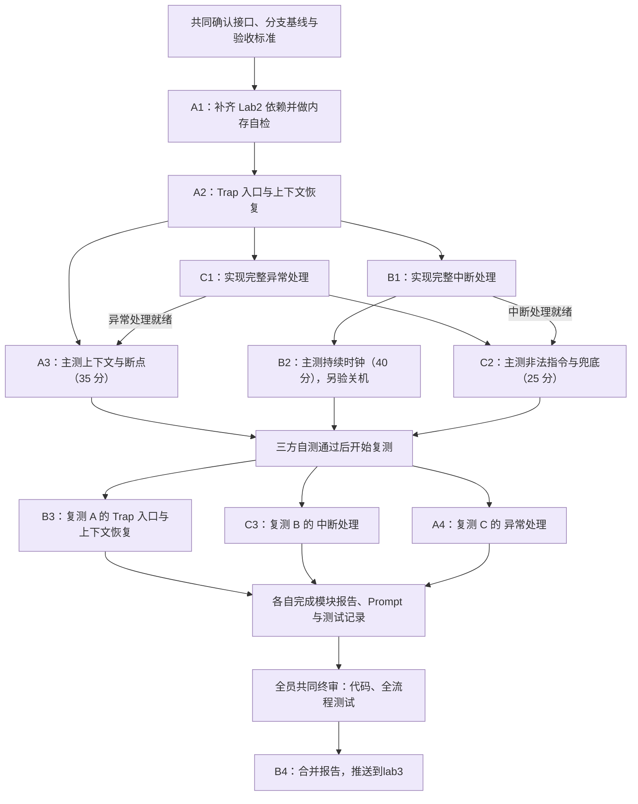

#### 六、复测、报告与共同终审

1. **各自自测。** A、B、C 分别确认自己的主测项通过，记录对应代码提交、环境、命令、日志和截图。
2. **循环复测。** B 复测 A，C 复测 B，A 复测 C。复测人独立重新构建、运行；问题由对应实现人修复，修复后复测受影响的功能。
3. **各自写报告。** 每人完成自己模块的功能说明、Spec、实际使用的 Prompt、真实问题及修复过程、自测和复测记录。
4. **B 合并报告。** B 汇总各人的材料，统一报告格式、术语、图表、图片引用和测试结果。
5. **全员共同终审。** 在终审阶段汇总待合并版本，三人共同确认完整评分达到 100/100、关机验证通过、复测结论齐备、报告与代码一致。确认两个占位函数均已替换，并更新 README 中过时的占位提示，保留历史 Prompt 记录。
6. **B 合并分支。** 共同终审通过后，由 B 将验收通过的版本通过 PR 合并到 `Lab3`，并记录最终提交。若代码在复测后有变化，补测受影响的功能。

---
