# 操作系统实验报告

## 实验基本信息

| 项目 | 内容 |
|------|------|
| **实验名称** | Lab 2: 物理内存和页表 |
| **小组成员** | 2412700-甘文杰 2412712-王子楸 2413318-向宇航 |
| **完成日期** | 2026-10-22 |

### 小组分工

练习如何分工？

| 成员 | 负责的练习/模块 |
|------|----------------|
| 2412700-甘文杰 | 实现 Best-Fit 连续物理内存分配算法，双GDB调试与交叉验证 |
| 2412712-王子楸 | Buddy System 分配器的设计、实现、接入与独立测试 |
| 2413318-向宇航 | 实现物理内存探测与页描述符初始化功能，实现 SLUB 分配器和相关测试 |

实验报告如何分工？

---

## 一、实验目的

本实验的主要目的是：

1. 理解 ucore 物理页管理框架，掌握 `Page` 描述符、空闲链表和连续物理页分配之间的关系。
2. 实现并接入 Best-Fit 连续物理页分配器，验证块选择、拆分、回收合并和计数维护。
3. 使用双 GDB 调试 QEMU 与 RISC-V ucore，观察 Bare 模式、Sv39 页表转换和 QEMU 软件 TLB 的工作过程。

---

## 二、实验环境

你们使用的 AI 工具

| 成员 | AI 编程工具 | 底层模型 | 备注 |
|------|------------|---------|------|
| 2412700-甘文杰 | Codex | GPT-6.0-Luna | 无 |
| 2412712-王子楸 | Codex | GPT-6.1 Sol High | 无 |
| 2413318-向宇航 | Codex | GPT-6.1 Sol Light & Medium | 无 |

**说明：**
- **AI 编程工具**：指具体使用的终端工具、编辑器插件、桌面应用或浏览器界面
- **底层模型**：指该工具使用的大语言模型及版本

---

## 三、实验整体逻辑分析

### 3.1 本章节的逻辑主线

本章围绕物理内存管理和地址转换展开。内核首先依据设备树确定可用物理内存，建立 `Page` 描述符数组；随后通过统一的 PMM 接口登记、分配和回收连续物理页。在此基础上，启动页表将内核映射到高虚拟地址，处理器通过 Sv39 完成虚拟地址到物理地址的转换，QEMU 则使用软件 TLB 缓存转换结果。

个人任务 B1–B4 沿着这条主线逐步推进：先实现 Best-Fit 分配器，再将其接入内核并完成验收；随后建立双 GDB 调试环境，最后跟踪一次真实的 Sv39 页表转换和软件 TLB 回填过程。

### 3.2 功能的逐步实现

本组按照模块依赖关系安排实现与验证顺序：

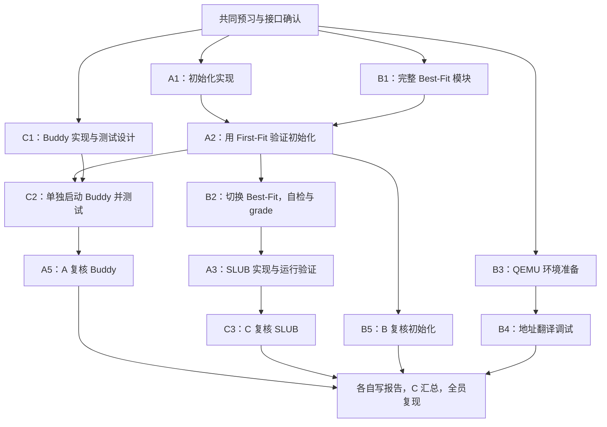
具体而言：

- A 是 2413318-向宇航；
- B 是 2412700-甘文杰；
- C 是 2412712-王子楸；

箭头表示实现或运行验证之间的依赖关系。

---

## 四、实验内容与实现

<!-- 
说明：本部分按照 exercises 文档中的练习顺序组织
每个功能模块或者练习中可能包含多项任务，请根据实际情况调整
-->

### 功能模块：[模块名称]

**负责人：** [学号-姓名]

### 功能模块：实现 Best-Fit 连续物理内存分配算法（功能模块二 · 任务三）

**负责人：** 2412700-甘文杰

#### 任务目标与模块关系

B1 的目标是在 `kern/mm/best_fit_pmm.c` 中实现完整的 Best-Fit 连续物理页分配器，B2 则将该分配器接入内核的 PMM 框架。内存探测和页描述符初始化由 `page_init()` 完成；Best-Fit 接收已经登记的可用页区间，负责后续的连续页分配、回收和空闲块维护。

PMM 的初始化顺序为：`pmm_init()` → `init_pmm_manager()` → `best_fit_init()` → `page_init()` → `best_fit_init_memmap()` → `best_fit_check()`。初始化完成后，`alloc_pages()`、`free_pages()` 和 `nr_free_pages()` 通过 `struct pmm_manager` 中的函数指针调用 Best-Fit 实现。

B2 阶段通过 `pmm.c` 注册为当前 `pmm_manager`。实现复用 `struct Page` 和地址有序双向链表：`best_fit_init()` 建立空闲链表并清零计数；`best_fit_init_memmap()` 将初始连续页登记为空闲块；`best_fit_alloc_pages(n)` 从所有满足请求的空闲块中选页数最少者，必要时拆分余块；`best_fit_free_pages()` 按地址插入释放块并合并紧邻的左右块；`best_fit_nr_free_pages()` 返回空闲页数。

#### 数据结构与状态维护

分配器沿用 ucore 的 `Page` 描述符和双向链表。`free_area_t` 中的 `free_list` 保存空闲块首项，`nr_free` 记录空闲页总数。每个空闲块只有第一页设置 `PageProperty`，其 `property` 表示连续页数；所有空闲块按物理地址从低到高排列。

实现过程中始终维护以下关系：

- `nr_free` 等于所有空闲块页数之和；
- 空闲链表中的节点均为空闲块首项；
- 已分配页面不保留在空闲链表中；
- 相邻空闲区间在释放时合并为一个连续块。

#### 接口实现

| 接口 | 主要职责 |
|------|----------|
| `best_fit_init()` | 初始化空闲链表，并将空闲页计数置零。 |
| `best_fit_init_memmap(base, n)` | 初始化连续页描述符，将区间登记为一个空闲块，并按地址插入链表。 |
| `best_fit_alloc_pages(n)` | 遍历空闲块，选择能够满足请求且页数最少的块；分配后拆分剩余区间。 |
| `best_fit_free_pages(base, n)` | 恢复页描述符状态，按地址插入空闲块，并依次完成左合并和右合并。 |
| `best_fit_nr_free_pages()` | 返回当前空闲页总数。 |
| `best_fit_check()` | 运行框架提供的固定断言，检查分配、拆分、失败返回和回收行为。 |

Best-Fit 与 First-Fit 使用相同的数据结构和回收逻辑，区别集中在候选块的选择。First-Fit 找到第一个足够大的空闲块后立即分配；Best-Fit 扫描全部候选块，从中选择页数最少的一个。对于大小相同的候选块，地址有序链表使分配器稳定地选择低地址块。

例如，空闲链表依次包含 8 页、3 页和 5 页三个块，请求 4 页时，First-Fit 会选择 8 页块，Best-Fit 则选择 5 页块，并将剩余的 1 页重新登记为空闲块。

一次分配的状态变化可以概括为“选择、摘除、拆分、计数”四步：先找出最合适的空闲块，将其从链表中移除；若块大小超过请求页数，就从分配区间之后建立新的空闲块；最后清除已分配块首项的空闲标志，并从 `nr_free` 中扣除实际分配的页数。释放过程与之相反，先恢复页描述符并按地址插回链表，再检查左右相邻块是否连续。地址有序既保证了相同大小时选择结果稳定，也使释放时能够直接判断相邻块并完成合并。

#### 完成结果

已有验收记录显示，Best-Fit 构建退出码为 `0`；限时 QEMU 运行到 `check_alloc_page() succeeded!` 后因内核进入循环而由 `timeout` 停止，退出码 `124` 属预期停止结果；`make -C code grade` 退出码为 `0`，Page Init 与 Best-Fit 均为 `OK`，总分 `20/20`。其中内核的 `best_fit_check()` 检查分配算法行为，评分中的 Best-Fit 项确认管理器注册。

#### 思考题：你的 Best-Fit 算法是否有进一步的改进空间？

有。当前空闲块按地址保存在链表中，若有 `k` 个空闲块，分配时需要扫描全部候选以找到最小的合适块，时间复杂度为 `O(k)`；释放时为保持地址顺序查找插入位置也需要 `O(k)`。可以增加按块大小组织的平衡树，以 `(块大小, 地址)` 为键，将 Best-Fit 候选查找降至约 `O(log k)`。但只按大小排序会削弱相邻物理块的快速定位能力；要兼顾释放合并，通常需要同时维护地址索引和大小索引，并在分配、拆分、释放、合并时同步更新，复杂度和出错风险也会增加。

Best-Fit 也不保证所有请求序列下都能减少碎片，它可能留下许多无法满足较大连续请求的小块。改进效果应通过相同的分配/释放轨迹比较扫描步数、空闲块数、最大连续块和总空闲页数来评估。

#### 内核接入

B2 在 `kern/mm/pmm.c` 的 `init_pmm_manager()` 中将管理器注册为 `best_fit_pmm_manager`。内核启动后，`page_init()` 通过统一接口登记可用内存，`check_alloc_page()` 再调用管理器的 `check` 回调执行 `best_fit_check()`，由此完成从内存初始化到算法自检的完整调用链。

#### AI 协作过程

实现过程按照“阅读 First-Fit 与固定测试 → 明确接口和状态不变量 → 编写 Best-Fit Spec → 完成 B1 实现 → 审查数据结构变化 → 完成 B2 接入与验收”的顺序推进。提示词将允许修改的文件、接口职责、选择规则、拆分合并行为和验收命令分别写明，完整记录见 `report/prompt.md`。

#### 实现迭代过程

##### 第一次迭代：B1 实现与独立审查

实现集中在 `kern/mm/best_fit_pmm.c` 的原占位区域，保留 `//lab2 function2-2 2412700` 标记。Git 历史包含 `74e5381` 和 `e7bde35` 中的 Best-Fit 实现；从初始版本到当前 HEAD 的 Best-Fit 文件差异位于实现区域，固定测试区域保持不变。

独立 harness 的一次检查曾因手工填写的总页数期望值错误而失败。定位后修正的是临时 harness 的期望值，生产分配器代码未因此修改；记录的重跑结果通过。没有发现或修复 Best-Fit 生产代码 Bug。B1 审查阶段的完整构建曾因当时 A 的 `page_init()` 尚未实现而受阻，之后 A 的实现进入分支，B2 基线构建通过。

##### 第二次迭代：B2 接入与运行验收

default First-Fit 基线构建和启动自检通过后，`pmm.c` 的 `init_pmm_manager()` 已将管理器指针切换为 `best_fit_pmm_manager`，并保留既有初始化和打印逻辑。该注册切换已随提交 `585b259`（`feat(lab2): integrate and document Best-Fit allocator`）进入当前分支历史。Best-Fit 构建、QEMU 自检和自动评分结果见下方 B2 验收记录。

2026-10-23 合并同步：merge 提交 `c86c559` 保留编译期选择，顺序为 Buddy → 显式 First-Fit → 默认 Best-Fit。配套 Makefile 默认 `PMM=best_fit`，`PMM=first_fit` 定义 `PMM_USE_FIRST_FIT`；显式选择 Buddy、Best-Fit 分别使用 `PMM=buddy`、`PMM=best_fit`。切换配置前执行 `make clean`。下方 B2 结果保留为原阶段验收记录。

### 功能模块：Buddy System 物理页分配（功能模块二 · 任务三）

**负责人：** 2412712-王子楸


#### 模块功能描述

**需要实现/修改的函数：**

```c
// kern/mm/buddy_pmm.c：分配器回调与注册对象
static void buddy_init(void);
static void buddy_init_memmap(struct Page *base, size_t n);
static struct Page *buddy_alloc_pages(size_t n);
static void buddy_free_pages(struct Page *base, size_t n);
static size_t buddy_nr_free_pages(void);
static void buddy_check(void);
const struct pmm_manager buddy_pmm_manager;

// kern/mm/buddy_test.c：独立测试入口与用例
void buddy_test_all(void);
static void test_init_memmap(void);
static void test_split_merge(void);
static void test_rounding(void);
static void test_failure(void);
static void test_reuse(void);
static void test_invalid_request(unsigned int case_id);

// kern/mm/pmm.c：管理器选择与条件测试接入
static void init_pmm_manager(void);
void pmm_init(void);
```

**功能说明：**

`page_init()` 确定可用页范围，Buddy 将其组织为各阶空闲块：`buddy_init()` 准备管理结构，`buddy_init_memmap()` 登记页面，`buddy_alloc_pages()` 按请求选择并拆分块，`buddy_free_pages()` 校验参数后回收并合并真正伙伴，`buddy_nr_free_pages()` 提供空闲页统计。模块通过现有 `pmm_manager` 接口接入，不改变其他成员的物理内存初始化逻辑。

模块处理非对齐初始区间、非二次幂请求、空间不足及非法释放。`buddy_check()` 用于实际内存初始化后的基础检查；独立测试由 `buddy_test_all()` 统一调度。相关文件为 [buddy_pmm.c](../code/kern/mm/buddy_pmm.c)、[buddy_test.c](../code/kern/mm/buddy_test.c) 及其头文件。

#### 最终提示词

两份最终提示词全文见 [prompt.md](./prompt.md) 的“任务三：Buddy System”部分：第一份用于生成分配器并接入内核，第二份用于针对该实现设计独立测试。

#### 实现迭代过程

本模块按“生成分配器并接入、补充独立测试”两个阶段推进，分别记录如下。

---

##### 第一次迭代：分配器实现与接入

**遇到的问题：**

初次验证调用了环境中默认的 QEMU 7.0.0，原启动流程出现异常，未能完成内存检查。核对指导书后，确认实验应使用 QEMU 4.1.1。

**问题解决策略：**

安装课程指定版本，在运行命令中显式指定其路径；删除排错时新增的临时兼容文件，按原启动方式重新验证。本次调整集中在运行环境，分配器算法主体未改写。

**最终结果：**

- 分配模块及管理器注册结构编译通过。
- 能通过 `PMM=buddy` 选择该管理器并正常启动。
- 在规定版本下通过基础自检，完成第一阶段交付。

---

##### 第二次迭代：独立测试与回归验证

依据第二份提示词增加测试代码、条件入口和运行脚本。测试代码首次编译、执行通过，未发现需要修复的算法错误。

**最终结果：**

- 独立测试能够编译运行，正常用例及非法调用均符合预期。
- 测试完成后能够恢复环境，并继续内核初始化。
- 关闭扩展测试后，原有分配器的启动检查通过；具体覆盖、输出和截图统一见第五部分。

**关键改进点总结：**

验证由分配器自身的基础检查扩展为独立预期模型和明确的非法调用判据，使生成代码的行为可以逐项核查。

---

### 练习：[练习标题]

**负责人：** [学号-姓名]

[按照练习的具体要求进行解答]

---

### Challenge：[Challenge标题]

**负责人：** [学号-姓名]

[按照Challenge的具体要求进行解答]

---

## 五、测试与验证

<!-- 根据该实验的具体情况，提供完整的测试运行截图，应包含：
- 编译及运行成功的输出（make qemu），可能有多个
- 测试通过的结果（make grade），只有一个
-->

### A1：物理内存初始化阶段验证

本线负责人为 2413318-向宇航。

在lab2代码的修改之前，运行 `make qemu`，可以编译过程中有报错，如下图所示：


从中可见是基线代码中 best-fit 模块未实现导致。

在添加完初始化函数，并且补全了 best-fit 模块后，运行 `make qemu`，如下图所示：


此时可以成功编译。

此时运行本次实验提供的测试脚本 `make grade`，可以看到初始函数的验证通过，截图如下：


截图显示 Page Init 为 `OK`，Best-Fit 为 `WRONG`，总分 `10/20`。这是 Best-Fit 接入验收前的中间结果，后续会在 B2 阶段完成 Best-Fit 的接入和验收。


### B1：Best-Fit 分配器验证

`best_fit_check()` 在隔离的空闲链表环境中执行算法自检，覆盖空闲页计数、基本分配与回收、空链表返回、块拆分，以及 1 页和 2 页候选块的最优选择。测试结束后恢复原有 `free_list` 和 `nr_free`，因此能够直接嵌入内核初始化流程。

结合独立测试，对算法行为进行了进一步检查：

| 场景 | 检查内容 |
|------|----------|
| 精确匹配 | 请求页数等于空闲块大小时，整块从链表移除。 |
| 最优选择 | 多个候选块同时满足请求时，选择其中最小的连续块。 |
| 确定性 | 候选块大小相同时，选择物理地址较低的空闲块。 |
| 拆分 | 分配块小于候选块时，剩余页重新形成有效空闲块。 |
| 合并 | 分别检查左合并、右合并和双侧合并。 |
| 分配失败 | 总页数不足或缺少足够大的连续块时返回 `NULL`。 |
| 状态恢复 | 反复分配和释放后，空闲块结构与页数恢复。 |

### B2：构建、启动与自动评分

从仓库根目录运行 Best-Fit 构建、启动自检和自动评分：

```sh
make -C code
timeout --foreground --signal=INT --kill-after=2s 8s make -C code qemu
make -C code grade
```

| 阶段 | 运行命令/方式 | 关键输出与结果 |
|------|----------|----------------|
| default First-Fit 基线 | `make`；`timeout --foreground --signal=INT --kill-after=2s 6s make qemu` | `make` 退出 0。QEMU 输出 `memory management: default_pmm_manager`、空闲页区间及 `check_alloc_page() succeeded!`。QEMU 以 124 结束，是内核进入空闲循环后由超时安全停止。 |
| Best-Fit 集成 | `make`；`timeout --foreground --signal=INT --kill-after=2s 8s make qemu` | `make` 退出 0。QEMU 输出 `memory management: best_fit_pmm_manager`、登记 31929 个空闲页及 `check_alloc_page() succeeded!`；后一句出现在 `pmm_manager->check()` 返回之后，表明固定 `best_fit_check()` 未触发断言。QEMU 以 124 安全停止。 |
| 自动评分 | `make grade` | 退出 0；评分输出两项 `OK`，并以 `Total Score: 20/20` 结束。 |
| 显示评分串口行 | 在临时副本运行 `tools/inject.py` 和 `make`，再启动 QEMU 并将串口输出接到标准输出；完整 shell 命令和临时路径未留存 | 实际输出 `[Test 1] Page Init: PASS`、`[Test 2] Best-Fit: PASS`。有界 QEMU 退出码 124，停止原因同上。 |

`make grade` 将评分用副本和串口文件放在 `/tmp/lab2_grade`，评分后清理该目录；因此评分终端显示 `OK`，不直接显示串口 PASS 行。PASS 行另由上表所述的临时副本串口运行核对。

QEMU 启动截图显示内核已选择 `best_fit_pmm_manager`，物理页初始化完成，且 `check_alloc_page()` 自检通过。

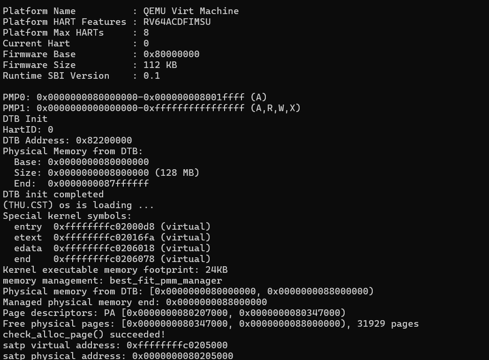

自动评分截图显示 Page Init 与 Best-Fit 检查均为 OK，总分为 20/20。


构建、内核自检和自动评分结果一致，说明 Best-Fit 已通过 PMM 接口完成注册，并能参与实际的物理页初始化和分配流程。

### B3：QEMU 宿主机与 ucore 客体双 GDB 联调

B3 的目标是建立两层调试环境：宿主 GDB 观察 QEMU 模拟器自身的执行，RISC-V GDB 通过 QEMU 的 GDB stub 观察 ucore 客体。实验复用带调试信息的 QEMU 4.1.1，并通过 Makefile 的 `QEMU` 变量传入调试版可执行文件和源码路径。

调试时，宿主 GDB 直接启动 QEMU，并在 `riscv_cpu_tlb_fill()` 设置源码断点；另一个终端中的客体 GDB 使用 `make gdb` 连接 `localhost:1234`。宿主 GDB 加载 QEMU 的符号和源码，用于观察模拟器如何处理客体访存；客体 GDB 加载 `bin/kernel`，用于查看 ucore 的 `pc`、`satp`、指令和内核函数。QEMU 暂停在宿主断点时，客体 CPU 也随之暂停；宿主端继续执行后，客体端才会继续运行。

| 调试层 | 观察结果 |
|------|----------|
| 宿主层 | 能够解析 QEMU 源码，命中 `riscv_cpu_tlb_fill()`，并查看从 CPU 执行到地址翻译的调用栈。 |
| 客体启动状态 | 成功连接 GDB stub，初始 `pc=0x1000`、`satp=0`，能够读取寄存器和反汇编指令。 |
| ucore 内核入口 | 临时断点命中 `kern_init`，此时 `pc=0xffffffffc02000d8`、`satp=0x8000000000080205`。 |
| 联动执行 | 宿主层控制 QEMU 的运行与暂停，客体层同步反映 ucore 当前执行位置。 |

首先在客体端运行 `make gdb`，确认 RISC-V GDB 能够加载 `bin/kernel` 并连接 QEMU 的 1234 端口。图中初始 `pc=0x1000`、`satp=0`，且能够正常反汇编当前指令，说明客体 GDB 已经取得虚拟 CPU 的执行状态。随后设置 `kern_init` 临时断点，用于观察 ucore 从固件启动阶段进入内核后的变化。

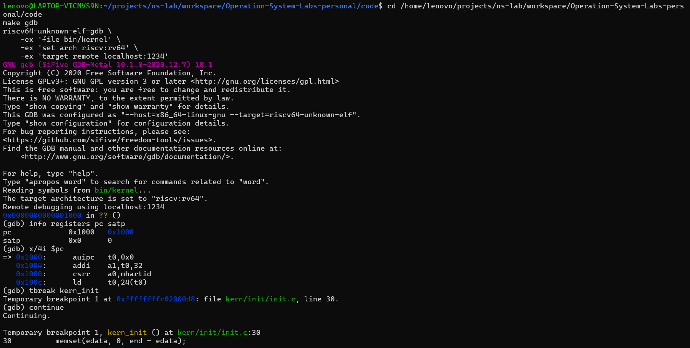

内核运行到 `kern_init` 后再次读取寄存器。图中 `pc` 已变为高虚拟地址 `0xffffffffc02000d8`，`satp` 也由 0 变为 `0x8000000000080205`，同时 GDB 能够识别函数名并反汇编内核指令。这说明客体调试符号有效，并且 ucore 已经完成页表切换，开始在高地址空间执行。

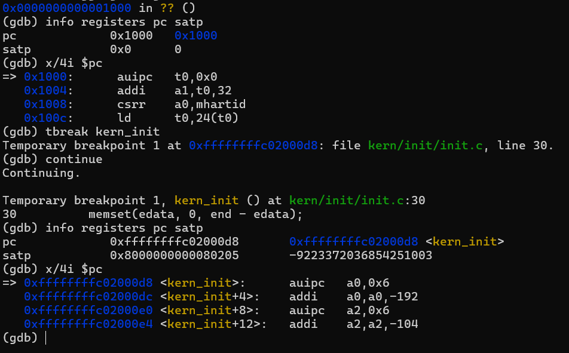

宿主端需要先确认调试版 QEMU 与源码相匹配。图中 GDB 成功读取 QEMU 符号，并通过 `info functions` 和 `list` 定位到 `target/riscv/cpu_helper.c` 中的 `riscv_cpu_tlb_fill()`。这一步说明宿主 GDB 可以按源码函数设置断点，而不只是查看汇编地址。

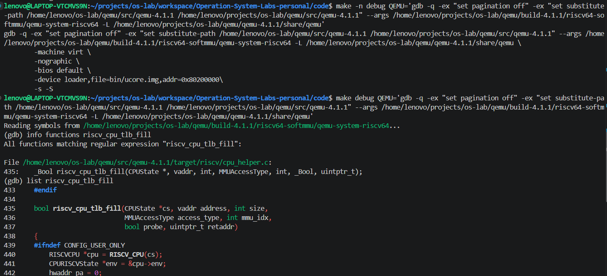

断点命中后使用 `bt` 查看调用栈。图中可以看到执行路径从 QEMU 的 CPU 执行循环进入取指查找，在软件 TLB 未命中后依次调用 `tlb_fill()` 和 `riscv_cpu_tlb_fill()`。该结果证明宿主 GDB 已经真正进入 QEMU 的地址转换流程，也为 B4 继续观察 Sv39 页表查找提供了断点位置。

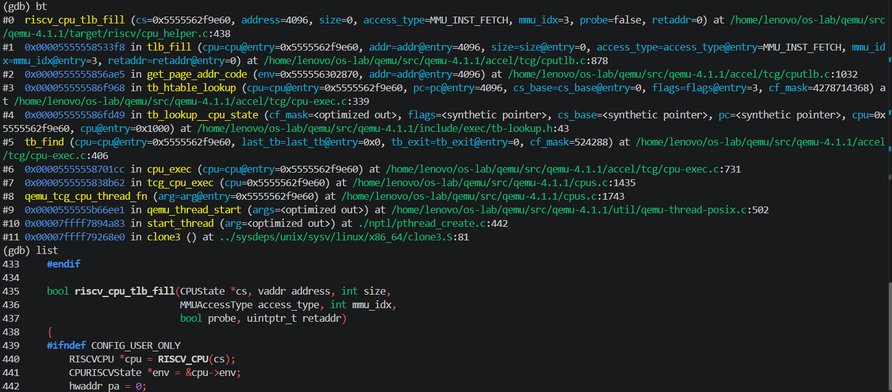

以上结果分别验证了客体内核调试和宿主模拟器调试：客体端可以观察 ucore 的执行状态，宿主端可以观察 QEMU 如何执行这段客体代码，两者能够围绕同一次启动过程配合工作。

### B4：QEMU 软件 TLB 与 Sv39 地址转换跟踪

B4 在双 GDB 环境中跟踪一次完整的地址转换过程，观察内核从 Bare 模式进入 Sv39 后，QEMU 如何处理软件 TLB 未命中、读取页表项并安装新的地址映射。断点分别设置在地址翻译、TLB 填充和映射安装位置，并通过访问地址筛选本次需要观察的内核访存。

#### 整体执行流程与观察思路

处理器执行程序时，取指、读数据和写数据都会产生一个待访问地址。QEMU 会先在软件 TLB 中查找该虚拟页的现有映射：命中时直接使用缓存结果，未命中时才进入 TLB 填充过程。填充时，如果 `satp=0`，地址处于 Bare 模式，可以直接作为物理地址使用；如果 `satp` 已启用 Sv39，则需要从 `satp` 指向的根页表开始查找 PTE，得到物理页和访问权限，再把结果写入软件 TLB。因此，本次调试并不是任意选择一个地址，而是沿着 ucore 的真实启动流程，依次等待三次具有代表性的首次访问。

ucore 从启动到触发这些访问的过程如下：

1. QEMU 启动后先执行 OpenSBI，客体 GDB 此时观察到 `pc=0x1000`、`satp=0`。OpenSBI 完成初始化后，将控制权交给加载在物理地址 `0x80200000` 的 ucore。
2. 处理器准备执行 `kern_entry` 的第一条指令时，需要从 `0x80200000` 取指。由于软件 TLB 中还没有这个页的映射，第一次与 ucore 相关的 TLB 填充由此触发。此时 `satp` 仍为 0，所以得到的是 `VA=PA` 的直接映射。
3. `kern_entry` 先保存 hart ID 和设备树地址，再计算 `boot_page_table_sv39` 的物理页号。随后执行 `csrw satp, t0` 启用 Sv39，并通过 `sfence.vma` 清除旧的 TLB 映射。
4. 页表启用后，`kern_entry` 将栈指针设置为高虚拟地址 `bootstacktop`，再跳转到同样位于高地址空间的 `kern_init`。由于刚刚刷新了 TLB，处理器第一次从 `0xffffffffc02000d8` 取指时再次发生未命中，这一次必须通过启动页表完成地址转换。
5. 客体 GDB 在 `kern_init` 入口停下，用 `pc` 和 `satp` 确认内核已经进入 Sv39 高地址空间。继续执行后，函数序言先将 `sp` 减少 16 字节，再执行 `sd ra, 8(sp)` 保存返回地址，于是产生对 `0xffffffffc0204ff8` 的 8 字节写入。
6. 该写入位于新的数据页 `0xffffffffc0204000`，软件 TLB 中尚无对应数据映射，因此触发本次重点观察的 TLB 填充。QEMU 根据启动页表得到物理页 `0x80204000`，安装页级映射后，实际写入地址为 `0x80204ff8`。


两个 GDB 在这一过程中承担不同任务。宿主 GDB 运行 QEMU，并在地址转换和 TLB 安装位置等待；客体 GDB 连接 QEMU 的 GDB stub，控制 ucore 继续执行或停在 `kern_init`。客体端执行 `continue` 后，虚拟 CPU 开始运行；当宿主断点命中时，整个 QEMU 进程暂停，客体端也会暂时等待。宿主端记录本次访问并继续后，客体才会向下执行。利用这种交替控制，可以把 ucore 中的一条取指或栈写入，与宿主端观察到的 TLB 填充对应起来。

下面的截图按照上述顺序，分别验证 Bare 模式直接映射、启用 Sv39 后的高地址取指，以及 `kern_init` 栈写入触发的数据页转换。

#### Bare 模式下的首次取指转换

首先观察页表尚未启用时的取指，目的是为后续 Sv39 转换建立对照。OpenSBI 完成基础初始化后，将控制权交给位于物理地址 `0x80200000` 的 ucore。图中 `get_physical_address()` 收到的地址为 `0x80200000`，`satp=0`，访问类型为取指；调用栈表明这次转换由软件 TLB 未命中触发。

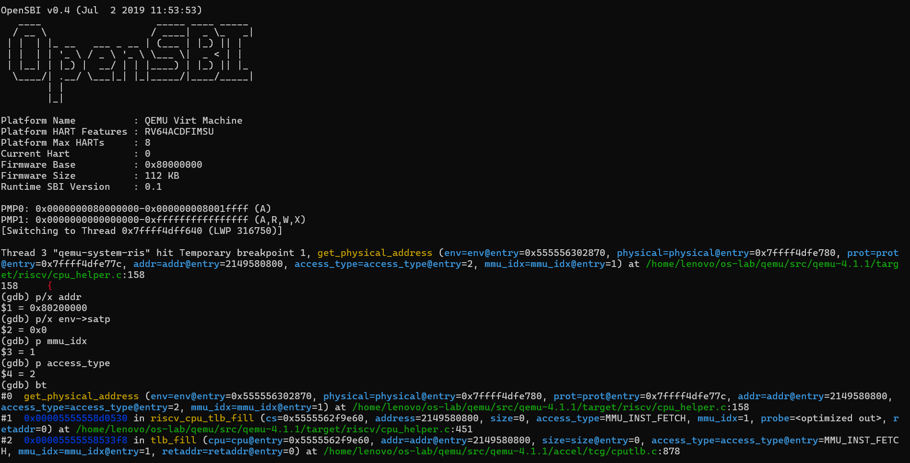

由于处理器仍处于 Bare 模式，地址不会经过 Sv39 页表，转换结果为 `VA=PA=0x80200000`。继续执行后，QEMU 调用 `tlb_set_page_with_attrs()` 安装映射；图中 `vaddr` 和 `paddr` 相同，`size=4096`，说明 QEMU 以 4 KiB 页为单位缓存了这段直接映射。同一页内的后续取指可以直接复用该结果。

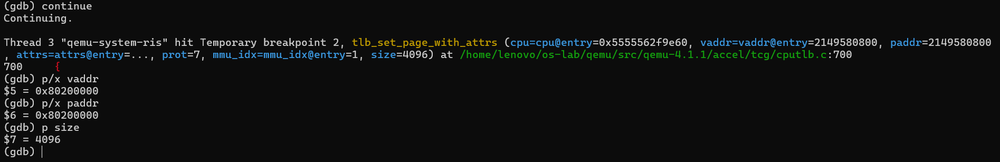

#### 启用 Sv39 后的高地址取指

接下来观察启用页表后的第一次高地址取指，目的是确认内核何时从直接访问物理地址切换到 Sv39。`entry.S` 将启动页表写入 `satp`，通过 `sfence.vma` 使旧的地址转换缓存失效，再跳转到高地址的 `kern_init`。图中新的访问地址为 `0xffffffffc02000d8`，`satp=0x8000000000080205`，调用栈仍从取指路径进入地址翻译函数。

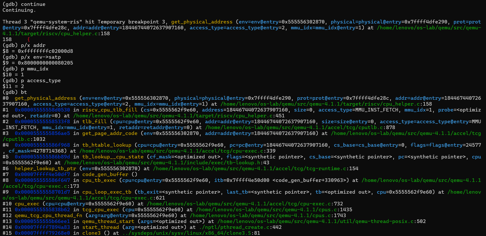

`satp` 的最高位表示当前使用 Sv39，低位给出根页表的物理页号。结合 B3 中客体端在同一地址命中 `kern_init`，可以确认 ucore 已经离开低地址启动阶段，QEMU 正在使用页表解释内核的高虚拟地址。

#### 数据写入触发 TLB 未命中、页表遍历和映射安装

进入 `kern_init` 后继续观察第一次具有代表性的数据访问，用于说明代码执行如何引出新的 TLB 映射。处理器先在代码页连续取指，函数序言随后调整栈指针，并通过 `sd ra, 8(sp)` 保存返回地址：栈顶原为 `0xffffffffc0205000`，下移 16 字节后，写入地址为 `0xffffffffc0204ff8`。这仍是 `kern_init` 的正常执行过程，只是访问对象从指令变成了栈数据。

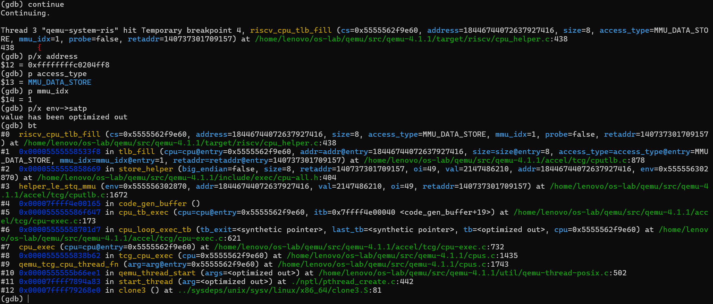

图中 `address=0xffffffffc0204ff8`、`size=8`、`access_type=MMU_DATA_STORE`，与保存 8 字节返回地址的指令相符。该地址属于数据页 `0xffffffffc0204000`，此前的取指映射不能直接用于这次数据写入，因此 QEMU 进入 `riscv_cpu_tlb_fill()` 为目标页补充映射。

随后在页表读取位置停下，目的是查看 QEMU 用哪个页表项完成转换。QEMU 从 `satp` 取得根页表位置，再根据虚拟地址的 VPN 计算索引。图中根层索引为 `511`，页表项地址为 `0x80205ff8`，读取到的内容为 `0x200000cf`。

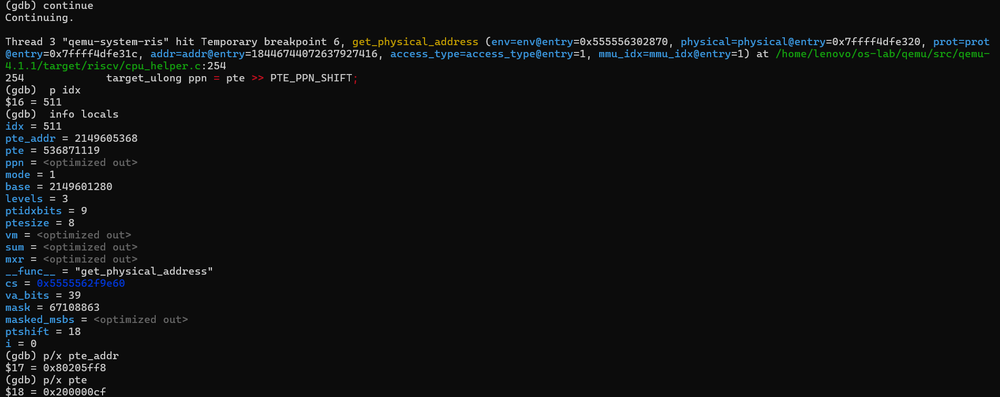

`0x200000cf` 的 V 位表明页表项有效，R/W/X 位表明它是可以直接给出映射的叶子项，A/D 位则反映该映射已经被访问和写入。因此本次转换在根层即可完成，无需继续读取下一级页表。

最后在 TLB 安装位置观察转换的输出。图中 QEMU 将结果按页对齐，建立 `VA 0xffffffffc0204000 → PA 0x80204000` 的 4 KiB 映射，`prot=7` 表示允许读、写和执行。这个画面把前面的虚拟地址、页表项和最终物理页连接成了完整结果。

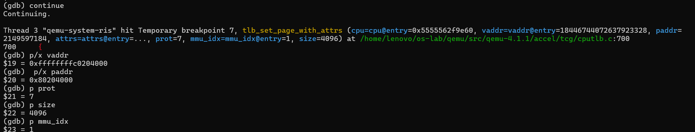

原始写入地址在页内的偏移为 `0xff8`，该偏移在转换前后保持不变，因此实际访问的字节物理地址为 `0x80204000 + 0xff8 = 0x80204ff8`。这次跟踪由此形成完整链路：Bare 模式直接访问内核入口，启用 Sv39 后进入高虚拟地址，再由 `kern_init` 的栈写入触发页表查找，最终把页级映射写入 QEMU 软件 TLB。后续访问同一虚拟页时可以复用该映射，只需保留各自的页内偏移。

### C1：Buddy 实现与测试设计

**负责人：** 2412712-王子楸

本任务负责实现 Buddy 分配器，并设计验证其正确性的测试；独立启动与实际运行结果列于 C2。

[buddy_pmm.c](../code/kern/mm/buddy_pmm.c) 实现 `buddy_init()`、`buddy_init_memmap()`、`buddy_alloc_pages()`、`buddy_free_pages()`、`buddy_nr_free_pages()` 和 `buddy_check()`，通过 `buddy_pmm_manager` 接入现有 PMM 框架。实现按阶管理空闲块，申请时向上取整并拆分，释放时按绝对物理页号 XOR 查找同阶伙伴并合并，同时维护页面标记与空闲计数。接口及实现过程见第四节“Buddy System 物理页分配”。

[buddy_test.c](../code/kern/mm/buddy_test.c) 使用 64 个静态页描述符构造受控状态，由独立逐页归属表核对分配区不重叠、块对齐、页面标记和空闲计数。正常测试覆盖如下。

| 测试组 | 验证内容 |
|---|---|
| 区域登记（4 个场景） | 对齐区域、非对齐起点的 13 页、分次登记的相邻区域及带保留间隙的区域，检查页面遗漏、重复分配和跨保留区合并 |
| 拆分与合并 | 整块拆为单页；释放相邻但非伙伴的页后无法申请 2 页，补齐伙伴后可逐级合并 |
| 非二次幂请求 | 请求 1、2、3、5、8、9 页，实际占用分别为 1、2、4、8、8、16 页；按原请求长度释放后计数恢复 |
| 分配失败 | 空状态、耗尽、超大请求及碎片化状态下返回失败，管理状态保持有效 |
| 重复使用 | 进行 16 轮混合申请与不同顺序释放，每轮均可重新申请完整区域 |

正常用例共 8 个场景，每次操作均与独立模型核对。非法调用另设零页申请、重复释放、错误释放长度、内部页释放、重复登记和越界登记 6 个用例；每个用例独立启动，只在预期位置触发对应断言时判为符合预期。

分配器与测试源码的编译、链接结果见下图，其中包括 `buddy_pmm.c`、`buddy_test.c` 及最终内核镜像生成。


### C2：单独启动 Buddy 并测试

**负责人：** 2412712-王子楸

本任务在可用的物理内存初始化基础上，显式选择 Buddy 后端并单独启动，验证 C1 实现和测试的实际行为。详细说明见 [Buddy 使用说明](./buddy_usage.md)。

在 WSL 中使用 QEMU 4.1.1，以 `PMM=buddy BUDDY_TEST=1` 显式启用 Buddy 及独立测试。运行输出 `memory management: buddy_pmm_manager`，确认实际选用了 Buddy 后端。

8 个正常场景均通过。测试结束后恢复全局状态，继续真实 `page_init()` 和 `buddy_check()`，基础自检前后空闲页数均为 31926。


6 个非法调用用例分别启动 QEMU，均在预期位置触发断言；超时或其他位置的崩溃不计为通过。下图为错误释放长度的验证结果。


在仓库根目录执行以下命令，可运行本线测试并保存日志：

```bash
cd code
bash tools/run_buddy_tests.sh \
    "$HOME/.local/opt/qemu-4.1.1/bin/qemu-system-riscv64"
```

上述阶段关闭独立测试后，Buddy 的启动自检通过；4 种非法测试构建配置均被拒绝。当前脚本另覆盖显式 First-Fit、显式 Best-Fit 和不传 `PMM` 参数的默认 Best-Fit，逐项核对管理器名称与公共自检输出，默认构建回归放在最后并在成功结束后保留。本次验证使用单 hart，结果摘要见 [Buddy 使用说明](./buddy_usage.md)。旧日志不再随仓库保存；重新运行上述脚本可在 `report/buddy_tests/` 生成完整日志与 `summary.log`。


合并同步复测：使用 QEMU 4.1.1、RISC-V GCC 10.2.0 运行完整脚本，退出码为 0。八个正常场景、六个非法调用、四种后端回归和四个非法配置检查全部符合预期；默认及显式 Best-Fit 输出 `best_fit_pmm_manager`，显式 First-Fit 输出 `default_pmm_manager`，Buddy 输出 `buddy_pmm_manager`，各正常启动均通过公共自检。脚本成功结束后保留默认 Best-Fit 构建；本次未运行 `make grade`。

### C3：SLUB 独立复核

**负责人：** 2412712-王子楸

本任务复核 A3 的 SLUB 实现，并独立编译运行现有测试。源码检查覆盖类别选择、16 字节对齐、大小溢出、空闲链表维护及页面回收，在单核串行、合法原始指针的接口约定内未发现实现缺陷。

在 `lab2` 提交 `02f14ca` 上复测，使用 WSL Ubuntu、QEMU 4.1.1、RISC-V GCC 15.1.0，配置为 128 MiB、单 hart、Best-Fit。清理旧产物后，以 `PMM=best_fit DEFS=-DSLUB_TEST=1` 编译，使用独立目录 `obj/slub-test`、`bin/slub-test`，编译、链接及镜像生成成功。

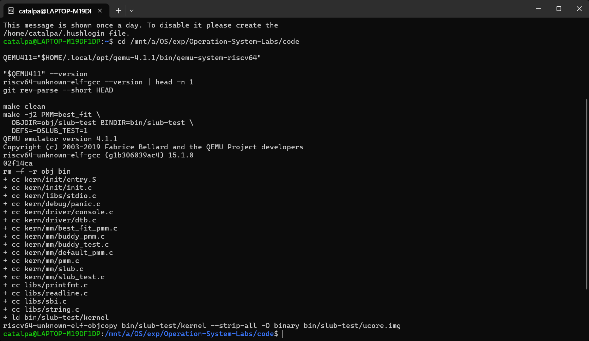

运行输出 `memory management: best_fit_pmm_manager`，原有 PMM 自检通过。零大小与 NULL、类别边界、对象隔离、释放复用、多 slab、即时回收、大对象、失败与耗尽、384 轮混合操作共九组测试均输出 PASS。耗尽场景实际临时占用 31859 页；最终输出 `ALL 9 CASES PASSED: baseline=31862 final=31862`，测试结束后空闲页数完整恢复。

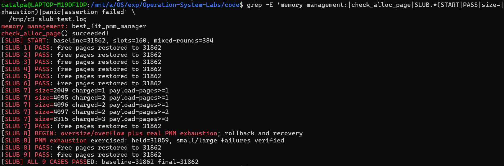

关闭 `SLUB_TEST` 后重新清理、编译并启动，内核仍选择 Best-Fit，输出 `check_alloc_page() succeeded!`，未出现 SLUB 测试输出。此时空闲页数为 31929，与测试版的差异来自内核代码和静态测试数据占用。内核初始化后继续循环，图中的 signal 15 由预设超时结束 QEMU 触发。

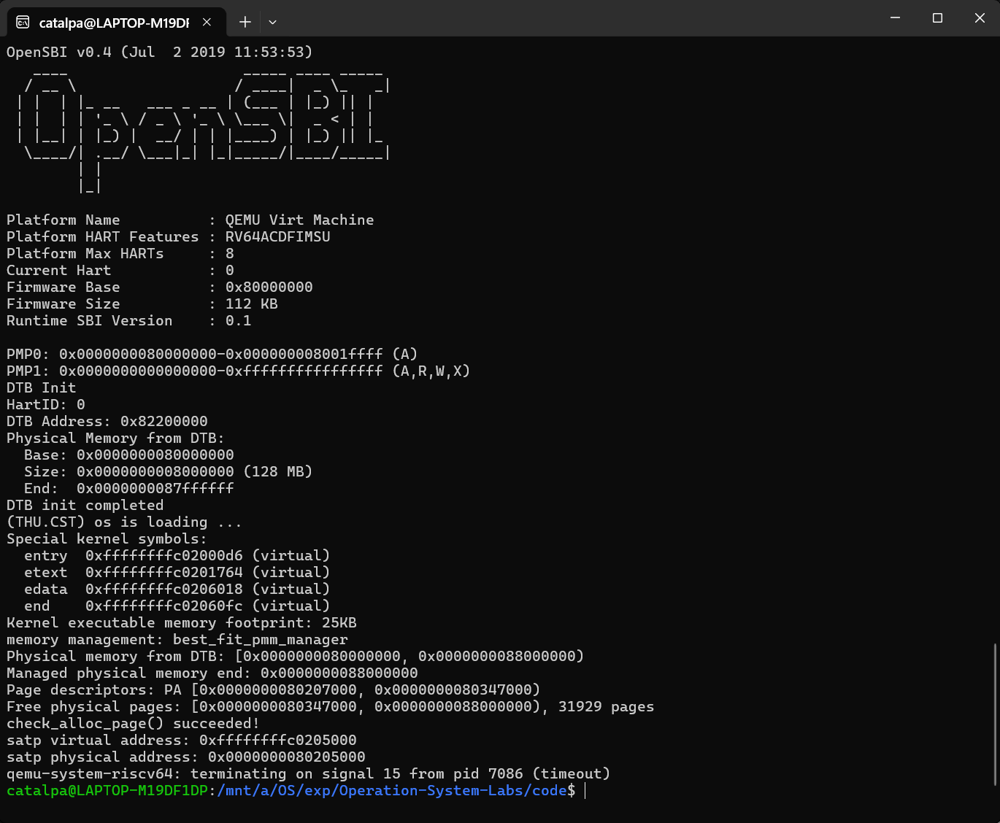


### A3：Buddy System 验证

在当前声明的单 hart、整块释放约定下，未发现需要阻塞合入的 Buddy 正确性问题。
检查结果：
- 按阶拆分、绝对物理页号 XOR 寻找伙伴、同阶合并和空闲计数逻辑一致。
- 非对齐区域、非二次幂长度、分次登记相邻区域及保留空洞处理合理。
- 向上取整后的整个块被保留；释放必须传原始请求长度，错误长度、内部页释放和重复释放均有断言保护。

验证边界：独立测试最多使用 64 页，较高阶块缺少专门测试；本次未运行 make grade，也未验证并发和实际物理页数据读写。工作区源码未修改。

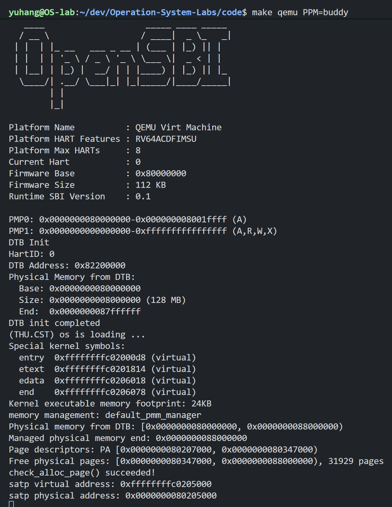

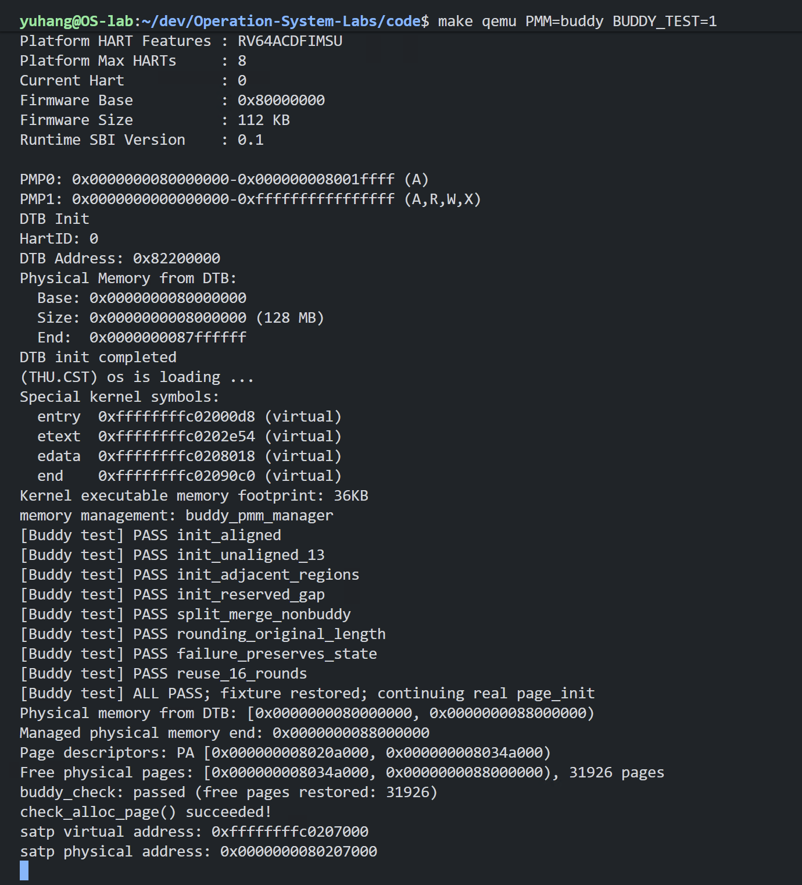

---

## 六、实验总结与收获

### 对操作系统的理解

1. 列出你们认为本实验中重要的知识点，以及与对应的 OS 原理中的知识点，并简要说明二者的含义、关系和差异
2. 列出你们认为 OS 原理中很重要、但在本实验中没有对应上的知识点

#### Buddy module

通过实现 Buddy 模块，我加深了对物理页、页描述符和分配器接口之间关系的理解。拆分与合并需要同时维护块的边界、状态和空闲计数，局部操作正确才能保证后续分配可靠。请求取整产生的内部碎片也说明，分配策略需要兼顾实现成本与空间利用率。页替换、缺页处理和多核同步仍需在后续学习中进一步掌握。

#### Other

本实验把物理页分配和虚拟地址转换连接成了一条完整路径。PMM 负责管理“哪些物理页可用”，页表负责描述“虚拟页对应哪个物理页”，TLB 则缓存近期使用的转换结果。三者分工不同，但共同决定了内核访问内存时的正确性和效率。

Best-Fit 的实现进一步体现了操作系统对共享状态的维护要求。链表顺序、块首标志、块长度和空闲页总数必须同步更新；任一状态不一致，都可能在后续分配或合并时扩大为内存管理错误。B4 的动态调试则将课本中的 Sv39 过程落实到具体运行值，包括 `satp`、VPN 索引、PTE、物理页地址和 TLB 缓存项。


### AI 协作开发的经验

[写出你们在与 AI 协作过程中实际收获的经验或者感悟]

本次协作让我认识到，清晰的接口约定和边界条件是有效使用 AI 的基础。将实现与测试分别描述，有助于逐项核对生成代码的行为。验证时还应确认工具版本，保存实际命令与输出，使代码、测试结果和报告相互对应。

---

AI 主要用于辅助阅读代码、整理接口约束和设计验证步骤。实现前先根据固定测试形成明确的规格，再限制允许修改的文件和接口范围，可以使生成结果更贴合实验框架。调试阶段则以实际断点、寄存器和调用栈为依据逐步核对推导，使源码分析与运行现象能够相互验证。

### Best-Fit 的时间开销与改进空间

当前 `best_fit_alloc_pages()` 需要遍历整条空闲链表，在存在 `k` 个空闲块时，选择过程的时间复杂度为 O(k)。按地址插入释放块同样需要线性查找，而找到相邻节点后的合并操作可以在常数时间内完成。相比之下，First-Fit 在遇到第一个合适块时即可结束查找，平均扫描长度通常更短。

进一步优化可以同时维护地址索引和大小索引：地址索引用于定位相邻块并完成合并，平衡树或分桶结构则用于快速找到最小可用块。这样的设计能够降低查找开销，但也会增加索引同步和空间管理成本。碎片方面，Best-Fit 倾向于保留较大的完整空闲块，同时也可能形成较小的剩余块，因此实际效果与请求序列和空闲块分布密切相关。


---
