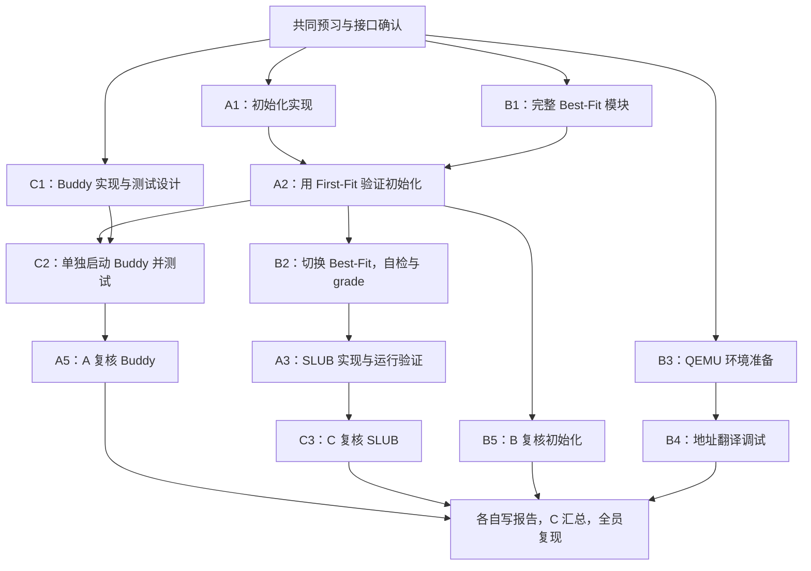
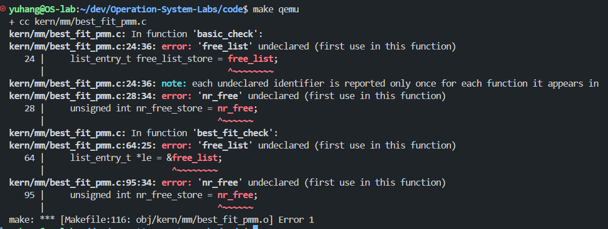
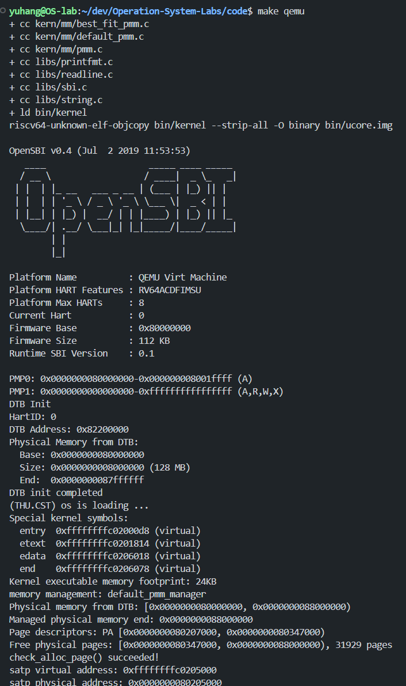
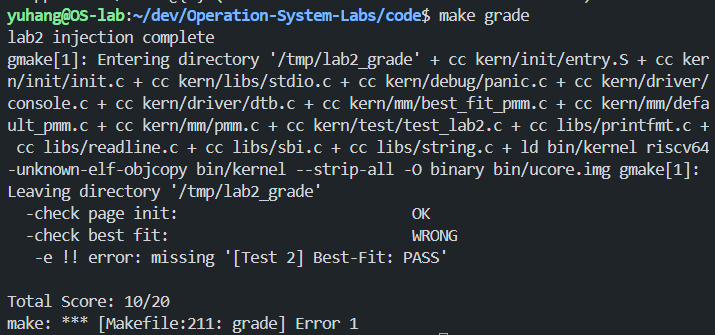

# 操作系统实验报告

## 实验基本信息

| 项目 | 内容 |
|------|------|
| **实验名称** | Lab 2: 物理内存和页表 |
| **小组成员** | 2412700-甘文杰 2412712-王子楸 2413318-向宇航 |
| **完成日期** | YYYY-MM-DD |

### 小组分工

练习如何分工？

| 成员 | 负责的练习/模块 |
|------|----------------|
| 2412700-甘文杰 | 实现 Best-Fit 连续物理内存分配算法 |
| 2412712-王子楸 | [练习或模块名称] |
| 2413318-向宇航 | 实现物理内存探测与页描述符初始化功能 |

实验报告如何分工？

---

## 一、实验目的

<!-- 说明本次实验的主要目标和预期成果 -->

本实验的主要目的是：

1. [目的1：例如，理解用户态进程如何通过系统调用进入内核]
2. [目的2：例如，掌握进程创建、执行、退出的完整生命周期]
3. [目的3：例如，学习使用 AI 辅助开发操作系统核心功能]

---

## 二、实验环境

你们使用的 AI 工具

| 成员 | AI 编程工具 | 底层模型 | 备注 |
|------|------------|---------|------|
| 学号1-姓名1 | [例如：Cline（VS Code插件） / Claude Code（终端 Agent） / DeepSeek Harness等] | [例如：Claude Sonnet 4.5 / GPT-5.5 / DeepSeek-V4-Flash等] | [可选：特殊配置等] |
| 学号2-姓名2 | | | |
| 2413318-向宇航 | Codex | GPT-6.1 Sol Light | 无 |

**说明：**
- **AI 编程工具**：指具体使用的终端工具、编辑器插件、桌面应用或浏览器界面
- **底层模型**：指该工具使用的大语言模型及版本

---

## 三、实验整体逻辑分析

### 2.1 本章节的逻辑主线

[请用自己的话描述本章实验的核心主线，例如：
- 本章围绕哪个核心主题展开？（例如：用户进程管理、虚拟内存、文件系统等）
- 整个实验解决什么问题？（例如：如何让用户程序运行在操作系统之上）]

### 2.2 功能的逐步实现

由于很难在开发前完全确定下来分工和顺序，我们在 AI 的帮助下，设计了如下的分工和实现顺序：


具体而言：

- A 是 2413318-向宇航；
- B 是 2412700-甘文杰；
- C 是 2412712-王子楸；

箭头表示这一步的交付或运行验证依赖前一步。不表示必须等前一步结束才开始阅读、设计或写代码。

---

## 四、实验内容与实现

<!-- 
说明：本部分按照 exercises 文档中的练习顺序组织
每个功能模块或者练习中可能包含多项任务，请根据实际情况调整
-->

### 功能模块：Best-Fit 连续物理页分配器

**负责人：** 2412700-甘文杰

#### 模块功能描述

该模块为内核提供连续物理页的分配与回收。`struct pmm_manager` 定义统一的分配器回调；B1 在 `kern/mm/best_fit_pmm.c` 实现 Best-Fit 管理器，B2 在 `kern/mm/pmm.c` 的 `init_pmm_manager()` 注册该管理器。A 负责的 `page_init()` 仍负责从 DTB 获取内存范围、初始化 Page 描述符并登记可用区间，分配策略不负责探测物理内存。

初始化调用顺序为：`pmm_init()` → `init_pmm_manager()` → 管理器 `init()` → `page_init()` → `init_memmap()` → 管理器 `init_memmap()` → `check_alloc_page()` → 管理器 `check()`。之后 `alloc_pages()`、`free_pages()` 和 `nr_free_pages()` 都通过 `pmm_manager` 的函数指针动态分派。相关接口见 `kern/mm/pmm.h`，调用与注册见 `kern/mm/pmm.c`。

**接口职责：**

| 接口 | 职责 |
|------|------|
| `best_fit_init(void)` | 初始化空的双向空闲链表，并将 `nr_free` 清零。 |
| `best_fit_init_memmap(struct Page *base, size_t n)` | 将已保留的连续页描述符初始化为一个空闲块，设置块首 `PageProperty` 和 `property`，更新空闲页数并按地址插入链表。 |
| `best_fit_alloc_pages(size_t n)` | 在所有足够大的空闲块中选择页数最少的块；必要时拆分，并返回分配块首描述符；无合适块时返回 `NULL`。 |
| `best_fit_free_pages(struct Page *base, size_t n)` | 恢复释放页状态，按地址插入空闲链表，合并相邻左块和右块。 |
| `best_fit_nr_free_pages(void)` | 返回当前空闲页数。 |
| `best_fit_check(void)` | 运行文件中已有的固定分配器断言测试；管理器对象的 `.check` 指向此函数。 |

`free_area_t` 保存 `free_list` 和 `nr_free`。空闲块首项用 `PageProperty` 标记，`property` 表示该块页数；链表按物理页地址排序。正常状态下，`nr_free` 等于链表各块 `property` 之和，已分配页不在空闲链表中。对未设置 `PageProperty` 的描述符，`property` 数值不代表有效空闲块长度。

#### First-Fit 与 Best-Fit 的区别

两种算法复用相同的 `Page` 描述符、`free_area_t`、按地址排序的双向链表、`PageProperty` 块首标记及 `nr_free` 计数；都通过拆分来满足较小请求，并在释放时检查前后相邻块。区别在候选块选择：`default_pmm.c` 的 First-Fit 遇到第一个 `property >= n` 的块便停止；`best_fit_pmm.c` 遍历全部块，选择其中 `property` 最小者。等长候选时，Best-Fit 保留地址较低的先遇到块。

例如，按地址顺序有 8 页、3 页和 5 页三个空闲块，请求 4 页。First-Fit 选 8 页块，留下 4 页；Best-Fit 选 5 页块，留下 1 页。这个例子只说明单次选择结果，不代表 Best-Fit 对长期外部碎片有普遍保证。

#### 最终提示词

提示词按“需求梳理 → 源码与固定测试阅读 → Best-Fit Spec → B1 实现 → B1 审查 → B2 接入验收”的顺序逐步细化，完整记录见 `report/prompt.md`。实施阶段的核心要求如下：

````markdown
[PROMPT]
仅在 kern/mm/best_fit_pmm.c 实现完整的连续物理页 Best-Fit 分配器，并让它可作为 pmm_manager 注册。

[RELY]
复用 pmm.h 的 pmm_manager 接口、memlayout.h 的 Page/free_area_t/页面标志、libs/list.h 的双向链表，以及 default_pmm.c 的初始化、拆分和合并方式。

[GUARANTEE]
实现 init、init_memmap、alloc_pages、free_pages、nr_free_pages、check 回调和 best_fit_pmm_manager；保持 basic_check()、best_fit_check() 与其他框架文件不变。

[SPECIFICATION]
从所有大小不小于 n 的空闲块中选最小者，同尺寸选低地址；无连续块时返回 NULL 且不改变状态。分配后正确拆分余块，释放后按地址插入并合并左右相邻块。B2 仅在基线通过后，将 pmm.c 的 init_pmm_manager() 注册对象切换为 best_fit_pmm_manager，并运行 make、QEMU 与 make grade。
````

#### 实现迭代过程

##### 第一次迭代：B1 实现与独立审查

实现集中在 `kern/mm/best_fit_pmm.c` 的原占位区域，保留 `//lab2 function2-2 2412700` 标记。Git 历史包含 `74e5381` 和 `e7bde35` 中的 Best-Fit 实现；从初始版本到当前 HEAD 的 Best-Fit 文件差异位于实现区域，固定测试区域保持不变。

独立 harness 的一次检查曾因手工填写的总页数期望值错误而失败。定位后修正的是临时 harness 的期望值，生产分配器代码未因此修改；记录的重跑结果通过。没有发现或修复 Best-Fit 生产代码 Bug。B1 审查阶段的完整构建曾因当时 A 的 `page_init()` 尚未实现而受阻，之后 A 的实现进入分支，B2 基线构建通过。

##### 第二次迭代：B2 接入与运行验收

default First-Fit 基线构建和启动自检通过后，只在 `pmm.c` 的 `init_pmm_manager()` 将管理器指针改为 `best_fit_pmm_manager`，保留既有初始化和打印逻辑。此次审阅时，Best-Fit 实现已在 HEAD 中；B2 注册切换是 `pmm.c` 的一行工作区改动，尚未提交。

### 练习：[练习标题]

**负责人：** [学号-姓名]

[按照练习的具体要求进行解答]

---

### Challenge：[Challenge标题]

**负责人：** [学号-姓名]

[按照Challenge的具体要求进行解答]

---

## 五、测试与验证

<!-- 根据该实验的具体情况，提供完整的测试运行截图，应包含：
- 编译及运行成功的输出（make qemu），可能有多个
- 测试通过的结果（make grade），只有一个
-->

### B1：Best-Fit 分配器验证

固定 `best_fit_check()` 检查空闲块首标记与 `nr_free` 总量、基本分配/释放、空链表分配失败、拆分以及对 1 页块和 2 页块的选择。其临时测试会保存 `free_list` 和 `nr_free`，隔离链表并将计数清零，完成后恢复原状态。`tools/test_lab2.c` 中的 `test_best_fit()` 只检查管理器注册指针；实际算法断言由 `pmm_init()` 调用的 `best_fit_check()` 执行。

此前记录的独立临时 harness 还覆盖精确匹配、最小合适块、同尺寸低地址、地址排序、左右/双侧合并、碎片化失败、超总量失败和重复分配释放后恢复。该 harness 源码和原始输出没有保存在仓库中，以下仅作为历史运行记录，不是可从仓库直接重放的测试。

### B2：构建、启动与自动评分

| 阶段 | 运行命令/方式 | 关键输出与结果 |
|------|----------|----------------|
| default First-Fit 基线 | `make`；`timeout --foreground --signal=INT --kill-after=2s 6s make qemu` | `make` 退出 0。QEMU 输出 `memory management: default_pmm_manager`、空闲页区间及 `check_alloc_page() succeeded!`。QEMU 以 124 结束，是内核进入空闲循环后由超时安全停止。 |
| Best-Fit 集成 | `make`；`timeout --foreground --signal=INT --kill-after=2s 8s make qemu` | `make` 退出 0。QEMU 输出 `memory management: best_fit_pmm_manager`、空闲页区间及 `check_alloc_page() succeeded!`；后一句出现在 `pmm_manager->check()` 返回之后，表明固定 `best_fit_check()` 未触发断言。QEMU 以 124 安全停止。 |
| 自动评分 | `make grade` | 退出 0；评分输出两项 `OK`，并以 `Total Score: 20/20` 结束。 |
| 显示评分串口行 | 在临时副本运行 `tools/inject.py` 和 `make`，再启动 QEMU 并将串口输出接到标准输出；完整 shell 命令和临时路径未留存 | 实际输出 `[Test 1] Page Init: PASS`、`[Test 2] Best-Fit: PASS`。有界 QEMU 退出码 124，停止原因同上。 |

`make grade` 将评分用副本和串口文件放在 `/tmp/lab2_grade`，评分后清理该目录；因此它的终端显示 `OK`，不直接显示串口 PASS 行。评分脚本用这两条精确字符串进行检查；PASS 行另由上表的临时副本串口运行核对。当前报告记录的是关键输出，没有附加并不存在的截图文件。

### 阶段性问题与未覆盖边界

- B1 审查时的一次全项目构建因 A 的 `page_init()` 尚未实现而失败；这是当时的跨成员前置条件缺失。A 的实现合入后，default 基线和 Best-Fit 构建、启动均通过，不属于 Best-Fit 分配器 Bug。
- 临时 harness 首次运行时使用了错误的手工总页数期望值。定位后改正 harness 期望值并重编重跑通过，没有修改生产代码。
- 没有独立测试 `n == 0`、非法或重叠释放、极大页数/计数溢出、并发分配、其他 DTB 内存布局、压力下长期碎片率或分配器性能。调用者应遵守接口前置条件；当前结果不能证明上述边界。
- 本轮整理时当前仓库没有 `docs/lab2/requirements.md`，相关课程要求需再对照原文件人工复核。B1 harness 的原始源文件和输出也未归档。

### 验证初始化函数

在lab2代码的修改之前，运行 `make qemu`，可以编译过程中有报错，如下图所示：



从中可见是基线代码中 best-fit 模块未实现导致。

在添加完初始化函数，并且补全了 best-fit 模块后，运行 `make qemu`，如下图所示：



此时可以成功编译。

此时运行本次实验提供的测试脚本 `make grade`，可以看到初始函数的验证通过，截图如下：



---

## 六、实验总结与收获

### 对操作系统的理解

1. 列出你们认为本实验中重要的知识点，以及与对应的 OS 原理中的知识点，并简要说明二者的含义、关系和差异
2. 列出你们认为 OS 原理中很重要、但在本实验中没有对应上的知识点

### AI 协作开发的经验

[写出你们在与 AI 协作过程中实际收获的经验或者感悟]

### Best-Fit 的时间开销与改进空间

当前 Best-Fit 为了找到最小可用块，`best_fit_alloc_pages()` 必须扫描整条空闲链表；若链表中有 `k` 个空闲块，选择开销为 O(k)。按地址插入新空闲块也需线性查找，合并本身在找到相邻节点后为常数时间。First-Fit 的最坏查找同样是 O(k)，但找到首个可用块时可提前结束。当前实现只维护一条地址有序链表，没有大小索引，也没有实测性能对比。

一种理论改进是增加按大小组织的平衡树或分桶索引，使查找候选块更快；释放合并仍需要按地址查找相邻块，因此可能要维护第二个地址索引。额外索引会增加空间和一致性维护成本，本实验没有实现。Best-Fit 选择较小的可用块能减少该次分配留下的尾部空间，但可能产生更多很小、难以再利用的空闲块；不能仅凭算法名称断言它总能降低外部碎片。

---

