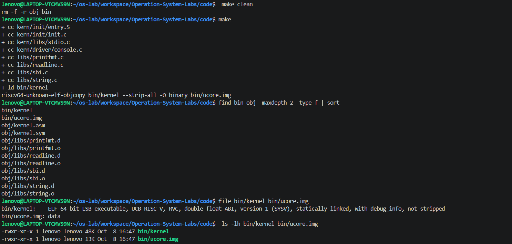
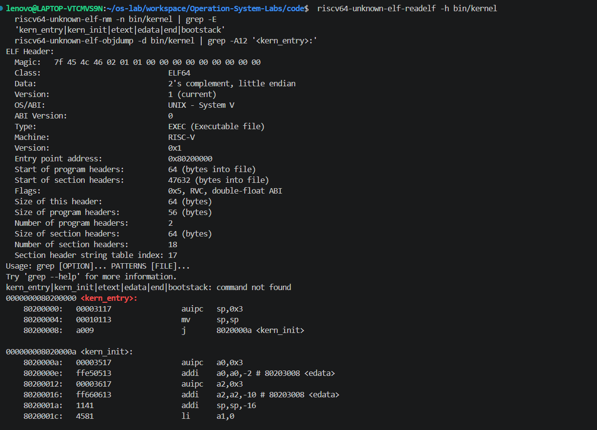
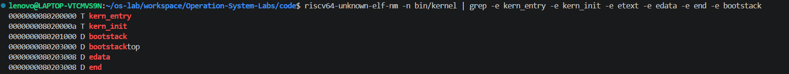
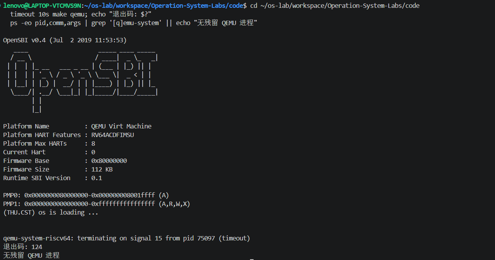
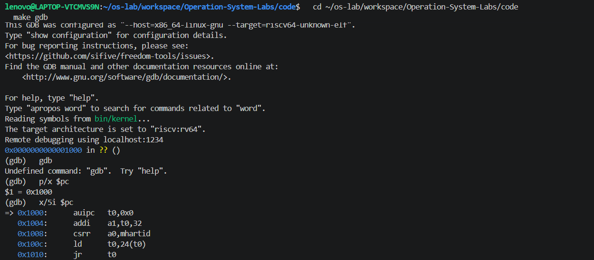
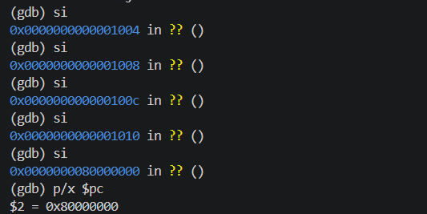
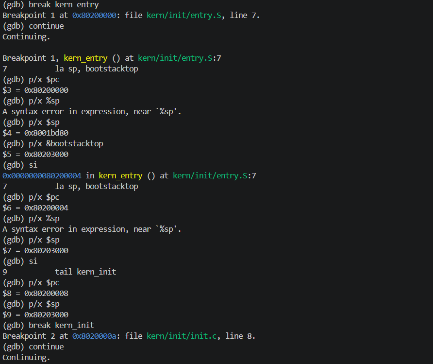
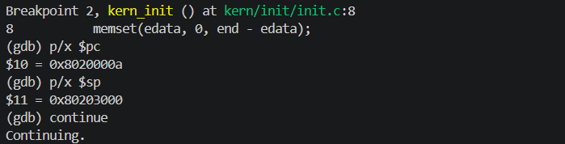

# 操作系统实验报告

## 实验基本信息

| 项目 | 内容 |
|---|---|
| **实验名称** | Lab1：最小可执行 RISC-V 内核与启动流程 |
| **小组成员** |  | 甘文杰 2412700 王子楸 2412712 向宇航2413318 |
| **完成日期** | 2026-10-07 至 2026-10-08 |

### 小组分工

| 成员 | 负责的练习/模块 |
|---|---|
|甘文杰  | 工具链、QEMU 环境与构建流程   |
|王子楸  | 练习 1：内核入口与栈；练习 2：QEMU/GDB 启动跟踪，并进行代码 review  |
|向宇航  | 进行代码review，启动结果复核、测试证据整理，完善整理报告   |

---

## 一、实验目的

本实验围绕 **RISC-V 最小可执行内核如何被构建、装载并启动** 展开。需要先理解编译、链接、镜像装载和固件交接之间的关系。

1. 使用 `riscv64-unknown-elf` 交叉工具链，将 C/汇编源码编译成目标文件，由链接脚本组织内存布局，生成 ELF 内核和裸二进制镜像。
2. 理解 QEMU `virt` 模拟机的启动过程，区分复位代码（Reset ROM）、OpenSBI 固件与内核入口的职责，并结合具体地址说明执行流如何逐级转移。
3. 分析 `kern_entry` 如何设置内核栈并跳转到 `kern_init`，理解链接脚本、汇编段、栈空间和 C 初始化的联系。
4. 分析内核如何利用 OpenSBI 提供的 SBI 服务，通过 `ecall` 将格式化字符串输出到 QEMU 控制台。
5. 通过 `readelf`、`nm`、`objdump` 和 QEMU/GDB 的静态、动态验证，证明源码中的启动设计与 CPU 的实际运行结果一致。

---

## 二、实验环境

| 项目 | 环境与版本 |
|---|---|
| 宿主与开发环境 | x86-64 主机；WSL2，Ubuntu 22.04.5 LTS |
| GNU Make | 4.3 |
| RISC-V 交叉编译器 | `riscv64-unknown-elf-gcc` 10.2.0 |
| RISC-V 调试器 | `riscv64-unknown-elf-gdb` 10.1 |
| QEMU | `qemu-system-riscv64` 4.1.1 |
| 工具链路径 | `~/os-lab/toolchain/current/` |
| QEMU 路径 | `~/os-lab/qemu/current/` |
| 实验源码 | `Operation-System-Labs/code/` |
| 主要调试方式 | QEMU GDB Stub；`localhost:1234` |

### AI 辅助工具

| 成员 | AI 编程工具 | 底层模型 | 备注 |
|---|---|---|---|
|  | Codex CLI |GPT6-luna  | 用于实验环境检查、运行与验证流程辅助 |
|  | Claude Code | DeepSeek Flash | 用于源码阅读、概念解释及实验复盘辅助 |
|  |  |  |  |

> AI 提示词原文记录在同目录的 `prompt.md`。实验结论以实际源码、构建产物、GDB 输出和截图为依据。

---

## 三、实验整体逻辑分析

### 3.1 本章节的逻辑主线

本实验从已有的最小内核源码出发，依次解决三个不同层面的问题：**如何生成内核、如何让模拟机启动内核、内核如何完成最早期的运行和输出**。

```text
【构建阶段：由主机上的工具完成】
  .c / .S 源码
      │  riscv64-unknown-elf-gcc
      ▼
  .o 目标文件
      │  riscv64-unknown-elf-ld + tools/kernel.ld
      ▼
  bin/kernel                 ELF：入口、段、符号、调试信息
      │  riscv64-unknown-elf-objcopy -O binary
      ▼
  bin/ucore.img              裸二进制内核镜像

【模拟机启动前：QEMU 配置模拟硬件与装入字节】
  QEMU virt 机器 + 默认 OpenSBI 固件
      ├── Reset ROM / 复位入口：0x1000
      ├── OpenSBI 固件：       0x80000000 附近
      └── ucore.img：          0x80200000 开始（-device loader）

【CPU 实际执行阶段：观察 PC 的变化】
  PC = 0x1000               Reset ROM
      │  读启动参数、取得下一阶段入口、跳转
      ▼
  PC = 0x80000000           OpenSBI（M-mode）
      │  初始化并安排进入内核（S-mode）
      ▼
  PC = 0x80200000           kern_entry
      │  sp ← bootstacktop = 0x80203000
      ▼
  PC = 0x8020000a           kern_init
      │  处理 BSS 清零区间、调用 cprintf
      ▼
  SBI ecall → OpenSBI → QEMU 控制台
      │
      ▼
  (THU.CST) os is loading ...
      │
      ▼
  while (1)
```

这里区分 **“字节已经装入内存”** 和 **“CPU 开始执行这些字节”**。前者是 QEMU 启动配置和镜像加载阶段的行为；后者由 CPU 的 PC（程序计数器）驱动。本实验并不是让 OpenSBI 在运行后自己读取磁盘上的 `ucore.img`：当前 `Makefile` 的 `-device loader` 已要求 QEMU **在 CPU 执行前**将内核镜像放入 `0x80200000`。OpenSBI 在该配置下主要负责固件初始化和向已装入内核的控制权交接。


### 3.2 功能的逐步实现及其依赖关系

| 顺序 | 工作 | 为什么要先完成这一项 |
|---|---|---|
| 1 | 阅读 `Makefile`、入口汇编和链接脚本 | 先知道参与构建的文件、预计入口与加载地址，形成待验证的启动路径 |
| 2 | 交叉编译、链接并生成 `ucore.img` | 模拟的 CPU 只能执行 RISC-V 机器指令，不能直接执行 C 源码或 x86 可执行文件 |
| 3 | 静态检查 ELF 入口和符号 | 先验证构建产物的架构、入口、栈符号位置，避免直接把源码配置当成运行结果 |
| 4 | 启动 QEMU，观察 OpenSBI 和内核输出 | 验证镜像放置、固件交接和最小 C 内核可以形成完整运行闭环 |
| 5 | 使用 GDB 单步并设置断点 | 将 `0x1000 → 0x80000000 → 0x80200000` 以及 `sp` 的变化变成直接可观察的证据 |
| 6 | 整理两个练习、代码调用链和测试截图 | 用真实输出解释原理 |

### 3.3 主要代码目录与职责

当前 `lab1` 分支的 `code/` 结构精简，主要目录和文件为：

| 路径 | 职责 | 本次运行中的作用 |
|---|---|---|
| `Makefile` | 构建、链接、生成镜像、启动 QEMU/GDB | 贯穿实验所有操作 |
| `tools/function.mk` | Makefile 辅助规则 | 自动组织编译目标与依赖 |
| `tools/kernel.ld` | 链接脚本 | 安排 section、入口和符号地址 |
| `kern/init/entry.S` | 最初的内核汇编入口 | 设置内核栈、转入 C |
| `kern/init/init.c` | 最早期 C 初始化函数 | 处理 BSS 区间、输出启动信息 |
| `kern/mm/mmu.h`、`kern/mm/memlayout.h` | 页大小、内核栈大小常量 | 为 `entry.S` 提供对齐和栈容量 |
| `kern/libs/stdio.c` | 内核格式化输出的上层封装 | `cprintf`、`vcprintf`、逐字符输出 |
| `kern/driver/console.c` | 控制台抽象 | 将字符输出交给 SBI |
| `libs/printfmt.c` | 格式字符串处理 | 解析 `%s` 等格式占位符 |
| `libs/sbi.c`、`libs/sbi.h` | SBI 调用封装 | 设置服务号/参数寄存器并执行 `ecall` |
| `libs/string.c`、`libs/string.h` | 基础字符串/内存操作 | 提供 `memset` |
| `libs/defs.h`、`libs/stdarg.h`、`libs/stdio.h` | 基础类型、变长参数、接口声明 | 支撑内核自有运行库 |
| `libs/riscv.h`、`libs/error.h`、`libs/readline.c` | 架构定义、错误处理、行输入 | 提供通用能力，并非当前启动路径的全部执行内容 |

---

## 四、实验内容

### 4.1 功能模块一：交叉编译、链接与内核镜像生成

#### 4.1.1 为什么需要交叉编译

开发机使用 x86-64 指令集，而 QEMU 当前模拟的是 64 位 RISC-V CPU。若直接用普通宿主 `gcc` 生成 x86 机器代码，目标 CPU 无法解释这些指令。因此使用 `riscv64-unknown-elf-gcc`：编译器本身运行在 x86-64 Ubuntu 中，但输出的是 RISC-V 目标文件。

源代码被分开编译为 `.o` 目标文件，每个目标文件含有自己的代码与数据 section，以及尚待链接器处理的符号引用和重定位信息。`Makefile` 用 `riscv64-unknown-elf-ld` 将多个 `.o` 组合成一个 ELF 内核；最后再用 `objcopy` 生成适合本次 QEMU loader 直接放入内存的裸镜像。

#### 4.1.2 Makefile 中的关键编译链

源码中使用的工具前缀及目标定义为：

```makefile
GCCPREFIX := riscv64-unknown-elf-
CC      := $(GCCPREFIX)gcc
LD      := $(GCCPREFIX)ld
OBJCOPY := $(GCCPREFIX)objcopy
OBJDUMP := $(GCCPREFIX)objdump

# 将各个源码文件编译得到的目标文件链接为 ELF 内核
$(kernel): $(KOBJS)
	@echo + ld $@
	$(V)$(LD) $(LDFLAGS) -T tools/kernel.ld -o $@ $(KOBJS)

# ELF 转换为裸内核镜像
$(UCOREIMG): $(kernel)
	$(OBJCOPY) $(kernel) --strip-all -O binary $@
```

在 `code/` 下执行：

```bash
make clean
make
file bin/kernel bin/ucore.img
```

本次构建成功，关键输出包含：

```text
+ cc kern/init/entry.S
+ cc kern/init/init.c
+ cc kern/libs/stdio.c
+ cc kern/driver/console.c
+ cc libs/printfmt.c
+ cc libs/readline.c
+ cc libs/sbi.c
+ cc libs/string.c
+ ld bin/kernel
riscv64-unknown-elf-objcopy bin/kernel --strip-all -O binary bin/ucore.img
```



*图 1：`make clean && make` 编译、链接和 `objcopy` 的实际终端输出。*

#### 4.1.3 ELF 与裸二进制的区别

`bin/kernel` 是 **ELF（Executable and Linkable Format）** 文件。除需要运行的内容外，它还记录 ELF 入口、section、符号以及调试信息；GDB 可以根据这些信息把内存地址与 `kern_entry`、`kern_init` 等名字关联起来。

`bin/ucore.img` 是 `objcopy -O binary` 生成的 **raw binary**。它不再带有 ELF 文件头、程序头或符号表，也不包含描述“应装到哪个地址”的通用文件头；因此本实验必须通过 QEMU 的 `addr=0x80200000` 显式指定放置位置。`objcopy` 会按照相关可加载 section 的装载地址组织输出字节。

### 4.2 功能模块二：链接脚本与内核内存布局

#### 4.2.1 链接脚本解决什么问题

每个 `.o` 文件分别具有 `.text`、`.rodata`、`.data` 等输入 section。链接器必须决定各 section 在最终内核中的顺序、起始地址，以及跨文件符号的具体地址。`tools/kernel.ld` 就是这一布局规则。

本实验链接脚本的主要内容如下，保留了与启动有关的完整结构：

```ld
OUTPUT_ARCH(riscv)
ENTRY(kern_entry)
BASE_ADDRESS = 0x80200000;

SECTIONS
{
    . = BASE_ADDRESS;

    .text : {
        *(.text.kern_entry .text .stub .text.* .gnu.linkonce.t.*)
    }
    PROVIDE(etext = .);

    .rodata : {
        *(.rodata .rodata.* .gnu.linkonce.r.*)
    }

    . = ALIGN(0x1000);

    .data : {
        *(.data)
        *(.data.*)
    }
    .sdata : {
        *(.sdata)
        *(.sdata.*)
    }
    PROVIDE(edata = .);

    .bss : {
        *(.bss)
        *(.bss.*)
        *(.sbss*)
    }
    PROVIDE(end = .);

    /DISCARD/ : {
        *(.eh_frame .note.GNU-stack)
    }
}
```

这里的 `.` 是链接脚本的**位置计数器**，表示当前安排输出内容的地址；`. = BASE_ADDRESS` 把布局起点设置为 `0x80200000`。`*(.text ...)` 把各输入目标文件中匹配的 `.text` 类 section 收集进输出 `.text`；`.rodata` 放只读数据；`ALIGN(0x1000)` 将当前位置向上调整到 4096 字节边界，再安排可写数据。

`ENTRY(kern_entry)` 指定 ELF 的入口符号：QEMU 加载 `ucore.img`，并且在启动命令中独立指定装载地址。

`PROVIDE(edata = .)`、`PROVIDE(end = .)` 用来给程序提供边界符号；与无条件符号赋值相比，`PROVIDE` 只在符号被引用且不存在其他定义等条件下提供定义。这里两个符号作为地址使用：`edata` 标记数据区之后的位置，`end` 标记本脚本安排的 BSS 后边界，`kern_init` 通过 `extern char edata[], end[]` 引用它们。

#### 4.2.2 本次内存布局与实测符号

构建后用下面的命令核对链接脚本最终产生的地址：

```bash
riscv64-unknown-elf-readelf -h bin/kernel
riscv64-unknown-elf-nm -n bin/kernel | grep -E 'kern_entry|kern_init|bootstack|edata|end'
riscv64-unknown-elf-objdump -d bin/kernel | grep -A12 '<kern_entry>'
```

结果为：

| 地址/范围 | 内容 | 地址的来源 |
|---|---|---|
| `0x1000` 附近 | QEMU `virt` 的复位 ROM | 当前虚拟平台启动布局，非内核链接脚本 |
| `0x80000000` 附近 | OpenSBI 固件 | QEMU 默认固件的装载/执行区域 |
| `0x80200000` | `kern_entry`，内核起点 | `kernel.ld`、ELF 入口和 QEMU loader 约定 |
| `0x8020000a` | `kern_init` | 当前编译链接结果 |
| `0x80201000`—`0x80203000` | `bootstack` 预留区间，8 KiB | `entry.S` 的 `.space KSTACKSIZE` 与链接布局 |
| `0x80203000` | `bootstacktop`，初始内核栈顶 | 栈结束位置的链接符号 |
| `0x80203008` | `edata`、`end` | 当前链接结果；二者恰好相等 |

内核内部的本次实际布局可概括为：

```text
0x80200000 ┌─────────────────────────────────┐
           │ .text（kern_entry、kern_init 等）│
           ├─────────────────────────────────┤
           │ .rodata（字符串等只读数据）       │
           ├─────────────────────────────────┤
           │ 页边界对齐，进入可写数据区域       │
0x80201000 ├─────────────────────────────────┤
           │ bootstack：8192 B               │
           │   栈空间向低地址增长             │
0x80203000 ├─────────────────────────────────┤ ← bootstacktop
           │ 其他少量可写数据                 │
0x80203008 └─────────────────────────────────┘ ← edata = end
```



*图 2：`readelf` 确认 ELF 为 RISC-V、入口为 `0x80200000`；`objdump` 给出入口的最终机器指令。*



*图 3：`nm` 观察 `kern_entry`、`kern_init`、`bootstack`、`bootstacktop`、`edata` 和 `end`。*

### 4.3 功能模块三：QEMU 创建模拟机、准备固件与内核镜像

#### 4.3.1 QEMU 创建模拟硬件

执行 `make qemu` 时，宿主 Ubuntu 运行的是一个 x86-64 的 QEMU 进程。QEMU 模拟 RISC-V 处理器、RAM、串口及 `virt` 平台所需的硬件行为。我们编译出的 `ucore.img` 是被模拟的 RISC-V CPU 将要读取的机器码。

当前 `Makefile` 的关键命令：

```makefile
qemu: $(UCOREIMG) $(SWAPIMG) $(SFSIMG)
	$(V)$(QEMU) \
		-machine virt \
		-nographic \
		-bios default \
		-device loader,file=$(UCOREIMG),addr=0x80200000
```

各参数对应不同的工作：

| 参数 | 在本实验中的作用 |
|---|---|
| `-machine virt` | 创建 RISC-V `virt` 虚拟开发板 |
| `-nographic` | 将虚拟串口控制台连接到当前终端，不打开图形显示窗口 |
| `-bios default` | 使用此 QEMU 版本提供的默认 OpenSBI 固件 |
| `-device loader,file=...,addr=0x80200000` | **由 QEMU** 把 `ucore.img` 文件的原始字节装入指定模拟物理内存地址 |

启动时需要分清两个时间点：

CPU 开始执行以前，QEMU 已经根据启动参数配置虚拟机器、准备复位代码、放置 OpenSBI 固件和内核镜像。**CPU 开始执行以后**，才发生下面的 `0x1000 → 0x80000000 → 0x80200000` 控制流交接。

Bootloader 的一般职责包括定位、装载和启动 OS；OpenSBI 在本实验中兼具固件/启动阶段的角色，但实际装载内核文件的操作者是 QEMU loader。OpenSBI 的主要任务是建立必要的底层执行环境，并按启动约定进入已经准备好的内核。

#### 4.3.2 启动输出

执行：

```bash
cd code
timeout 10s make qemu
```

实际观察到 OpenSBI v0.4 的启动信息，以及：

```text
Platform Name          : QEMU Virt Machine
Current Hart           : 0
Firmware Base          : 0x80000000
...
(THU.CST) os is loading ...
```

控制台先显示固件输出，再显示 ucore 输出，说明程序已完成两阶段的运行。当前 `kern_init` 最后有 `while (1)`，故自动测试使用 `timeout` 时退出状态为 `124`，表示超时程序主动终止 QEMU，启动成功的依据是预期消息已出现，且没有留下异常后台进程。



*图 4：普通 `make qemu` 中 OpenSBI 与最小内核的控制台输出。*

### 4.4 功能模块四：Reset ROM → OpenSBI → 内核入口的控制流

#### 4.4.1 为什么 CPU 先从 Reset ROM 开始

即使镜像已装入 `0x80200000`，CPU 仍不会“发现那里有代码就自动运行”。复位后的 CPU 必须先有一个确定的 PC（Program Counter，当前执行位置）。在本次 QEMU `virt` 平台中，复位 PC 为 `0x1000`，这里放有一段 QEMU 提供的复位启动代码，即 Reset ROM。它将必要的启动参数准备好，并跳转到固件入口。

本次实际反汇编和单步观察到：

```asm
0x1000: auipc t0,0x0
0x1004: addi  a1,t0,32
0x1008: csrr  a0,mhartid
0x100c: ld    t0,24(t0)
0x1010: jr    t0
```

逐条解释如下：

| 指令 | 操作机制 | 在本次启动中的具体结果 |
|---|---|---|
| `auipc t0,0x0` | 将当前 PC 加上立即数左移 12 位后的值，写入 `t0` | `t0 = 0x1000 + (0 << 12) = 0x1000`，获得相对寻址基准 |
| `addi a1,t0,32` | 对寄存器值加立即数 | `a1 = 0x1000 + 0x20 = 0x1020`，指向启动使用的设备树数据位置 |
| `csrr a0,mhartid` | 读取一个控制与状态寄存器（CSR） | 把当前硬件线程标识 `mhartid` 交给下一阶段，当前为 hart 0 |
| `ld t0,24(t0)` | 从地址 `t0 + 24` 读取 64 位数据 | 从 `0x1018` 取出下一阶段入口地址，当前为 `0x80000000` |
| `jr t0` | 将 PC 改为 `t0` 指向的地址 | 跳转到 `0x80000000`，开始执行 OpenSBI |

其中 `hart` 是 RISC-V 的硬件线程（hardware thread），设备树用于描述模拟机的硬件配置，启动参数寄存器 `a0`/`a1` 把这些信息传给后续固件。五次 GDB 指令级单步之后，PC 实际从 `0x1000` 到达 `0x80000000`。



*图 5：GDB 初次连接时 `PC=0x1000`，展示 Reset ROM 的五条机器指令。*



*图 6：单步执行后 PC 到达 `0x80000000`，确认复位代码向固件移交控制权。*

#### 4.4.2 OpenSBI、SBI 和 M/S 特权级的关系

RISC-V 有特权级划分。**M-mode（Machine mode）** 拥有执行机器级管理操作所需的权限；**S-mode（Supervisor mode）** 通常运行操作系统内核；**U-mode（User mode）** 对应普通用户程序。这样的划分允许内核不必一直保持最高机器权限，也使底层硬件服务通过受控接口提供。

**SBI（Supervisor Binary Interface）** 是 S-mode 软件与更底层执行环境之间的一组接口约定；**OpenSBI** 是该接口的开源固件实现。

本实验 OpenSBI 在机器级固件阶段运行，进行必要的初始化，并将执行控制权交给 S-mode 的 ucore 内核。

在控制流层面：

```text
复位后 PC = 0x1000        QEMU Reset ROM
    ↓
PC = 0x80000000           OpenSBI，M-mode 固件
    ↓ 完成初始化并按约定交接
PC = 0x80200000           ucore 的 kern_entry
```

OpenSBI 负责启动阶段时属于“固件/引导阶段”，但启动以后并未从内存中消失。在内核需要 SBI 服务时，仍可以通过 `ecall` 返回固件处理请求。OpenSBI 因而同时出现在启动链和后文的输出调用链里，承担的是不同阶段的两种职责。

### 4.5 功能模块五：`entry.S` 建立内核栈，再进入 `kern_init`

#### 4.5.1 `kern_entry` 的两条源码级操作

`kern/init/entry.S` 是 ucore 自己的第一段代码，源码如下：

```asm
#include <mmu.h>
#include <memlayout.h>

    .section .text,"ax",%progbits
    .globl kern_entry
kern_entry:
    la sp, bootstacktop
    tail kern_init

.section .data
    .align PGSHIFT
    .global bootstack
bootstack:
    .space KSTACKSIZE
    .global bootstacktop
bootstacktop:
```

`.section .text` 告诉汇编器把后续机器指令放入代码 section，`.globl kern_entry` 使链接器可找到入口符号；`kernel.ld` 中的 `ENTRY(kern_entry)` 再把此符号确定为 ELF 入口。`.section .data` 切换到可写数据 section，`.space KSTACKSIZE` 预留一段字节空间，末尾的 `bootstacktop` 是栈高地址边界对应的符号。

`mmu.h` 定义 `PGSIZE=4096`、`PGSHIFT=12`；`memlayout.h` 定义 `KSTACKPAGE=2`、`KSTACKSIZE=KSTACKPAGE×PGSIZE`，因此本实验启动栈为：


$$KSTACKSIZE = 2\times4096=8192\ \text{Bytes}=8\ \text{KiB}$$

RISC-V 的栈按常规调用约定向低地址增长。`la sp, bootstacktop` 的作用是**把 `bootstacktop` 的地址装进栈指针寄存器 `sp`**,栈空间在汇编源中已经预留，在链接时得到了位置。

#### 4.5.2 实际机器指令与寄存器变化

本次链接产物中：

```asm
0x80200000 <kern_entry>:   auipc sp,0x3
0x80200004 <kern_entry+4>: mv    sp,sp
0x80200008 <kern_entry+8>: j     0x8020000a <kern_init>
```

`la`、`tail` 都是汇编伪指令，汇编/链接后可能展开或优化为不同的真实指令。具体到此次构建，`auipc sp,0x3` 利用当前 PC 进行地址计算：


$$sp = 0x80200000+(0x3\ll12)=0x80203000$$

第二条 `mv sp,sp` 不改变 `sp`；这与此次链接地址使低位偏移为零有关，不应推广为 `la` 总是只有一条有效机器指令。`tail kern_init` 则是**不保留返回地址的尾跳转**，当前最终跳至 `0x8020000a`，恰为 `kern_init` 的入口地址。

GDB 实测：

| 位置 | `PC` | `sp` | 解释 |
|---|---|---|---|
| 刚进入 `kern_entry` | `0x80200000` | `0x8001bd80` | 栈指针尚指向此前固件阶段的地址 |
| 执行 `auipc` 后 | `0x80200004` | `0x80203000` | `sp` 已等于 `bootstacktop` |
| 执行第二条入口指令后 | `0x80200008` | `0x80203000` | 栈指针保持不变，即将跳入 C |
| 命中 `kern_init` | `0x8020000a` | `0x80203000` | 内核已在自己的栈上进入 C 初始化 |



*图 7：`kern_entry` 断点、`sp` 变化及 `bootstacktop=0x80203000` 的实测结果。*

#### 4.5.3 `kern_init` 的实际任务

`kern/init/init.c`：

```c
#include <stdio.h>
#include <string.h>
#include <sbi.h>
int kern_init(void) __attribute__((noreturn));

int kern_init(void) {
    extern char edata[], end[];
    memset(edata, 0, end - edata);

    const char *message = "(THU.CST) os is loading ...\n";
    cprintf("%s\n\n", message);
    while (1)
        ;
}
```

函数第一步用链接符号 `edata` 和 `end` 标记的半开区间 `[edata,end)` 进行清零。未初始化的静态或全局数据被安排在 `.bss`，程序启动时需要保证其初值为零；在此处通过自定义 `memset` 完成相关处理。本次链接符号实际为：

```text
edata = 0x80203008
end   = 0x80203008
```

故 `end-edata=0`，此次构建没有实际清零任何字节。之后 `cprintf` 输出启动信息，最后 `while (1)` 保持内核运行。



*图 8：GDB 命中 `kern_init=0x8020000a`，验证从汇编入口进入 C 后 PC 与栈指针的值。*

### 4.6 功能模块六：从 `cprintf` 到 OpenSBI 的输出调用链

#### 4.6.1 为什么不能直接使用宿主 Linux 的 `printf`

当前编译目标是一个独立运行的裸机内核，并没有可供它使用的 Linux 用户进程运行环境。为了实现一条启动提示，系统先把格式化字符串拆成字符，再将每个字符交给 OpenSBI 的控制台服务：

```text
kern_init
  └─ cprintf("%s\n\n", message)         kern/libs/stdio.c
       └─ vcprintf                        kern/libs/stdio.c
            └─ vprintfmt                  libs/printfmt.c
                 └─ cputch               kern/libs/stdio.c
                      └─ cons_putc        kern/driver/console.c
                           └─ sbi_console_putchar   libs/sbi.c
                                └─ sbi_call          libs/sbi.c
                                     └─ ecall
                                          └─ OpenSBI（M-mode 服务）
                                               └─ QEMU 虚拟控制台
                                                    └─ WSL 终端显示字符
```

#### 4.6.2 关键代码及各层职责

第一层：`cprintf` 接收格式串和可变参数，转交格式化器。`cputch` 把格式化后得到的字符送往 console：

```c
/* kern/libs/stdio.c */
static void cputch(int c, int *cnt) {
    cons_putc(c);
    (*cnt)++;
}

int vcprintf(const char *fmt, va_list ap) {
    int cnt = 0;
    vprintfmt((void *)cputch, &cnt, fmt, ap);
    return cnt;
}

int cprintf(const char *fmt, ...) {
    va_list ap;
    int cnt;
    va_start(ap, fmt);
    cnt = vcprintf(fmt, ap);
    va_end(ap);
    return cnt;
}
```

`vprintfmt` 的实现位于 `libs/printfmt.c`：它识别 `%s`、`%d` 等格式说明符，并通过回调 `cputch` 输出字符。第二层的 console 抽象并不直接访问硬件寄存器，而是调用 SBI 封装：

```c
/* kern/driver/console.c */
void cons_putc(int c) {
    sbi_console_putchar((unsigned char)c);
}

/* libs/sbi.c */
uint64_t SBI_CONSOLE_PUTCHAR = 1;

void sbi_console_putchar(unsigned char ch) {
    sbi_call(SBI_CONSOLE_PUTCHAR, ch, 0, 0);
}
```

第三层的 `sbi_call` 通过内联汇编准备特权服务请求，并执行改变执行路径的 `ecall`：

```c
/* libs/sbi.c：与本实验相关的完整调用逻辑 */
uint64_t sbi_call(uint64_t sbi_type,
                  uint64_t arg0, uint64_t arg1, uint64_t arg2) {
    uint64_t ret_val;
    __asm__ volatile (
        "mv x17, %[sbi_type]\n"
        "mv x10, %[arg0]\n"
        "mv x11, %[arg1]\n"
        "mv x12, %[arg2]\n"
        "ecall\n"
        "mv %[ret_val], x10"
        : [ret_val] "=r" (ret_val)
        : [sbi_type] "r" (sbi_type),
          [arg0] "r" (arg0),
          [arg1] "r" (arg1),
          [arg2] "r" (arg2)
        : "memory"
    );
    return ret_val;
}
```

`x17` 即寄存器别名 `a7`，此处放入 SBI 服务号；`x10`、`x11`、`x12` 即 `a0`、`a1`、`a2`，用于传递字符等参数。当前代码采用SBI 控制台字符输出调用，服务号 `1` 表示 `console_putchar`。执行 `ecall` 时，CPU 产生受控的环境调用异常，进入对应的更高权限处理程序，由 OpenSBI 解释服务请求、执行底层输出，再返回内核继续执行。`ecall` 本身并不是“输出字符指令”，真正输出行为由固件的服务实现完成。

这里体现了两个不同的权限接口：用户程序可通过系统调用向操作系统请求服务；而当前 S-mode 内核通过 SBI 向 M-mode 固件请求机器级服务。

### 4.7 练习解答：入口指令与 GDB 启动跟踪

#### 练习 1：理解内核启动中的程序入口操作

**问题：** `la sp, bootstacktop` 和 `tail kern_init` 分别做什么，目的是什么？

**解答：**

`la sp, bootstacktop` 将汇编符号 `bootstacktop` 的地址加载到 RISC-V 栈指针 `sp` 中。`entry.S` 已通过 `.space KSTACKSIZE` 预留 8192 字节栈空间；当前链接后 `bootstack=0x80201000`、`bootstacktop=0x80203000`，栈向低地址增长。进入内核时 `sp` 尚指向原固件阶段的地址，所以首先切换到内核自己的栈，才能可靠执行接下来的 C 代码。GDB 显示 `auipc sp,0x3` 后 `sp` 变为 `0x80203000`，与符号地址相等。

`tail kern_init` 是 RISC-V 汇编伪指令，表示把控制流跳转到 `kern_init` 而不保留返回 `kern_entry` 的地址。当前最终指令跳至 `0x8020000a`；因为 `kern_init` 被标记为 `noreturn` 且设计为持续运行，所以不需要普通函数调用的返回路径。两条源码级操作分别完成“建立内核栈”和“交接给 C 初始化函数”。

#### 练习 2：使用 GDB 验证启动流程

**问题：** 加电后最初指令位于什么地址？主要完成什么功能？如何跟踪到内核第一条指令？

**解答与步骤：**

终端 A 执行：

```bash
cd code
make debug
```

终端 B 执行：

```bash
cd code
make gdb
```

`make debug` 为 QEMU 添加 `-s -S`：`-s` 开启默认 1234 端口的 GDB Stub，`-S` 使虚拟 CPU 在执行前暂停；`make gdb` 则用 `file bin/kernel` 加载 ELF 符号、设置 `riscv:rv64` 并通过 `target remote localhost:1234` 连接模拟 CPU。

GDB 中执行：

```gdb
p/x $pc
x/5i $pc
si
si
si
si
si
p/x $pc
break *0x80200000
continue
p/x $pc
x/3i $pc
p/x $sp
p/x &bootstacktop
si
p/x $sp
break kern_init
continue
p/x $pc
```

开始时 `PC=0x1000`；五次单步后 `PC=0x80000000`；继续运行命中 `0x80200000`，进入 `kern_entry`；进一步单步确认 `sp` 改成 `0x80203000`，并最终命中 `kern_init` 的 `0x8020000a`。因此最初五条指令位于当前 QEMU `virt` 的 `0x1000` 复位代码区域，主要用于计算启动数据位置、传递 hart ID 和设备树地址、取出固件入口并跳转到 OpenSBI。`0x1000` 并非所有 RISC-V 芯片统一规定的复位地址。

**实验结论：** 启动路径已由实际 PC 与寄存器观测验证为 `0x1000 → 0x80000000 → 0x80200000 → 0x8020000a`；同时确认内核执行 C 代码前，`sp` 已切换为 `bootstacktop=0x80203000`。

### 4.8 AI 辅助过程与实现迭代

本 Lab1 的主要工作是分析已有 Starter Code、完成构建和启动验证。Codex 和 Claude Code 的作用主要是辅助阅读、组织执行流程、解释运行结果和定位问题。真实用户提示词按实际先后保存在 `report/prompt.md`，不虚构额外的迭代轮次。

---

## 五、测试与验证

### 5.1 验收结果

| 验证项 | 实际结果 | 结论 |
|---|---|---|
| `make clean && make` | 退出码 `0`，生成 `bin/kernel` 和 `bin/ucore.img` | 通过 |
| ELF 架构与入口 | ELF64 RISC-V，入口 `0x80200000` | 通过 |
| 符号与栈位置 | `kern_entry=0x80200000`；`bootstacktop=0x80203000` | 通过 |
| QEMU 普通启动 | OpenSBI v0.4 正常显示；输出 `(THU.CST) os is loading ...` | 通过 |
| GDB Reset ROM | 初始 `PC=0x1000`；五次单步到 `0x80000000` | 通过 |
| GDB 内核入口 | 断在 `kern_entry=0x80200000` | 通过 |
| GDB 内核栈 | `sp` 从 `0x8001bd80` 改为 `0x80203000` | 通过 |
| GDB C 入口 | 命中 `kern_init=0x8020000a` | 通过 |
| 干净重建和关键流程复跑 | 静态与动态结果一致 | 通过 |

### 5.2 实验截图

以下图片均引用仓库 `report/images/` 中已存在的文件。图片分别嵌入第四部分中对应的步骤，便于对照源码、命令和结果。

| 图片 | 所证实的实验环节 |
|---|---|
| `01-build-success.png` | 干净构建、ELF/裸镜像生成 |
| `02-static-elf-entry.png` | ELF 架构/入口与反汇编 |
| `03-static-elf-symbols.png` | 链接符号地址 |
| `04-qemu-start.png` | OpenSBI 与内核正常运行 |
| `05-gdb-reset-vector.png` | CPU 复位 PC 和 Reset ROM 指令 |
| `06-gdb-opensbi.png` | 跳入 `0x80000000` 固件入口 |
| `07-gdb-kernel-entry.png` | `kern_entry` 与栈指针切换 |
| `08-gdb-kern-init.png` | 命中 C 初始化函数 |


---

## 六、实验总结与收获

### 6.1 对操作系统原理的理解

通过交叉编译和链接，我们得到了入口及内存布局明确的 RISC-V 内核；通过 QEMU 的加载参数，我们把裸镜像放到约定的模拟物理地址；通过复位代码和 OpenSBI 的交接，CPU 才真正进入内核，同时学习关于在未搭建好操作系统环境时如何通过SBI底层机制实现输出等操作。

其中有几个关键区分：

1. **编译/链接与装载：** `kernel.ld` 决定内核符号和 section 的地址布局；QEMU loader 决定裸镜像实际被放入何处。当前无分页，`0x80200000` 同时作为内核链接和装载地址；二者需要配合但并非同一操作。
2. **固件与内核：** Reset ROM、OpenSBI 和 ucore 不属于同一段程序。CPU 先运行复位代码、再运行 M-mode 固件，随后进入 S-mode 内核；固件完成启动交接后仍能响应 SBI 服务。
3. **入口汇编与 C 初始化：** `kern_entry` 首先建立 8 KiB 内核栈，把 `sp` 指向 `bootstacktop`，然后才能可靠进入 C 函数 `kern_init`。栈空间由源码预留和链接器定位，栈指针则在运行时通过机器指令设置。
4. **SBI 与系统调用：** `ecall` 是触发受控环境调用的机器指令；SBI 定义了内核向机器级固件请求服务的约定；OpenSBI 实现这些服务。它不同于用户进程向操作系统内核发起的系统调用。
5. **静态分析与动态验证：** `readelf`、`nm`、`objdump` 说明“构建出的二进制是什么”；GDB 的 PC/SP 变化说明“CPU 实际做了什么”。两者相互印证，构成可复现的启动流程证据。


### 6.2 AI 协作开发的经验

AI 可以快速帮助梳理 `Makefile`、链接脚本、入口汇编及 GDB 命令，也能辅助组织过程记录，但关键结论必须由实际证据确定。本次尤其需要纠正“OpenSBI 在运行时加载内核文件”的笼统说法：结合 `-device loader` 参数可知，当前是 QEMU 在 CPU 执行前完成镜像放置，OpenSBI 完成启动初始化与内核交接。通过核对源码、运行参数和实际观测，可以避免把通用概念误写成本实验中的具体事实。

---

