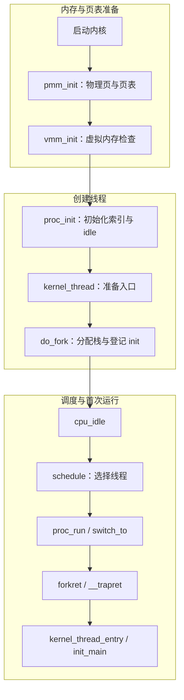
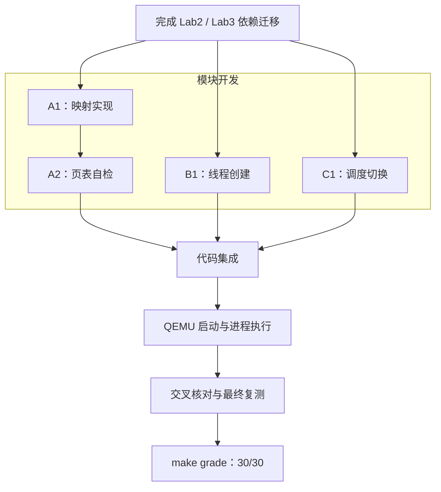
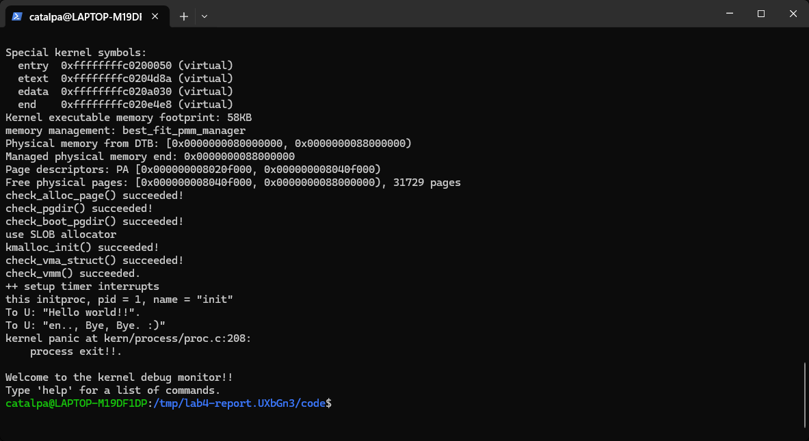
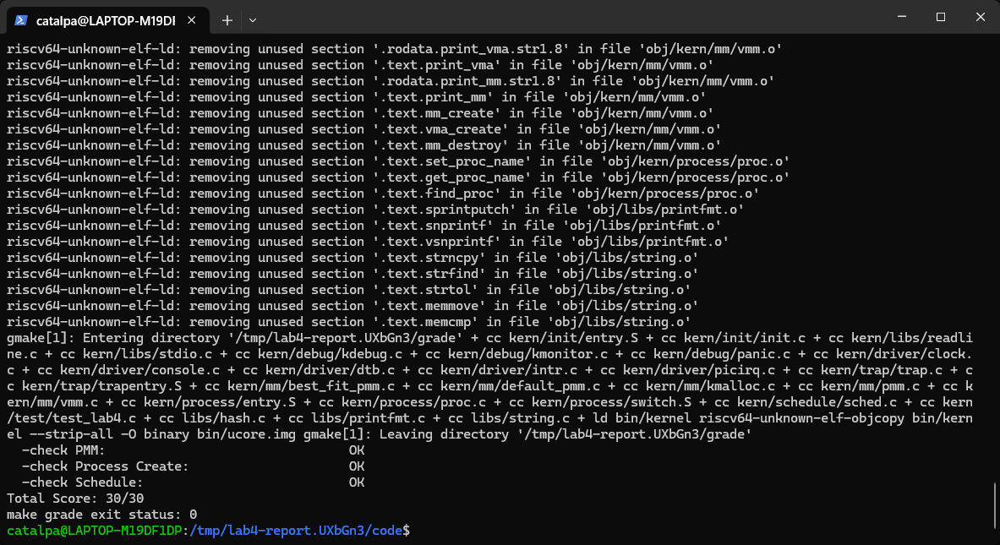

# 操作系统实验报告

报告导航：[实验目的](#purpose) · [实验环境](#environment) · [整体逻辑](#workflow) · [内容与实现](#implementation) · [测试与验证](#verification) · [扩展练习](#challenge) · [实验总结](#summary) · [完整实验过程](#process) · [提示词记录](#prompts)

## 实验基本信息

| 项目 | 内容 |
| --- | --- |
| **实验名称** | Lab4：进程管理与调度 |
| **小组成员** | 2412712-王子楸、2412700-甘文杰、2413318-向宇航 |
| **报告整理日期** | 2026-11-21 |
| **实验实现与集成日期** | 2026-11-10 至 2026-11-19 |
| **代码仓库** | [Operation-System-Labs / lab4](https://github.com/LIZZYGREAT/Operation-System-Labs/tree/lab4) |
| **最终核对版本** | `e8d678192`（Lab4 分支） |
| **集成评分** | `30/30`，PMM、Process Create、Schedule 三项通过 |

### 小组分工

**功能实现与验证分工：**

| 成员 | 实现模块 | 主要工作 | 测试与复核 |
| --- | --- | --- | --- |
| A：2412700-甘文杰 | A1：页表映射；A2：页表检查 | `page_insert`、`page_remove`；配合 `get_pte` 和启动映射检查完成 Sv39 适配；补充页表边界自检 | 页表映射、引用计数、内存不足回滚及 PMM 评分；按分工交叉核对 C 的调度链路 |
| B：2413318-向宇航 | B1：进程创建与初始化 | `alloc_proc`、`copy_mm`、`copy_thread`、`do_fork`、`kernel_thread`、`proc_init` | PCB 初始化、内核栈及首次现场、创建异常路径；按分工交叉核对 A 的页表接口 |
| C：2412712-王子楸 | C1：进程调度；C2：综合运行验证 | `cpu_idle`、`schedule`、`proc_run`、`switch_to` | QEMU 线程执行、上下文切换和调度评分；按分工交叉核对 B 的线程创建接口 |

**实验报告分工：**

| 成员 | 主要材料 |
| --- | --- |
| 甘文杰 | A1/A2 实现及页表测试，页表相关提示词和完成记录；汇总实验报告 |
| 向宇航 | B1 进程创建实现、独立检查及提示词记录 |
| 王子楸 | C1/C2 调度实现、QEMU 与评分截图、个人实验记录 |
| 全体成员 | 接口对照、模块整合、构建及评分结果核对 |

---

<a id="purpose"></a>

## 一、实验目的

1. 在 Lab2 的物理页分配和 Lab3 的 Trap 保存、恢复机制基础上，实现虚拟地址到物理页的动态映射、替换与解除，理解页表项、物理页引用计数和 TLB 之间的关系。
2. 掌握进程控制块（PCB）的结构及其初始化方式，区分复用当前运行现场的 `idleproc` 和通过 `kernel_thread()` 创建的 `initproc`。
3. 理解内核线程从申请资源、登记 PID、构造首次运行现场，到变为可调度状态的全过程，掌握 `trapframe` 与 `context` 的分工。
4. 实现基于进程链表的简单调度器和 RISC-V64 寄存器上下文切换，理解进程切换时 `current`、`satp`、栈指针及返回地址的变化。
5. 利用 QEMU 和实验评分测试验证页表维护、线程创建、首次运行及多线程调度；结合交叉复查，确认三个模块能够在同一内核中协同工作。

---

<a id="environment"></a>

## 二、实验环境

### 2.1 开发工具

本次实验延续前三次实验的 RISC-V 内核工程，采用 Git 分支协作，在 WSL/Linux 环境中使用 RISC-V 交叉编译工具链与 GNU Make 构建，通过 QEMU `virt` 机器运行。代码实现与检查过程中使用 Codex 辅助阅读工程、补全函数和整理验证命令，最终依据仓库源码与实际日志核对结果。

| 项目 | 使用情况 |
| --- | --- |
| 操作系统环境 | WSL Ubuntu / Linux |
| 代码管理 | Git、GitHub，分支开发与 PR 合并 |
| 编译工具 | `riscv64-unknown-elf-gcc`、`riscv64-unknown-elf-ld`、GNU Make |
| 模拟环境 | QEMU RISC-V64，`virt` 机器，OpenSBI |
| C 组综合复现 | QEMU 4.1.1，采用与工具链相容的 GCC 编译参数 |
| AI 编程辅助 | Codex；各组的任务提示词单独保存在 `report/prompts/` |

### 2.2 构建与运行约定

实验代码位于仓库的 `code/` 目录。QEMU 使用的内核镜像为 `bin/ucore.img`，加载地址为 `0x80200000`。C2 的记录采用以下参数执行综合测试：

```bash
cd code
lab4_qemu=/home/catalpa/.local/opt/qemu-4.1.1/bin/qemu-system-riscv64
lab4_flags='-Wno-error=int-conversion -Wno-error=incompatible-pointer-types'

timeout 15s make qemu QEMU="$lab4_qemu" DEFS="$lab4_flags" </dev/null
make grade QEMU="$lab4_qemu" DEFS="$lab4_flags" \
    GRADE_TMP="$(dirname "$PWD")/grade"
```

上述 QEMU 绝对路径来自 C 组的实际复现环境。A 组最终集成复测使用可直接调用的 `qemu-system-riscv64`，相应命令与结果在第五部分列出。构建中的兼容参数主要针对框架及固定评分代码的编译诊断，不改变实验模块的功能实现。

---

<a id="workflow"></a>

## 三、实验整体逻辑分析

### 3.1 从内存管理到内核线程

前三次实验已经具备物理内存初始化、Best-Fit 页分配，以及 Trap 入口和返回机制。Lab4 在此基础上新增三个环节：先维护虚拟页映射，再建立内核线程对象，最后把运行权交给新线程。

内核入口 `kern_init()` 先调用 `pmm_init()` 建立物理页管理与页表相关状态，随后完成中断入口和虚拟内存区域检查；`proc_init()` 建立 PCB 管理结构，把当前启动执行流记为 `idleproc`，同时创建可运行的 `initproc`。完成时钟初始化并开启中断以后，控制流进入 `cpu_idle()`，由 `schedule()` 选中 `initproc`，再经 `proc_run()` 和 `switch_to()` 完成第一次切换。



这三个环节之间具有清晰的数据依赖：A 模块负责提供可靠的页表操作；B 模块在内存分配器和内核页表已准备好的前提下构造 PCB、独立内核栈及首次运行现场；C 模块读取 B 生成的 `proc_struct` 和 `context`，让相应线程获得 CPU。Lab3 的 `__trapret` 在此被复用：它既是普通 Trap 返回的恢复入口，也是新线程第一次启动时恢复预置 Trapframe 的入口。

### 3.2 关键对象及其联系

本实验中的物理页描述符 `struct Page`、进程控制块 `struct proc_struct`、寄存器上下文 `struct context` 和异常现场 `struct trapframe` 分别承担不同职责。

| 对象 | 存放的信息 | 在本实验中的作用 |
| --- | --- | --- |
| `struct Page` | 物理页状态、引用计数、空闲块信息 | 为页表页、PCB 内核栈等提供物理内存基础 |
| 页表项 `pte_t` | 物理页号、有效位及权限位 | 描述虚拟页与物理页之间的映射 |
| `struct proc_struct` | PID、状态、内核栈、父指针、`context`、`tf`、页表地址、链表节点 | 表示能够被管理和调度的内核线程 |
| `struct context` | `ra`、`sp`、`s0`～`s11` | 保存调度切换所需的被调用者保存寄存器 |
| `struct trapframe` | 通用寄存器、`sstatus`、`epc`、异常原因等 | 描述首次启动或 Trap 返回时需要恢复的完整现场 |

特别需要区分两个地址：`proc->pgdir` 保存**根页表的物理地址**，供 `satp` 使用；`proc->kstack` 保存**内核栈的虚拟地址**，可直接由内核访问。两者不能混用。

### 3.3 分工与集成过程

小组从完成 Lab2/Lab3 代码迁移的 Lab4 基线开始，分别开发页表维护、线程创建和调度切换。A1、B1、C1 的主要代码经 PR 合入，A2 随后扩展了页表检查；集成审查进一步修订了 Sv39 非叶子页表项、`kmalloc` 大块分配边界及进程名称复制接口。三项功能最终使用同一套 QEMU 构建与评分入口验证。



---

<a id="implementation"></a>

## 四、实验内容与实现

### 4.1 前置依赖：Lab2/Lab3 功能迁移

Lab4 沿用了 Lab2 的物理页分配器及 Lab3 的启动和 Trap 实现。物理内存初始化先从 DTB 读取内存范围，计算内核和页描述符数组占用的区域，再把余下的完整页面登记到 Best-Fit 空闲链表。`init_pmm_manager()` 继续选择 `best_fit_pmm_manager`，`alloc_pages()` 和 `free_pages()` 通过管理器统一访问空闲页。

在 Trap 侧，Lab3 的 `SAVE_ALL`、`RESTORE_ALL` 和 `__alltraps` 保持原有现场布局；Lab4 另外保留了 `forkrets`，使新线程能够通过预置的 Trapframe 进入第一次执行。启动代码和内存管理代码则按 Lab4 的结构及 Sv39 映射方式适配，没有整目录覆盖后续实验新增的进程文件。

这一部分在 QEMU 中先于进程创建执行。只有 `check_alloc_page()`、`check_pgdir()` 和 `check_boot_pgdir()` 都能够完成，后续线程栈分配和调度才具备可靠的内存基础。

### 4.2 A1：页表映射的建立与删除

**负责人：2412700-甘文杰**  
**主要文件：** `code/kern/mm/pmm.c`

#### 模块功能

实验要求补全的两个公开接口为：

```c
int page_insert(pde_t *pgdir, struct Page *page,
                uintptr_t la, uint32_t perm);
void page_remove(pde_t *pgdir, uintptr_t la);
```

`page_insert()` 负责将线性地址 `la` 所在的虚拟页映射到 `page` 指定的物理页；`page_remove()` 则解除既有映射。二者不仅修改页表项，还必须同步维护物理页引用计数，并在映射变化后执行 TLB 失效操作。这里的引用计数表示某个物理页被多少个有效映射使用，因此不能简单地在每次插入时递增、每次调用删除时递减。

#### 映射建立与替换

实现首先检查根页表和目标物理页是否有效，并核对指定虚拟地址是否位于已有的上层超级页映射内。启动内核使用的高地址映射包含超级页叶子，不能误把叶子项解释为指向下一级页表的地址。在确认可以建立普通 4 KiB 映射后，通过 `get_pte(pgdir, la, 1)` 定位或创建最后一级页表项。

页表项取得后分成三种情况处理：

| 原映射状态 | 操作 | 引用计数变化 |
| --- | --- | --- |
| 没有映射 | 写入新物理页号和权限 | 新页 `ref + 1` |
| 已映射到同一个物理页 | 更新权限，保持映射对象不变 | 新页 `ref` 不变 |
| 已映射到不同物理页 | 删除旧映射并写入新映射 | 旧页 `ref - 1`；新页 `ref + 1` |

代码中先对新页执行 `page_ref_inc(page)`，随后检查旧页表项。若原映射就是同一页，则执行一次 `page_ref_dec(page)` 抵消多加的引用；否则通过 `page_remove()` 处理旧映射，使引用归零的旧物理页及时释放。最后使用 `pte_create()` 构造新表项，并调用 `tlb_invalidate()`。

```c
page_ref_inc(page);
if (*ptep & PTE_V) {
    struct Page *mapped_page = pte2page(*ptep);
    if (mapped_page == page) {
        page_ref_dec(page);
    } else {
        page_remove(pgdir, la);
    }
}
*ptep = pte_create(ppn, perm);
tlb_invalidate(pgdir, la);
```

以一页物理页 `p1` 为例，先把地址 `0` 映射到 `p1`，其引用计数为 1；再把 `PGSIZE` 处映射到同一页，引用计数变为 2。删除其中一处映射后，引用计数仍为 1，物理页继续有效；只有最后一个映射被删除时才释放 `p1`。这一过程直接对应 A2 中的别名映射检查。

#### 映射删除

`page_remove()` 使用 `get_pte(pgdir, la, 0)` 查找已有表项。`create=0` 表示只查找而不申请新的页表页；若目标地址尚未映射，则直接返回。有效映射的删除顺序为：取得对应 `struct Page`，清除叶子页表项，失效 TLB，减少引用计数；只有计数减至零时才调用 `free_page()`。

```c
pte_t *ptep = get_pte(pgdir, la, 0);
if (ptep == NULL || !(*ptep & PTE_V)) {
    return;
}
struct Page *page = pte2page(*ptep);
*ptep = 0;
tlb_invalidate(pgdir, la);
if (page_ref_dec(page) == 0) {
    free_page(page);
}
```

这样，同一地址的重复删除不会再次减少引用计数；同一物理页存在多个虚拟地址别名时，删除其中一个也不会提前释放该页。

#### Sv39 页表兼容与失败回滚

现有 `get_pte()` 对 Sv39 的两级中间页表分别检查有效位。中间表缺失且 `create=1` 时，函数申请一页、清零并把新表的 PPN 写入上级项。若第二次分配失败，已经新建的第一层页表页会回滚释放，避免留下无效的部分结构。遇到一级或二级超级页叶子时，函数直接拒绝把该项继续当作下一级页表。

集成修订后，中间页表项通过 `ptd_create()` 创建，只设置有效位 `PTE_V`；真正的读、写、执行及用户权限保存在叶子项中。此项修订与 `check_pgdir()` 的非叶子合法性检查同步完成。

#### 实现迭代与提示词

A1 先完成 `page_remove()`，再实现 `page_insert()` 和页表分配失败回滚。随后核对启动高地址的超级页映射，并调整 `check_boot_pgdir()` 的遍历方式：使用 `uintptr_t` 遍历物理地址，识别 1 GiB、2 MiB 和 4 KiB 映射，避免旧代码将 64 位高地址压缩为 `int`。对应实现经 PR #24 合入。

A1 的最终提示词、输入接口和验收规格整理在 [A 组 Prompt](./prompts/prompt_wj.md) 中。

### 4.3 A2：页表自检与边界检查

**负责人：2412700-甘文杰**  
**主要文件：** `code/kern/mm/pmm.c` 中的 `check_pgdir()`、`check_boot_pgdir()`

A2 的工作是在原有页表检查上增加边界场景，并保留原有资源清理顺序。新增断言覆盖空指针、重复映射、权限更新、超级页冲突、别名删除、重复删除和内存不足回滚等情况。

其中，**失败回滚检查**将当时的大部分空闲页暂时申请为一个连续块，只留下一个空闲物理页，随后尝试在此前没有页表结构的地址上建立映射。由于 Sv39 普通 4 KiB 映射需要两级中间页表，第一次页表页分配成功后，第二次分配会失败。测试要求 `page_insert()` 返回 `-E_NO_MEM`，根表项恢复为零，预留的目标页引用计数不变；释放临时占用的内存后，空闲页数量应恢复至测试前。

```c
size_t nr_free_before_oom = nr_free_pages();
struct Page *reserved = alloc_pages(nr_free_before_oom - 1);
assert(reserved != NULL && nr_free_pages() == 1);
assert(page_insert(boot_pgdir_va, reserved, 0, 0) == -E_NO_MEM);
assert(boot_pgdir_va[PDX1(0)] == 0);
assert(page_ref(reserved) == 0 && nr_free_pages() == 1);
free_pages(reserved, nr_free_before_oom - 1);
assert(nr_free_pages() == nr_free_before_oom);
```

针对规范化后的 Sv39 中间级表项，A2 还检查其 `V=1`，且 `R/W/X/U/A/D` 均为零。最后，`check_boot_pgdir()` 不只检查表项中的物理地址，还建立两个指向同一物理页的虚拟地址，通过 `strcpy()`、`strcmp()` 和直接修改物理页内容验证实际读写与别名关系，清理后再次核对空闲页数量。

A2 的扩展检查经 PR #26 合入；非叶子表项的后续修订见集成提交 `7b2332a`。对应提示词同样收录在 [A 组 Prompt](./prompts/prompt_wj.md) 中。

### 4.4 B1：进程创建与初始化

**负责人：2413318-向宇航**  
**主要文件：** `code/kern/process/proc.c`

#### PCB 初始化与线程类型

本模块实现 `alloc_proc()`、`copy_mm()`、`copy_thread()`、`do_fork()`、`kernel_thread()` 和 `proc_init()` 六个接口。首先，`alloc_proc()` 通过 `kmalloc()` 申请 `struct proc_struct` 并清零，把状态设置为 `PROC_UNINIT`、初始 PID 设置为 -1，`pgdir` 指向启动根页表的物理地址，并独立初始化进程链表与哈希链表的节点。

本实验创建的是**内核线程**，其 `mm` 为空，多个线程共享内核地址空间。`copy_mm()` 在本轮不执行用户地址空间复制，保持 `proc->mm=NULL`，为后续进程实验留出相同接口。PCB、线程内核栈与地址空间管理对象应分别理解：PCB 记录线程元数据，内核栈用于保存函数调用和恢复现场，而 `mm` 在当前阶段并不代表一个待复制的用户地址空间。

#### `idleproc` 与 `initproc`

`proc_init()` 首先初始化 `proc_list` 和 PID 哈希表，随后调用 `alloc_proc()` 创建 `idleproc`。这个特殊进程的 PID 为 0、状态为 `PROC_RUNNABLE`，直接复用启动栈 `bootstack`，不经过普通的 `do_fork()`，也不登记进普通进程链表。`current` 随之指向 `idleproc`，并将其 `need_resched` 设置为 1，为第一次调度做好准备。

然后调用：

```c
int pid = kernel_thread(init_main, "Hello world!!", 0);
initproc = find_proc(pid);
```

新线程获得 PID 1、父指针指向 `idleproc`，名字设置为 `init`，并具有自己的内核栈及首次执行现场。这样，初始化结束后系统中已经存在当前运行的空闲线程，以及等待调度执行的 `initproc`。

#### 创建流程与失败回收

`do_fork()` 是创建线程的主要组织函数。它先检查进程数量上限，再申请 PCB 和连续内核栈，调用 `copy_mm()` 处理地址空间，随后由 `copy_thread()` 准备初始 Trapframe 和 Context。所有现场准备完成后，才在关闭本地中断的临界区内分配 PID、登记到哈希表和进程链表、增加进程数量；最后调用 `wakeup_proc()` 将新线程设置为 `PROC_RUNNABLE`。

```text
do_fork
  ├─ 检查 MAX_PROCESS
  ├─ alloc_proc：申请并初始化 PCB
  ├─ setup_kstack：分配独立内核栈
  ├─ copy_mm：设置地址空间语义
  ├─ copy_thread：复制首次执行现场
  ├─ get_pid / hash_proc / list_add：登记线程
  └─ wakeup_proc：转入 PROC_RUNNABLE
```

当 PCB、内核栈或地址空间准备失败时，函数沿对应路径释放已经取得的资源，返回负错误码，不将半成品线程登记到全局索引。通过将登记步骤放在最后，调度器不会看到还缺少内核栈或初始上下文的 PCB。

#### Trapframe 与 Context 的构造

`kernel_thread()` 创建一个临时 Trapframe：把目标函数 `fn` 放入 `s0`，参数 `arg` 放入 `s1`，将 `epc` 设置为 `kernel_thread_entry`；同时设置 `sstatus` 的 `SPP` 和 `SPIE`，清除 `SIE`，保证首次 `sret` 返回到正确的内核执行状态。

`copy_thread()` 将该临时帧复制到新线程的内核栈顶部下方，设置子线程的初始返回值和栈指针，并使：

```c
proc->context.ra = (uintptr_t)forkret;
proc->context.sp = (uintptr_t)proc->tf;
```

这里两个入口不能混淆：`context.ra` 决定 `switch_to()` 第一次执行 `ret` 时进入哪里；Trapframe 中的 `epc` 决定此后执行 `sret` 时真正跳转到哪里。前者指向 `forkret`，后者指向 `kernel_thread_entry`，两次返回动作共同完成新线程第一次运行。

#### 提示词与实现迭代

B1 根据 `proc.h`、`trap.h` 中的实际字段和已有辅助函数完成六个接口，集中在 `LAB4 function2` 区域实现，不改动 C 组的调度实现。实现中还核对了 `set_proc_name()` 固定长度复制的行为，使用足够大小的名称缓冲区，避免从短字符串地址读取越界。进程创建阶段通过单独的 QEMU 工程副本检查 PCB、首次现场、PID、失败返回等行为，结果见第五部分。

B1 经 PR #25 合入；提示词与独立验证记录分别见 [B 组 Prompt](./prompts/prompt_yh.md) 和 [B1 完成记录](./records/Lab4_B1_完成记录.md)。

### 4.5 C1：进程调度与上下文切换

**负责人：2412712-王子楸**  
**主要文件：** `code/kern/process/proc.c`、`code/kern/schedule/sched.c`、`code/kern/process/switch.S`

#### 空闲线程与调度选择

`proc_init()` 已将 `current` 指向 `idleproc`，并为它设置 `need_resched=1`。启动流程进入 `cpu_idle()` 后，空闲线程不断检查这一标志；当标志置位时调用 `schedule()`。第一次进入调度时，进程链表中已有可运行的 `initproc`，因此调度器能够从空闲执行流切换到新线程。

`schedule()` 先通过 `local_intr_save()` 保存并关闭本地中断，随后清除当前线程的 `need_resched`。它从当前线程对应位置的下一个链表节点开始，沿循环链表查找状态为 `PROC_RUNNABLE` 的线程；若当前就是不在普通进程链表中的 `idleproc`，则直接从链表第一个节点开始查找。遇到表头时跳过表头并继续向后遍历，直到找到候选线程或完成一轮遍历。若没有普通可运行线程，则退回 `idleproc`。

选择完成以后，调度器先增加被选中线程的 `runs`，当目标与当前线程不同时调用 `proc_run()`：

```c
next->runs++;
if (next != current) {
    proc_run(next);
}
local_intr_restore(intr_flag);
```

由于 `schedule()` 直接使用进程链表和全局 `current` 状态，选择和切换期间保持本地中断关闭，避免当前核上的中断打断这一状态更新过程。

#### `proc_run()` 的切换顺序

`proc_run()` 首先判断目标是否就是当前线程；若需要切换，则保存并关闭本地中断，将旧线程保存到 `prev`，更新 `current`，然后根据目标 PCB 的根页表物理地址构造 Sv39 `satp` 值，刷新 TLB，最后调用 `switch_to()`：

```c
bool intr_flag;
local_intr_save(intr_flag);
struct proc_struct *prev = current;
current = proc;

uintptr_t satp_value = ((uintptr_t)SATP_MODE_SV39 << 60) |
                       (proc->pgdir >> RISCV_PGSHIFT);
write_csr(satp, satp_value);
flush_tlb();
switch_to(&prev->context, &proc->context);
local_intr_restore(intr_flag);
```

这里 `satp` 保存的是分页模式和根页表的物理页号，而 `proc->pgdir` 保存的是物理地址，所以必须先右移 `RISCV_PGSHIFT`。当前实验中的线程共享内核地址空间，但仍保持统一的页表切换接口，方便后续扩展。

这段 C 代码还有一个容易误解的特点：`switch_to()` 返回时，不一定是在刚刚执行切换的那条时间线上。旧线程的 `ra` 和 `sp` 已被保存；未来调度器再次切回旧线程时，它才从自己的 `switch_to()` 后继续执行 `local_intr_restore()`。因此，代码的先后顺序与线程间实际交替执行的顺序需要区分。

#### RV64 寄存器上下文

`switch_to()` 使用 `a0` 和 `a1` 接收两个 `struct context` 的地址，并依次保存旧线程的 `ra`、`sp`、`s0` 至 `s11`，再从目标线程中恢复相同寄存器，最后 `ret`。这些寄存器是调用约定中需要跨函数调用保留的状态；普通临时寄存器不属于这次上下文保存的范围。

| 字段 | `struct context` 偏移 | 汇编操作 |
| --- | --- | --- |
| `ra` | 0 | `sd ra, 0(a0)` / `ld ra, 0(a1)` |
| `sp` | 8 | `sd sp, 8(a0)` / `ld sp, 8(a1)` |
| `s0`～`s11` | 16～104，每项 8 字节 | 逐个执行对应的 `sd`、`ld` |

```asm
switch_to:
    sd ra,  0(a0)
    sd sp,  8(a0)
    # 保存 s0～s11
    ld ra,  0(a1)
    ld sp,  8(a1)
    # 恢复 s0～s11
    ret
```

汇编中的实际实现完整保存并恢复了 `s0`～`s11`，与 `proc.h` 中结构体字段的顺序逐项对应。恢复目标线程的 `ra` 后执行 `ret`，CPU 就从目标线程保存的返回地址继续执行。

#### 首次运行链路

新线程第一次被选中时，`copy_thread()` 已设置 `context.ra=forkret`，所以 `switch_to()` 的 `ret` 首先进入 `forkret()`。随后 `forkrets()` 将栈指针指向新线程 Trapframe，`__trapret` 把保存的状态恢复到寄存器和 CSR，`sret` 按 Trapframe 的 `epc` 进入 `kernel_thread_entry`。最后线程入口从 `s0`、`s1` 取得目标函数与参数，进入 `init_main()`。

```text
schedule
  → proc_run
  → switch_to
  → ret 到 forkret
  → forkrets(current->tf)
  → __trapret / RESTORE_ALL
  → sret 到 kernel_thread_entry
  → init_main("Hello world!!")
```

这一链路是 B、C 两个模块交接的重点：B 构造可恢复的初始现场，C 负责让这份现场真正加载到 CPU。首次运行后，普通线程之间再次切换则从各自先前保存的 Context 继续执行。

#### 提示词与实现迭代

C1 首先补全 `cpu_idle()`、`schedule()`、`proc_run()` 和 `switch_to()`，随后对照 `struct context` 的实际字段检查汇编偏移，并沿 `forkret → forkrets → __trapret → kernel_thread_entry` 逐段核对首次启动流程。后续工作集中于 QEMU 启动及 GCC 兼容参数的调整。源码实现通过 PR #27 合入。

对应提示词见 [C 组 Prompt](./prompts/prompt_zq_c1.md)，个人实现说明与实际复现记录见 [C 组个人报告](./personal_reports/report_ziqiu.md)。

---

<a id="verification"></a>

## 五、测试与验证

本节使用仓库中保存的实际构建、QEMU 和评分日志作为结果依据。A、B、C 阶段性检查与最终集成评分的验证范围不同，因此按模块列出，不把局部检查直接等同于全量评分。

### 5.1 内存初始化与基础自检

内核启动后先运行 `pmm_init()` 和 `vmm_init()`。最终集成版 QEMU 日志中的关键输出如下：

```text
Physical memory from DTB: [0x0000000080000000, 0x0000000088000000)
Managed physical memory end: 0x0000000088000000
Page descriptors: PA [0x000000008020f000, 0x000000008040f000)
Free physical pages: [0x000000008040f000, 0x0000000088000000), 31729 pages
check_alloc_page() succeeded!
check_pgdir() succeeded!
check_boot_pgdir() succeeded!
kmalloc_init() succeeded!
check_vma_struct() succeeded!
check_vmm() succeeded.
```

DTB 提供的内存范围为 128 MiB；物理页描述符和内核映像被排除在空闲区外，空闲页数量为 31729。上述输出说明 Best-Fit 分配器自检、页表结构检查、启动映射检查及 VMA 基础检查均已走通。

### 5.2 A1/A2：页表映射与自检

A1/A2 的验证分为启动时的 `check_pgdir()`、`check_boot_pgdir()`，以及通过评分注入运行的 `test_lab4_pmm_basic()`。检查重点包括：

| 检查对象 | 验证方式 | 结果 |
| --- | --- | --- |
| 新建映射 | 取得 PTE，核对物理页号与 `ref` | 通过 |
| 同页重映射 | 改变权限，核对引用计数和空闲页不变 | 通过 |
| 替换原物理页 | 核对旧页引用归零、新页成为目标映射 | 通过 |
| 别名映射 | 两个地址映射到同一物理页，删除其一后检查另一地址 | 通过 |
| 重复删除 | 再次删除不存在的映射，不重复释放物理页 | 通过 |
| 超级页保护 | 尝试覆盖启动内核超级页，确认原表项不变 | 通过 |
| 中间页表权限 | 检查非叶子 PTE 的有效位与禁用位 | 通过 |
| 内存不足回滚 | 仅保留一页空闲页，强制第二级分配失败 | 通过 |
| 虚实地址读写 | `strcpy()` / `strcmp()` 检查实际映射和别名 | 通过 |

A 组保存的启动和评分记录分别为 [A1 QEMU 日志](./logs/lab4_a1_qemu.log) 和 [A2 评分日志](./logs/lab4_a2_grade.log)。后者除 PMM 项通过外，还记录了完整集成评分 `30/30`。A1/A2 实现、版本及复测信息见 [完成记录](./records/Lab4_A1_完成记录.md)。

### 5.3 B1：线程创建的独立检查

B 组在调度模块尚未合入时，先对 `proc.c` 进行单文件编译，并在独立工程副本中完成 PCB 与线程创建的运行检查。这种方式将进程创建正确性和后续调度依赖分开验证，避免只靠最终启动日志判断创建过程。

独立检查覆盖 `idleproc`、`initproc` 的状态和 PID，PCB 初始化字段、内核栈内的 Trapframe 位置、16 字节栈对齐、`s0/s1` 中的线程入口与参数、`sstatus` 标志位、PID 登记、进程数量上限以及创建失败后的资源状态。测试中另外创建一个线程，验证新线程获得 PID 2 后可被登记和唤醒。

该独立测试副本的关键输出为：

```text
check_alloc_page() succeeded!
check_pgdir() succeeded!
check_boot_pgdir() succeeded!
kmalloc_init() succeeded!
check_vmm() succeeded.
[Test Process Create] PASS
[B1 extended creation checks] PASS
```

B1 的运行命令和对应的临时副本范围记载于 [B1 完成记录](./records/Lab4_B1_完成记录.md)。在 C1 合入之后，最终集成评分再次给出了 `Process Create: OK`。

### 5.4 C1/C2：QEMU 首次运行与线程调度

C 组在 QEMU 4.1.1 环境中运行集成内核，编译、链接并生成 `bin/ucore.img` 后进入 QEMU。串口日志在页表和 VMA 自检完成之后输出：

```text
++ setup timer interrupts
this initproc, pid = 1, name = "init"
To U: "Hello world!!".
To U: "en.., Bye, Bye. :)"
```

这里的 PID 和名称来自 `proc_init()` 建立的 `initproc`；字符串 `Hello world!!` 来自 `kernel_thread(init_main, "Hello world!!", 0)` 的参数。能够打印这些内容，说明 `idleproc` 已经通过调度切换到新线程，且新线程从 `kernel_thread_entry` 正确调用了 `init_main()`。



**图 1：** C1 运行结果。内存相关检查完成后，`initproc` 获得 CPU，打印线程 PID、名称及传入参数。`init_main()` 返回后进入原框架的 `do_exit()`，因该函数仍为占位实现而输出 `process exit!!.` 并进入内核调试监视器；这一现象与当前源码一致。

C2 的评分测试会创建两个额外的内核线程。每个测试线程先设置自己的已运行标志，再主动调用 `schedule()` 让出 CPU；测试入口重复调度后检查两个标志都已置位。因此，这一项验证的不只是第一个 `initproc` 能启动，还包括多个线程轮流执行、从旧上下文恢复以及继续完成后续代码的能力。



**图 2：** C2 运行评分脚本，PMM、Process Create 和 Schedule 三项均为 `OK`，总分 `30/30`。原始日志见 [C2 评分记录](./logs/lab4_c2_grade.log)。

### 5.5 集成修订与最终回归

A、B、C 合并后，对照代码和编译日志进行了集中复查，并对已发现的问题作了小范围修订。其中，`kmalloc()` 的大块分配页数计算改为向上取整，再确定最小满足需求的二次幂页数；`get_pte()` 的非叶子页表项改用 `ptd_create()`；进程名称复制函数增加了长度边界处理。这些修订保留了原有接口与三组核心实现。

最终回归使用以下命令：

```bash
cd code
make clean && make
timeout 15s make qemu
make grade QEMU=qemu-system-riscv64 \
  'DEFS=-Wno-error=int-conversion -Wno-error=incompatible-pointer-types' \
  GRADE_TMP=/tmp/lab4-review-grade-20261119
```

结果来自 [最终构建与 QEMU 日志](./logs/lab4_review_final_build_qemu.log) 和 [最终评分日志](./logs/lab4_review_final_grade.log)：

```text
  -check PMM:                                OK
  -check Process Create:                     OK
  -check Schedule:                           OK
Total Score: 30/30
exit_status=0
```

最终构建与链接成功，QEMU 完成内存检查并运行到 `init_main()`；评分脚本的三项检查均为 `OK`。修订后的结果与 C2 阶段的完整评分一致。

### 5.6 交叉复核与结果汇总

交叉核对围绕三条接口依赖展开。A 重点复查 C 的调度选择、页表切换及 Context 保存恢复；B 重点复查 A 的映射引用、失败路径与测试；C 重点复查 B 的初始现场如何经过 `forkret` 和 `__trapret` 进入线程函数。各模块的独立记录与最终共同评分相互补充。

| 检查链路 | 重点核对内容 | 对应证据 |
| --- | --- | --- |
| A → B | 物理页分配、页表映射与内核栈申请 | A1/A2 日志；B1 独立检查 |
| B → C | PCB 状态、`context.ra/sp`、首次执行入口 | B1 记录；C1 QEMU 日志 |
| C → A | 调度切换后的内核页表及运行状态是否稳定 | C2 综合评分；最终 QEMU 回归 |
| 完整集成 | PMM、线程创建、调度三项共同通过 | `lab4_review_final_grade.log`：`30/30` |

上述记录共同表明，本次实现已经从页表管理贯通到内核线程首次执行和多线程主动调度。阶段性记录与全量评分分开保存，便于定位各自证明的功能范围。

---

<a id="challenge"></a>

## 六、扩展练习 Challenge

### 6.1 中断开关：`local_intr_save()` 与 `local_intr_restore()`

实验中 `schedule()`、`proc_run()` 以及部分内存管理操作使用以下写法：

```c
bool intr_flag;
local_intr_save(intr_flag);
/* 临界区操作 */
local_intr_restore(intr_flag);
```

其实现位于 `code/kern/sync/sync.h`，核心并不是简单地“先关中断、再开中断”，而是**保存进入临界区前的中断使能状态，并在离开时恢复该状态**。

RISC-V 的 `sstatus` 寄存器包含 `SIE`（Supervisor Interrupt Enable）位。`SIE=1` 表示当前 S 模式允许响应已使能的相应中断；`SIE=0` 表示在该模式下暂时屏蔽相应中断。内核通过以下接口操作这一位：

```c
void intr_enable(void)  { set_csr(sstatus, SSTATUS_SIE); }
void intr_disable(void) { clear_csr(sstatus, SSTATUS_SIE); }
```

框架将“保存并关闭”写成：

```c
static inline bool __intr_save(void) {
    if (read_csr(sstatus) & SSTATUS_SIE) {
        intr_disable();
        return 1;
    }
    return 0;
}

static inline void __intr_restore(bool flag) {
    if (flag) {
        intr_enable();
    }
}
```

`local_intr_save(intr_flag)` 调用 `__intr_save()`，将进入时是否开启中断的结果保存到 `intr_flag`。若原来已开启，则关闭并返回 1；若原来就已关闭，则保持关闭并返回 0。`local_intr_restore(intr_flag)` 只在保存值为 1 时重新开启中断，否则保持关闭。

| 进入临界区前 | 保存的 `intr_flag` | 临界区内 | 恢复后 |
| --- | --- | --- | --- |
| `SIE=1` | 1 | `SIE=0` | `SIE=1` |
| `SIE=0` | 0 | `SIE=0` | `SIE=0` |

这一设计还支持**嵌套临界区**。假设外层调用之前中断开启，外层保存 1 并关中断；内层再次调用时发现中断已关闭，保存 0。内层退出时不会开启中断，只有外层最后恢复保存的 1，才重新开启中断。这样便避免内层操作提前打开外层仍需保持关闭的中断状态。

本实验中的 `schedule()` 会调用 `proc_run()`，两者都使用这一对操作。`schedule()` 先关闭中断，`proc_run()` 进入时读到的 `SIE` 已经为 0，所以其内部保存值为 0；当旧线程将来恢复执行并退出 `proc_run()` 时，内部恢复不会错误开启中断，随后才由外层 `schedule()` 恢复它最初的状态。

这种机制保证当前执行核在维护进程链表、`current` 和上下文期间不会被普通 S 模式中断打断；它作用于本地 Hart 的中断状态，并不等同于多核环境下对共享数据的互斥锁。

### 6.2 分页模式：Sv32、Sv39 与 Sv48

RISC-V 的 Sv32、Sv39、Sv48 都采用**多级页表**。虚拟地址由若干级虚拟页号索引（VPN）与页内偏移组成。硬件从 `satp` 提供的根页表物理页号开始，按从高到低的索引依次读取页表项；如果表项指向下一级表，就继续下降；如果遇到合法叶子表项，就根据其物理页号和页内偏移组成最终物理地址。

这三种模式的主要区别是虚拟地址宽度、页表层级数和每级索引位数：

| 分页模式 | 虚拟地址组成 | 页表级数 | 单个 PTE | 每级表项数 | 基本页大小 |
| --- | --- | --- | --- | --- | --- |
| Sv32 | `VPN[1](10) + VPN[0](10) + offset(12)` | 2 | 4 B | 1024 | 4 KiB |
| Sv39 | `VPN[2](9) + VPN[1](9) + VPN[0](9) + offset(12)` | 3 | 8 B | 512 | 4 KiB |
| Sv48 | `VPN[3](9) + VPN[2](9) + VPN[1](9) + VPN[0](9) + offset(12)` | 4 | 8 B | 512 | 4 KiB |

表中括号内为各部分占用的位数。三种模式的基本页大小相同，都是 $2^{12}=4096$ 字节，因为页内偏移均为 12 位。一页页表的大小同样为 4 KiB；Sv32 的 PTE 为 4 字节，所以每表有 $4096/4=1024$ 项；Sv39/Sv48 的 PTE 为 8 字节，所以每表有 $4096/8=512$ 项。

以 Sv39 为例，虚拟地址可以写成：

$$
VA = (VPN[2] \ll 30)\;|\;(VPN[1] \ll 21)\;|\;(VPN[0] \ll 12)\;|\;offset.
$$

硬件取 `satp.PPN` 给出的根页表物理地址，先根据 `VPN[2]` 选出第一级表项；若它是非叶子项，则取出其中的 PPN 作为下一级页表地址，再用 `VPN[1]` 索引；随后使用 `VPN[0]` 定位最终叶子项。叶子项中的 PPN 对应物理页框，结合 `offset` 得到目标物理地址。

在实际页表中，合法叶子项也可以提前出现在较高层，从而形成超级页映射：Sv32 的 4 MiB 页，Sv39 的 2 MiB / 1 GiB 页，以及 Sv48 的 2 MiB / 1 GiB / 512 GiB 页。上层表项究竟是叶子还是目录项，由其有效位和读写执行标志共同决定；不能只看到 `V=1` 就把它当作下级页表指针。

#### `get_pte()` 两段相似代码的原因

`get_pte()` 当前用于查找或创建**Sv39 的普通 4 KiB 叶子 PTE**。因为 Sv39 有三级页表，从根页表走到最终叶子项之前需要经过两级中间页表，所以函数中存在两段几乎相同的逻辑。

第一段通过 `PDX1(la)` 在根表中定位中间项；若该项不存在，且 `create=1`，就申请、清零一页作为下一层页表，并在根项写入新表的 PPN。第二段通过 `PDX0(la)` 在新得到的下级页表中重复这一过程。完成两层下降后，才通过 `PTX(la)` 返回最后一级 PTE 的地址。

两段操作的共性是：检查当前级表项是否有效、判断它是不是超级页叶子、决定是否需要分配下一级页表、将新表清零并把其物理页号写入上级表项。它们的差异仅在于所处层级及索引宏不同。

```text
根页表 pgdir
   │  PDX1(la) / VPN[2]
   ▼
中间项 pdep1 ──缺失且 create=1──> 分配下一级页表
   │  PDX0(la) / VPN[1]
   ▼
中间项 pdep0 ──缺失且 create=1──> 分配最后一级页表
   │  PTX(la) / VPN[0]
   ▼
最终 PTE ──> 物理页号 + 权限位
```

从更一般的分页机制看，每下降一级都执行同一种“检查当前页表项—必要时取得下级页表—继续索引”的操作，所以多级页表代码天然具有重复结构。如果是 Sv32，只需经过一级中间页表便到达叶子项；如果是 Sv48，则需要经过三级中间页表。当前两段代码是 Sv39 三级结构的直接展开，而不是两个互不相关的查表功能。

### 6.3 `get_pte()` 查找与页表分配的合并设计

实验的第二个问题是：`get_pte()` 同时负责查找 PTE 和申请缺失的页表页，是否合适，以及是否有必要拆开。

当前设计通过 `create` 参数区分两种用途：`get_pte(pgdir, la, 0)` 只查找已有页表，不改变页表结构；`get_pte(pgdir, la, 1)` 则允许在下降过程中分配尚不存在的页表页。这个接口对于 Lab4 很直接：`page_remove()` 只需查找，所以传入 0；`page_insert()` 需要建立映射，因此传入 1。上层调用不必分别处理根表、二级表和末级表的存在性。

合并查找与分配的好处，是公共遍历逻辑只实现一遍，`page_insert()` 可以直接取得可写入的 PTE 地址。其代价是一次函数调用可能产生副作用：查找过程中会改变页表、申请物理页；第二级分配失败时还必须回滚第一级新建的表。随着页表级数增加、加入超级页或支持不同地址空间，函数中的分支和清理逻辑会更加复杂。

如果将来需要支持多个分页模式，可以把遍历与“取得缺失页表”拆成内部辅助步骤：

```text
walk_to_leaf(pgdir, va, create):
    table = pgdir
    for level from highest_level down to 1:
        entry = table[index(va, level)]
        if entry is a valid leaf:
            return SUPERPAGE_CONFLICT
        if entry is invalid:
            if not create:
                return NOT_FOUND
            new_table = allocate_zeroed_page_table()
            if allocation failed:
                rollback pages created in this call
                return NO_MEMORY
            entry = make_nonleaf_entry(new_table)
        table = next_level_table(entry)
    return address of table[index(va, 0)]
```

这里把“如何按层级遍历”和“缺失时如何创建下一级页表”作为可复用的内部操作；对于外部调用者，仍可以保留 `get_pte(pgdir, la, create)` 这个简洁接口。如果进一步需要纯查询能力，还可以另外提供只读的 `lookup_pte()`，避免读操作隐式修改页表。

**我们的判断是：对于 Lab4 的 Sv39 三级页表，当前合并实现比较合适，没有必要为了形式上的模块化而强行拆分。** 这一实验只需两级中间页表和少量调用点，保留 `create` 参数能够减少接口复杂度。真正需要注意的是约束：`create=0` 不允许产生页表分配；`create=1` 的失败路径必须回滚本次新建的页表；遇到超级页叶子时不能按目录继续下降。A1/A2 的修改和自检主要就是围绕这些条件完成的。若后续实验引入多种分页模式或更复杂的地址空间管理，再将两段重复逻辑抽象成按层级循环会更有实际意义。

---

<a id="summary"></a>

## 七、实验总结与收获

### 7.1 对页表和物理内存管理的认识

Lab4 的页表操作进一步说明，物理内存分配与虚拟内存映射是两件相互依赖但不同的工作。`alloc_page()` 得到的是一个可用物理页，`page_insert()` 才把它关联到具体虚拟地址。一个物理页可以同时被多个虚拟地址引用，因此引用计数要反映映射关系，而不是反映某个函数被调用了多少次。删除映射时也需要同步更新 TLB，否则页表中已经改变的内容未必立刻体现在地址翻译结果中。

A2 的边界检查让我们更直观地看到了这些关系：同页权限更新不应该额外占用物理页，别名删除不能提前释放仍在使用的页面，页表中间级分配失败后不能留下只建立了一半的结构。Sv39 的超级页和普通页又要求软件先辨别当前表项的含义，才能安全地继续查表。

### 7.2 对内核线程和执行现场的认识

通过 B1，我们把进程控制块、内核栈、Trapframe、Context 和 PID 索引连接成了一条完整创建流程。`idleproc` 是对当前启动现场的管理性封装，而 `initproc` 在创建时并没有立即运行；它只是先具备完整的 PCB、独立栈和初始现场，再由调度器决定何时获得 CPU。

C1 则说明进程切换不仅是修改 `current` 指针。真正的切换要保存旧线程的寄存器状态，恢复目标线程的栈和返回地址；第一次运行的新线程还需要通过 `forkret` 和 `sret` 才能进入指定函数。理解了这两层返回地址以后，`copy_thread()` 与 `switch_to()` 的配合关系就更加清晰。

### 7.3 对协作实现和验证的认识

本次实验按页表、创建、调度划分模块。A、B、C 可以分别实现核心接口，但集成时仍需对齐数据结构、地址类型、状态变化和首次运行入口。B1 的独立检查用于确认线程对象本身已经建立，C2 的运行结果进一步证明这些对象能够被调度执行，最终完整评分则检验三个模块放在一起后的效果。

在已有功能通过后再进行集成复查，还发现并修订了页表非叶子权限、大块内存分配边界和进程名称复制等问题。最终版本完成内存自检、内核线程首次运行和多线程主动调度，`make grade` 的 PMM、Process Create、Schedule 三项均通过，成绩为 `30/30`。

---

<a id="process"></a>

## 附录：实验过程与复现材料

### 附录 1：代码提交与集成顺序

| 阶段 | 主要提交或 PR | 内容 |
| --- | --- | --- |
| 基础迁移 | `277b205`、`7eb297e` | 迁移 Lab2 物理内存管理和 Lab3 启动、Trap 代码 |
| A1 | PR [#24](https://github.com/LIZZYGREAT/Operation-System-Labs/pull/24) | `page_insert`、`page_remove`，Sv39 启动映射适配 |
| B1 | PR [#25](https://github.com/LIZZYGREAT/Operation-System-Labs/pull/25) | PCB 初始化、线程创建、首次执行现场构造 |
| A2 | PR [#26](https://github.com/LIZZYGREAT/Operation-System-Labs/pull/26) | 页表自检、权限更新、失败回滚等边界场景 |
| C1/C2 | PR [#27](https://github.com/LIZZYGREAT/Operation-System-Labs/pull/27) | 调度、寄存器切换，整理 QEMU 和评分证据 |
| 集成修订 | `010b756`、`7b2332a`、`14117a2` | `kmalloc` 分配边界、非叶子页表项、名称复制 |
| 最终整理 | PR #28、[#29](https://github.com/LIZZYGREAT/Operation-System-Labs/pull/29) | 集成复核、完成记录与提示词材料 |

### 附录 2：复现命令

从仓库 `lab4` 分支进入工程目录：

```bash
git checkout lab4
cd code
make clean
make
```

预期能够生成 `bin/kernel` 和 `bin/ucore.img`。运行内核：

```bash
make qemu
```

预期依次看到物理页、页表和 VMA 检查通过，以及 `this initproc, pid = 1, name = "init"`。当前框架中 `init_main()` 返回后调用 `do_exit()` 的占位实现，会进入调试监视器。

在使用 GCC 15 且遇到框架兼容警告被当作错误时，可采用记录中已验证的编译参数执行评分：

```bash
make grade QEMU=qemu-system-riscv64 \
  'DEFS=-Wno-error=int-conversion -Wno-error=incompatible-pointer-types' \
  GRADE_TMP=/tmp/lab4-review-grade-20261119
```

预期输出：

```text
  -check PMM:                                OK
  -check Process Create:                     OK
  -check Schedule:                           OK
Total Score: 30/30
```

### 附录 3：测试日志与图片

| 文件 | 内容 |
| --- | --- |
| [A1 QEMU 日志](./logs/lab4_a1_qemu.log) | 内核启动、页表和虚拟内存自检 |
| [A2 评分日志](./logs/lab4_a2_grade.log) | 页表测试及集成评分 |
| [C1 QEMU 日志](./logs/lab4_c1_qemu.log) | 调度首次运行、`init_main()` 输出 |
| [C2 评分日志](./logs/lab4_c2_grade.log) | C2 阶段完整评分与构建信息 |
| [最终构建与 QEMU 日志](./logs/lab4_review_final_build_qemu.log) | 集成修订后的构建与启动 |
| [最终评分日志](./logs/lab4_review_final_grade.log) | 集成修订后的三项评分，`30/30` |
| [C1 截图](./images/c_1.png) | 内核启动和 `initproc` 运行 |
| [C2 截图](./images/c_2.png) | PMM、创建、调度评分结果 |

### 附录 4：个人完成记录

- [A1/A2 页表映射与测试完成记录](./records/Lab4_A1_完成记录.md)
- [B1 进程创建与初始化完成记录](./records/Lab4_B1_完成记录.md)
- [C1 进程调度完成记录](./records/Lab4_C1_完成记录.md)
- [C 组个人实验报告](./personal_reports/report_ziqiu.md)

<a id="prompts"></a>

### 附录 5：提示词汇总

- [A1、A2 及交叉验证提示词](./prompts/prompt_wj.md)
- [B1 进程创建与初始化提示词](./prompts/prompt_yh.md)
- [C1 进程调度提示词](./prompts/prompt_zq_c1.md)

三组提示词都按照工程已有函数和接口制定任务约束，实验正文记录实际实现思路，详细输入和规格保留在各自文件中，便于与代码变更及测试日志对应。
