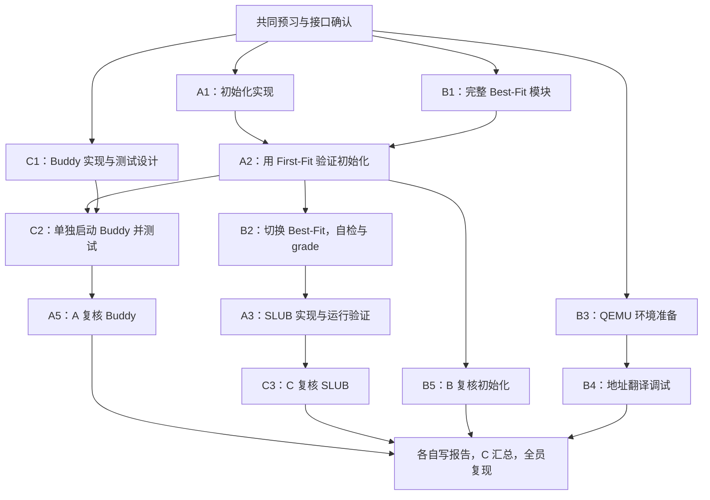
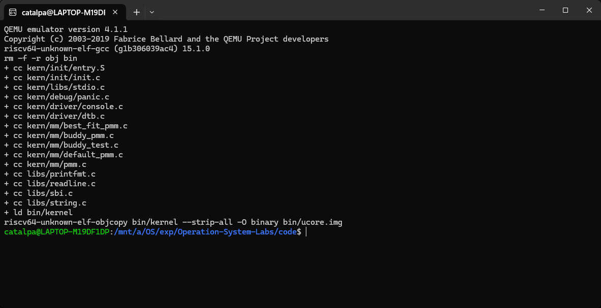
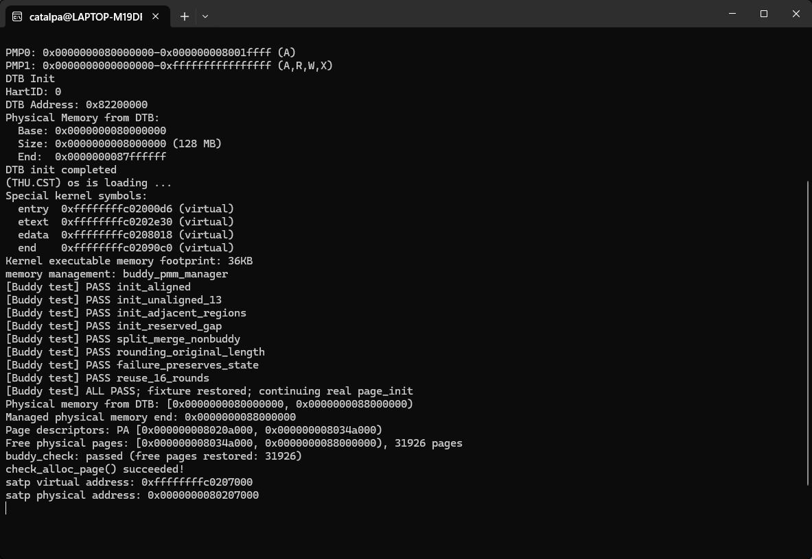
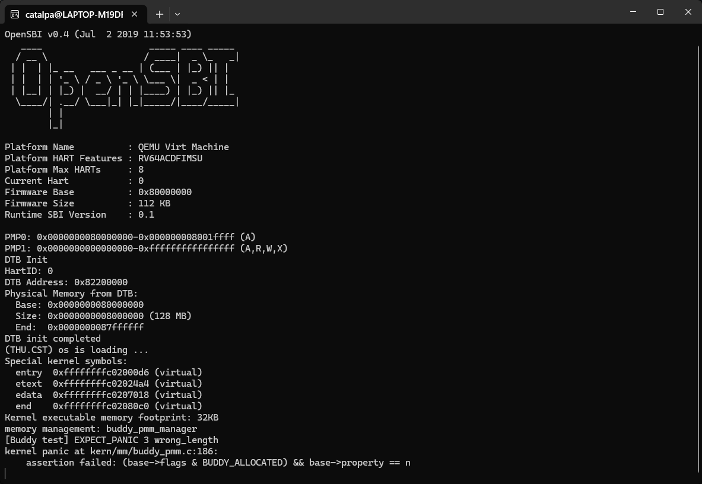
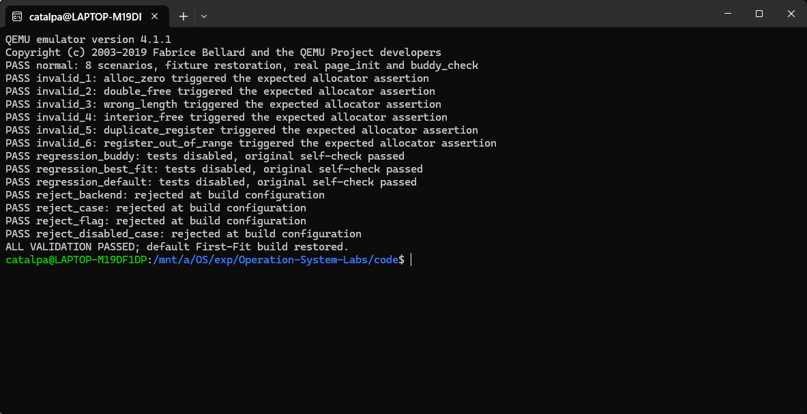

# 操作系统实验报告

## 实验基本信息

| 项目 | 内容 |
|------|------|
| **实验名称** | Lab 2: 物理内存和页表 |
| **小组成员** | 2412700-甘文杰 2412712-王子楸 2413318-向宇航 |
| **完成日期** | YYYY-MM-DD |

### 小组分工

练习如何分工？

| 成员 | 负责的练习/模块 |
|------|----------------|
| 2412700-甘文杰 | 实现 Best-Fit 连续物理内存分配算法 |
| 2412712-王子楸 | Buddy System 分配器的设计、实现、接入与独立测试 |
| 2413318-向宇航 | 实现物理内存探测与页描述符初始化功能 |

实验报告如何分工？

---

## 一、实验目的

<!-- 说明本次实验的主要目标和预期成果 -->

本实验的主要目的是：

1. [目的1：例如，理解用户态进程如何通过系统调用进入内核]
2. [目的2：例如，掌握进程创建、执行、退出的完整生命周期]
3. [目的3：例如，学习使用 AI 辅助开发操作系统核心功能]

---

## 二、实验环境

你们使用的 AI 工具

| 成员 | AI 编程工具 | 底层模型 | 备注 |
|------|------------|---------|------|
| 学号1-姓名1 | [例如：Cline（VS Code插件） / Claude Code（终端 Agent） / DeepSeek Harness等] | [例如：Claude Sonnet 4.5 / GPT-5.5 / DeepSeek-V4-Flash等] | [可选：特殊配置等] |
| 2412712-王子楸 | Codex | GPT-6.1 Sol High | 无 |
| 2413318-向宇航 | Codex | GPT-6.1 Sol Light | 无 |

**说明：**
- **AI 编程工具**：指具体使用的终端工具、编辑器插件、桌面应用或浏览器界面
- **底层模型**：指该工具使用的大语言模型及版本

---

## 三、实验整体逻辑分析

### 2.1 本章节的逻辑主线

[请用自己的话描述本章实验的核心主线，例如：
- 本章围绕哪个核心主题展开？（例如：用户进程管理、虚拟内存、文件系统等）
- 整个实验解决什么问题？（例如：如何让用户程序运行在操作系统之上）]

### 2.2 功能的逐步实现

由于很难在开发前完全确定下来分工和顺序，我们在 AI 的帮助下，设计了如下的分工和实现顺序：


具体而言：

- A 是 2413318-向宇航；
- B 是 2412700-甘文杰；
- C 是 2412712-王子楸；

箭头表示这一步的交付或运行验证依赖前一步。不表示必须等前一步结束才开始阅读、设计或写代码。

---

## 四、实验内容与实现

<!-- 
说明：本部分按照 exercises 文档中的练习顺序组织
每个功能模块或者练习中可能包含多项任务，请根据实际情况调整
-->

### 功能模块：Buddy System 物理页分配（功能模块二 · 任务三）

**负责人：** 2412712-王子楸

#### 模块功能描述

**需要实现/修改的函数：**

```c
// kern/mm/buddy_pmm.c：分配器回调与注册对象
static void buddy_init(void);
static void buddy_init_memmap(struct Page *base, size_t n);
static struct Page *buddy_alloc_pages(size_t n);
static void buddy_free_pages(struct Page *base, size_t n);
static size_t buddy_nr_free_pages(void);
static void buddy_check(void);
const struct pmm_manager buddy_pmm_manager;

// kern/mm/buddy_test.c：独立测试入口与用例
void buddy_test_all(void);
static void test_init_memmap(void);
static void test_split_merge(void);
static void test_rounding(void);
static void test_failure(void);
static void test_reuse(void);
static void test_invalid_request(unsigned int case_id);

// kern/mm/pmm.c：管理器选择与条件测试接入
static void init_pmm_manager(void);
void pmm_init(void);
```

**功能说明：**

`page_init()` 确定可用页范围，Buddy 将其组织为各阶空闲块：`buddy_init()` 准备管理结构，`buddy_init_memmap()` 登记页面，`buddy_alloc_pages()` 按请求选择并拆分块，`buddy_free_pages()` 校验参数后回收并合并真正伙伴，`buddy_nr_free_pages()` 提供空闲页统计。模块通过现有 `pmm_manager` 接口接入，不改变其他成员的物理内存初始化逻辑。

模块处理非对齐初始区间、非二次幂请求、空间不足及非法释放。`buddy_check()` 用于实际内存初始化后的基础检查；独立测试由 `buddy_test_all()` 统一调度。相关文件为 [buddy_pmm.c](../code/kern/mm/buddy_pmm.c)、[buddy_test.c](../code/kern/mm/buddy_test.c) 及其头文件。

#### 最终提示词

两份最终提示词全文见 [prompt.md](./prompt.md) 的“任务三：Buddy System”部分：第一份用于生成分配器并接入内核，第二份用于针对该实现设计独立测试。

#### 实现迭代过程

本模块按“生成分配器并接入、补充独立测试”两个阶段推进，分别记录如下。

---

##### 第一次迭代：分配器实现与接入

**遇到的问题：**

初次验证调用了环境中默认的 QEMU 7.0.0，原启动流程出现异常，未能完成内存检查。核对指导书后，确认实验应使用 QEMU 4.1.1。

**问题解决策略：**

安装课程指定版本，在运行命令中显式指定其路径；删除排错时新增的临时兼容文件，按原启动方式重新验证。本次调整集中在运行环境，分配器算法主体未改写。

**最终结果：**

- 分配模块及管理器注册结构编译通过。
- 能通过 `PMM=buddy` 选择该管理器并正常启动。
- 在规定版本下通过基础自检，完成第一阶段交付。

---

##### 第二次迭代：独立测试与回归验证

依据第二份提示词增加测试代码、条件入口和运行脚本。测试代码首次编译、执行通过，未发现需要修复的算法错误。

**最终结果：**

- 独立测试能够编译运行，正常用例及非法调用均符合预期。
- 测试完成后能够恢复环境，并继续内核初始化。
- 关闭扩展测试后，原有分配器的启动检查通过；具体覆盖、输出和截图统一见第五部分。

**关键改进点总结：**

验证由分配器自身的基础检查扩展为独立预期模型和明确的非法调用判据，使生成代码的行为可以逐项核查。

---

### 练习：[练习标题]

**负责人：** [学号-姓名]

[按照练习的具体要求进行解答]

---

### Challenge：[Challenge标题]

**负责人：** [学号-姓名]

[按照Challenge的具体要求进行解答]

---

## 五、测试与验证

<!-- 根据该实验的具体情况，提供完整的测试运行截图，应包含：
- 编译及运行成功的输出（make qemu），可能有多个
- 测试通过的结果（make grade），只有一个
-->

### 验证初始化函数

在lab2代码的修改之前，运行 `make qemu`，可以编译过程中有报错，如下图所示：


从中可见是基线代码中 best-fit 模块未实现导致。

在添加完初始化函数，并且补全了 best-fit 模块后，运行 `make qemu`，如下图所示：


此时可以成功编译。

此时运行本次实验提供的测试脚本 `make grade`，可以看到初始函数的验证通过，截图如下：


### C 线：Buddy System 分配器验证

**负责人：** 2412712-王子楸

在 WSL 中使用 QEMU 4.1.1，以 `PMM=buddy BUDDY_TEST=1` 启用 Buddy 及独立测试，编译、链接成功。



[buddy_test.c](../code/kern/mm/buddy_test.c) 使用 64 个静态页描述符构造受控状态，由独立逐页归属表核对分配区不重叠、块对齐、页面标记和空闲计数。正常测试覆盖如下。

| 测试组 | 验证内容 |
|---|---|
| 区域登记（4 个场景） | 对齐区域、非对齐起点的 13 页、分次登记的相邻区域及带保留间隙的区域，检查页面遗漏、重复分配和跨保留区合并 |
| 拆分与合并 | 整块拆为单页；释放相邻但非伙伴的页后无法申请 2 页，补齐伙伴后可逐级合并 |
| 非二次幂请求 | 请求 1、2、3、5、8、9 页，实际占用分别为 1、2、4、8、8、16 页；按原请求长度释放后计数恢复 |
| 分配失败 | 空状态、耗尽、超大请求及碎片化状态下返回失败，管理状态保持有效 |
| 重复使用 | 进行 16 轮混合申请与不同顺序释放，每轮均可重新申请完整区域 |

8 个正常场景均通过。测试结束后恢复全局状态，继续真实 `page_init()` 和 `buddy_check()`，基础自检前后空闲页数均为 31926。



非法调用测试包括零页申请、重复释放、错误释放长度、内部页释放、重复登记和越界登记。6 个用例分别启动 QEMU，均在预期位置触发断言；超时或其他位置的崩溃不计为通过。下图为错误释放长度的验证结果。



在仓库根目录执行以下命令，可运行本线测试并保存日志：

```bash
cd code
bash tools/run_buddy_tests.sh \
    "$HOME/.local/opt/qemu-4.1.1/bin/qemu-system-riscv64"
```

关闭独立测试后，Buddy 的启动自检通过；4 种非法测试构建配置均被拒绝。本次验证使用单 hart，结果摘要见 [Buddy 使用说明](./buddy_usage.md)。旧日志不再随仓库保存；重新运行上述脚本可在 `report/buddy_tests/` 生成完整日志与 `summary.log`。



---

## 六、实验总结与收获

### 对操作系统的理解

通过实现 Buddy 模块，我加深了对物理页、页描述符和分配器接口之间关系的理解。拆分与合并需要同时维护块的边界、状态和空闲计数，局部操作正确才能保证后续分配可靠。请求取整产生的内部碎片也说明，分配策略需要兼顾实现成本与空间利用率。页替换、缺页处理和多核同步仍需在后续学习中进一步掌握。

### AI 协作开发的经验

本次协作让我认识到，清晰的接口约定和边界条件是有效使用 AI 的基础。将实现与测试分别描述，有助于逐项核对生成代码的行为。验证时还应确认工具版本，保存实际命令与输出，使代码、测试结果和报告相互对应。

---
