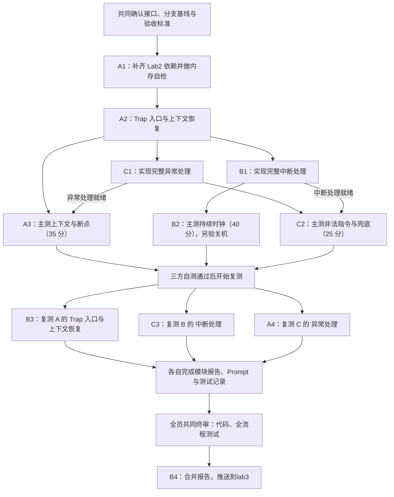

# Lab3 任务分工

本文只用 A、B、C 表示三位成员。实现任务、主测任务和复测任务分别明确到人。

## 一、已经完成的准备工作

已经在 `Lab3` 分支中补好了以下两个函数的临时占位，并推送到 GitHub：

- `interrupt_handler(struct trapframe *tf)`
- `exception_handler(struct trapframe *tf)`

代码位置为 `code/kern/trap/trap.c`，对应提交为 [`436ddc4`](https://github.com/LIZZYGREAT/Operation-System-Labs/commit/436ddc497ac7b055d6f326fe2f78aa0cb24d4e6e)。代码注释和 README 均已注明占位用途。

**这两个函数目前仅提供定义，供分项开发时编译、链接。实际进入占位函数时，会打印 Trap frame 并触发 `panic`，报告功能尚未实现。** 已完成 `trap.c` 的单文件编译和函数符号检查，整个实验仍需完成下面的实现与验证。

后续分工不再包含“补占位函数”这个任务。B、C 分别将自己负责的函数体替换为真实实现。Lab2 代码回填、Trap 入口和上下文恢复仍属于 A 的工作。

## 二、分工总览

**主测固定为：A 测 35 分，B 测 40 分，C 测 25 分。** 其他模块提供测试依赖，主测归属保持上述对应关系。

| 成员 | 实现任务 | 自己主测 | 复测另一人的任务 |
| --- | --- | --- | --- |
| A | Lab2 依赖、Trap 入口、上下文恢复 | 35 分：上下文与断点；另做内存基础自检 | 复测 C 的 25 分 |
| B | 完整中断处理 | 40 分：持续时钟中断；另验证关机 | 复测 A 的 35 分及内存基础 |
| C | 完整异常处理 | 25 分：非法指令与兜底 | 复测 B 的 40 分及关机 |

报告由各人先完成自己的部分，B 负责合并报告、统一格式。终审由 A、B、C 共同完成，终审通过后由 B 执行分支合并。

## 三、各人的具体任务

### A：基础功能与 35 分测试

**实现范围：**

1. 在 `code/kern/mm/pmm.c` 中回填 Lab2 的 `page_init()`，完成内存探测、页描述符初始化和可用页登记，保留新框架已有的中断保护逻辑。
2. 在 `code/kern/mm/best_fit_pmm.c` 中回填 Best-Fit 实现及所需的数据结构、管理器定义，保留框架提供的固定自检。
3. 在 `code/kern/trap/trapentry.S` 中实现 `__alltraps` 和 `RESTORE_ALL`，正确传递 Trap frame、恢复寄存器与返回状态，并处理栈指针恢复。

**主测与交付：**

- 检查基础代码能够编译，内存初始化和页分配、释放自检正常。
- C 的异常处理可用后，由 A 主测 35 分项，检查断点返回、寄存器恢复和后续执行。
- 保留实现提交、Spec、Prompt、内存自检记录和 35 分测试证据。

**复测 C：** 独立运行 25 分项，核对非法指令处理后能够继续执行，以及规定的兜底输出。异常分支问题交回 C，中断兜底问题交回 B，基础链路问题由 A 处理。

### B：中断处理与 40 分测试

**实现范围：**

1. 将 `code/kern/trap/trap.c` 中的 `interrupt_handler()` 占位函数体替换为完整实现。
2. 完成中断类型识别、软件中断提示和未知中断兜底。
3. 完成时钟中断的下一次事件设置、`ticks` 计数、规定的统计输出，以及达到设定条件后的关机逻辑。

**主测与交付：**

- A 的基础代码完成后，B 的中断处理完成即可先测 40 分项，异常函数可以暂时占位。
- 检查时钟持续触发、计数能够达到 200，并出现规定的 `100 ticks` 输出及测试通过标记。
- 额外验证关机条件、统计输出次数和实际关机结果；关机行为没有包含在现有 40 分项的直接评分条件中。
- 保留实现提交、Spec、Prompt、40 分测试记录和关机验证证据。

**复测 A：** 在包含所需异常实现的版本上重新构建，检查内存基础和 35 分项，核对 Trap frame 布局、参数传递、栈指针及寄存器恢复。

**额外职责：** 合并三人的报告、Prompt 和测试材料，统一格式、图表与图片引用；全员终审通过后，执行合并到 `Lab3` 的操作。

### C：异常处理与 25 分测试

**实现范围：**

1. 将 `code/kern/trap/trap.c` 中的 `exception_handler()` 占位函数体替换为完整实现。
2. 完成断点异常和非法指令异常的识别、规定输出，以及按照对应指令长度更新 `tf->epc`。
3. 对其他异常调用框架提供的 `print_trapframe(tf)` 进行兜底输出。

**主测与交付：**

- 提供真实的断点处理，供 A 的 35 分项使用；35 分仍由 A 主测。
- 异常处理和中断处理都完成后，由 C 主测 25 分项。
- 检查非法指令处理后能够继续执行，并核对软件中断提示、未知中断提示和未知异常的 Trap frame 输出。
- 保留实现提交、Spec、Prompt 和 25 分测试证据。

**复测 B：** 独立运行 40 分项并验证关机，检查下一次时钟事件设置、计数、输出边界和关机行为。

## 四、测试依赖与执行顺序

所有评分测试的共同前提是：**Lab2 依赖、Trap 入口、上下文恢复已经完成。**

| 测试项 | 主测人 | 开始测试的条件 |
| --- | --- | --- |
| 上下文与断点，35 分 | A | A 的基础代码和 C 的异常处理可用；中断处理可以暂时占位 |
| 持续时钟中断，40 分 | B | A 的基础代码和 B 的中断处理可用；异常处理可以暂时占位 |
| 非法指令与兜底，25 分 | C | A 的基础代码、B 的中断处理和 C 的异常处理均可用 |

按完整任务安排验收时，25 分项在 B、C 都完成后进行。它实际使用异常处理，以及中断处理中的软件中断提示和未知中断兜底分支。

**35 分、40 分可以在各自条件满足后先测，无需等待统一汇总三人的全部实现。** A 测 35 分时取得 C 的异常代码，C 测 25 分时取得 B 的中断代码。组合测试所需代码时，记录使用的提交版本。

如果单独测 35 分时中断函数仍是占位，独立测试副本需要在核心检查结束后、开启时钟之前暂停，避免后续调用中断占位函数。临时测试控制逻辑保留在测试副本中，正式提交恢复正常初始化流程。

框架的完整评分入口是在 WSL 的 `code` 目录运行：

```bash
make grade
```

该命令会依次构建、运行三组测试。每人保留完整日志，并重点记录自己负责的测试项；临时占位状态下，其他尚未实现的测试项可能失败。

## 五、流程图



## 六、复测、报告与共同终审

1. **各自自测。** A、B、C 分别确认自己的主测项通过，记录对应代码提交、环境、命令、日志和截图。
2. **循环复测。** B 复测 A，C 复测 B，A 复测 C。复测人独立重新构建、运行；问题由对应实现人修复，修复后复测受影响的功能。
3. **各自写报告。** 每人完成自己模块的功能说明、Spec、实际使用的 Prompt、真实问题及修复过程、自测和复测记录。
4. **B 合并报告。** B 汇总各人的材料，统一报告格式、术语、图表、图片引用和测试结果。
5. **全员共同终审。** 在终审阶段汇总待合并版本，三人共同确认完整评分达到 100/100、关机验证通过、复测结论齐备、报告与代码一致。确认两个占位函数均已替换，并更新 README 中过时的占位提示，保留历史 Prompt 记录。
6. **B 合并分支。** 共同终审通过后，由 B 将验收通过的版本通过 PR 合并到 `Lab3`，并记录最终提交。若代码在复测后有变化，补测受影响的功能。
